# Medidas del nodo LanternGuard y de la boya

> Este archivo lo escribe el programa `cad_final/medidas.py` a partir de `cad_final/params.py`. **No lo edites a mano**: si una medida cambia, se cambia en `params.py` y se vuelve a generar (`python cad_final/build.py --medidas`).

**Cómo leer las tablas.** Cada medida dice de dónde sale (*origen*) y si ya se comprobó (*estado*):

- **medido**: lo medimos con la pieza real en la mano.
- **dato del fabricante**: viene de la hoja de datos o del anuncio; hay que confirmarlo con la pieza comprada.
- **decisión del equipo**: lo decidimos nosotros (por ejemplo, el largo del riel).
- **estimado**: es una suposición o una propuesta de diseño; se confirma midiendo o con una probeta.

Hoy hay 324 medidas en `params.py`: 0 medidas a mano y 248 por confirmar. Las piezas de `salida/preliminar/` y `salida/boya/` **no están listas para imprimir** hasta que se confirmen las medidas de la tabla 1. Lo único listo para imprimir son las probetas de `salida/probetas/`.

## 1. Medidas por confirmar, de la más importante a la menos

| # | Qué hay que medir | Con qué | Valor que usa hoy el modelo | Nombre en params.py | Origen | Por qué importa |
|---|---|---|---|---|---|---|
| 1 | Largo, ancho y alto (con pines) de la ESP32-S3 DevKitC-1 | calibrador | 69 × 26 × 15 × 10 | `comp.esp32_devkitc1` | estimado | fija el tamaño de la bandeja y de la caja |
| 2 | Entrecaras de la contratuerca del prensaestopas PG7 | calibrador | 15 | `pg7.contratuerca_AF` | estimado | fija el lugar de los PG7 y el largo de la caja |
| 3 | Diámetro y largo del prensaestopas PG7 por fuera (cuerpo + domo) | calibrador | 19 × 22 | `pg7.domo` | estimado | fija el alto de la cámara de cables bajo la caja |
| 4 | Densidad real del PETG: pesar una probeta y dividir por su volumen del slicer | balanza + slicer | 1.27 | `petg.densidad` | estimado | cambia el peso en el agua y la cantidad de pletinas |
| 5 | Holgura que ajusta sin juego en el peine PB7 | probeta PB7 | 0.3 | `impresion.holgura` | estimado | todos los encajes |
| 6 | Cuánto se achican los agujeros en la impresora (peine PB7) | probeta PB7 | 0.2 | `impresion.comp_agujero` | estimado | agujeros de tornillos, insertos y varilla |
| 7 | Que la tuerca M4 entre y deslice en la ranura T (probeta PB2) | probeta PB2 + tuerca real | abertura: 4.6, ancho: 8, alto: 3.6 | `riel.ranura_T` | estimado | ganchos y carros se aprietan ahí |
| 8 | Fuerza de arranque del inserto M4 (probeta PB8); el fondo pide 274 N | probeta PB8 + dinamómetro | 5.6 | `m4.inserto_agujero` | estimado | el riel cuelga de esos 4 insertos |
| 9 | Diámetro de la varilla del aro de la linterna real | calibrador | 6 × 8 × 10 × 12 | `aro.varilla_D` | estimado | elige el casquillo M13 que se imprime |
| 10 | Distancia del fondo del riel al centro de la varilla del aro, con el aro real | regla o calibrador | 40 | `gancho.caida` | estimado | alto del gancho |
| 11 | Peso de la linterna (aro, red y carga) dentro del agua | dinamómetro en un balde | 30 | `ensamble.linterna_peso_agua_N` | estimado | carga del asa en Ø100 y Ø200 |
| 12 | Ancho y espesor de la pletina de inox comprada | calibrador | 25 × 5 | `lastre.pletina` | estimado | tamaño del bolsillo del lastre |
| 13 | Peso de la varilla M8 (por metro), la tuerca y la arandela | balanza | g_por_mm: 0.32, tuerca: 5, arandela: 6.5 | `riel.varilla_masas` | estimado | lastre del nodo |
| 14 | Grado de la varilla M8 (8.8 o 4.6, viene marcado o en la factura) | a la vista | 8.8 | `riel.varilla_grado` | estimado | resistencia de la unión del riel |
| 15 | Diámetro exterior y espesor de la arandela ancha M8 | calibrador | 24 × 2 × 8.4 | `riel.varilla_arandela` | dato del fabricante | apoyo en la punta del riel |
| 16 | Diámetro del porta-lente de la Arducam Mega | calibrador | 16 | `camara.lente_D` | estimado | frente de la cápsula |
| 17 | Diámetro exterior y espesor del anillo LED | calibrador | 30 × 3 | `aro_led.envolvente` | estimado | ventana y apertura de la cápsula |
| 18 | Diámetro interior del anillo LED | calibrador | 19 | `aro_led.agujero` | estimado | tubo separador entre LED y lente |
| 19 | Diámetro del Cat5e de exterior | calibrador | 5.5 | `cable.cat5e_D` | estimado | conducto del riel y prensaestopas |
| 20 | Largo del cable que trae la cámara | cinta métrica | 300 | `camara.cable_incluido` | dato del fabricante | si alcanza o hay que alargar (prueba SPI) |
| 21 | Medidas del panel solar | calibrador | 170 × 170 × 3 | `boya.panel` | estimado | largueros de la boya |
| 22 | Peso de cada componente de la boya, sobre todo el panel y las baterías | balanza | celda_18650: 47, portabaterias: 25, pcb_heltec: 35, waveshare: 15, rtc: 8, panel: 350, antena: 20, cables_fusible: 40, prensaestopas: 20, tornilleria: 60 | `boya.masas` | estimado | francobordo: con unos 40 g más en el panel baja de 50 mm |
| 23 | Peso de la cámara + LED + cable + PG7 de una cápsula | balanza | 35 | `masa.capsula_contenido` | estimado | peso en el agua |
| 24 | Peso de ganchos, carros, perillas y tornillería del riel ya impresos | balanza | 200 | `masa.otras_piezas` | estimado | peso en el agua |
| 25 | Tamaño de la cama de la impresora que se use | manual de la impresora | 220 × 220 × 250 | `impresora.cama` | estimado | si cada pieza entra |
| 26 | Diámetro y largo del cable umbilical | calibrador + cinta métrica | 6 × 3000 | `umbilical` | estimado | prensaestopas y boya |
| 27 | Que el pestillo haga clic sin trabarse (probeta PB4 sobre PB1) | probeta + guante | 0.6 | `pestillo.resalte` | decisión del equipo | cierre del gancho |
| 28 | Que el casquillo entre a presión en el gancho (probeta PB1) | probeta | 0.15 | `casquillo.interferencia` | estimado | casquillo firme |

Además hay 220 valores de diseño propuestos (formas, holguras, espesores) que se confirman con las probetas y la prueba en el agua. Están en las secciones de cada pieza y todos juntos en `cad_final/reporte_parametros.md` §2.

## 2. Qué se arma para cada aro

| Aro | Largo del riel | Extensiones por lado | Varilla M8 | Pletinas de inox por lado | Peso en el aire | Peso dentro del agua (hacia abajo) |
|---|---|---|---|---|---|---|
| Ø100 | 230 mm | 0 | 251 mm, con 2 tuercas y 2 arandelas | 3 | 2.07 kg | 319 g |
| Ø200 | 430 mm | 1 | 451 mm, con 2 tuercas y 2 arandelas | 2 | 2.05 kg | 225 g |
| Ø300 | 430 mm | 1 | 451 mm, con 2 tuercas y 2 arandelas | 2 | 2.05 kg | 225 g |
| Ø500 | 630 mm | 2 | 651 mm, con 2 tuercas y 2 arandelas | 2 | 2.23 kg | 302 g |

El peso dentro del agua tiene que quedar entre 200 y 500 g y el peso en el aire bajo 3 kg. Bandeja al 40 %.

Piezas por nodo según el aro:

| Pieza | Ø100 | Ø200 | Ø300 | Ø500 |
|---|---|---|---|---|
| M1 Caja, cuerpo | 1 | 1 | 1 | 1 |
| M2 Caja, tapa con asa | 1 | 1 | 1 | 1 |
| M11 Bandeja de la electrónica | 1 | 1 | 1 | 1 |
| M3c Riel, tramo central (cámara de cables) | 1 | 1 | 1 | 1 |
| M3e Riel, extensión | 0 | 2 | 2 | 4 |
| M3p Riel, punta | 2 | 2 | 2 | 2 |
| M3t Tapa del bolsillo del lastre | 2 | 2 | 2 | 2 |
| M4 Cápsula de la cámara, cuerpo | 2 | 2 | 2 | 2 |
| M5 Cápsula, tapa con bisagra | 2 | 2 | 2 | 2 |
| M6 Bisel de la ventana | 2 | 2 | 2 | 2 |
| M7 Ventana | 2 | 2 | 2 | 2 |
| M9 Gancho al aro | 2 | 2 | 2 | 2 |
| M10 Carro de la cápsula | 2 | 2 | 2 | 2 |
| M12 Perilla | 4 | 4 | 4 | 4 |
| M13 Casquillo de la varilla | 2 | 2 | 2 | 2 |
| M14 Pestillo del gancho | 2 | 2 | 2 | 2 |
| Pletinas de inox 25 × 5 × 100 | 6 | 4 | 4 | 4 |

La boya es una sola para todos los aros (sección 3, piezas B).

## 3. Piezas

Para cada pieza: el plano (generado desde el modelo, en `planos/cad_final/`), las medidas generales tal como está dibujada (largo × ancho × alto) y las medidas importantes con su nombre en `params.py`.

### M1 · Caja, cuerpo

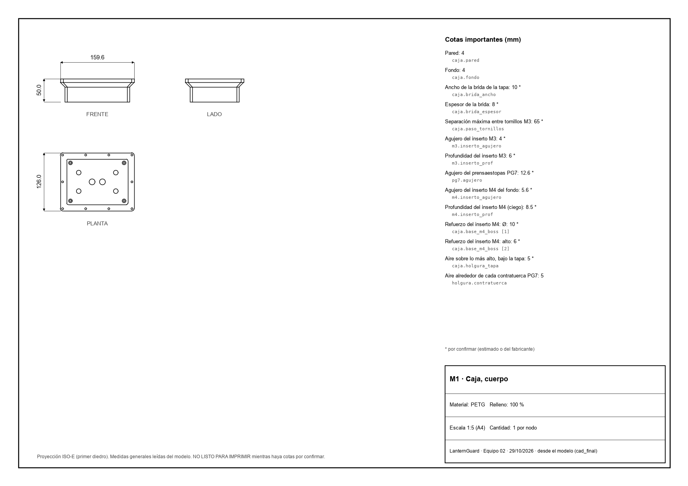

- **Para qué sirve:** Caja sellada con la electrónica del nodo.
- **Medidas generales:** 159.6 × 126.0 × 50.0 mm.
- **Material:** PETG. **Relleno:** 100 %, 5 perímetros (pieza sellada o tramo del riel). **Cómo se imprime:** boca arriba, fondo en la cama; sin soportes.
- **Cantidad:** 1 por nodo. **Masa:** 273 g.
- **Archivos:** `salida/preliminar/stl/M1_caja_cuerpo.stl`, `salida/preliminar/step/M1_caja_cuerpo.step`.

| Medida | Valor (mm) | Nombre en params.py | Origen | Estado |
|---|---|---|---|---|
| Pared | 4 | `caja.pared` | decisión del equipo | confirmado |
| Fondo | 4 | `caja.fondo` | decisión del equipo | confirmado |
| Ancho de la brida de la tapa | 10 | `caja.brida_ancho` | estimado | **por confirmar** |
| Espesor de la brida | 8 | `caja.brida_espesor` | estimado | **por confirmar** |
| Separación máxima entre tornillos M3 | 65 | `caja.paso_tornillos` | estimado | **por confirmar** |
| Agujero del inserto M3 | 4 | `m3.inserto_agujero` | estimado | **por confirmar** |
| Profundidad del inserto M3 | 6 | `m3.inserto_prof` | estimado | **por confirmar** |
| Agujero del prensaestopas PG7 | 12.6 | `pg7.agujero` | estimado | **por confirmar** |
| Agujero del inserto M4 del fondo | 5.6 | `m4.inserto_agujero` | estimado | **por confirmar** |
| Profundidad del inserto M4 (ciego) | 8.5 | `m4.inserto_prof` | estimado | **por confirmar** |
| Refuerzo del inserto M4: Ø | 10 | `caja.base_m4_boss` [1.º valor] | estimado | **por confirmar** |
| Refuerzo del inserto M4: alto | 6 | `caja.base_m4_boss` [2.º valor] | estimado | **por confirmar** |
| Aire sobre lo más alto, bajo la tapa | 5 | `caja.holgura_tapa` | estimado | **por confirmar** |
| Aire alrededor de cada contratuerca PG7 | 5 | `holgura.contratuerca` | decisión del equipo | confirmado |

### M2 · Caja, tapa con asa

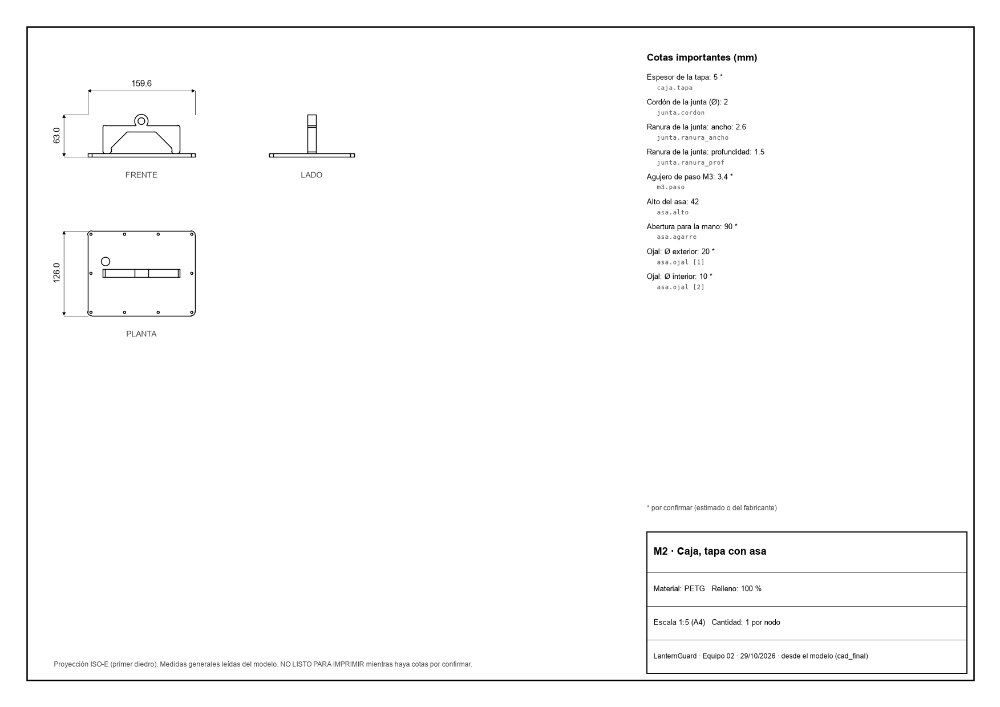

- **Para qué sirve:** Cierra la caja con junta tórica; el asa lleva el ojal del cabo.
- **Medidas generales:** 159.6 × 126.0 × 63.0 mm.
- **Material:** PETG. **Relleno:** 100 %, 5 perímetros (pieza sellada o tramo del riel). **Cómo se imprime:** cara de la ranura en la cama, asa arriba; sin soportes.
- **Cantidad:** 1 por nodo. **Masa:** 164 g.
- **Archivos:** `salida/preliminar/stl/M2_caja_tapa.stl`, `salida/preliminar/step/M2_caja_tapa.step`.

| Medida | Valor (mm) | Nombre en params.py | Origen | Estado |
|---|---|---|---|---|
| Espesor de la tapa | 5 | `caja.tapa` | estimado | **por confirmar** |
| Cordón de la junta (Ø) | 2 | `junta.cordon` | decisión del equipo | confirmado |
| Ranura de la junta: ancho | 2.6 | `junta.ranura_ancho` | decisión del equipo | confirmado |
| Ranura de la junta: profundidad | 1.5 | `junta.ranura_prof` | decisión del equipo | confirmado |
| Agujero de paso M3 | 3.4 | `m3.paso` | estimado | **por confirmar** |
| Alto del asa | 42 | `asa.alto` | decisión del equipo | confirmado |
| Abertura para la mano | 90 | `asa.agarre` | estimado | **por confirmar** |
| Ojal: Ø exterior | 20 | `asa.ojal` [1.º valor] | estimado | **por confirmar** |
| Ojal: Ø interior | 10 | `asa.ojal` [2.º valor] | estimado | **por confirmar** |

### M11 · Bandeja de la electrónica

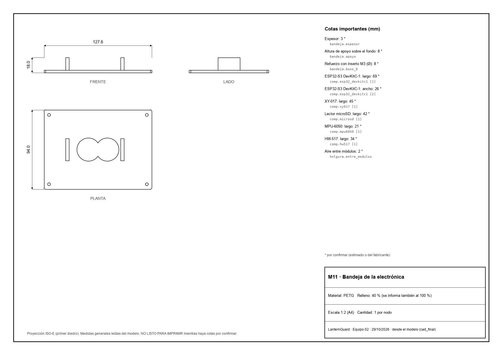

- **Para qué sirve:** Lleva la ESP32 y los módulos dentro de la caja.
- **Medidas generales:** 127.6 × 94.0 × 18.0 mm.
- **Material:** PETG. **Relleno:** 40 % (se informa también al 100 %), 3 perímetros. **Cómo se imprime:** plana; sin soportes.
- **Cantidad:** 1 por nodo. **Masa:** 41 g al 40 % (45 g al 100 %).
- **Archivos:** `salida/preliminar/stl/M11_bandeja.stl`, `salida/preliminar/step/M11_bandeja.step`.

| Medida | Valor (mm) | Nombre en params.py | Origen | Estado |
|---|---|---|---|---|
| Espesor | 3 | `bandeja.espesor` | estimado | **por confirmar** |
| Altura de apoyo sobre el fondo | 8 | `bandeja.apoyo` | estimado | **por confirmar** |
| Refuerzo con inserto M3 (Ø) | 8 | `bandeja.boss_D` | estimado | **por confirmar** |
| ESP32-S3 DevKitC-1: largo | 69 | `comp.esp32_devkitc1` [1.º valor] | estimado | **por confirmar** |
| ESP32-S3 DevKitC-1: ancho | 26 | `comp.esp32_devkitc1` [2.º valor] | estimado | **por confirmar** |
| XY-017: largo | 45 | `comp.xy017` [1.º valor] | estimado | **por confirmar** |
| Lector microSD: largo | 42 | `comp.microsd` [1.º valor] | estimado | **por confirmar** |
| MPU-6050: largo | 21 | `comp.mpu6050` [1.º valor] | estimado | **por confirmar** |
| HW-517: largo | 34 | `comp.hw517` [1.º valor] | estimado | **por confirmar** |
| Aire entre módulos | 2 | `holgura.entre_modulos` | estimado | **por confirmar** |

### M3c · Riel, tramo central (cámara de cables)

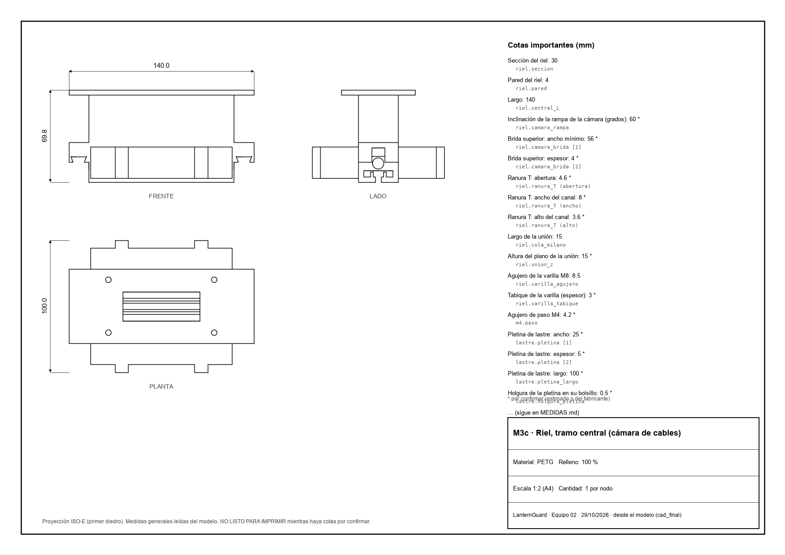

- **Para qué sirve:** Va atornillado bajo la caja; por dentro bajan los cables desde los PG7 y pasa la varilla M8.
- **Medidas generales:** 140.0 × 100.0 × 69.8 mm.
- **Material:** PETG. **Relleno:** 100 %, 5 perímetros (pieza sellada o tramo del riel). **Cómo se imprime:** brida abajo (dada vuelta); necesita soportes en el techo de la cámara y los bolsillos.
- **Cantidad:** 1 por nodo. **Masa:** 216 g.
- **Archivos:** `salida/preliminar/stl/M3_riel_central.stl`, `salida/preliminar/step/M3_riel_central.step`.

| Medida | Valor (mm) | Nombre en params.py | Origen | Estado |
|---|---|---|---|---|
| Sección del riel | 30 | `riel.seccion` | decisión del equipo | confirmado |
| Pared del riel | 4 | `riel.pared` | decisión del equipo | confirmado |
| Largo | 140 | `riel.central_L` | decisión del equipo | confirmado |
| Inclinación de la rampa de la cámara (grados) | 60 | `riel.camara_rampa` | estimado | **por confirmar** |
| Brida superior: ancho mínimo | 56 | `riel.camara_brida` [1.º valor] | estimado | **por confirmar** |
| Brida superior: espesor | 4 | `riel.camara_brida` [2.º valor] | estimado | **por confirmar** |
| Ranura T: abertura | 4.6 | `riel.ranura_T` (abertura) | estimado | **por confirmar** |
| Ranura T: ancho del canal | 8 | `riel.ranura_T` (ancho) | estimado | **por confirmar** |
| Ranura T: alto del canal | 3.6 | `riel.ranura_T` (alto) | estimado | **por confirmar** |
| Largo de la unión | 15 | `riel.cola_milano` | decisión del equipo | confirmado |
| Altura del plano de la unión | 15 | `riel.union_z` | estimado | **por confirmar** |
| Agujero de la varilla M8 | 8.5 | `riel.varilla_agujero` | decisión del equipo | confirmado |
| Tabique de la varilla (espesor) | 3 | `riel.varilla_tabique` | estimado | **por confirmar** |
| Agujero de paso M4 | 4.2 | `m4.paso` | estimado | **por confirmar** |
| Pletina de lastre: ancho | 25 | `lastre.pletina` [1.º valor] | estimado | **por confirmar** |
| Pletina de lastre: espesor | 5 | `lastre.pletina` [2.º valor] | estimado | **por confirmar** |
| Pletina de lastre: largo | 100 | `lastre.pletina_largo` | estimado | **por confirmar** |
| Holgura de la pletina en su bolsillo | 0.5 | `lastre.holgura_pletina` | estimado | **por confirmar** |
| Boss del inserto M3 de la tapa: saliente | 6 | `lastre.tapa_boss` [2.º valor] | estimado | **por confirmar** |
| Inserto térmico M3: agujero | 4 | `m3.inserto_agujero` | estimado | **por confirmar** |

### M3e · Riel, extensión

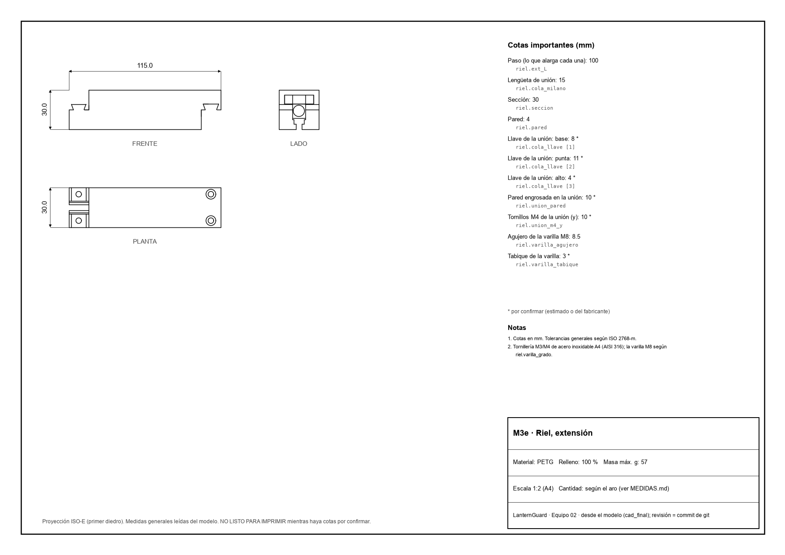

- **Para qué sirve:** Alarga el riel 100 mm por lado (Ø200 a Ø500).
- **Medidas generales:** 115.0 × 30.0 × 30.0 mm.
- **Material:** PETG. **Relleno:** 100 %, 5 perímetros (pieza sellada o tramo del riel). **Cómo se imprime:** acostada sobre una cara lateral; casi sin soportes.
- **Cantidad:** Ø100: 0, Ø200: 2, Ø300: 2, Ø500: 4. **Masa:** 57 g.
- **Archivos:** `salida/preliminar/stl/M3_riel_ext.stl`, `salida/preliminar/step/M3_riel_ext.step`.

| Medida | Valor (mm) | Nombre en params.py | Origen | Estado |
|---|---|---|---|---|
| Paso (lo que alarga cada una) | 100 | `riel.ext_L` | decisión del equipo | confirmado |
| Lengüeta de unión | 15 | `riel.cola_milano` | decisión del equipo | confirmado |
| Sección | 30 | `riel.seccion` | decisión del equipo | confirmado |
| Pared | 4 | `riel.pared` | decisión del equipo | confirmado |
| Llave de la unión: base | 8 | `riel.cola_llave` [1.º valor] | estimado | **por confirmar** |
| Llave de la unión: punta | 11 | `riel.cola_llave` [2.º valor] | estimado | **por confirmar** |
| Llave de la unión: alto | 4 | `riel.cola_llave` [3.º valor] | estimado | **por confirmar** |
| Pared engrosada en la unión | 10 | `riel.union_pared` | estimado | **por confirmar** |
| Tornillos M4 de la unión (y) | 10 | `riel.union_m4_y` | estimado | **por confirmar** |
| Agujero de la varilla M8 | 8.5 | `riel.varilla_agujero` | decisión del equipo | confirmado |
| Tabique de la varilla | 3 | `riel.varilla_tabique` | estimado | **por confirmar** |

### M3p · Riel, punta

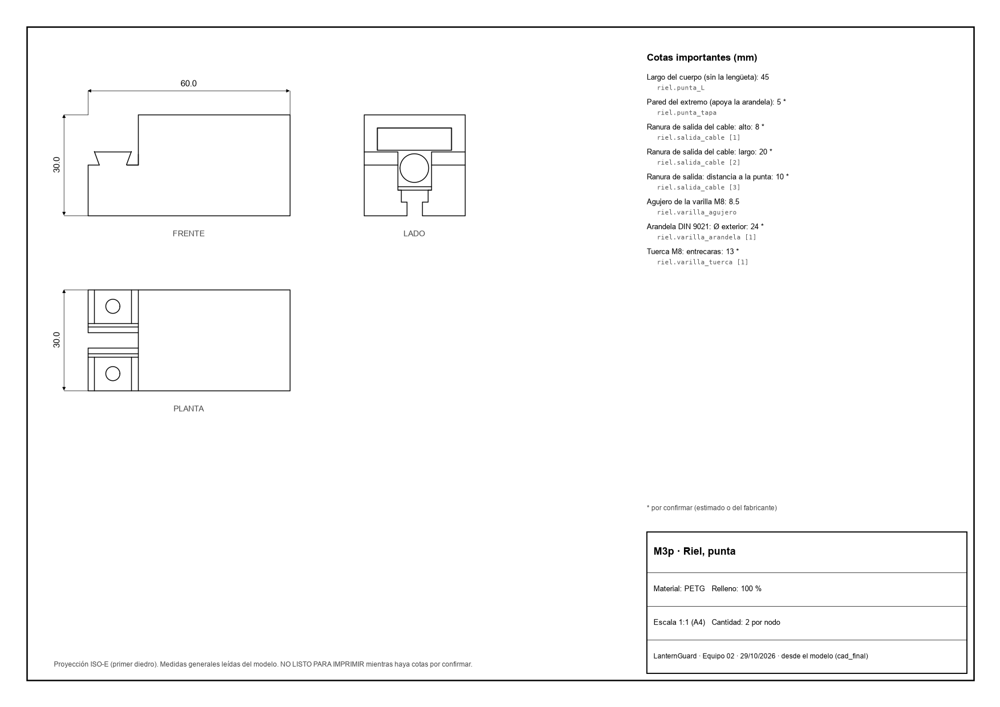

- **Para qué sirve:** Cierra cada extremo del riel; por su ranura lateral sale el cable a la cápsula.
- **Medidas generales:** 60.0 × 30.0 × 30.0 mm.
- **Material:** PETG. **Relleno:** 100 %, 5 perímetros (pieza sellada o tramo del riel). **Cómo se imprime:** acostada sobre una cara lateral.
- **Cantidad:** 2 por nodo. **Masa:** 32 g.
- **Archivos:** `salida/preliminar/stl/M3_riel_punta.stl`, `salida/preliminar/step/M3_riel_punta.step`.

| Medida | Valor (mm) | Nombre en params.py | Origen | Estado |
|---|---|---|---|---|
| Largo del cuerpo (sin la lengüeta) | 45 | `riel.punta_L` | decisión del equipo | confirmado |
| Pared del extremo (apoya la arandela) | 5 | `riel.punta_tapa` | estimado | **por confirmar** |
| Ranura de salida del cable: alto | 8 | `riel.salida_cable` [1.º valor] | estimado | **por confirmar** |
| Ranura de salida del cable: largo | 20 | `riel.salida_cable` [2.º valor] | estimado | **por confirmar** |
| Ranura de salida: distancia a la punta | 10 | `riel.salida_cable` [3.º valor] | estimado | **por confirmar** |
| Agujero de la varilla M8 | 8.5 | `riel.varilla_agujero` | decisión del equipo | confirmado |
| Arandela DIN 9021: Ø exterior | 24 | `riel.varilla_arandela` [1.º valor] | dato del fabricante | **por confirmar** |
| Tuerca M8: entrecaras | 13 | `riel.varilla_tuerca` [1.º valor] | dato del fabricante | **por confirmar** |

### M3t · Tapa del bolsillo del lastre

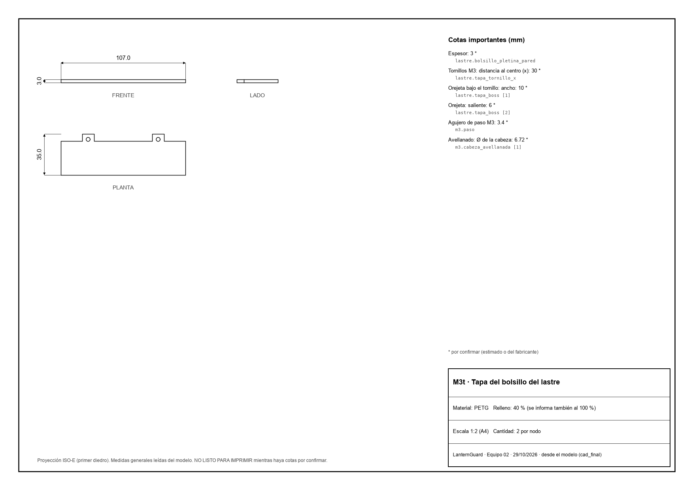

- **Para qué sirve:** Cierra por abajo el bolsillo de las pletinas de inox.
- **Medidas generales:** 107.0 × 35.0 × 3.0 mm.
- **Material:** PETG. **Relleno:** 40 % (se informa también al 100 %), 3 perímetros. **Cómo se imprime:** plana.
- **Cantidad:** 2 por nodo. **Masa:** 12 g al 40 % (12 g al 100 %).
- **Archivos:** `salida/preliminar/stl/M3_tapa_bolsillo.stl`, `salida/preliminar/step/M3_tapa_bolsillo.step`.
- **Ojo:** Se fija con 2 tornillos M3 x 8 avellanados (ISO 10642) a insertos térmicos M3 en el bolsillo; la cabeza queda al ras.

| Medida | Valor (mm) | Nombre en params.py | Origen | Estado |
|---|---|---|---|---|
| Espesor | 3 | `lastre.bolsillo_pletina_pared` | estimado | **por confirmar** |
| Tornillos M3: distancia al centro (x) | 30 | `lastre.tapa_tornillo_x` | estimado | **por confirmar** |
| Orejeta bajo el tornillo: ancho | 10 | `lastre.tapa_boss` [1.º valor] | estimado | **por confirmar** |
| Orejeta: saliente | 6 | `lastre.tapa_boss` [2.º valor] | estimado | **por confirmar** |
| Agujero de paso M3 | 3.4 | `m3.paso` | estimado | **por confirmar** |
| Avellanado: Ø de la cabeza | 6.72 | `m3.cabeza_avellanada` [1.º valor] | dato del fabricante | **por confirmar** |

### M4 · Cápsula de la cámara, cuerpo

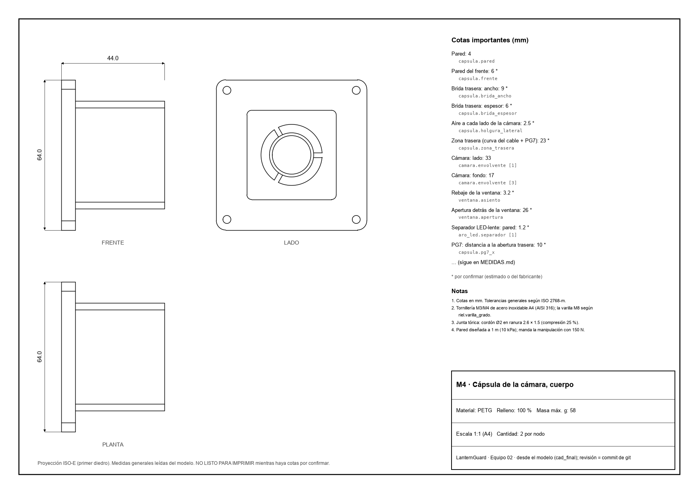

- **Para qué sirve:** Caja sellada de la cámara con la ventana al frente.
- **Medidas generales:** 44.0 × 64.0 × 64.0 mm.
- **Material:** PETG. **Relleno:** 100 %, 5 perímetros (pieza sellada o tramo del riel). **Cómo se imprime:** eje de la cámara vertical; soportes chicos.
- **Cantidad:** 2 por nodo. **Masa:** 58 g.
- **Archivos:** `salida/preliminar/stl/M4_capsula_cuerpo.stl`, `salida/preliminar/step/M4_capsula_cuerpo.step`.

| Medida | Valor (mm) | Nombre en params.py | Origen | Estado |
|---|---|---|---|---|
| Pared | 4 | `capsula.pared` | decisión del equipo | confirmado |
| Pared del frente | 6 | `capsula.frente` | estimado | **por confirmar** |
| Brida trasera: ancho | 9 | `capsula.brida_ancho` | estimado | **por confirmar** |
| Brida trasera: espesor | 6 | `capsula.brida_espesor` | estimado | **por confirmar** |
| Aire a cada lado de la cámara | 2.5 | `capsula.holgura_lateral` | estimado | **por confirmar** |
| Zona trasera (curva del cable + PG7) | 23 | `capsula.zona_trasera` | estimado | **por confirmar** |
| Cámara: lado | 33 | `camara.envolvente` [1.º valor] | dato del fabricante | confirmado |
| Cámara: fondo | 17 | `camara.envolvente` [3.º valor] | dato del fabricante | confirmado |
| Rebaje de la ventana | 3.2 | `ventana.asiento` | estimado | **por confirmar** |
| Apertura detrás de la ventana | 26 | `ventana.apertura` | estimado | **por confirmar** |
| Separador LED-lente: pared | 1.2 | `aro_led.separador` [1.º valor] | estimado | **por confirmar** |
| PG7: distancia a la abertura trasera | 10 | `capsula.pg7_x` | estimado | **por confirmar** |

### M5 · Cápsula, tapa con bisagra

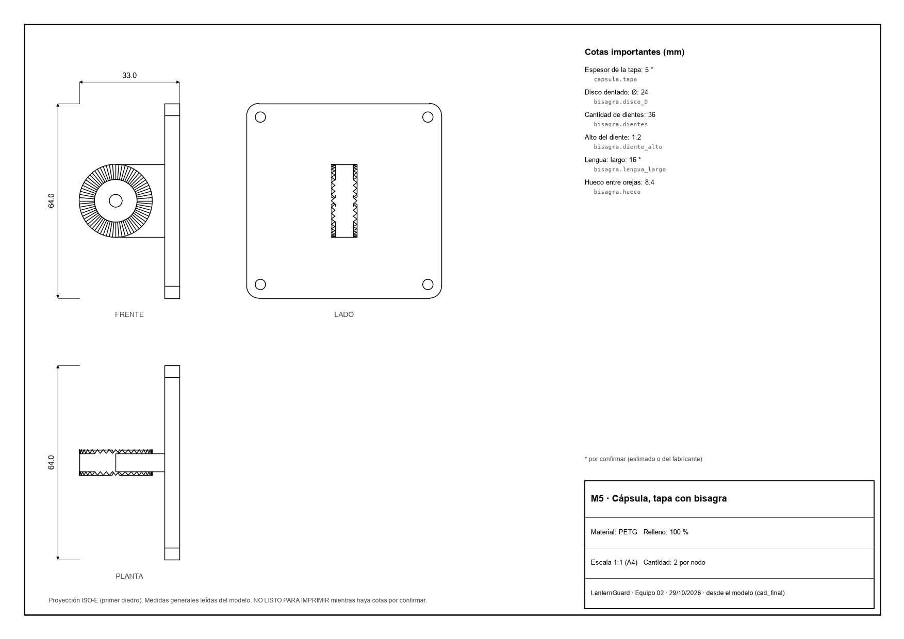

- **Para qué sirve:** Cierra la cápsula y lleva el disco dentado de la bisagra.
- **Medidas generales:** 33.0 × 64.0 × 64.0 mm.
- **Material:** PETG. **Relleno:** 100 %, 5 perímetros (pieza sellada o tramo del riel). **Cómo se imprime:** de canto; soportes chicos.
- **Cantidad:** 2 por nodo. **Masa:** 30 g.
- **Archivos:** `salida/preliminar/stl/M5_capsula_tapa.stl`, `salida/preliminar/step/M5_capsula_tapa.step`.

| Medida | Valor (mm) | Nombre en params.py | Origen | Estado |
|---|---|---|---|---|
| Espesor de la tapa | 5 | `capsula.tapa` | estimado | **por confirmar** |
| Disco dentado: Ø | 24 | `bisagra.disco_D` | decisión del equipo | confirmado |
| Cantidad de dientes | 36 | `bisagra.dientes` | decisión del equipo | confirmado |
| Alto del diente | 1.2 | `bisagra.diente_alto` | decisión del equipo | confirmado |
| Lengua: largo | 16 | `bisagra.lengua_largo` | estimado | **por confirmar** |
| Hueco entre orejas | 8.4 | `bisagra.hueco` | decisión del equipo | confirmado |

### M6 · Bisel de la ventana

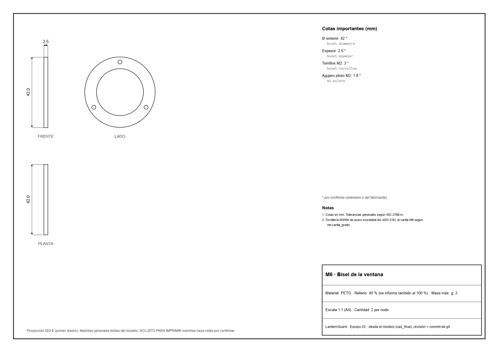

- **Para qué sirve:** Aprieta la ventana de acrílico contra el frente.
- **Medidas generales:** 2.5 × 42.0 × 42.0 mm.
- **Material:** PETG. **Relleno:** 40 % (se informa también al 100 %), 3 perímetros. **Cómo se imprime:** plano.
- **Cantidad:** 2 por nodo. **Masa:** 2 g al 40 % (2 g al 100 %).
- **Archivos:** `salida/preliminar/stl/M6_capsula_bisel.stl`, `salida/preliminar/step/M6_capsula_bisel.step`.

| Medida | Valor (mm) | Nombre en params.py | Origen | Estado |
|---|---|---|---|---|
| Ø exterior | 42 | `bisel.diametro` | estimado | **por confirmar** |
| Espesor | 2.5 | `bisel.espesor` | estimado | **por confirmar** |
| Tornillos M2 | 3 | `bisel.tornillos` | estimado | **por confirmar** |
| Agujero piloto M2 | 1.8 | `m2.piloto` | estimado | **por confirmar** |

### M7 · Ventana

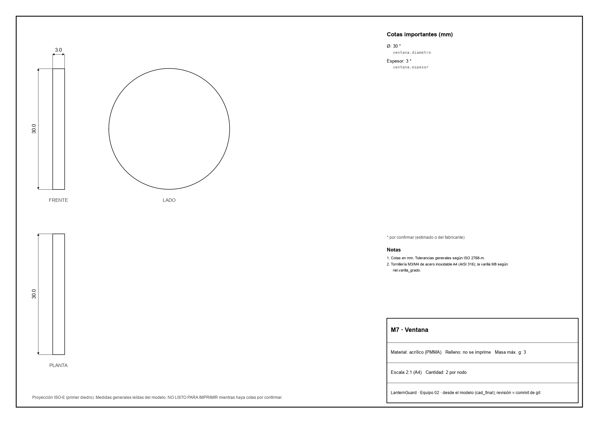

- **Para qué sirve:** Disco de acrílico; se corta, no se imprime.
- **Medidas generales:** 3.0 × 30.0 × 30.0 mm.
- **Material:** acrílico (PMMA). **Relleno:** no se imprime. **Cómo se imprime:** corte láser o torno.
- **Cantidad:** 2 por nodo. **Masa:** 3 g.
- **Archivos:** `salida/preliminar/stl/M7_capsula_ventana.stl`, `salida/preliminar/step/M7_capsula_ventana.step`.

| Medida | Valor (mm) | Nombre en params.py | Origen | Estado |
|---|---|---|---|---|
| Ø | 30 | `ventana.diametro` | estimado | **por confirmar** |
| Espesor | 3 | `ventana.espesor` | estimado | **por confirmar** |

### M9 · Gancho al aro

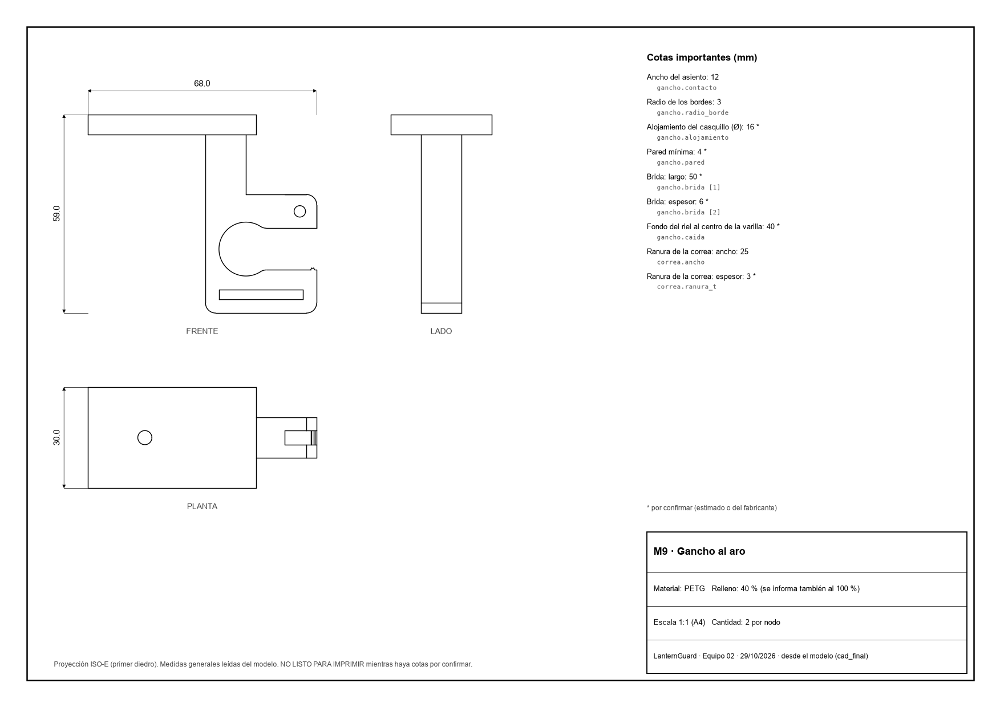

- **Para qué sirve:** Sujeta el riel a la varilla del aro.
- **Medidas generales:** 68.0 × 30.0 × 59.0 mm.
- **Material:** PETG. **Relleno:** 40 % (se informa también al 100 %), 3 perímetros. **Cómo se imprime:** de costado; soporte bajo el escalón de la brida.
- **Cantidad:** 2 por nodo. **Masa:** 18 g al 40 % (25 g al 100 %).
- **Archivos:** `salida/preliminar/stl/M9_gancho.stl`, `salida/preliminar/step/M9_gancho.step`.

| Medida | Valor (mm) | Nombre en params.py | Origen | Estado |
|---|---|---|---|---|
| Ancho del asiento | 12 | `gancho.contacto` | decisión del equipo | confirmado |
| Radio de los bordes | 3 | `gancho.radio_borde` | decisión del equipo | confirmado |
| Alojamiento del casquillo (Ø) | 16 | `gancho.alojamiento` | estimado | **por confirmar** |
| Pared mínima | 4 | `gancho.pared` | estimado | **por confirmar** |
| Brida: largo | 50 | `gancho.brida` [1.º valor] | estimado | **por confirmar** |
| Brida: espesor | 6 | `gancho.brida` [2.º valor] | estimado | **por confirmar** |
| Fondo del riel al centro de la varilla | 40 | `gancho.caida` | estimado | **por confirmar** |
| Ranura de la correa: ancho | 25 | `correa.ancho` | decisión del equipo | confirmado |
| Ranura de la correa: espesor | 3 | `correa.ranura_t` | estimado | **por confirmar** |

### M10 · Carro de la cápsula

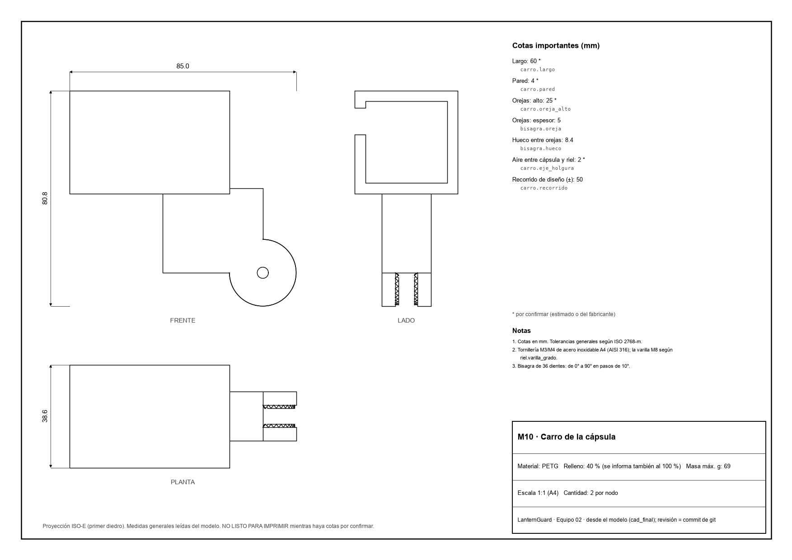

- **Para qué sirve:** Desliza sobre el riel y sostiene la cápsula con la bisagra.
- **Medidas generales:** 85.0 × 38.6 × 80.8 mm.
- **Material:** PETG. **Relleno:** 40 % (se informa también al 100 %), 3 perímetros. **Cómo se imprime:** de costado; soportes chicos.
- **Cantidad:** 2 por nodo. **Masa:** 49 g al 40 % (69 g al 100 %).
- **Archivos:** `salida/preliminar/stl/M10_carro_capsula.stl`, `salida/preliminar/step/M10_carro_capsula.step`.

| Medida | Valor (mm) | Nombre en params.py | Origen | Estado |
|---|---|---|---|---|
| Largo | 60 | `carro.largo` | estimado | **por confirmar** |
| Pared | 4 | `carro.pared` | estimado | **por confirmar** |
| Orejas: alto | 25 | `carro.oreja_alto` | estimado | **por confirmar** |
| Orejas: espesor | 5 | `bisagra.oreja` | decisión del equipo | confirmado |
| Hueco entre orejas | 8.4 | `bisagra.hueco` | decisión del equipo | confirmado |
| Aire entre cápsula y riel | 2 | `carro.eje_holgura` | estimado | **por confirmar** |
| Recorrido de diseño (±) | 50 | `carro.recorrido` | decisión del equipo | confirmado |

### M12 · Perilla

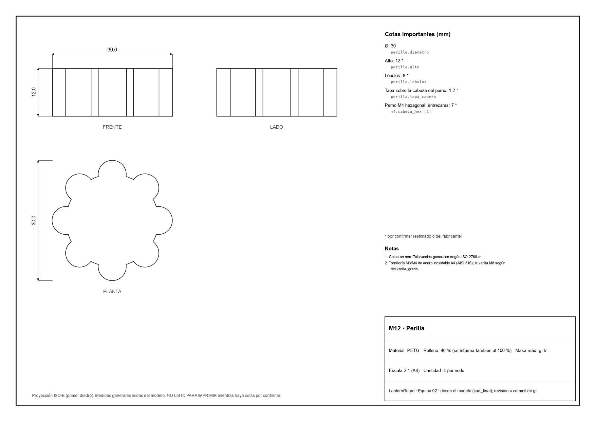

- **Para qué sirve:** Aprieta el gancho y el carro con guante (lleva un perno M4 adentro).
- **Medidas generales:** 30.0 × 30.0 × 12.0 mm.
- **Material:** PETG. **Relleno:** 40 % (se informa también al 100 %), 3 perímetros. **Cómo se imprime:** plana; PAUSAR la impresión para meter el perno.
- **Cantidad:** 4 por nodo. **Masa:** 6 g al 40 % (9 g al 100 %).
- **Archivos:** `salida/preliminar/stl/M12_perilla.stl`, `salida/preliminar/step/M12_perilla.step`.

| Medida | Valor (mm) | Nombre en params.py | Origen | Estado |
|---|---|---|---|---|
| Ø | 30 | `perilla.diametro` | decisión del equipo | confirmado |
| Alto | 12 | `perilla.alto` | estimado | **por confirmar** |
| Lóbulos | 8 | `perilla.lobulos` | estimado | **por confirmar** |
| Tapa sobre la cabeza del perno | 1.2 | `perilla.tapa_cabeza` | estimado | **por confirmar** |
| Perno M4 hexagonal: entrecaras | 7 | `m4.cabeza_hex` [1.º valor] | dato del fabricante | **por confirmar** |

### M13 · Casquillo de la varilla

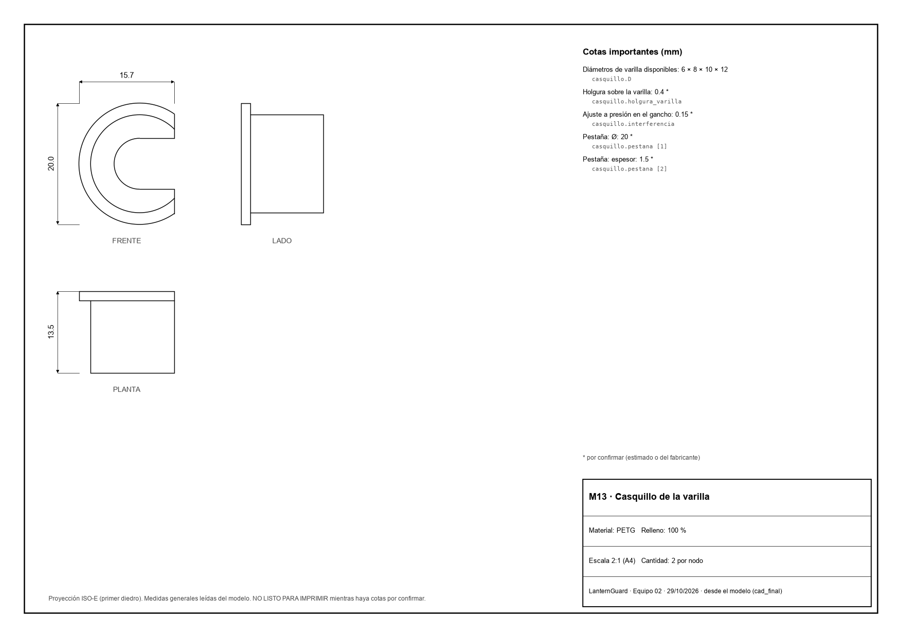

- **Para qué sirve:** Adapta el gancho a la varilla del aro (Ø6, 8, 10 o 12).
- **Medidas generales:** 15.7 × 13.5 × 20.0 mm.
- **Material:** PETG. **Relleno:** 100 %. **Cómo se imprime:** de pie, pestaña en la cama.
- **Cantidad:** 2 por nodo. **Masa:** 2 g.
- **Archivos:** `salida/preliminar/stl/M13_casquillo_D8.stl`, `salida/preliminar/step/M13_casquillo_D8.step`.
- **Ojo:** Se imprime el del diámetro de la varilla real; el dibujo es el de Ø8.

| Medida | Valor (mm) | Nombre en params.py | Origen | Estado |
|---|---|---|---|---|
| Diámetros de varilla disponibles | 6 × 8 × 10 × 12 | `casquillo.D` | decisión del equipo | confirmado |
| Holgura sobre la varilla | 0.4 | `casquillo.holgura_varilla` | estimado | **por confirmar** |
| Ajuste a presión en el gancho | 0.15 | `casquillo.interferencia` | estimado | **por confirmar** |
| Pestaña: Ø | 20 | `casquillo.pestana` [1.º valor] | estimado | **por confirmar** |
| Pestaña: espesor | 1.5 | `casquillo.pestana` [2.º valor] | estimado | **por confirmar** |

### M14 · Pestillo del gancho

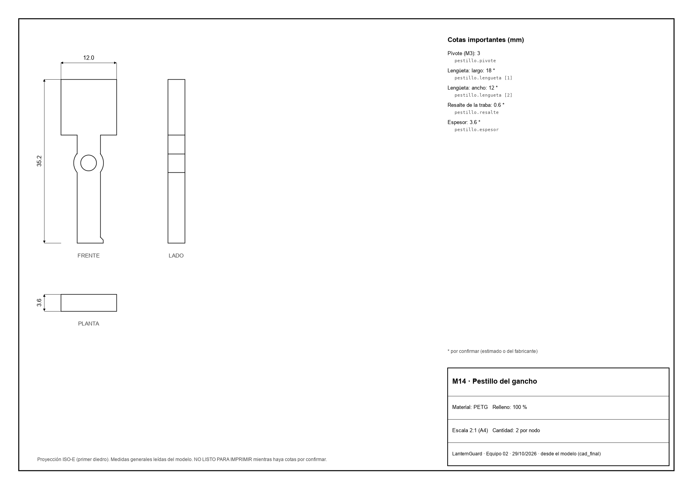

- **Para qué sirve:** Traba el gancho cerrado sobre la varilla.
- **Medidas generales:** 12.0 × 3.6 × 35.2 mm.
- **Material:** PETG. **Relleno:** 100 %. **Cómo se imprime:** plano.
- **Cantidad:** 2 por nodo. **Masa:** 1 g.
- **Archivos:** `salida/preliminar/stl/M14_pestillo.stl`, `salida/preliminar/step/M14_pestillo.step`.

| Medida | Valor (mm) | Nombre en params.py | Origen | Estado |
|---|---|---|---|---|
| Pivote (M3) | 3 | `pestillo.pivote` | decisión del equipo | confirmado |
| Lengüeta: largo | 18 | `pestillo.lengueta` [1.º valor] | estimado | **por confirmar** |
| Lengüeta: ancho | 12 | `pestillo.lengueta` [2.º valor] | estimado | **por confirmar** |
| Resalte de la traba | 0.6 | `pestillo.resalte` | decisión del equipo | **por confirmar** |
| Espesor | 3.6 | `pestillo.espesor` | estimado | **por confirmar** |

### PB8 · Probeta de arranque del inserto M4

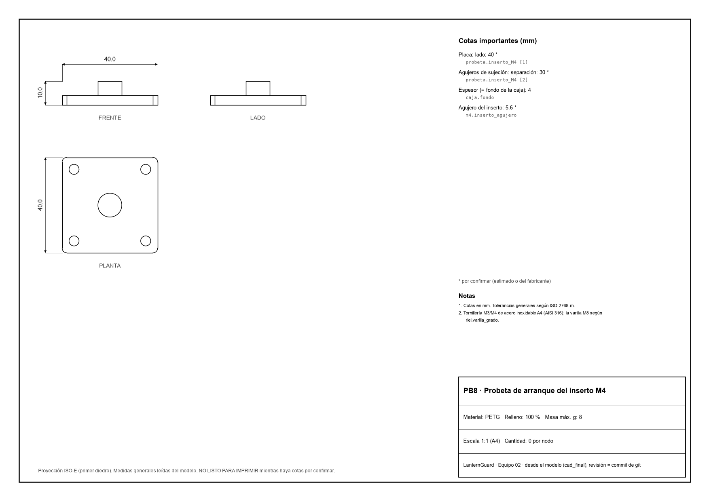

- **Para qué sirve:** Prueba cuánto aguanta el inserto M4 del fondo de la caja.
- **Medidas generales:** 40.0 × 40.0 × 10.0 mm.
- **Material:** PETG. **Relleno:** 100 %, 5 perímetros (pieza sellada o tramo del riel). **Cómo se imprime:** cara de afuera en la cama.
- **Cantidad:** 3 (aparte, para la prueba). **Masa:** 8 g.
- **Archivos:** `salida/probetas/PB8_inserto_M4.stl`.
- **Ojo:** Imprimir 3 aparte del nodo; no va en el ensamble.

| Medida | Valor (mm) | Nombre en params.py | Origen | Estado |
|---|---|---|---|---|
| Placa: lado | 40 | `probeta.inserto_M4` [1.º valor] | estimado | **por confirmar** |
| Agujeros de sujeción: separación | 30 | `probeta.inserto_M4` [2.º valor] | estimado | **por confirmar** |
| Espesor (= fondo de la caja) | 4 | `caja.fondo` | decisión del equipo | confirmado |
| Agujero del inserto | 5.6 | `m4.inserto_agujero` | estimado | **por confirmar** |

### B1 · Boya, casco

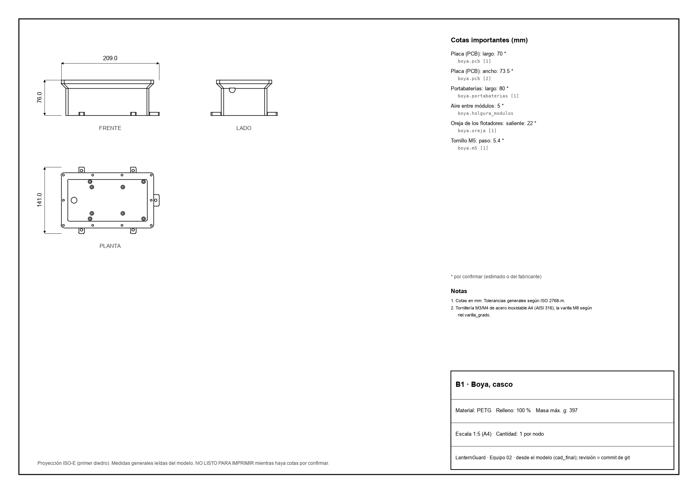

- **Para qué sirve:** Caja sellada de la boya con la placa y las baterías.
- **Medidas generales:** 209.0 × 141.0 × 76.0 mm.
- **Material:** PETG. **Relleno:** 100 %. **Cómo se imprime:** ver reporte_boya.md.
- **Cantidad:** 1 por nodo. **Masa:** 397 g.
- **Archivos:** `salida/boya/stl/B1_casco_central.stl`, `salida/boya/step/B1_casco_central.step`.

| Medida | Valor (mm) | Nombre en params.py | Origen | Estado |
|---|---|---|---|---|
| Placa (PCB): largo | 70 | `boya.pcb` [1.º valor] | decisión del equipo | **por confirmar** |
| Placa (PCB): ancho | 73.5 | `boya.pcb` [2.º valor] | decisión del equipo | **por confirmar** |
| Portabaterías: largo | 80 | `boya.portabaterias` [1.º valor] | estimado | **por confirmar** |
| Aire entre módulos | 5 | `boya.holgura_modulos` | estimado | **por confirmar** |
| Oreja de los flotadores: saliente | 22 | `boya.oreja` [1.º valor] | estimado | **por confirmar** |
| Tornillo M5: paso | 5.4 | `boya.m5` [1.º valor] | estimado | **por confirmar** |

### B1b · Boya, bandeja

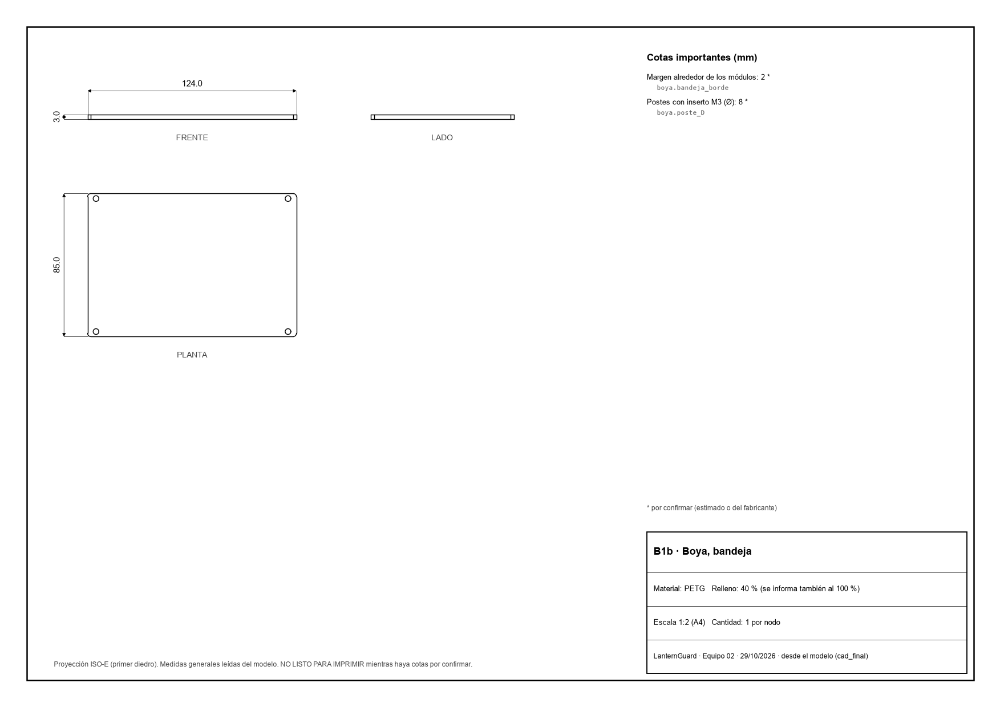

- **Para qué sirve:** Lleva la placa, el Waveshare y el reloj.
- **Medidas generales:** 124.0 × 85.0 × 3.0 mm.
- **Material:** PETG. **Relleno:** 40 % (se informa también al 100 %), 3 perímetros. **Cómo se imprime:** plana.
- **Cantidad:** 1 por nodo. **Masa:** 36 g al 40 % (40 g al 100 %).
- **Archivos:** `salida/boya/stl/B1b_bandeja.stl`, `salida/boya/step/B1b_bandeja.step`.

| Medida | Valor (mm) | Nombre en params.py | Origen | Estado |
|---|---|---|---|---|
| Margen alrededor de los módulos | 2 | `boya.bandeja_borde` | estimado | **por confirmar** |
| Postes con inserto M3 (Ø) | 8 | `boya.poste_D` | estimado | **por confirmar** |

### B2 · Boya, tapa

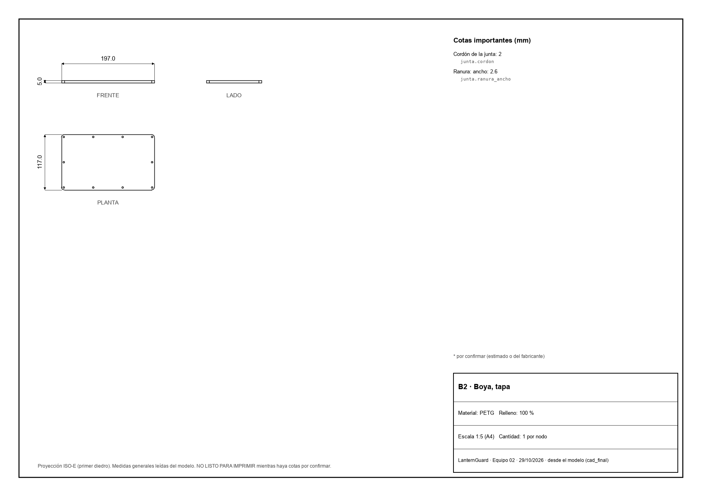

- **Para qué sirve:** Cierra el casco con junta tórica.
- **Medidas generales:** 197.0 × 117.0 × 5.0 mm.
- **Material:** PETG. **Relleno:** 100 %. **Cómo se imprime:** plana.
- **Cantidad:** 1 por nodo. **Masa:** 143 g.
- **Archivos:** `salida/boya/stl/B2_tapa.stl`, `salida/boya/step/B2_tapa.step`.

| Medida | Valor (mm) | Nombre en params.py | Origen | Estado |
|---|---|---|---|---|
| Cordón de la junta | 2 | `junta.cordon` | decisión del equipo | confirmado |
| Ranura: ancho | 2.6 | `junta.ranura_ancho` | decisión del equipo | confirmado |

### B3 · Boya, larguero del panel

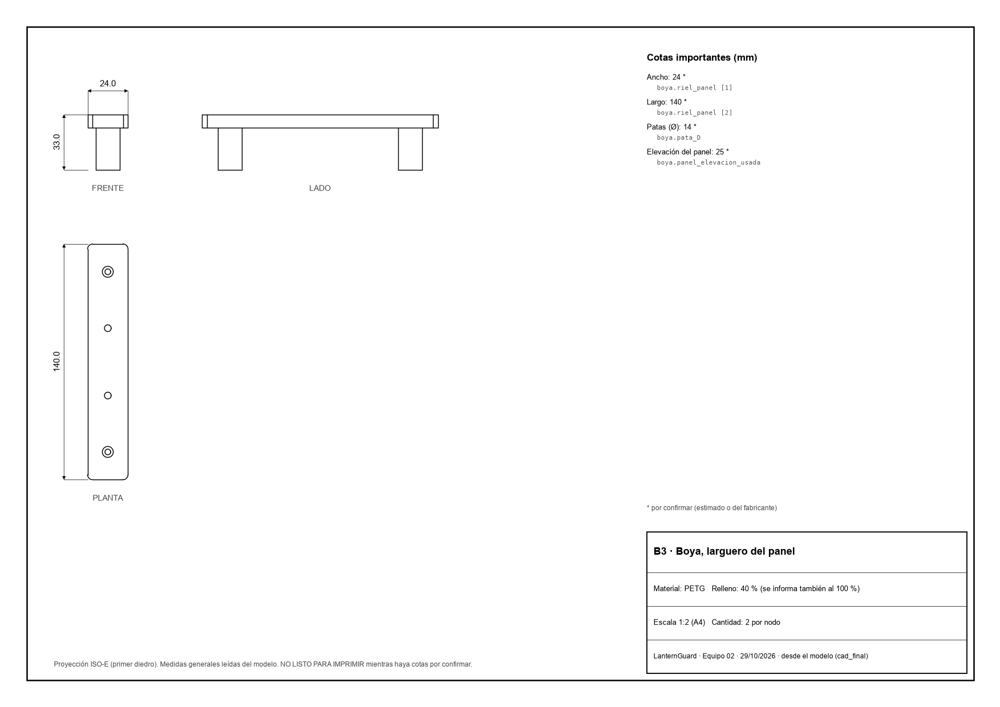

- **Para qué sirve:** Eleva el panel solar sobre la tapa.
- **Medidas generales:** 24.0 × 140.0 × 33.0 mm.
- **Material:** PETG. **Relleno:** 40 % (se informa también al 100 %), 3 perímetros. **Cómo se imprime:** plano.
- **Cantidad:** 2 por nodo. **Masa:** 28 g al 40 % (43 g al 100 %).
- **Archivos:** `salida/boya/stl/B3_larguero_panel.stl`, `salida/boya/step/B3_larguero_panel.step`.

| Medida | Valor (mm) | Nombre en params.py | Origen | Estado |
|---|---|---|---|---|
| Ancho | 24 | `boya.riel_panel` [1.º valor] | estimado | **por confirmar** |
| Largo | 140 | `boya.riel_panel` [2.º valor] | estimado | **por confirmar** |
| Patas (Ø) | 14 | `boya.pata_D` | estimado | **por confirmar** |
| Elevación del panel | 25 | `boya.panel_elevacion_usada` | estimado | **por confirmar** |

### B4 · Boya, mástil de la antena

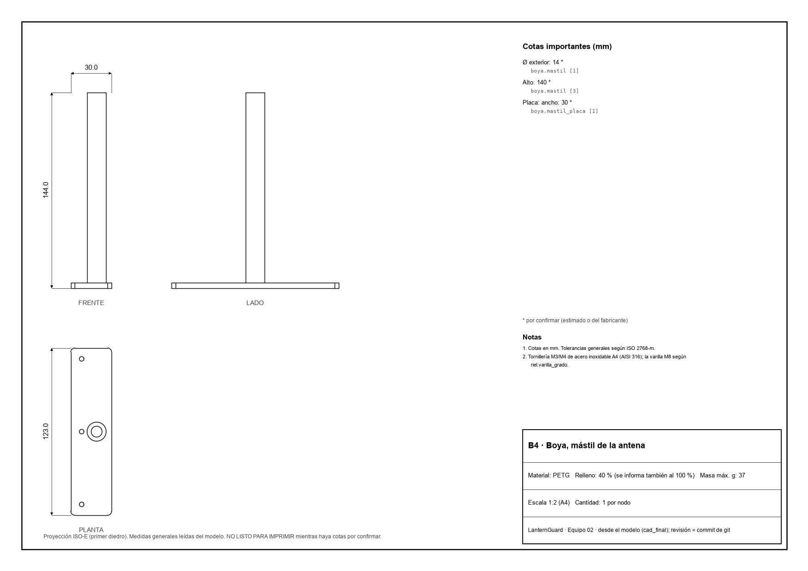

- **Para qué sirve:** Sostiene la antena LoRa fuera del panel.
- **Medidas generales:** 30.0 × 123.0 × 144.0 mm.
- **Material:** PETG. **Relleno:** 40 % (se informa también al 100 %), 3 perímetros. **Cómo se imprime:** de pie.
- **Cantidad:** 1 por nodo. **Masa:** 32 g al 40 % (37 g al 100 %).
- **Archivos:** `salida/boya/stl/B4_mastil_antena.stl`, `salida/boya/step/B4_mastil_antena.step`.

| Medida | Valor (mm) | Nombre en params.py | Origen | Estado |
|---|---|---|---|---|
| Ø exterior | 14 | `boya.mastil` [1.º valor] | estimado | **por confirmar** |
| Alto | 140 | `boya.mastil` [3.º valor] | estimado | **por confirmar** |
| Placa: ancho | 30 | `boya.mastil_placa` [1.º valor] | estimado | **por confirmar** |

### B5 · Boya, flotador

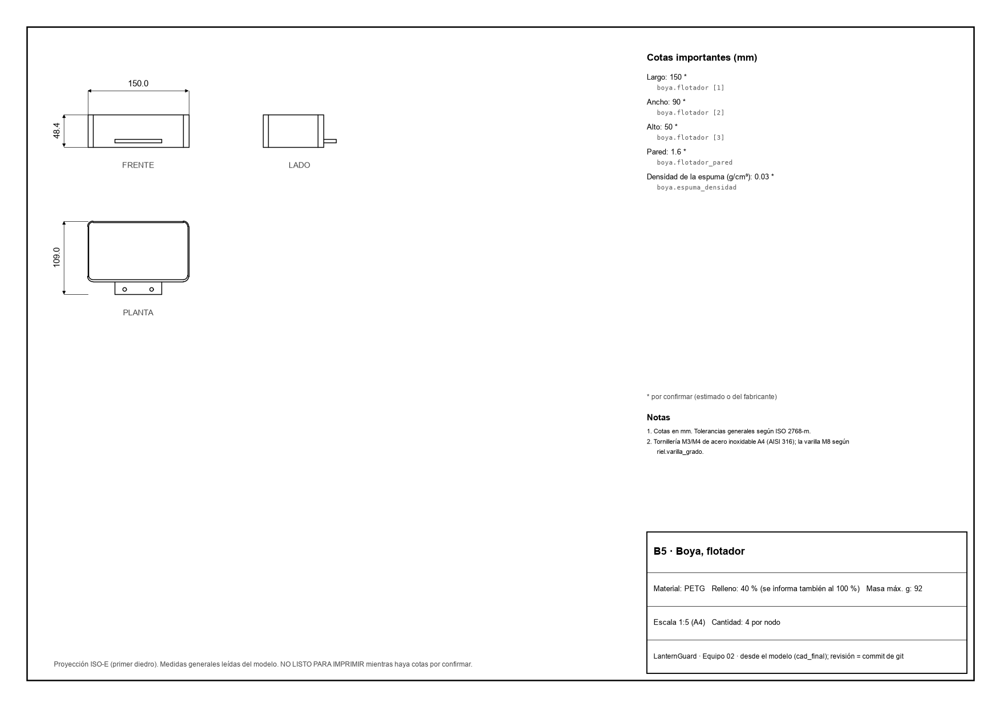

- **Para qué sirve:** Uno de los 4 flotadores; se rellena con espuma.
- **Medidas generales:** 150.0 × 109.0 × 48.4 mm.
- **Material:** PETG. **Relleno:** 40 % (se informa también al 100 %), 3 perímetros. **Cómo se imprime:** boca arriba.
- **Cantidad:** 4 por nodo. **Masa:** 92 g al 40 % (92 g al 100 %).
- **Archivos:** `salida/boya/stl/B5_flotador.stl`, `salida/boya/step/B5_flotador.step`.

| Medida | Valor (mm) | Nombre en params.py | Origen | Estado |
|---|---|---|---|---|
| Largo | 150 | `boya.flotador` [1.º valor] | estimado | **por confirmar** |
| Ancho | 90 | `boya.flotador` [2.º valor] | estimado | **por confirmar** |
| Alto | 50 | `boya.flotador` [3.º valor] | estimado | **por confirmar** |
| Pared | 1.6 | `boya.flotador_pared` | estimado | **por confirmar** |
| Densidad de la espuma (g/cm³) | 0.03 | `boya.espuma_densidad` | estimado | **por confirmar** |

### B5b · Boya, tapa del flotador

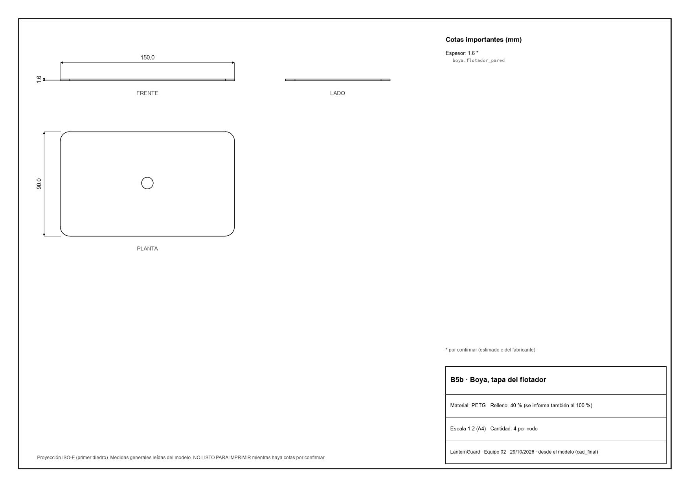

- **Para qué sirve:** Cierra cada flotador.
- **Medidas generales:** 150.0 × 90.0 × 1.6 mm.
- **Material:** PETG. **Relleno:** 40 % (se informa también al 100 %), 3 perímetros. **Cómo se imprime:** plana.
- **Cantidad:** 4 por nodo. **Masa:** 27 g al 40 % (27 g al 100 %).
- **Archivos:** `salida/boya/stl/B5b_tapa_flotador.stl`, `salida/boya/step/B5b_tapa_flotador.step`.

| Medida | Valor (mm) | Nombre en params.py | Origen | Estado |
|---|---|---|---|---|
| Espesor | 1.6 | `boya.flotador_pared` | estimado | **por confirmar** |

### B6 · Boya, ojal de amarre

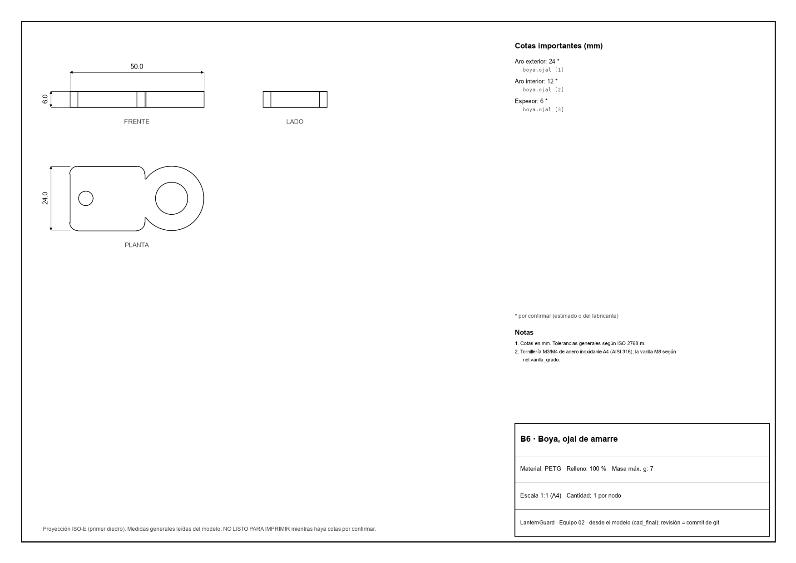

- **Para qué sirve:** Ojal para el cabo de fondeo, separado del umbilical.
- **Medidas generales:** 50.0 × 24.0 × 6.0 mm.
- **Material:** PETG. **Relleno:** 100 %. **Cómo se imprime:** plano.
- **Cantidad:** 1 por nodo. **Masa:** 7 g.
- **Archivos:** `salida/boya/stl/B6_ojal_amarre.stl`, `salida/boya/step/B6_ojal_amarre.step`.

| Medida | Valor (mm) | Nombre en params.py | Origen | Estado |
|---|---|---|---|---|
| Aro exterior | 24 | `boya.ojal` [1.º valor] | estimado | **por confirmar** |
| Aro interior | 12 | `boya.ojal` [2.º valor] | estimado | **por confirmar** |
| Espesor | 6 | `boya.ojal` [3.º valor] | estimado | **por confirmar** |

## 4. Tornillería y compras que fija el modelo

| Qué | Medida | Nombre en params.py | Estado |
|---|---|---|---|
| Tuerca M4 (ranura T) | 7 × 3.2 | `m4.tuerca` | **por confirmar** |
| Cabeza Allen M4 | 7 × 4 | `m4.cabeza` | **por confirmar** |
| Tuerca M3 | 5.5 × 2.4 | `m3.tuerca` | **por confirmar** |
| Inserto térmico M3: agujero | 4 | `m3.inserto_agujero` | **por confirmar** |
| Tornillo M3 avellanado (tapa del bolsillo) | 6.72 × 1.86 | `m3.cabeza_avellanada` | **por confirmar** |
| Inserto térmico M4: agujero | 5.6 | `m4.inserto_agujero` | **por confirmar** |
| Varilla roscada M8 (datos) | d: 8, d_nucleo: 6.47, A_s: 36.6, E: 200000, fy_8.8: 640, fy_4.6: 240 | `riel.varilla_M8_datos` | **por confirmar** |
| Arandela ancha M8 DIN 9021 | 24 × 2 × 8.4 | `riel.varilla_arandela` | **por confirmar** |
| Tuerca M8 | 13 × 6.5 | `riel.varilla_tuerca` | **por confirmar** |
| Cordón de junta tórica | 2 | `junta.cordon` | confirmado |
| Pletina de inox | 25 × 5 | `lastre.pletina` | **por confirmar** |
| Cat5e | 5.5 | `cable.cat5e_D` | **por confirmar** |
