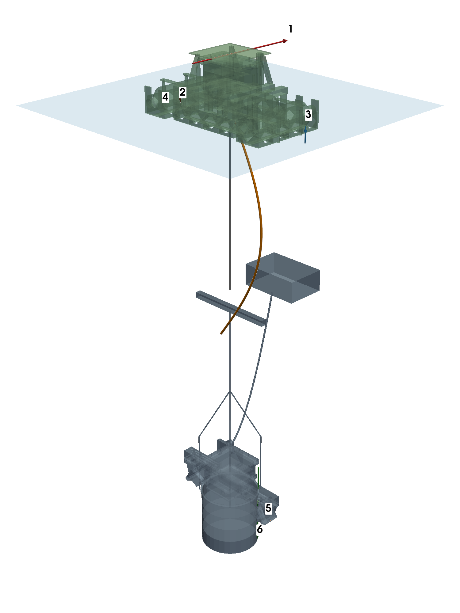
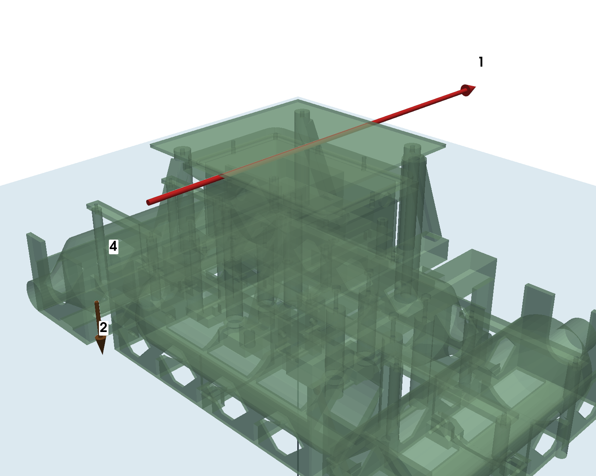
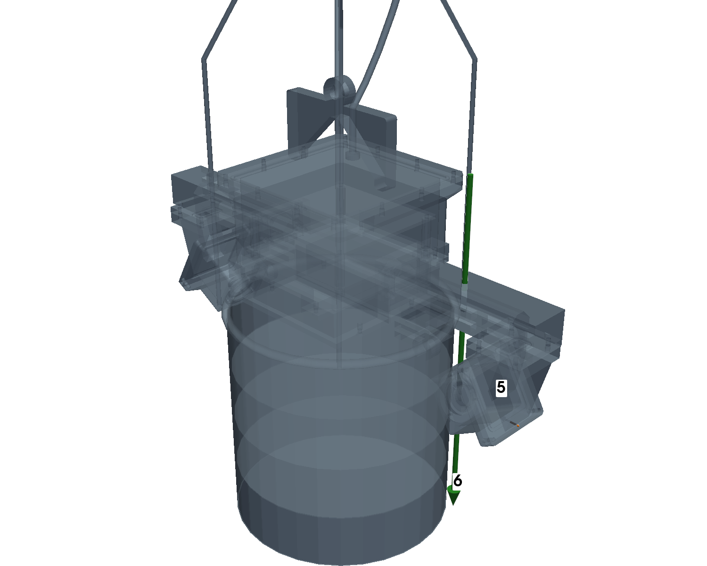

# Cargas sobre el conjunto boya + nodo sumergido

Fecha: 05/11/2026. Hecho por `cad_final/cargas_conjunto.py` con las piezas actuales (boya y nodo P2). Las flechas están a escala: **2 mm de flecha = 1 N** (la misma escala en las tres vistas)
(las que serían menores de 22 mm se dibujan de 22 mm para que se vean: 4, 5; su valor real está en la tabla).
Verde = boya, azul = nodo sumergido con la linterna, línea negra = cabo, tubo naranja = umbilical (son referencias, no se calculan). Las flechas 2, 3 y 4 se dibujan al costado de la boya para que se vean; en la realidad actúan en el centro. El plano azul es la superficie del agua.

| N.º | Carga | Valor | Dirección |
|---|---|---|---|
| 1 | Golpe de ola sobre el panel | 200.0 N | horizontal, +Y |
| 2 | Peso de la boya | 22.4 N | hacia abajo |
| 3 | Empuje de las botellas | 25.4 N | hacia arriba |
| 4 | Tirón del cabo (peso del nodo en el agua) | 3.0 N | hacia abajo |
| 5 | Corriente de 1.5 m/s sobre la cápsula | 2.1 N | horizontal, −X |
| 6 | Izado a mano 150 N (caso de diseño de la cápsula) | 150.0 N | hacia abajo |

## Camino de la carga (qué pieza la lleva y por dónde pasa)

1. **Golpe de ola (1).** Pega en el panel solar, que hace de vela. Del panel pasa a las **4 columnas Ø12** de la cubierta, de ahí a las **barras de la cubierta** y a los **4 tornillos M3** que la unen al casco. Es la carga más peligrosa de la boya: en `docs/resultados` está el cálculo (cubierta, caso «lateral»).
2. **Peso de la boya (2)** (22.4 N, 2287 g con la electrónica). La caja seca lo apoya en 4 pilares de la cubierta; la cubierta lo pasa por los 4 tornillos M3 al casco.
3. **Empuje de las botellas (3).** El agua empuja las botellas hacia arriba con la misma fuerza del peso de la boya más lo que cuelga del cabo (25.4 N, calado 47 mm). Las botellas lo pasan a las costillas del casco. Si se hundiera del todo, el empuje máximo disponible es 40 N.
4. **Tirón del cabo (4).** El nodo pesa unos 305 g dentro del agua (lastre ajustado a 0.2–0.5 kgf). Ese peso baja por el cabo y tira del **parche de amarre del fondo del casco** (quilla).
5. **Corriente (5).** Con 1.5 m/s la presión es 1153 Pa sobre el frente de la cápsula (18 cm²): **2.1 N** hacia atrás. Pasa de la tapa de la cápsula al **pie en silla**, de ahí al **riel con gancho** y, por la C del gancho, al **aro** del que cuelga todo. La carga inclina un poco el cabo (no se dibuja).
6. **Izado a mano (6).** Es el caso de diseño de la cápsula y el riel: 150 N hacia abajo en el frente de la cápsula, mucho mayor que cualquier carga del agua. Se calcula en SimScale para el riel (M3s), el pie (M5s) y la caja (M1s).

La flotación y la estabilidad de la boya son analíticas (`docs/BOYA.md`); esto solo muestra de dónde viene cada carga que se usó en las simulaciones.
