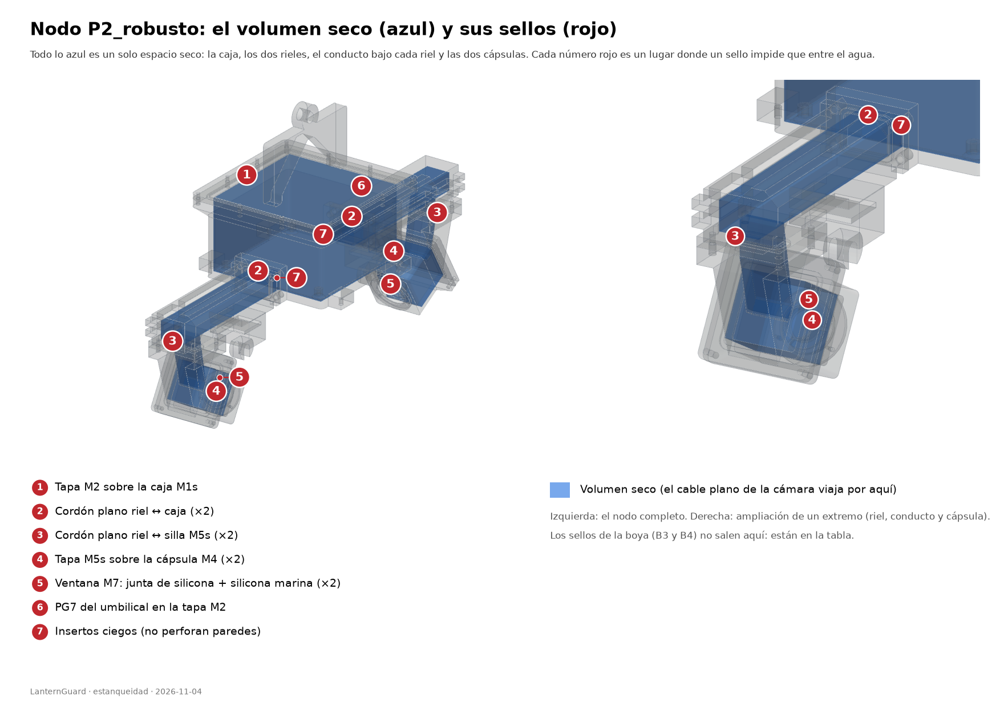

# Estanqueidad del nodo y de la boya

Versión del 2026-11-04 · concepto vigente: **un solo volumen seco** en el nodo (caja + rieles + cápsulas), con el cable plano de las cámaras por dentro. Los números de la tabla se pueden buscar en la guía de piezas (`GUIA_PIEZAS_LanternGuard.pdf`).

## 1. La idea en dos frases

Antes, cada cámara tenía su propio cable que salía de la caja por un prensaestopas (PG7), corría por un riel abierto lleno de agua y entraba a la cápsula por otro PG7. Eran cuatro pasos de cable que podían gotear.

Ahora la caja, los dos rieles y las dos cápsulas son **un solo espacio seco**: el cable plano de la cámara viaja por dentro, protegido, y las piezas se unen con cordones de goma planos. El único prensaestopas que queda en el nodo es el del cable umbilical, en la tapa M2.

## 2. El dibujo

En azul, el espacio que debe quedar seco. En rojo y numerado, cada sello. Los números son los de la tabla de abajo.

El camino del cable de una cámara, siempre en seco: dentro de la caja → ventana de la pared de extremo → canal del riel → curva suave (radio 10 mm) → abertura bajo el riel → conducto de la pieza M5s → ranura de la tapa de la cápsula → cámara.

## 3. Tabla de sellos

Hay **7** sellos en el nodo (números 1 a 7) y **6** en la boya (números 8 a 13). Los de la boya no cambiaron de tipo; la tapa B4 ahora mide 6.5 mm (la ranura de 1.5 deja 5 mm bajo el cordón).

| N° | Sello | Cuántos | Cómo sella | Qué protege | Dónde verlo en la guía |
|---|---|---|---|---|---|
| 1 | Tapa M2 sobre la caja M1s | ×1 | cordón O-ring Ø2 en ranura | La electrónica del nodo (bandejas M11) y todo el volumen seco, que desde la caja se extiende por los rieles hasta las cápsulas. | M2 N° 2; M2 N° 1; M1s N° 6 |
| 2 | Riel M3s ↔ caja M1s: cordón plano (×2) | ×2 | cordón de goma Ø2 NBR en ranura plana, 20 % de compresión (ranura 1.6 × 2.6 mm) | La unión entre la caja y cada riel, alrededor de la ventana por donde pasa el cable. | M3s N° 4; M3s N° 5; M1s N° 3; M1s N° 4 |
| 3 | Almohadilla del riel M3s ↔ silla de M5s: cordón plano (×2) | ×2 | cordón de goma Ø2 NBR en ranura plana, 20 % de compresión | La unión entre el riel y la tapa de la cápsula, alrededor de la abertura de 8 × 22 mm por donde baja el cable. | M5s N° 2; M3s N° 6; M3s N° 8; M5s N° 4 |
| 4 | Tapa M5s sobre la cápsula M4 (×2) | ×2 | cordón O-ring Ø2 en ranura | La cámara Arducam y el anillo LED dentro de cada cápsula. El cable plano entra por la ranura de esta tapa, que queda dentro del sello. | M5s N° 8; M5s N° 7; M4 N° 1 |
| 5 | Ventana de acrílico M7: junta plana + silicona (×2) | ×2 | junta plana de silicona de 1 mm (Ø30 × Ø26.5) comprimida 20 % por el bisel M6 + cordón de silicona marina en el borde | El frente de cada cápsula: la ventana deja pasar la luz y no el agua. | M4 N° 2; M6 N° 2; M6 N° 1 |
| 6 | PG7 del umbilical en la tapa M2 | ×1 | prensaestopas PG7 (Ø12.6) con contratuerca | El paso del cable umbilical hacia la caja seca. Es el único prensaestopas que queda en el nodo. | M2 N° 3 |
| 7 | Insertos ciegos que no perforan paredes |  | inserto térmico ciego (no atraviesa) | Los 12 M3 de la brida de M1s, los 8 M4 de los cojines y los 4 M3 de cada silla de M5s se enroscan en insertos ciegos: ningún tornillo abre un camino al interior. Los 4 M3 de la almohadilla del riel pasan por las alas, fuera del canal. | M1s N° 5; M1s N° 4; M5s N° 4; M3s N° 8 |
| 8 | Tapa B4 sobre la caja seca B3 | ×1 | cordón O-ring Ø2 en ranura | La electrónica de la boya: PCB, Waveshare, portabaterías 3×18650 y RTC. | B4 N° 2; B4 N° 1; B3 N° 8 |
| 9 | PG7 del umbilical en B3 (pared −X) | ×1 | prensaestopas PG7 (Ø12.6) con contratuerca | El paso del cable umbilical (boya ↔ nodo) hacia la caja seca. | B3 N° 5 |
| 10 | PG7 del cable solar en B3 (pared +X) | ×1 | prensaestopas PG7 (Ø12.6) con contratuerca | El paso del cable del panel solar hacia la caja seca. | B3 N° 6 |
| 11 | PG7 del pigtail de antena en B3 (pared +X) | ×1 | prensaestopas PG7 (Ø12.6) con contratuerca | El paso del pigtail de la antena hacia la caja seca. El mástil de B2 solo guía el cable: no sella. | B3 N° 7; B2 mástil N° 5 |
| 12 | Insertos M3 de la brida de B3 |  | inserto térmico ciego (no atraviesa la brida) | La brida no queda perforada y los tornillos quedan fuera del cordón: el agua no tiene camino por los tornillos. | B3 N° 2 |
| 13 | Botellas PET selladas (flotación) |  | tapón de rosca de fábrica (botella comprada) | El aire que flota la boya. El casco impreso NO es estanco: solo sostiene las botellas. | B1 N° 10; B1 N° 11; B5 cuello N° 5 |

Notas de la tabla:

- **Cordón plano** = un cordón de goma NBR de Ø2 mm puesto en una ranura con forma de marco (1.6 mm de hondo × 2.6 mm de ancho). Al apretar los tornillos se aplasta un 20 % y llena la rendija. No se pega ni se estira: se coloca sin torcer.
- **Insertos ciegos**: tuercas de latón que se funden dentro del plástico sin atravesarlo. Como no hay agujero de lado a lado, el agua no tiene camino por el tornillo. La excepción son los 4 tornillos de la almohadilla del riel (M3s), que pasan por las alas, fuera del canal.

## 4. Lo que NO es estanco, a propósito

- Marcos de lastre M3f y sus placas M3t: están fuera del sello y se llenan de agua. Es lo normal; el lastre son tuercas y arandelas a granel.
- Gancho en C de M3s y su correa: están por fuera del riel, mojados siempre.
- Las 4 alas de la almohadilla del riel (con los M3 que bajan a M5s): quedan fuera del canal. El agua puede tocarlas sin entrar.
- Casco B1, cunas B5, correas B6 y cubierta B2 de la boya: estructura abierta; flotan las botellas PET (cerradas de fábrica).
- Mástil de B2 (solo guía el cable del pigtail): no sella; el sello está en el PG7 de B3.

Todo lo demás del nodo (caja, riel, conducto, cápsulas) sí debe quedar seco.

## 5. Impresión de las piezas estancas

Las piezas que forman el volumen seco (M1s, M2, M3s, M4, M5s y, en la boya, B3 y B4) se imprimen con el perfil estanco: **4 perímetros, 5 capas arriba y 5 abajo, 100 % de relleno**. Las paredes del nodo (caja, fondo, cápsula, gancho) miden 5 mm; la caja de la boya, 2.4 mm, y su tapa B4, 6.5 mm. Los marcos de lastre M3f y sus placas M3t quedan **fuera** del sello: no necesitan el perfil estanco ni prueba de agua. Opcional: una capa de epoxi por dentro. Antes de armar, mire cada pieza contra una luz fuerte: si se ve luz a través de una pared, hay un hueco y esa pieza se reimprime.

## 6. Cómo probar que no entra agua

Regla general: **nunca ponga electrónica en una prueba de agua**. Dentro va papel de cocina seco: si al abrir está seco, el sello aguantó; si tiene manchas, ahí entró agua. **Todas las pruebas de agua son de 30 minutos a 1 m de profundidad** (la profundidad de diseño; ahí la presión es de solo 10 kPa, así que lo que falla es el sello, no la pared). El orden es siempre el mismo: primero la probeta P03, después cada volumen seco por separado, al final el conjunto armado.

### Paso 0. Probeta P03 (la prueba más barata)

1. Imprima la probeta de junta **P03** con el perfil estanco. Ponga el cordón de Ø2 en la ranura y cierre con los 4 M3.
2. Papel seco adentro; sumerja 30 minutos a 1 m. Abra y mire el papel.
3. Si la P03 falla, no siga: ninguna caja va a aguantar. Corrija el cordón, la ranura o la impresión y repita la P03.

**Cómo comparar dos impresiones** (otro filamento, otra temperatura, 4 o 5 perímetros): imprima dos P03 que cambien **una sola cosa**, hágales la misma prueba y compare el papel de cada una. Después abra y mire con luz fuerte, en este orden:
- **Capas**: líneas de luz entre capas o pelos de plástico en las paredes; una capa mal pegada deja pasar el agua por la pared aunque el sello esté bien.
- **Puentes**: el techo de la ranura y de las ventanas; si el puente quedó caído o con hilos, el cordón no asienta parejo.
- **Roscas e insertos**: el inserto debe quedar derecho y al ras; mire que no haya plástico rebordeado ni grietas alrededor del tornillo.
- **Cordón**: marca pareja y continua en todo el contorno; un tramo sin marca es un tramo sin presión.
Anote cuál impresión quedó seca, cuál mojada y en qué zona del papel. La que quede seca con la marca de cordón más pareja es la que se usa para las piezas finales.

### Paso 1. Montaje en seco (sin agua)

1. Limpie las ranuras (sin rebabas ni polvo) y coloque cada cordón sin torcerlo: debe asomar un poco por encima de la ranura.
2. Arme todo el nodo con los tornillos, apretando en cruz y de a poco (primero medio apriete en todos, luego el apriete final).
3. Pase por todo el camino del cable una tira de papel del mismo ancho que el cable plano (22 mm): debe entrar por la ventana de la caja y salir por la ranura de la tapa de la cápsula sin atascarse ni doblarse en ángulo.
4. Anote qué tornillos quedaron más flojos o más duros: son los primeros sospechosos si algo gotea.

### Paso 2. Baño de cada subconjunto vacío

Pruebe de lo pequeño a lo grande. En cada prueba: papel de cocina seco adentro, lastre para que se hunda (una piedra o pesas atadas por fuera), y un balde, tanque o piscina donde quepa a 1 m de profundidad (medidos desde la parte más alta de la pieza hasta la superficie).

| Subconjunto | Cómo prepararlo | Qué mirar al abrir |
|---|---|---|
| A. Una cápsula completa (M4 + M5s + M6 + M7 con su junta y silicona) | Cierre la abertura de la placa de M5s con una placa plana de prueba y su cordón (o con una tapa de acrílico). | Papel seco en la cámara; ninguna gota tras la ventana. |
| B. Caja M1s con tapa M2 | Tape las dos ventanas de las paredes con placas planas de prueba y ponga el PG7 con el cable umbilical (o un tapón). | Papel seco en las bandejas; ninguna gota en la tapa. |
| C. Un riel M3s con su silla M5s | Cierre la boca del riel contra una placa plana de prueba y la ranura de la tapa de M5s con cinta de buena calidad. | Papel seco dentro del canal y del conducto. |
| D. Nodo completo (caja + 2 rieles + 2 cápsulas) | El nodo armado como irá en el agua, sin electrónica. Los marcos de lastre M3f pueden ir puestos: se mojan y no importa. | Papel seco en la caja, en los dos canales y en las dos cápsulas. |
| E. Caja seca de la boya B3 con tapa B4 | Cierre con el cordón y los 10 M3; PG7 con tapón en los tres pasos. | Papel seco; ninguna gota bajo la tapa. |

Pasos de cada prueba:

1. Sumerja **30 minutos a 1 m**. Saque, seque por fuera con un paño y abra sobre una mesa. Mire el papel.
2. Si está seco, ponga papel nuevo y repita, esta vez **24 horas** a la misma profundidad.
3. Al terminar, saque una foto del papel y anote la fecha, el subconjunto y el resultado.
4. Pase al siguiente subconjunto solo si el anterior salió seco las 24 horas.

### Paso 3. Piscina con peso, antes de la electrónica

1. Arme el nodo completo con papel dentro y un peso de prueba que iguale la masa de la electrónica.
2. Cuélguelo del aro como irá en la linterna y bájelo a 1 m (con la boya armada, también el conjunto boya + nodo entero).
3. Déjelo 30 minutos. Saque, seque y revise el papel de la caja, de los dos rieles y de las dos cápsulas.
4. Solo si todo está seco, se pasa a montar la electrónica real.

### Si entra agua

1. No arme de nuevo enseguida. Abra, saque el papel y mire **dónde** está mojado: la mancha apunta al sello que falló (la tabla de la sección 3 dice qué piezas lo forman).
2. Causas más comunes: cordón torcido o pellizcado; un tornillo flojo en una esquina; ranura con rebaba o con polvo; pared impresa con huecos (se ve a contraluz); silicona de la ventana con un hueco.
3. Corrija **una sola cosa** a la vez (por ejemplo, cordón nuevo, o una capa de epoxi, o rehacer la pieza) y repita la prueba completa de ese subconjunto, empezando de nuevo por los 30 minutos a 1 m (y la P03 si cambió la impresión).
4. Si falla dos veces en el mismo sello, anote la pieza y avise: puede ser un problema de diseño y no de armado.

## 7. Por confirmar en las pruebas

- La junta plana de silicona de la ventana (Ø30 × Ø26.5 × 1 mm) y el cordón de silicona marina son nuevos: la prueba de la cápsula (A) es la que confirma que bastan.
- El cordón plano en forma de marco de la brida del riel y el de la silla de M5s tienen esquinas redondeadas: revise que el cordón no se pliegue en las esquinas al apretar.
- Tornillo de las bandejas (M11): M3 × 38 inox (o M3 × 40 recortado 2 mm). Atraviesa 33 mm (bandeja 3 + poste 27 + bandeja 3) y entra 5 mm en el inserto de 6 mm sin tocar el fondo. Verificar con las piezas impresas.