# Guía de piezas LanternGuard

> Texto de `GUIA_PIEZAS_LanternGuard.pdf`. Los números coinciden con los de los PNG de `salida/guia_piezas/`.
> Concepto vigente (04/11/2026): caja, rieles y cápsulas son un solo volumen seco; el cable plano va por dentro y el único PG7 del nodo es el del umbilical.

Colores en los PNG: azul = tornillo / unión · naranja = cable · rojo = sello · verde = forma / ahorro de material · morado = alineación · gris = montaje interno.
Medidas: M3 de paso Ø3.4 · inserto M3 Ø4.0 · M4 de paso Ø4.2 · inserto M4 Ø5.6 · piloto M2 Ø1.8 · PG7 Ø12.6 · cordón O-ring Ø2 en ranura de 2.6 × 1.5.
Regenerar: `cd cad_final && ..\.venv\Scripts\python.exe guia_piezas.py`.

# Boya con botellas PET

## B1 · Casco (una mitad)

Estructura que sostiene las botellas PET. Se imprime 2 veces: la segunda mitad es esta misma pieza girada 180° (x = 0 es la unión). Ejes: x a lo largo de las botellas, z arriba.

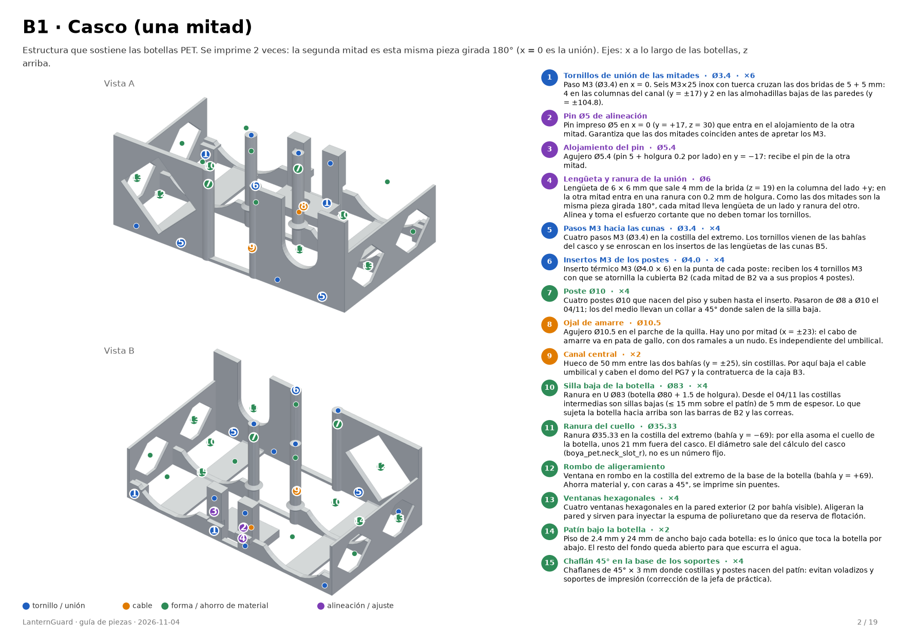

1. **Tornillos de unión de las mitades** Ø3.4 ×6 _(tornillo / unión)_. Paso M3 (Ø3.4) en x = 0. Seis M3×25 inox con tuerca cruzan las dos bridas de 5 + 5 mm: 4 en las columnas del canal (y = ±17) y 2 en las almohadillas bajas de las paredes (y = ±104.8).
2. **Pin Ø5 de alineación** Ø5 _(alineación / ajuste)_. Pin impreso Ø5 en x = 0 (y = +17, z = 30) que entra en el alojamiento de la otra mitad. Garantiza que las dos mitades coinciden antes de apretar los M3.
3. **Alojamiento del pin** Ø5.4 _(alineación / ajuste)_. Agujero Ø5.4 (pin 5 + holgura 0.2 por lado) en y = −17: recibe el pin de la otra mitad.
4. **Lengüeta y ranura de la unión** Ø6 _(alineación / ajuste)_. Lengüeta de 6 × 6 mm que sale 4 mm de la brida (z = 19) en la columna del lado +y; en la otra mitad entra en una ranura con 0.2 mm de holgura. Como las dos mitades son la misma pieza girada 180°, cada mitad lleva lengüeta de un lado y ranura del otro. Alinea y toma el esfuerzo cortante que no deben tomar los tornillos.
5. **Pasos M3 hacia las cunas** Ø3.4 ×4 _(tornillo / unión)_. Cuatro pasos M3 (Ø3.4) en la costilla del extremo. Los tornillos vienen de las bahías del casco y se enroscan en los insertos de las lengüetas de las cunas B5.
6. **Insertos M3 de los postes** Ø4.0 ×4 _(tornillo / unión)_. Inserto térmico M3 (Ø4.0 × 6) en la punta de cada poste: reciben los 4 tornillos M3 con que se atornilla la cubierta B2 (cada mitad de B2 va a sus propios 4 postes).
7. **Poste Ø10** Ø10 ×4 _(forma / ahorro de material)_. Cuatro postes Ø10 que nacen del piso y suben hasta el inserto. Pasaron de Ø8 a Ø10 el 04/11; los del medio llevan un collar a 45° donde salen de la silla baja.
8. **Ojal de amarre** Ø10.5 _(cable)_. Agujero Ø10.5 en el parche de la quilla. Hay uno por mitad (x = ±23): el cabo de amarre va en pata de gallo, con dos ramales a un nudo. Es independiente del umbilical.
9. **Canal central** ×2 _(cable)_. Hueco de 50 mm entre las dos bahías (y = ±25), sin costillas. Por aquí baja el cable umbilical y caben el domo del PG7 y la contratuerca de la caja B3.
10. **Silla baja de la botella** Ø83 ×4 _(forma / ahorro de material)_. Ranura en U Ø83 (botella Ø80 + 1.5 de holgura). Desde el 04/11 las costillas intermedias son sillas bajas (≤ 15 mm sobre el patín) de 5 mm de espesor. Lo que sujeta la botella hacia arriba son las barras de B2 y las correas.
11. **Ranura del cuello** Ø35.33 _(forma / ahorro de material)_. Ranura Ø35.33 en la costilla del extremo (bahía y = −69): por ella asoma el cuello de la botella, unos 21 mm fuera del casco. El diámetro sale del cálculo del casco (boya_pet.neck_slot_r), no es un número fijo.
12. **Rombo de aligeramiento** _(forma / ahorro de material)_. Ventana en rombo en la costilla del extremo de la base de la botella (bahía y = +69). Ahorra material y, con caras a 45°, se imprime sin puentes.
13. **Ventanas hexagonales** ×4 _(forma / ahorro de material)_. Cuatro ventanas hexagonales en la pared exterior (2 por bahía visible). Aligeran la pared y sirven para inyectar la espuma de poliuretano que da reserva de flotación.
14. **Patín bajo la botella** ×2 _(forma / ahorro de material)_. Piso de 2.4 mm y 24 mm de ancho bajo cada botella: es lo único que toca la botella por abajo. El resto del fondo queda abierto para que escurra el agua.
15. **Chaflán 45° en la base de los soportes** ×4 _(forma / ahorro de material)_. Chaflanes de 45° × 3 mm donde costillas y postes nacen del patín: evitan voladizos y soportes de impresión (corrección de la jefa de práctica).

## B2 · Cubierta, lado liso

Marco de barras que cierra el casco por arriba y sostiene la caja B3 y el panel solar. Cada mitad es un marco cerrado atornillado a sus propios 4 postes. Esta es la que no lleva mástil.

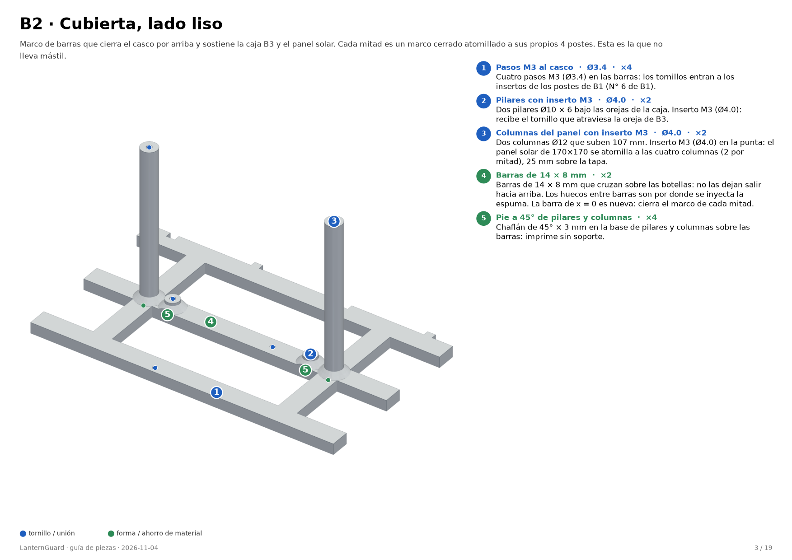

1. **Pasos M3 al casco** Ø3.4 ×4 _(tornillo / unión)_. Cuatro pasos M3 (Ø3.4) en las barras: los tornillos entran a los insertos de los postes de B1 (N° 6 de B1).
2. **Pilares con inserto M3** Ø4.0 ×2 _(tornillo / unión)_. Dos pilares Ø10 × 6 bajo las orejas de la caja. Inserto M3 (Ø4.0): recibe el tornillo que atraviesa la oreja de B3.
3. **Columnas del panel con inserto M3** Ø4.0 ×2 _(tornillo / unión)_. Dos columnas Ø12 que suben 107 mm. Inserto M3 (Ø4.0) en la punta: el panel solar de 170×170 se atornilla a las cuatro columnas (2 por mitad), 25 mm sobre la tapa.
4. **Barras de 14 × 8 mm** ×2 _(forma / ahorro de material)_. Barras de 14 × 8 mm que cruzan sobre las botellas: no las dejan salir hacia arriba. Los huecos entre barras son por donde se inyecta la espuma. La barra de x = 0 es nueva: cierra el marco de cada mitad.
5. **Pie a 45° de pilares y columnas** ×4 _(forma / ahorro de material)_. Chaflán de 45° × 3 mm en la base de pilares y columnas sobre las barras: imprime sin soporte.

## B2 · Cubierta, lado mástil

La otra mitad de la cubierta, con el mástil de la antena. Mismos pilares y columnas que el lado liso; la caja y el panel atornillados encima amarran las dos mitades.

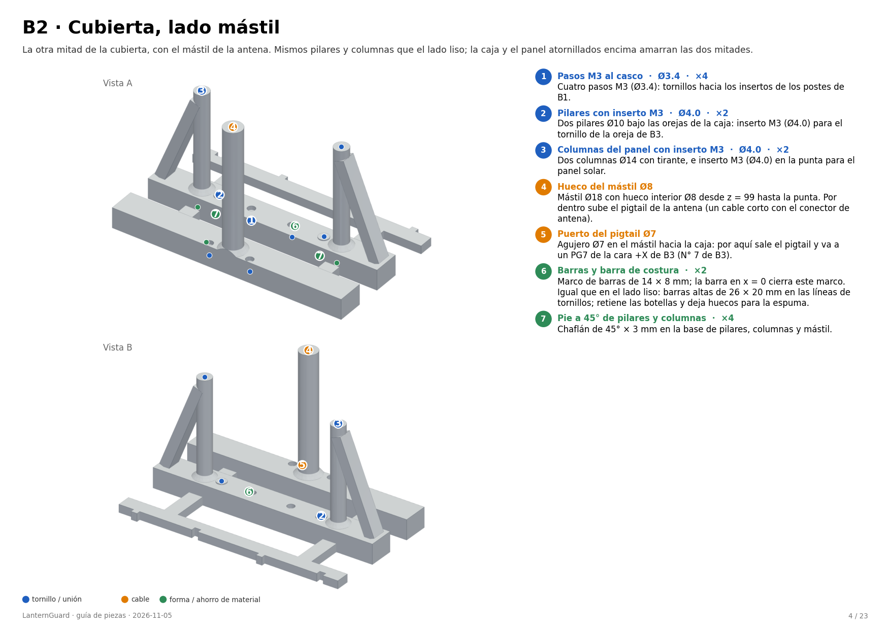

1. **Pasos M3 al casco** Ø3.4 ×4 _(tornillo / unión)_. Cuatro pasos M3 (Ø3.4): tornillos hacia los insertos de los postes de B1.
2. **Pilares con inserto M3** Ø4.0 ×2 _(tornillo / unión)_. Dos pilares Ø10 bajo las orejas de la caja: inserto M3 (Ø4.0) para el tornillo de la oreja de B3.
3. **Columnas del panel con inserto M3** Ø4.0 ×2 _(tornillo / unión)_. Dos columnas Ø12 con inserto M3 (Ø4.0) en la punta para el panel solar.
4. **Hueco del mástil Ø8** Ø8.0 _(cable)_. Mástil Ø18 con hueco interior Ø8 desde z = 99 hasta la punta. Por dentro sube el pigtail de la antena (un cable corto con el conector de antena).
5. **Puerto del pigtail Ø7** Ø7.0 _(cable)_. Agujero Ø7 en el mástil hacia la caja: por aquí sale el pigtail y va a un PG7 de la cara +X de B3 (N° 7 de B3).
6. **Barras y barra de costura** ×2 _(forma / ahorro de material)_. Marco de barras de 14 × 8 mm; la barra en x = 0 cierra este marco. Igual que en el lado liso: retiene las botellas y deja huecos para la espuma.
7. **Pie a 45° de pilares y columnas** ×4 _(forma / ahorro de material)_. Chaflán de 45° × 3 mm en la base de pilares, columnas y mástil.

## B3 · Caja seca

Caja hermética de la electrónica de la boya (PCB, Waveshare, portabaterías 3×18650, RTC). Paredes de 2.4 mm con brida de 10 × 7 mm. Se cierra con la tapa B4.

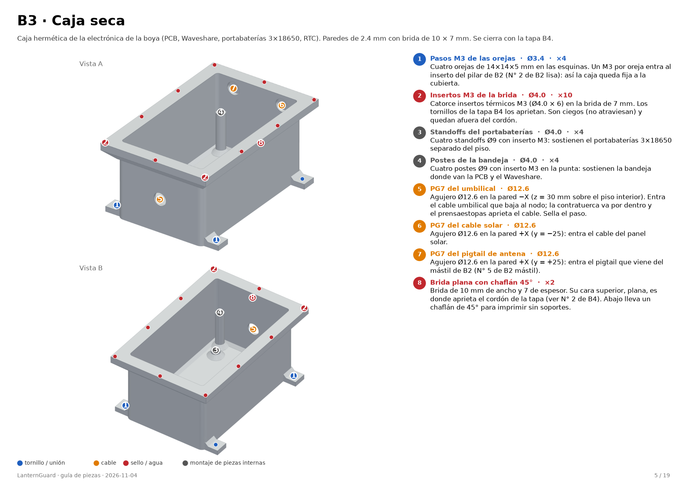

1. **Pasos M3 de las orejas** Ø3.4 ×4 _(tornillo / unión)_. Cuatro orejas de 14×14×5 mm en las esquinas. Un M3 por oreja entra al inserto del pilar de B2 (N° 2 de B2 lisa): así la caja queda fija a la cubierta.
2. **Insertos M3 de la brida** Ø4.0 ×10 _(sello / agua)_. Catorce insertos térmicos M3 (Ø4.0 × 6) en la brida de 7 mm. Los tornillos de la tapa B4 los aprietan. Son ciegos (no atraviesan) y quedan afuera del cordón.
3. **Standoffs del portabaterías** Ø4.0 ×4 _(montaje de piezas internas)_. Cuatro standoffs Ø9 con inserto M3: sostienen el portabaterías 3×18650 separado del piso.
4. **Postes de la bandeja** Ø4.0 ×4 _(montaje de piezas internas)_. Cuatro postes Ø9 con inserto M3 en la punta: sostienen la bandeja donde van la PCB y el Waveshare.
5. **PG7 del umbilical** Ø12.6 _(cable)_. Agujero Ø12.6 en la pared −X (z = 30 mm sobre el piso interior). Entra el cable umbilical que baja al nodo; la contratuerca va por dentro y el prensaestopas aprieta el cable. Sella el paso.
6. **PG7 del cable solar** Ø12.6 _(cable)_. Agujero Ø12.6 en la pared +X (y = −25): entra el cable del panel solar.
7. **PG7 del pigtail de antena** Ø12.6 _(cable)_. Agujero Ø12.6 en la pared +X (y = +25): entra el pigtail que viene del mástil de B2 (N° 5 de B2 mástil).
8. **Brida plana con chaflán 45°** ×2 _(sello / agua)_. Brida de 10 mm de ancho y 7 de espesor. Su cara superior, plana, es donde aprieta el cordón de la tapa (ver N° 2 de B4). Abajo lleva un chaflán de 45° para imprimir sin soportes.

## B4 · Tapa de la caja seca

Tapa plana de 6.5 mm de B3. Se imprime con la ranura hacia arriba (girada 180°). Aquí está el sello que mantiene seca la electrónica.

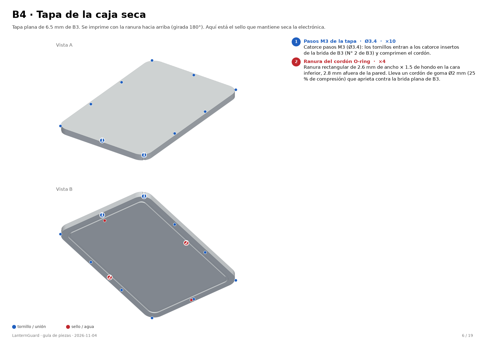

1. **Pasos M3 de la tapa** Ø3.4 ×10 _(tornillo / unión)_. Catorce pasos M3 (Ø3.4): los tornillos entran a los catorce insertos de la brida de B3 (N° 2 de B3) y comprimen el cordón.
2. **Ranura del cordón O-ring** ×4 _(sello / agua)_. Ranura rectangular de 2.6 mm de ancho × 1.5 de hondo en la cara inferior, 2.8 mm afuera de la pared. Lleva un cordón de goma Ø2 mm (25 % de compresión) que aprieta contra la brida plana de B3.

## B5 · Cuna, lado base

Cuna que sostiene una botella a lo largo de Y en cada extremo del casco. Mitad del lado de la base de la botella; se imprime 2 veces (una por cuna). Aquí x = 0 es la unión con el lado cuello.

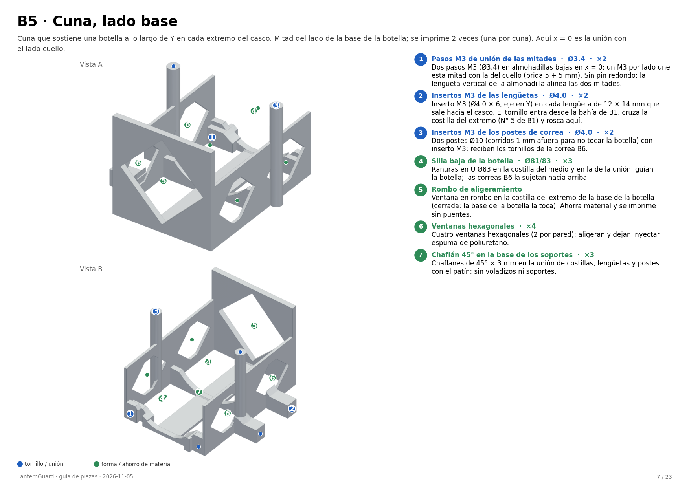

1. **Pasos M3 de unión de las mitades** Ø3.4 ×2 _(tornillo / unión)_. Dos pasos M3 (Ø3.4) en almohadillas bajas en x = 0: un M3 por lado une esta mitad con la del cuello (brida 5 + 5 mm). Sin pin redondo: la lengüeta vertical de la almohadilla alinea las dos mitades.
2. **Insertos M3 de las lengüetas** Ø4.0 ×2 _(tornillo / unión)_. Inserto M3 (Ø4.0 × 6, eje en Y) en cada lengüeta de 12 × 14 mm que sale hacia el casco. El tornillo entra desde la bahía de B1, cruza la costilla del extremo (N° 5 de B1) y rosca aquí.
3. **Insertos M3 de los postes de correa** Ø4.0 ×2 _(tornillo / unión)_. Dos postes Ø10 (corridos 1 mm afuera para no tocar la botella) con inserto M3: reciben los tornillos de la correa B6.
4. **Silla baja de la botella** Ø81/83 ×3 _(forma / ahorro de material)_. Ranuras en U Ø83 en la costilla del medio y en la de la unión: guían la botella; las correas B6 la sujetan hacia arriba.
5. **Rombo de aligeramiento** _(forma / ahorro de material)_. Ventana en rombo en la costilla del extremo de la base de la botella (cerrada: la base de la botella la toca). Ahorra material y se imprime sin puentes.
6. **Ventanas hexagonales** ×4 _(forma / ahorro de material)_. Cuatro ventanas hexagonales (2 por pared): aligeran y dejan inyectar espuma de poliuretano.
7. **Chaflán 45° en la base de los soportes** ×3 _(forma / ahorro de material)_. Chaflanes de 45° × 3 mm en la unión de costillas, lengüetas y postes con el patín: sin voladizos ni soportes.

## B5 · Cuna, lado cuello

La otra mitad de la cuna, la que recibe el cuello de la botella. Se imprime 2 veces. Mismas uniones que el lado base.

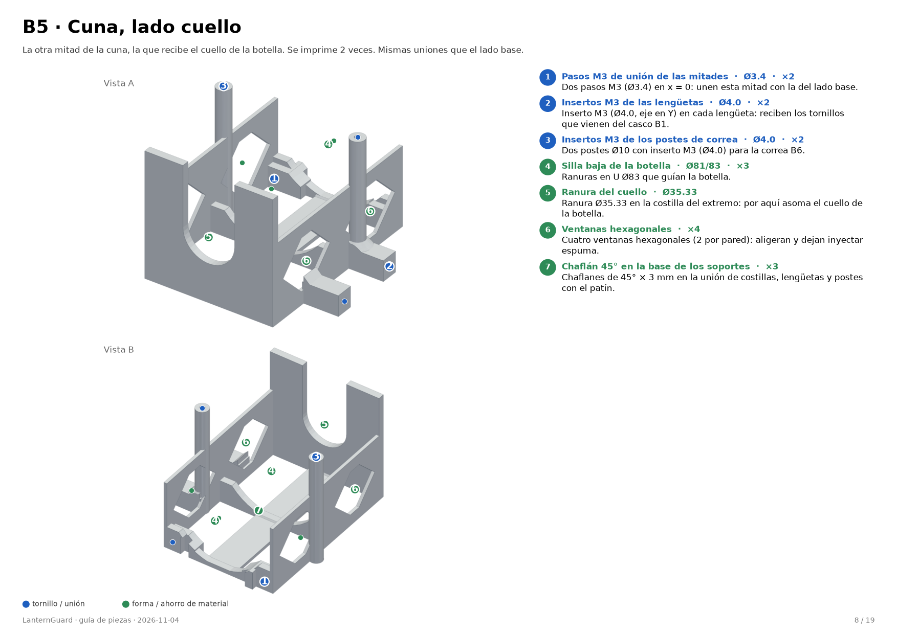

1. **Pasos M3 de unión de las mitades** Ø3.4 ×2 _(tornillo / unión)_. Dos pasos M3 (Ø3.4) en x = 0: unen esta mitad con la del lado base.
2. **Insertos M3 de las lengüetas** Ø4.0 ×2 _(tornillo / unión)_. Inserto M3 (Ø4.0, eje en Y) en cada lengüeta: reciben los tornillos que vienen del casco B1.
3. **Insertos M3 de los postes de correa** Ø4.0 ×2 _(tornillo / unión)_. Dos postes Ø10 con inserto M3 (Ø4.0) para la correa B6.
4. **Silla baja de la botella** Ø81/83 ×3 _(forma / ahorro de material)_. Ranuras en U Ø83 que guían la botella.
5. **Ranura del cuello** Ø35.33 _(forma / ahorro de material)_. Ranura Ø35.33 en la costilla del extremo: por aquí asoma el cuello de la botella.
6. **Ventanas hexagonales** ×4 _(forma / ahorro de material)_. Cuatro ventanas hexagonales (2 por pared): aligeran y dejan inyectar espuma.
7. **Chaflán 45° en la base de los soportes** ×3 _(forma / ahorro de material)_. Chaflanes de 45° × 3 mm en la unión de costillas, lengüetas y postes con el patín.

## B6 · Correa

Cierra cada cuna sobre la botella. Se imprimen 4 (2 por cuna). Va plana sobre la cama.

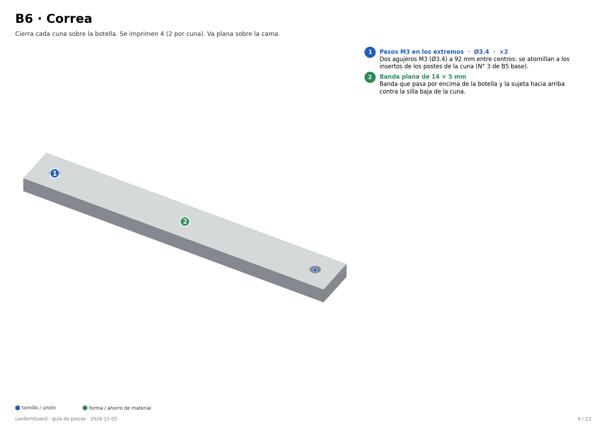

1. **Pasos M3 en los extremos** Ø3.4 ×2 _(tornillo / unión)_. Dos agujeros M3 (Ø3.4) a 92 mm entre centros: se atornillan a los insertos de los postes de la cuna (N° 3 de B5 base).
2. **Banda plana de 14 × 5 mm** _(forma / ahorro de material)_. Banda que pasa por encima de la botella y la sujeta hacia arriba contra la silla baja de la cuna.

# Nodo de cámaras P2_robusto

## M1s · Caja del nodo (cuerpo)

Caja seca del nodo (129 × 128 × 78 mm, paredes de 5), que se imprime sin soportes. La caja, los dos rieles y las dos cápsulas forman UN solo volumen seco: el cable plano de cada cámara va por dentro, sin prensaestopas. Cada extremo tiene una ventana al canal del riel. El piso queda plano sobre la cama; los bolsillos de lastre son la pieza aparte M3f, que se atornilla a cuatro orejas. La cierra la tapa M2. x a lo largo de los rieles, z arriba.

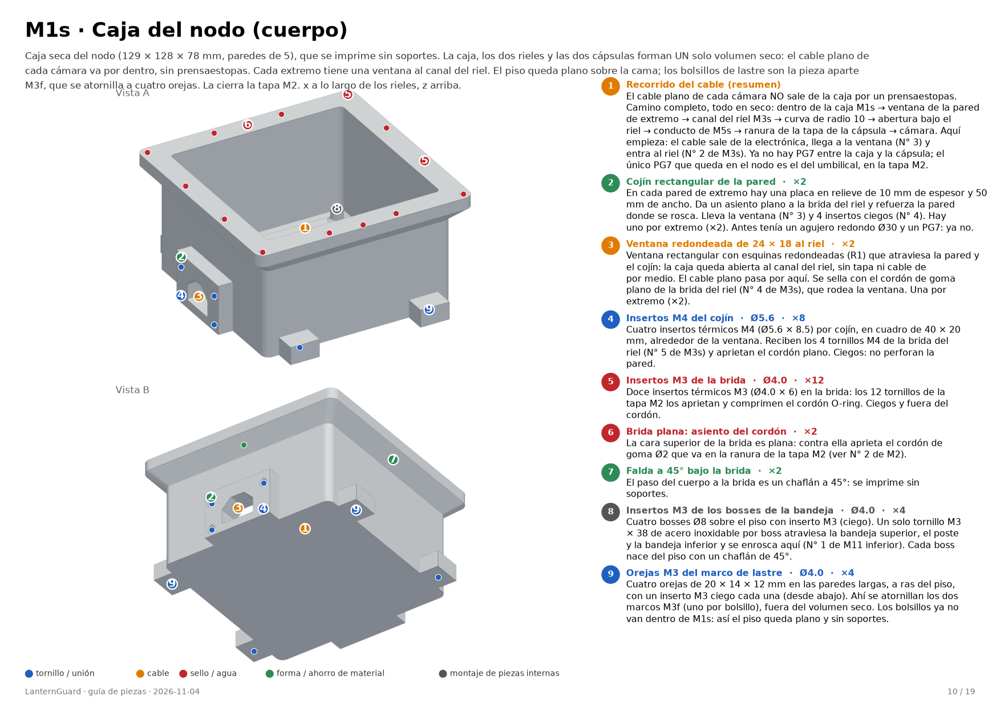

1. **Recorrido del cable (resumen)** _(cable)_. El cable plano de cada cámara NO sale de la caja por un prensaestopas. Camino completo, todo en seco: dentro de la caja M1s → ventana de la pared de extremo → canal del riel M3s → curva de radio 10 → abertura bajo el riel → conducto de M5s → ranura de la tapa de la cápsula → cámara. Aquí empieza: el cable sale de la electrónica, llega a la ventana (N° 3) y entra al riel (N° 2 de M3s). Ya no hay PG7 entre la caja y la cápsula; el único PG7 que queda en el nodo es el del umbilical, en la tapa M2.
2. **Cojín rectangular de la pared** ×2 _(forma / ahorro de material)_. En cada pared de extremo hay una placa en relieve de 10 mm de espesor y 50 mm de ancho. Da un asiento plano a la brida del riel y refuerza la pared donde se rosca. Lleva la ventana (N° 3) y 4 insertos ciegos (N° 4). Hay uno por extremo (×2). Antes tenía un agujero redondo Ø30 y un PG7: ya no.
3. **Ventana redondeada de 24 × 18 al riel** ×2 _(cable)_. Ventana rectangular con esquinas redondeadas (R1) que atraviesa la pared y el cojín: la caja queda abierta al canal del riel, sin tapa ni cable de por medio. El cable plano pasa por aquí. Se sella con el cordón de goma plano de la brida del riel (N° 4 de M3s), que rodea la ventana. Una por extremo (×2).
4. **Insertos M4 del cojín** Ø5.6 ×8 _(tornillo / unión)_. Cuatro insertos térmicos M4 (Ø5.6 × 8.5) por cojín, en cuadro de 40 × 20 mm, alrededor de la ventana. Reciben los 4 tornillos M4 de la brida del riel (N° 5 de M3s) y aprietan el cordón plano. Ciegos: no perforan la pared.
5. **Insertos M3 de la brida** Ø4.0 ×12 _(sello / agua)_. Doce insertos térmicos M3 (Ø4.0 × 6) en la brida: los 12 tornillos de la tapa M2 los aprietan y comprimen el cordón O-ring. Ciegos y fuera del cordón.
6. **Brida plana: asiento del cordón** ×2 _(sello / agua)_. La cara superior de la brida es plana: contra ella aprieta el cordón de goma Ø2 que va en la ranura de la tapa M2 (ver N° 2 de M2).
7. **Falda a 45° bajo la brida** ×2 _(forma / ahorro de material)_. El paso del cuerpo a la brida es un chaflán a 45°: se imprime sin soportes.
8. **Insertos M3 de los bosses de la bandeja** Ø4.0 ×4 _(montaje de piezas internas)_. Cuatro bosses Ø8 sobre el piso con inserto M3 (ciego). Un solo tornillo M3 × 38 de acero inoxidable por boss atraviesa la bandeja superior, el poste y la bandeja inferior y se enrosca aquí (N° 1 de M11 inferior). Cada boss nace del piso con un chaflán de 45°.
9. **Orejas M3 del marco de lastre** Ø4.0 ×4 _(tornillo / unión)_. Cuatro orejas de 20 × 14 × 12 mm en las paredes largas, a ras del piso, con un inserto M3 ciego cada una (desde abajo). Ahí se atornillan los dos marcos M3f (uno por bolsillo), fuera del volumen seco. Los bolsillos ya no van dentro de M1s: así el piso queda plano y sin soportes.

## M2 · Tapa de la caja con asa

Cierra la caja M1s. Lleva el asa para cargar con guante, el ojo de anclaje del cabo y el PG7 del umbilical, que es el único prensaestopas que queda en el nodo. Se imprime sin girar (sin soportes). Aquí z crece hacia arriba (asa arriba).

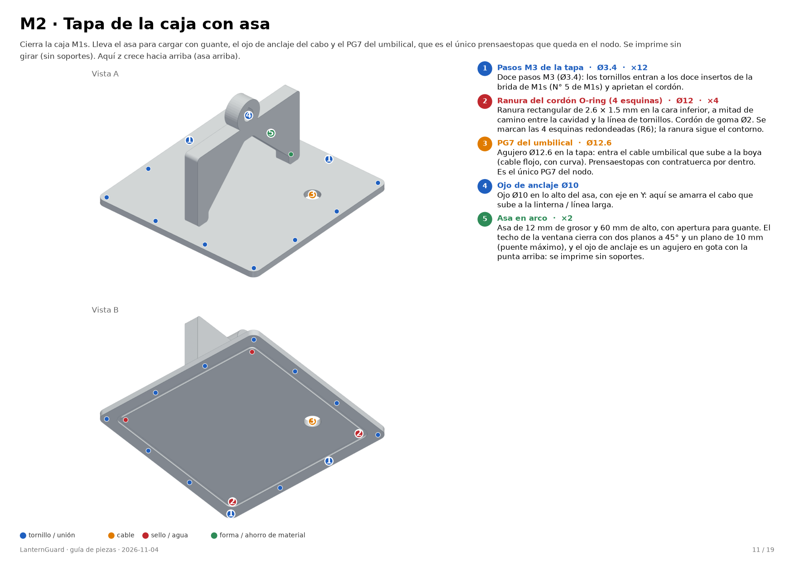

1. **Pasos M3 de la tapa** Ø3.4 ×12 _(tornillo / unión)_. Doce pasos M3 (Ø3.4): los tornillos entran a los doce insertos de la brida de M1s (N° 5 de M1s) y aprietan el cordón.
2. **Ranura del cordón O-ring (4 esquinas)** Ø12 ×4 _(sello / agua)_. Ranura rectangular de 2.6 × 1.5 mm en la cara inferior, a mitad de camino entre la cavidad y la línea de tornillos. Cordón de goma Ø2. Se marcan las 4 esquinas redondeadas (R6); la ranura sigue el contorno.
3. **PG7 del umbilical** Ø12.6 _(cable)_. Agujero Ø12.6 en la tapa: entra el cable umbilical que sube a la boya (cable flojo, con curva). Prensaestopas con contratuerca por dentro. Es el único PG7 del nodo.
4. **Ojo de anclaje Ø10** Ø10 _(tornillo / unión)_. Ojo Ø10 en lo alto del asa, con eje en Y: aquí se amarra el cabo que sube a la linterna / línea larga.
5. **Asa en arco** ×2 _(forma / ahorro de material)_. Asa de 12 mm de grosor y 60 mm de alto, con apertura para guante. El techo de la ventana cierra con dos planos a 45° y un plano de 10 mm (puente máximo), y el ojo de anclaje es un agujero en gota con la punta arriba: se imprime sin soportes.

## M3s · Riel cerrado con gancho (una mitad)

Ahora es una caja cerrada y seca de 36 × 30 mm que sale de la caja M1s y lleva el cable plano hasta la cápsula; ya no es una celosía abierta. Una mitad por lado; la otra es la misma pieza girada 180° sobre z. El gancho en C, fundido al riel, cuelga el nodo del aro de la linterna.

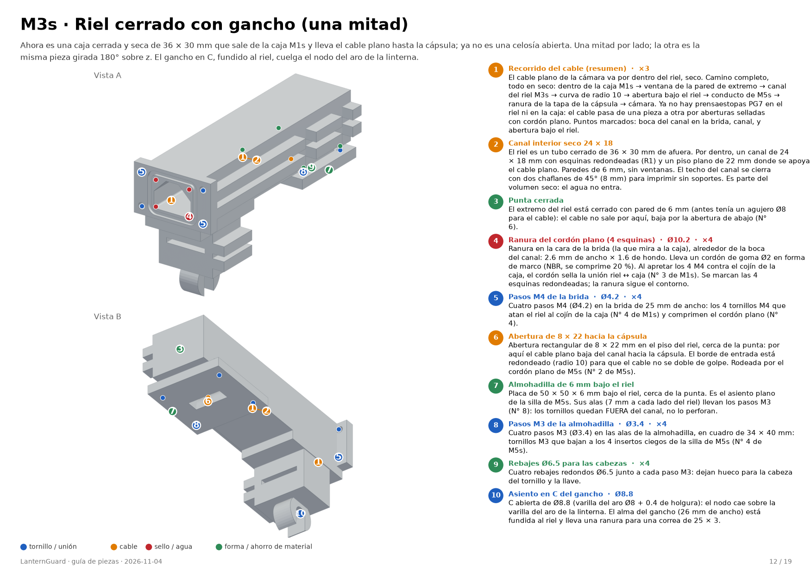

1. **Recorrido del cable (resumen)** ×3 _(cable)_. El cable plano de la cámara va por dentro del riel, seco. Camino completo, todo en seco: dentro de la caja M1s → ventana de la pared de extremo → canal del riel M3s → curva de radio 10 → abertura bajo el riel → conducto de M5s → ranura de la tapa de la cápsula → cámara. Ya no hay prensaestopas PG7 en el riel ni en la caja: el cable pasa de una pieza a otra por aberturas selladas con cordón plano. Puntos marcados: boca del canal en la brida, canal, y abertura bajo el riel.
2. **Canal interior seco 24 × 18** _(cable)_. El riel es un tubo cerrado de 36 × 30 mm de afuera. Por dentro, un canal de 24 × 18 mm con esquinas redondeadas (R1) y un piso plano de 22 mm donde se apoya el cable plano. Paredes de 6 mm, sin ventanas. El techo del canal se cierra con dos chaflanes de 45° (8 mm) para imprimir sin soportes. Es parte del volumen seco: el agua no entra.
3. **Punta cerrada** _(forma / ahorro de material)_. El extremo del riel está cerrado con pared de 6 mm (antes tenía un agujero Ø8 para el cable): el cable no sale por aquí, baja por la abertura de abajo (N° 6).
4. **Ranura del cordón plano (4 esquinas)** Ø10.2 ×4 _(sello / agua)_. Ranura en la cara de la brida (la que mira a la caja), alrededor de la boca del canal: 2.6 mm de ancho × 1.6 de hondo. Lleva un cordón de goma Ø2 en forma de marco (NBR, se comprime 20 %). Al apretar los 4 M4 contra el cojín de la caja, el cordón sella la unión riel ↔ caja (N° 3 de M1s). Se marcan las 4 esquinas redondeadas; la ranura sigue el contorno.
5. **Pasos M4 de la brida** Ø4.2 ×4 _(tornillo / unión)_. Cuatro pasos M4 (Ø4.2) en la brida de 25 mm de ancho: los 4 tornillos M4 que atan el riel al cojín de la caja (N° 4 de M1s) y comprimen el cordón plano (N° 4).
6. **Abertura de 8 × 22 hacia la cápsula** _(cable)_. Abertura rectangular de 8 × 22 mm en el piso del riel, cerca de la punta: por aquí el cable plano baja del canal hacia la cápsula. El borde de entrada está redondeado (radio 10) para que el cable no se doble de golpe. Rodeada por el cordón plano de M5s (N° 2 de M5s).
7. **Almohadilla de 6 mm bajo el riel** _(forma / ahorro de material)_. Placa de 50 × 50 × 6 mm bajo el riel, cerca de la punta. Es el asiento plano de la silla de M5s. Sus alas (7 mm a cada lado del riel) llevan los pasos M3 (N° 8): los tornillos quedan FUERA del canal, no lo perforan.
8. **Pasos M3 de la almohadilla** Ø3.4 ×4 _(tornillo / unión)_. Cuatro pasos M3 (Ø3.4) en las alas de la almohadilla, en cuadro de 34 × 40 mm: tornillos M3 que bajan a los 4 insertos ciegos de la silla de M5s (N° 4 de M5s).
9. **Rebajes Ø6.5 para las cabezas** Ø6.5 ×4 _(forma / ahorro de material)_. Cuatro rebajes redondos Ø6.5 junto a cada paso M3: dejan hueco para la cabeza del tornillo y la llave.
10. **Asiento en C del gancho** Ø8.8 _(tornillo / unión)_. C abierta de Ø8.8 (varilla del aro Ø8 + 0.4 de holgura): el nodo cae sobre la varilla del aro de la linterna. El alma del gancho (26 mm de ancho) está fundida al riel y lleva una ranura para una correa de 25 × 3.

## M3f · Marco del bolsillo de lastre

Marco de 117 × 77 × 30 mm (paredes de 5) que guarda el lastre a granel (tuercas y arandelas M8). Se imprime ×2 (uno por bolsillo), sin soportes. Se atornilla por arriba a las orejas de la caja M1s y se cierra por abajo con la placa M3t. Queda fuera del volumen seco: se moja y no sella.

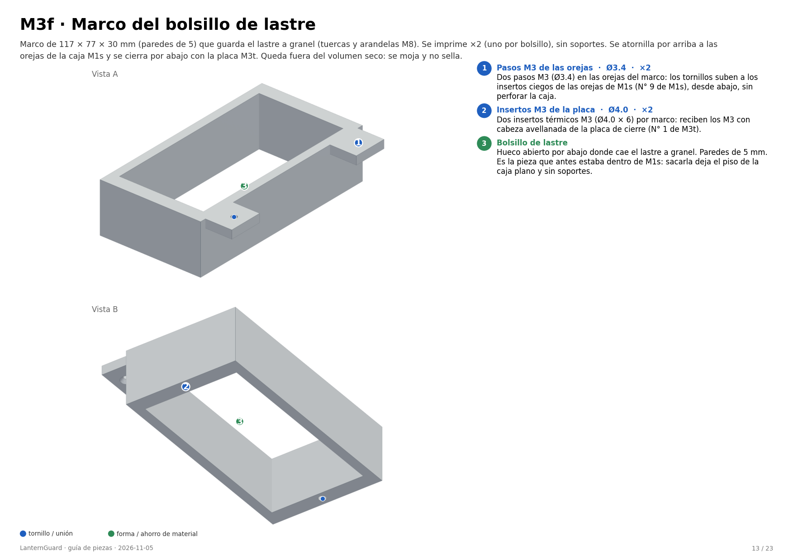

1. **Pasos M3 de las orejas** Ø3.4 ×2 _(tornillo / unión)_. Dos pasos M3 (Ø3.4) en las orejas del marco: los tornillos suben a los insertos ciegos de las orejas de M1s (N° 9 de M1s), desde abajo, sin perforar la caja.
2. **Insertos M3 de la placa** Ø4.0 ×2 _(tornillo / unión)_. Dos insertos térmicos M3 (Ø4.0 × 6) por marco: reciben los M3 con cabeza avellanada de la placa de cierre (N° 1 de M3t).
3. **Bolsillo de lastre** _(forma / ahorro de material)_. Hueco abierto por abajo donde cae el lastre a granel. Paredes de 5 mm. Es la pieza que antes estaba dentro de M1s: sacarla deja el piso de la caja plano y sin soportes.

## M3t · Tapa del bolsillo de lastre

Placa de 5 mm que cierra por abajo cada marco de lastre M3f. Se imprimen 2 (una por marco). Plana en la cama.

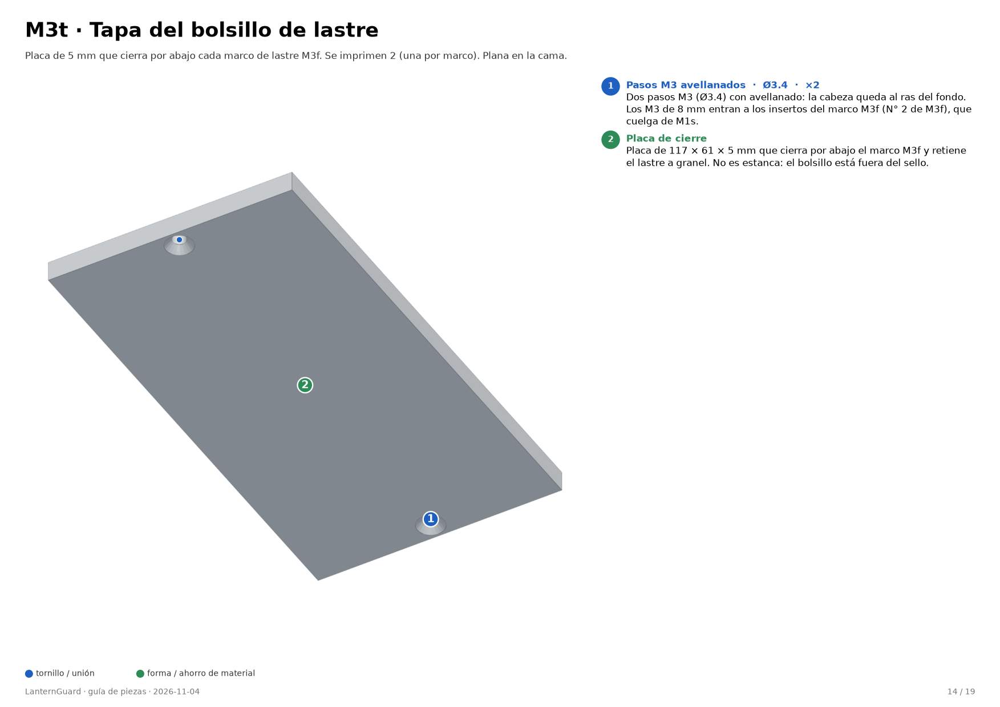

1. **Pasos M3 avellanados** Ø3.4 ×2 _(tornillo / unión)_. Dos pasos M3 (Ø3.4) con avellanado: la cabeza queda al ras del fondo. Los M3 de 8 mm entran a los insertos del marco M3f (N° 2 de M3f), que cuelga de M1s.
2. **Placa de cierre** _(forma / ahorro de material)_. Placa de 117 × 61 × 5 mm que cierra por abajo el marco M3f y retiene el lastre a granel. No es estanca: el bolsillo está fuera del sello.

## M4 · Cápsula de cámara (cuerpo)

Caja seca de la cámara Arducam Mega 5 MP, con anillo LED y ventana de acrílico. Ya no tiene prensaestopas: el cable plano entra por una ranura de la tapa M5s. Brida de 6 mm que se cierra con la tapa M5s. Hay una por lado (×2). x es el eje óptico (adelante = +x).

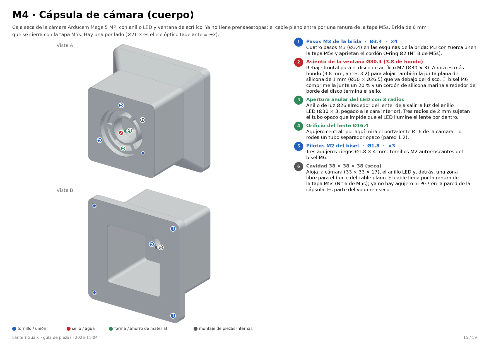

1. **Pasos M3 de la brida** Ø3.4 ×4 _(tornillo / unión)_. Cuatro pasos M3 (Ø3.4) en las esquinas de la brida: M3 con tuerca unen la tapa M5s y aprietan el cordón O-ring Ø2 (N° 8 de M5s).
2. **Asiento de la ventana Ø30.4 (3.8 de hondo)** Ø30.4 _(sello / agua)_. Rebaje frontal para el disco de acrílico M7 (Ø30 × 3). Ahora es más hondo (3.8 mm, antes 3.2) para alojar también la junta plana de silicona de 1 mm (Ø30 × Ø26.5) que va debajo del disco. El bisel M6 comprime la junta un 20 % y un cordón de silicona marina alrededor del borde del disco termina el sello.
3. **Apertura anular del LED con 3 radios** _(forma / ahorro de material)_. Anillo de luz Ø26 alrededor del lente: deja salir la luz del anillo LED (Ø30 × 3, pegado a la cara interior). Tres radios de 2 mm sujetan el tubo opaco que impide que el LED ilumine el lente por dentro.
4. **Orificio del lente Ø16.4** Ø16.4 _(forma / ahorro de material)_. Agujero central: por aquí mira el porta-lente Ø16 de la cámara. Lo rodea un tubo separador opaco (pared 1.2).
5. **Pilotos M2 del bisel** Ø1.8 ×3 _(tornillo / unión)_. Tres agujeros ciegos Ø1.8 × 4 mm: tornillos M2 autorroscantes del bisel M6.
6. **Cavidad 38 × 38 × 38 (seca)** _(montaje de piezas internas)_. Aloja la cámara (33 × 33 × 17), el anillo LED y, detrás, una zona libre para el bucle del cable plano. El cable llega por la ranura de la tapa M5s (N° 6 de M5s); ya no hay agujero ni PG7 en la pared de la cápsula. Es parte del volumen seco.

## M5s · Tapa de la cápsula con pie

Cierra la cápsula M4, la fija bajo el riel y lleva el cable plano desde el riel hasta la cámara por un conducto interior. Placa de silla de 10 mm bajo el riel, alma de 30 mm de ancho con el conducto, y tapa inclinada 30° con una ranura para el cable. Se imprime ×2. El STEP está en la pose del ensamble (x a lo largo del riel).

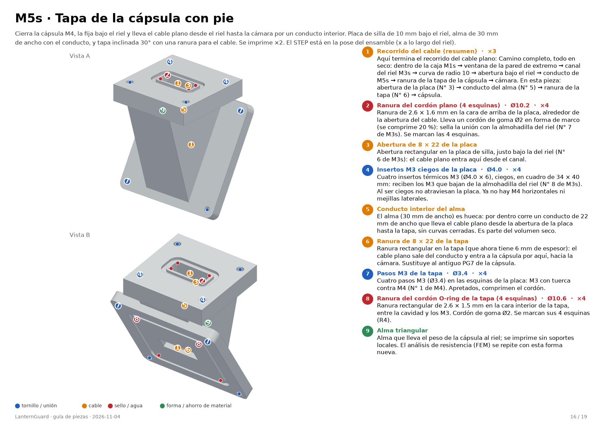

1. **Recorrido del cable (resumen)** ×3 _(cable)_. Aquí termina el recorrido del cable plano: Camino completo, todo en seco: dentro de la caja M1s → ventana de la pared de extremo → canal del riel M3s → curva de radio 10 → abertura bajo el riel → conducto de M5s → ranura de la tapa de la cápsula → cámara. En esta pieza: abertura de la placa (N° 3) → conducto del alma (N° 5) → ranura de la tapa (N° 6) → cápsula.
2. **Ranura del cordón plano (4 esquinas)** Ø10.2 ×4 _(sello / agua)_. Ranura de 2.6 × 1.6 mm en la cara de arriba de la placa, alrededor de la abertura del cable. Lleva un cordón de goma Ø2 en forma de marco (se comprime 20 %): sella la unión con la almohadilla del riel (N° 7 de M3s). Se marcan las 4 esquinas.
3. **Abertura de 8 × 22 de la placa** _(cable)_. Abertura rectangular en la placa de silla, justo bajo la del riel (N° 6 de M3s): el cable plano entra aquí desde el canal.
4. **Insertos M3 ciegos de la placa** Ø4.0 ×4 _(tornillo / unión)_. Cuatro insertos térmicos M3 (Ø4.0 × 6), ciegos, en cuadro de 34 × 40 mm: reciben los M3 que bajan de la almohadilla del riel (N° 8 de M3s). Al ser ciegos no atraviesan la placa. Ya no hay M4 horizontales ni mejillas laterales.
5. **Conducto interior del alma** _(cable)_. El alma (30 mm de ancho) es hueca: por dentro corre un conducto de 22 mm de ancho que lleva el cable plano desde la abertura de la placa hasta la tapa, sin curvas cerradas. Es parte del volumen seco.
6. **Ranura de 8 × 22 de la tapa** _(cable)_. Ranura rectangular en la tapa (que ahora tiene 6 mm de espesor): el cable plano sale del conducto y entra a la cápsula por aquí, hacia la cámara. Sustituye al antiguo PG7 de la cápsula.
7. **Pasos M3 de la tapa** Ø3.4 ×4 _(tornillo / unión)_. Cuatro pasos M3 (Ø3.4) en las esquinas de la placa: M3 con tuerca contra M4 (N° 1 de M4). Apretados, comprimen el cordón.
8. **Ranura del cordón O-ring de la tapa (4 esquinas)** Ø10.6 ×4 _(sello / agua)_. Ranura rectangular de 2.6 × 1.5 mm en la cara interior de la tapa, entre la cavidad y los M3. Cordón de goma Ø2. Se marcan sus 4 esquinas (R4).
9. **Alma triangular** _(forma / ahorro de material)_. Alma que lleva el peso de la cápsula al riel; se imprime sin soportes locales. El análisis de resistencia (FEM) se repite con esta forma nueva.

## M6 · Bisel de la cápsula

Anillo de 2.5 mm que sostiene la ventana de acrílico contra el frente de M4 y comprime la junta plana de silicona. Pequeño: se imprime ×2 al 40 %.

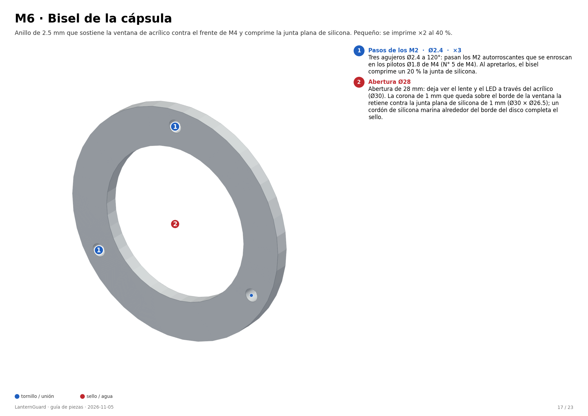

1. **Pasos de los M2** Ø2.4 ×3 _(tornillo / unión)_. Tres agujeros Ø2.4 a 120°: pasan los M2 autorroscantes que se enroscan en los pilotos Ø1.8 de M4 (N° 5 de M4). Al apretarlos, el bisel comprime un 20 % la junta de silicona.
2. **Abertura Ø28** Ø28 _(sello / agua)_. Abertura de 28 mm: deja ver el lente y el LED a través del acrílico (Ø30). La corona de 1 mm que queda sobre el borde de la ventana la retiene contra la junta plana de silicona de 1 mm (Ø30 × Ø26.5); un cordón de silicona marina alrededor del borde del disco completa el sello.

## M11 · Bandeja inferior

Bandeja de 3 mm dentro de la caja seca: sostiene los módulos electrónicos. Lleva 4 postes que además son separadores: un solo tornillo M3 × 38 inoxidable por esquina atraviesa la bandeja superior, el poste y esta bandeja y se enrosca en el inserto de M1s.

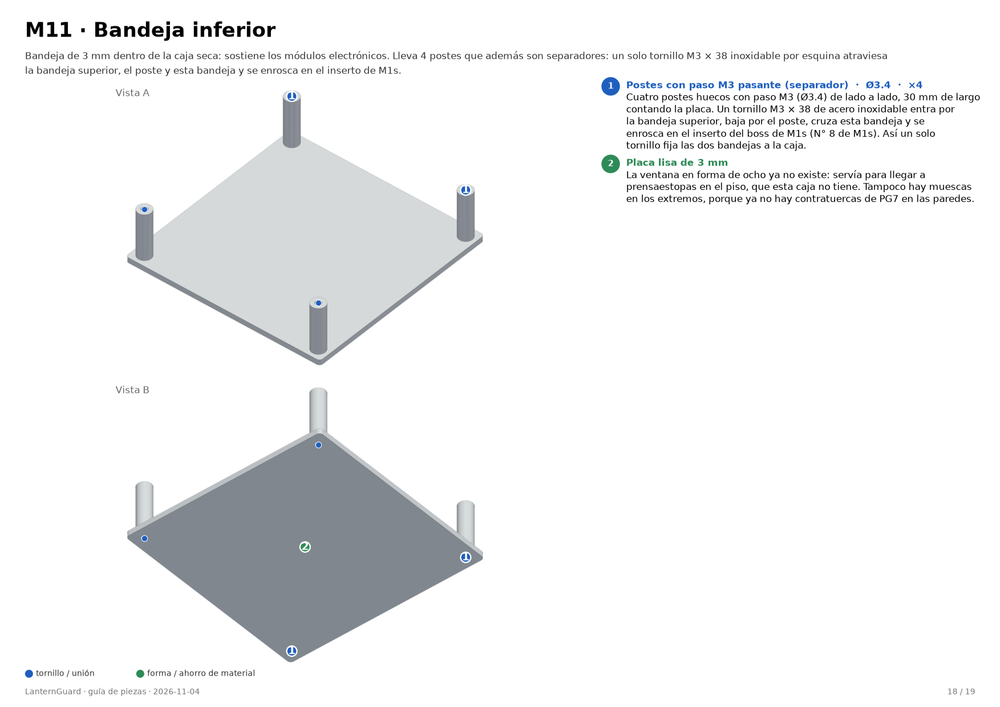

1. **Postes con paso M3 pasante (separador)** Ø3.4 ×4 _(tornillo / unión)_. Cuatro postes huecos con paso M3 (Ø3.4) de lado a lado, 30 mm de largo contando la placa. Un tornillo M3 × 38 de acero inoxidable entra por la bandeja superior, baja por el poste, cruza esta bandeja y se enrosca en el inserto del boss de M1s (N° 8 de M1s). Así un solo tornillo fija las dos bandejas a la caja.
2. **Placa lisa de 3 mm** _(forma / ahorro de material)_. La ventana en forma de ocho ya no existe: servía para llegar a prensaestopas en el piso, que esta caja no tiene. Tampoco hay muescas en los extremos, porque ya no hay contratuercas de PG7 en las paredes.

## M11 · Bandeja superior

Segundo piso de la caja seca. Placa de 3 mm que se apoya en los 4 postes de la bandeja inferior; el mismo tornillo M3 × 38 de cada esquina las une a las dos con la caja.

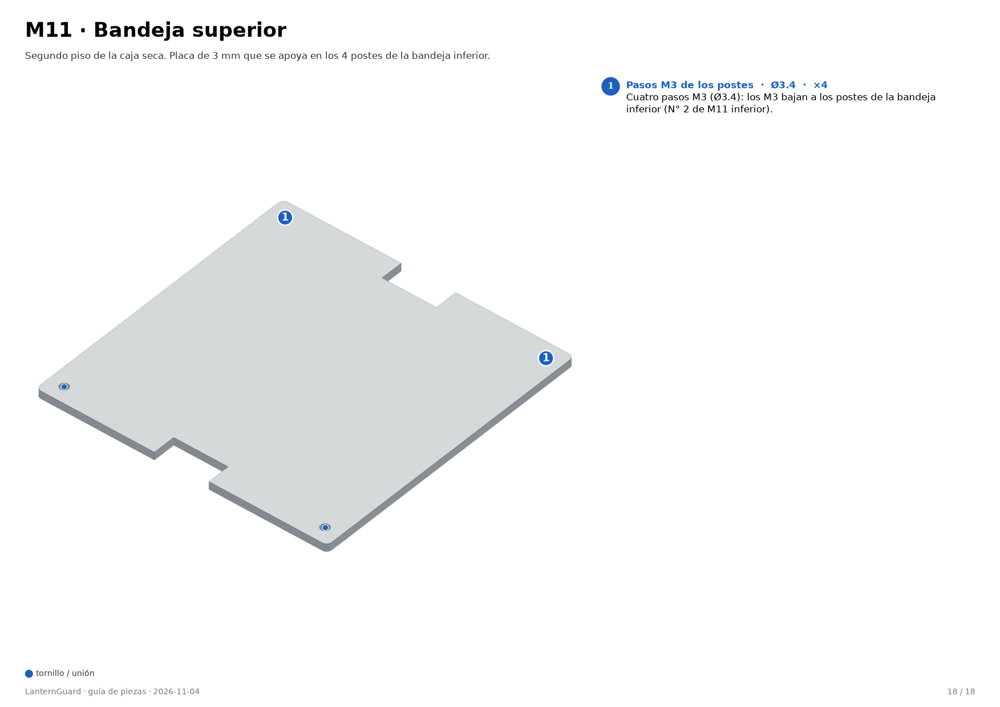

1. **Pasos M3 de los postes** Ø3.4 ×4 _(tornillo / unión)_. Cuatro pasos M3 (Ø3.4): por cada uno entra la cabeza de un tornillo M3 × 38 inoxidable que baja por el poste de la bandeja inferior (N° 1 de M11 inferior) hasta el inserto de M1s.
