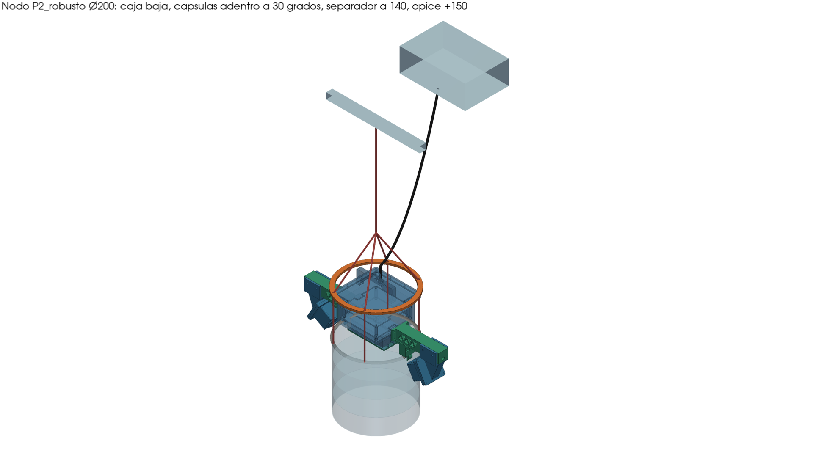
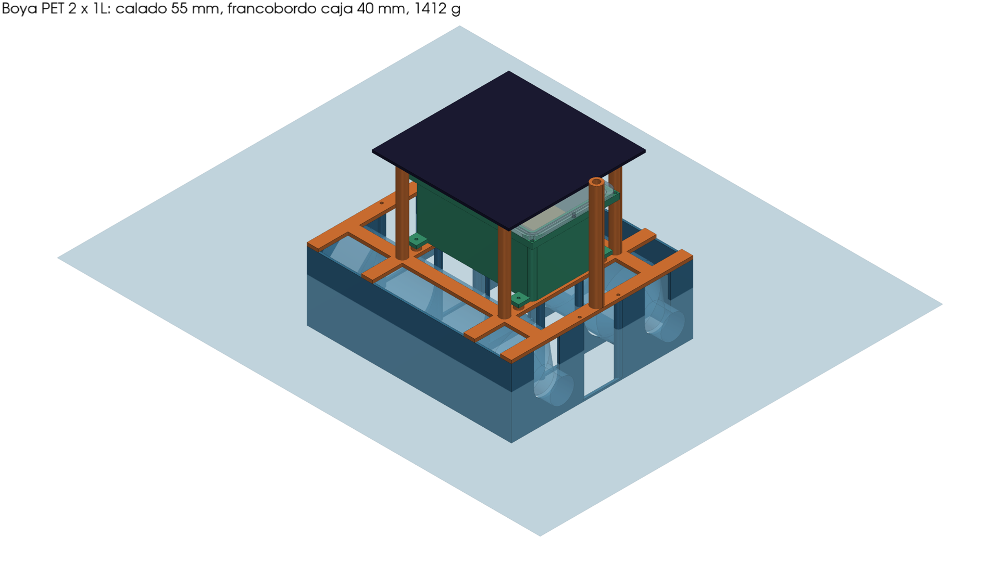
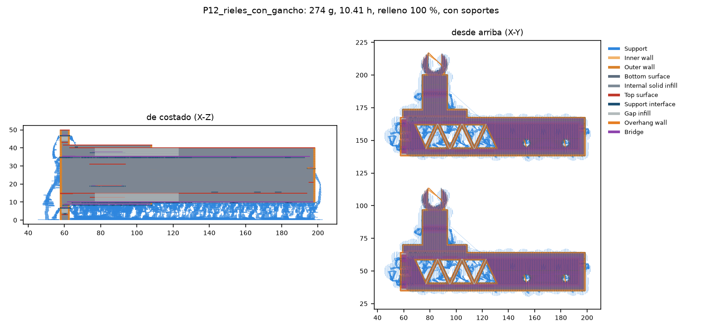
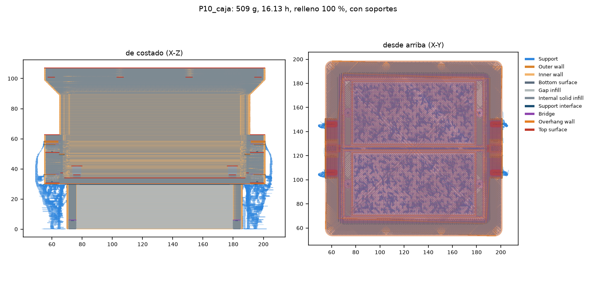
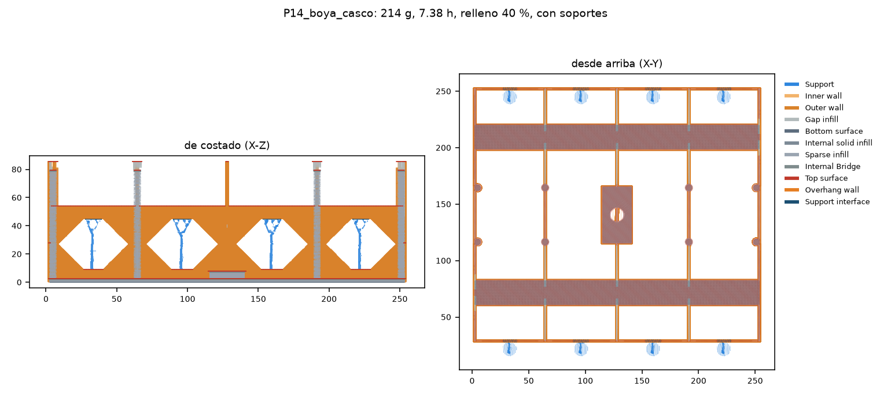
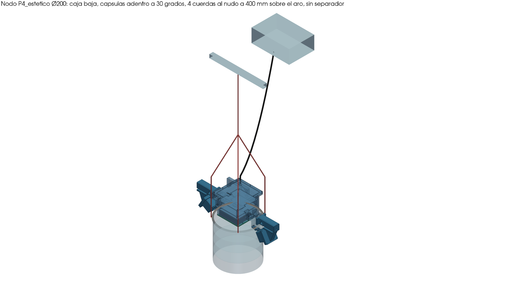
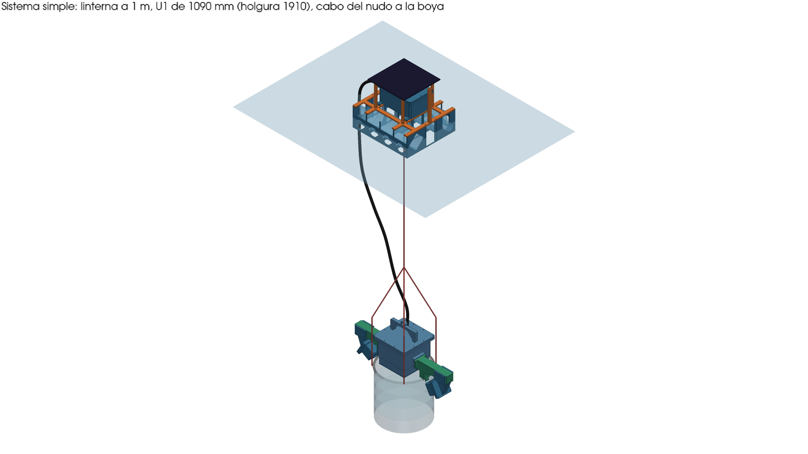

# LanternGuard: módulo mecánico, entrega del 30/10/2026

Nodo de cámaras que se engancha a la linterna de prueba (aro Ø200) y boya de superficie con botellas PET.
Todo sale del código de `Proyecto/MóduloMecánico/cad_final/` (CadQuery); `params.py` es la única fuente de medidas.
Pesos y horas: OrcaSlicer (Bambu P1P, PETG, 0.2 mm). FS: FEM local (Gmsh + CalculiX) con 150 N.

## 1. Resumen

1. El nodo de cámaras se engancha al aro superior (Ø200) de la linterna de prueba; la boya flota en superficie y se une con un cabo y el cable umbilical.
2. Se modelaron 5 versiones del nodo: P0 (los diseños originales, sin tocar), P1 mínimo, P2 robusto, P3 monocasco y P4 estético.
3. **Para la prueba en piscina se recomienda P2 robusto**: es el único con factor de seguridad ≥ 2.5 entre capas en todos los casos y sus piezas son chicas.
4. **Para presentar se recomienda P4 estético**: caja y riel en una sola pieza, bordes redondeados y logo en la tapa.
5. **Boya: casco central más 2 cunas con 4 botellas PET de 1 L en cruz**, rellenas con espuma PU. Flota con 136 % de reserva y es muy estable.
6. Si la boya pierde una botella, sin espuma vuelca; con la espuma queda escorada entre 6 y 12°. Por eso la espuma no es opcional.
7. Material: P2 + boya = unos 2.26 kg de PETG, 77 h de impresora (en placas) y unos S/ 204 de filamento; con las probetas, 2.47 kg y 85 h (sección 3).
8. La linterna de prueba se simplificó: aro + 4 cuerdas a un nudo + cabo, sin separador. El lastre es un bolsillo por lado con tuercas M8 de inox a granel.
9. Antes de imprimir las piezas grandes hay que imprimir las probetas (sección 3, grupo 1) y **medir la varilla del aro** (sección 6, fila 1).
10. Todo está en el repo (código y STL), en Onshape (un documento por prototipo) y en Drive (3MF, planos y este PDF). Links en la sección 5.

## 2. Prototipos del nodo y boya

Masa, horas y costo: OrcaSlicer por pieza × cantidad, sin tornillería, lastre ni electrónica; PETG a S/ 90 el kg (estimado).
FS: a lo largo de las capas / entre capas (la capa es lo débil en impresión 3D). Peso aparente: en agua de mar, con el lastre
calculado; se busca entre +200 y +500 g (que el nodo se hunda poco).

| | P0 simple V1 | P0 modular | P1 mínimo | **P2 robusto** | P3 monocasco | **P4 estético** |
|---|---|---|---|---|---|---|
| Masa impresa | 1248 g | 1285 g (est.) | 1314 g | **1400 g** | 1356 g | **1352 g** |
| Horas de impresora | 45.1 | 55.1 (est.) | 44.3 | **46.7** | 45.8 | **46.0** |
| Costo filamento | S/ 112 | S/ 116 | S/ 118.2 | **S/ 126.0** | S/ 122.0 | **S/ 121.7** |
| FS del riel | 6.9 / 3.4 (a mano) | 1.3 / 0.6 (a mano) | 4.1 / 2.0 | **5.6 / 2.7** | 4.8 / 2.3 | **4.7 / 2.3** |
| FS del pie de la cápsula | 2.5 / 1.2 (a mano) | sin cálculo | 5.4 / 2.6 | **5.0 / 2.5** | 5.5 / 2.7 | **5.5 / 2.7** |
| Piezas impresas por nodo | 17 | 28 | 14 | 14 | 14 | 14 |
| Lastre (tuercas M8 a granel) | pletinas | pletinas | 1020 g | **1150 g** | 1020 g | **1020 g** |
| Peso aparente en el agua | +265 g | +225 g | +348 g | **+352 g** | +354 g | **+353 g** |
| Recomendación | referencia | referencia | descartado (FS 2.0) | **piscina** | base de P4 | **presentar** |

### Boya

| | 2 × 1 L en fila | 4 × 500 ml en cruz | **4 × 1 L en cruz (recomendada)** |
|---|---|---|---|
| Masa impresa / horas / costo | 624 g / 20.9 h / S/ 56.2 | 720 g / 26.8 h / S/ 64.8 | **863 g / 32.0 h / S/ 77.7** |
| Masa total con electrónica y botellas | 1412 g | 1586 g | **1739 g** |
| Calado | 55.1 mm | 50.0 mm | **39.5 mm** |
| Francobordo hasta la abertura más baja (PG7) | 66.4 mm | 56.5 mm | **82.0 mm** (el fondo de la caja queda 56 mm sobre el agua) |
| Reserva de flotación | 45 % | 29 % | **136 %** |
| Estabilidad GM balanceo / cabeceo (pedido ≥ 40) | 31 / 13 mm | 56 / 242 mm | **112 / 762 mm** |
| Si se pierde una botella | vuelca | vuelca | **estable con la espuma (6 a 12°)**; sin espuma vuelca |

Objetivos que no se cumplen: la boya recomendada pesa 863 g impresos (objetivo 700 g) y tarda 32 h (objetivo 25 h). Se pasa
por el tamaño de la cruz; no se cambiaron los objetivos. Detalle en `docs/BOYA.md`.

## 3. Qué imprimir y en qué orden

Bambu P1P, PETG, 0.20 mm. Cada placa es un 3MF ya cortado (con el G-code adentro): se abre en Bambu Studio u
OrcaSlicer y se manda a imprimir tal cual. Los 3MF están en Drive `02_Imprimir_primero_probetas/imprimir_hoy_30oct_v2/`;
los STL sueltos, en el repo (`salida/imprimir_hoy/`). Gramos y horas por placa, de OrcaSlicer.

**Grupo 1. Probetas, primero (5 placas, 207 g, 7.9 h).** Sirven para ajustar holguras e insertos antes de gastar en piezas grandes.

| Placa | Qué es | g | h | Qué se comprueba |
|---|---|---|---|---|
| P01 | PB7 peine de holguras y pines | 10.1 | 0.6 | Qué holgura entra justa en esta impresora |
| P02 | PB8 insertos M4 (3) | 22.8 | 0.9 | Que el inserto caliente entre y aguante |
| P03 | PB6 junta: base y tapa | 57.1 | 1.4 | Que la tapa cierre sobre la junta |
| P04 | PB10 tramo del riel con el gancho | 72.1 | 2.9 | **Probarlo sobre la varilla real del aro** |
| P05 | PB9 bahía de botella | 45.1 | 2.1 | **Probarla con una botella real de 1 L** |

**Grupo 2. Nodo P2, piezas que no dependen de medidas pendientes (6 placas, 1125 g, 34.9 h).**

| Placa | Qué es | g | h |
|---|---|---|---|
| P06 | Biseles (2) y bandejas | 75.5 | 2.9 |
| P07 | Tapas del bolsillo de lastre (2) | 47.4 | 1.0 |
| P08 | Cuerpos de cápsula (2) | 119.1 | 4.0 |
| P09 | Tapa de la caja | 181.2 | 5.1 |
| P10 | Caja | 509.2 | 16.1 |
| P11 | Tapas de cápsula con pie (2). **Solo si se queda el ángulo de 30°** | 192.4 | 5.8 |

**Grupo 3. Esperan la medida de la varilla del aro (1 placa, 274 g, 10.4 h).**

| Placa | Qué es | g | h |
|---|---|---|---|
| P12 | Rieles con gancho (2) | 274.0 | 10.4 |

**Grupo 4. Boya 4 × 1 L (5 placas, 863 g, 31.5 h).** Después de probar P05 con una botella real.

| Placa | Qué es | g | h |
|---|---|---|---|
| P14 | Casco central | 213.6 | 7.4 |
| P15 | Cubierta (lleva el panel) | 119.0 | 5.8 |
| P16 | Caja seca y su tapa | 227.8 | 7.4 |
| P17 | Cuna: **imprimir 2 veces** (no caben las dos juntas) | 282.0 (las 2) | 10.0 (las 2) |
| P18 | Correas (4) | 20.1 | 0.9 |

**Total: 2469 g y 84.7 h** (probetas 207 g + nodo P2 1399 g + boya 863 g). Con un rollo de 1 kg hacen falta 3 rollos.
El separador LR1 ya no se imprime: la linterna de prueba va sin separador.

## 4. Capturas del slicer y renders

Vista previa de OrcaSlicer: costado y planta de cada placa, con los soportes en azul. Todas las placas tienen sus capturas
en `salida/capturas_slicer/` (`_placa.png`, `_arriba.png` y `_trayectoria.png`).

Renders del CAD: el nodo P4 (para presentar) y el sistema completo en la linterna de prueba.

## 5. Links

| Qué | Link |
|---|---|
| Repo, rama `cad/version-final` | https://github.com/Joseph-L-Q/PI_Equipo_02/tree/cad/version-final |
| PR #10 (cad/version-final → main) | https://github.com/Joseph-L-Q/PI_Equipo_02/pull/10 |
| Carpeta del módulo en el repo | https://github.com/Joseph-L-Q/PI_Equipo_02/tree/cad/version-final/Proyecto/M%C3%B3duloMec%C3%A1nico |
| Drive, LanternGuard_CAD | https://drive.google.com/drive/folders/1T8cv6NW7W2cESde3SLp9HgS4VRJMWwCO |

### Onshape (carpeta "LanternGuard")

Cada documento tiene una pestaña por pieza (con su código, por ejemplo `M1s_caja_cuerpo`) y una pestaña con el ensamble.
En el ensamble, lo que no se imprime lleva el prefijo `REF_` (linterna, aro, cuerdas, cabo, umbilical, botellas, electrónica).
**Abrir la pestaña indicada**: es la que tiene todas las piezas con nombre (comprobado contra el CAD: mismo número de partes).

| Documento | Qué es | Pestaña del ensamble | Link |
|---|---|---|---|
| LG_00_LEER_PRIMERO | Este PDF, para abrir desde Onshape | (PDF) | https://cad.onshape.com/documents/b9bce32f5ed7658b40f45777/w/5b938b69e9a7352f33c5075c |
| **LG_P2_robusto** | **Nodo para la piscina** | ENSAMBLE_v2 | https://cad.onshape.com/documents/999b4e78fb31ffdeaf864392/w/5004d17b81ec1ab1c916dc78 |
| **LG_P4_estetico** | **Nodo para presentar** | ENSAMBLE_v2_completo | https://cad.onshape.com/documents/d8e4b0f024f7efcb8f94ed99/w/fabae97231abb068b21c50e6 |
| **LG_boya_PET_v2** | **Boya 4 × 1 L en cruz** | ENSAMBLE | https://cad.onshape.com/documents/f4e8ac814316f253d53d94e0/w/a972a01f232336138e011bc2 |
| LG_sistema | Nodo + linterna + boya + cabo + umbilical | ENSAMBLE_v2_completo | https://cad.onshape.com/documents/add9a482719cd49ae97ca226/w/bc4e69d2a95cf63d59e5dc97 |
| LG_P0_original | Diseños originales (referencia) | ENSAMBLE_v2 y ENSAMBLE_modular_v2 | https://cad.onshape.com/documents/95702b685c4703a1812f1cd5/w/22e05e9a953df1fd6ec5ee2a |
| LG_P1_minimo | Descartado | ENSAMBLE_v2 | https://cad.onshape.com/documents/78580e61be69350e3e1577c4/w/e8effc28aa305039dd6d79cb |
| LG_P3_monocasco | Base de P4 | ENSAMBLE_v2_completo | https://cad.onshape.com/documents/a3f5a3445acf709539d118a1/w/6bec4bfed0a0cd181c80b6d6 |
| LG_probetas | Probetas de calibración | (sin ensamble) | https://cad.onshape.com/documents/dfcea0e1fd7d960062f6631e/w/7030967448e32d98d4462131 |
| LG_boya_PET | Boya, 1.ª vuelta 2 × 1 L (descartada) | ENSAMBLE | https://cad.onshape.com/documents/9bef1aea8cb725d8b9ef74ea/w/e0a2bb379713e51552ccdaf9 |

En P3, P4 y el sistema, la pieza `M1m_caja_riel` y el umbilical aparecen con un aviso de Onshape ("faulty"): el CAD es
correcto, pero el núcleo de Onshape no los cura al importar y sin esa opción los borraba. Para imprimir se usan los
STL/3MF, que salen del CAD.

## 6. Medidas que faltan y cómo medirlas

Todas están marcadas como estimadas en `params.py`. Cuando se mida una, se cambia el valor en `params.py` y se
regenera (`python cad_final/build.py --prototipo P2_robusto`). Orden de importancia:

| # | Qué medir | Con qué | Valor que usa hoy el modelo | Nombre en params.py | Qué cambia |
|---|---|---|---|---|---|
| 1 | Diámetro de la varilla del aro Ø200 real | calibrador, en 3 puntos del aro | 8 mm | `aro.seccion` | la C del gancho; los rieles esperan esta medida |
| 2 | Largo, ancho y alto del KIT A con la ESP32-S3 puesta | calibrador | 80 × 70 × 12 mm | `comp.kit_a` | el tamaño de la caja y de las bandejas |
| 3 | Entrecaras de la contratuerca PG7 | calibrador | 15 mm | `pg7.contratuerca_AF` | el asiento en la pared de la caja |
| 4 | Diámetro y largo del domo del PG7 | calibrador | 19 × 22 mm | `pg7.domo` | el paso por el conducto del riel |
| 5 | Densidad real del PETG | pesar una probeta y dividir por el volumen del slicer | 1.27 g/cm³ | `petg.densidad` | peso en el agua y lastre |
| 6 | Del fondo del riel al centro de la varilla del aro | regla, con la probeta PB10 puesta | 40 mm | `gancho.caida` | el alto del gancho |
| 7 | Peso del panel solar, las 18650 y la PCB | balanza de cocina | panel 350 g, 18650 47 g c/u, PCB 35 g | `boya.masas` | calado y francobordo de la boya |
| 8 | Botellas reales de 500 ml: diámetro, alto y cuello | calibrador, sobre la marca que se compre | ver `docs/BOYA.md` | `flotacion.*` | las bahías del casco; la probeta PB9 lo comprueba |

## 7. Decisiones abiertas del equipo

| Decisión | Opciones | Qué cambia con cada una |
|---|---|---|
| Ángulo de la cápsula | 30° (actual) o 70° | 30°: la pieza M5s ya está modelada y cortada. 70°: hay que regenerar M5s y no imprimirla hasta decidir |
| Límite de peso | 3 kg para todo, o nodo ≤ 3 kg y boya aparte | Con la boya incluida no se llega a 3 kg; separando, el nodo cumple |
| Botellas de la boya | 4 × 1 L en cruz (recomendada) o 4 × 500 ml en cruz | 1 L: más estable, aguanta perder una botella con espuma; 863 g y 32 h. 500 ml: 143 g y 5 h menos, pero vuelca si pierde una botella |
| Esquinas de la caja frente a las cuerdas | (a) dejar así, (b) girar el nodo menos de 45°, (c) recortar las esquinas de la brida | Con los brazos a 45° entre cuerdas, cada cuerda pasa a 2.9 mm de la brida de la tapa en P2 (6.8 mm en P4). (a) puede rozar si la caja se mueve; (b) los brazos dejan de quedar entre cuerdas; (c) cambia M1 y M2 |
| Espuma PU en la boya | con espuma (recomendado) o sin espuma | Sin espuma, perder una botella vuelca la boya |

## 8. Bitácora de costos

Filamento PETG a S/ 90 el kg (estimado, `costo.petg_soles_kg` en `params.py`). Gramos y horas de OrcaSlicer.

| Grupo | Masa impresa | Horas | Costo filamento |
|---|---|---|---|
| **Nodo P2 robusto (piscina)** | **1400 g** | **46.7 h** | **S/ 126.0** |
| Nodo P4 estético (presentar) | 1352 g | 46.0 h | S/ 121.7 |
| **Boya PET 4 × 1 L** | **863 g** | **32.0 h** | **S/ 77.7** |
| **P2 + boya** | **2263 g** | **78.7 h** (76.8 h en placas, porque varias piezas comparten placa) | **S/ 203.7** |
| Referencia: nodo V2 de la tarde | 1358 g | 47.0 h | S/ 122.3 |
| Referencia: boya plataforma vieja (descartada) | 1943 g | 129.5 h | S/ 174.9 |

Además del filamento: tornillería, tuercas M8 de inox para el lastre (unos 1150 g para P2), PG7, juntas, 4 botellas de
1 L y espuma PU en spray. **La hoja de hardware todavía no tiene precios** (columna amarilla de HARDWARE en el Excel).
Archivos: `salida/simple/BITACORA.xlsx` (con fórmulas) y `cad_final/BOM.md`, también en Drive `07_Documentos`.
