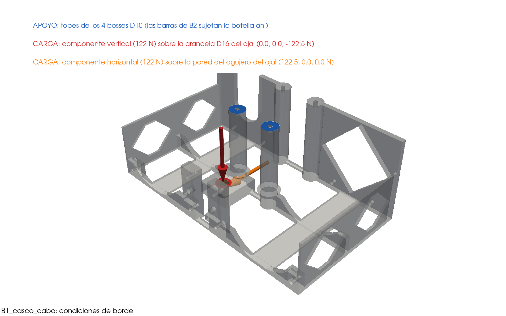
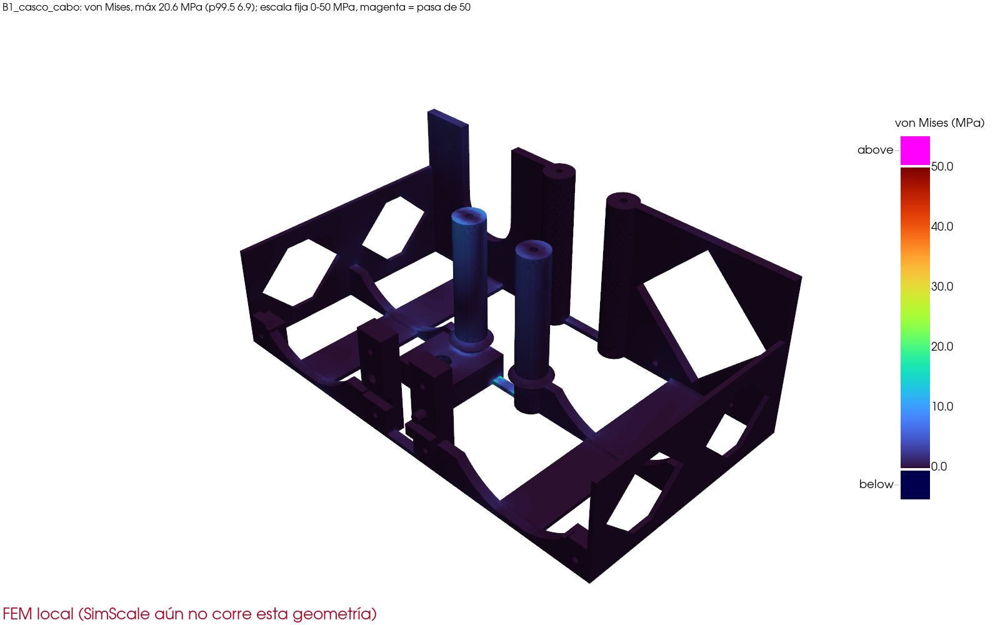
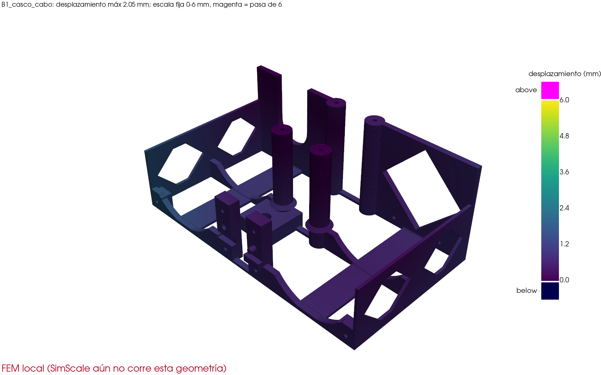
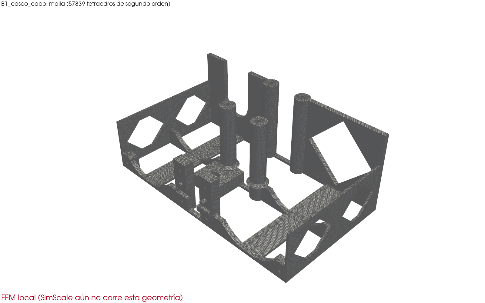

# LanternGuard: simulación con SimScale (cálculo por API)

Fecha: 05/11/2026. Este documento se explica solo: no hace falta abrir el repositorio.

## Qué se hizo

Se calculó cuánto se deforma y cuánto esfuerzo soporta cada pieza impresa del nodo sumergido (grupo A) y de la boya (grupo B) bajo las cargas de uso, con el programa
SimScale (plan gratuito, por su API) y, cuando SimScale no entrega el resultado o todavía no corrió la geometría actual, con CalculiX en la computadora **con el mismo caso**
(mismas caras, mismas fuerzas, mismo material). Son dos proyectos separados: **«LanternGuard nodo sumergido»** y **«LanternGuard boya»**. Todo lo hace `cad_final/simscale_run.py`
(`python simscale_run.py --pieza NOMBRE`; el informe con `--informe`) y `cad_final/resultados_bloque3.py` (imágenes y `docs/resultados/resultados.json`).

- **Material (PETG):** E = 2.1 GPa, ν = 0.38, densidad 1270 kg/m³. Esfuerzo admisible 50 MPa en el plano de las capas (el cálculo local de la versión simple usaba 45) y 22 MPa **entre capas**.
- **FS = 50 / σ máxima** (cuántas veces cabe la carga hasta el límite). **FS entre capas = 22 / σ p99.5.** σ p99.5 es el esfuerzo sin el 0.5 % de puntos más altos: los picos
  en el borde de un apoyo o de un agujero cargado son un efecto del modelo («pellizca» la pieza), por eso la regla del proyecto juzga con el p99.5. «Cumple» = FS ≥ 1 con p99.5 en ambos sentidos.
- **Fuente de cada resultado:** «SimScale» solo si la corrida existe, se pudo descargar y corrió **la geometría actual**; si no, «FEM local». Local y SimScale coinciden en las piezas
  que tienen los dos (desplazamientos en torno al 3 %).
- **Escalas de color fijas** en todas las imágenes (esfuerzo 0 a 50 MPa; desplazamiento 0 a 6 mm), para poder comparar piezas a simple vista.
- **La flotación y la estabilidad de la boya NO son de este cálculo:** son analíticas y están en `docs/BOYA.md`. El diagrama de cargas del conjunto está en `docs/CARGAS_CONJUNTO.pdf`.

## Resultados

| Pieza | Caso | Fuente | σ máx. (MPa) | FS = 50/σ máx. | σ p99.5 (MPa) | FS entre capas (22/σ p99.5) | Desplaz. (mm) | Local: σ máx. / desplaz. | SimScale: σ máx. / desplaz. | Veredicto | Enlace |
|---|---|---|---|---|---|---|---|---|---|---|---|
| M3s_riel_gancho | Riel con gancho colgado del anillo: capsula con 150 N hacia abajo + corriente de 1.5 m/s | **FEM local** | 16.9 | 2.96 | 6.4 | 3.44 | 1.47 | 16.9 / 1.47 | no hay | **cumple** | [abrir](https://www.simscale.com/workbench/?pid=770997415227428031&mi=spec:288d6bda-8d82-402b-a6f2-7d2cccd2a913%2Cservice:SIMULATION%2Cstrategy:1) |
| M5s_capsula_tapa_pie | Tapa de capsula con pie: silla fija, 150 N + corriente en el frente de la capsula | **FEM local** | 17.0 | 2.95 | 6.6 | 3.35 | 0.30 | 17.0 / 0.30 | no hay | **cumple** | [abrir](https://www.simscale.com/workbench/?pid=770997415227428031&mi=spec:1e5436ec-c92b-43e7-8438-86a9eb22d7b4%2Cservice:SIMULATION%2Cstrategy:1) |
| M1s_caja_cuerpo | Caja: colgada de los insertos M3 de la tapa, el riel con la capsula tira del cojin +X (150 N + corriente) | **FEM local** | 18.9 | 2.65 | 5.8 | 3.77 | 0.31 | 18.9 / 0.31 | no hay | **cumple** | [abrir](https://www.simscale.com/workbench/?pid=770997415227428031&mi=spec:6936e052-5dc1-4552-aa16-9e394ce3c29e%2Cservice:SIMULATION%2Cstrategy:1) |
| B3_caja | Caja seca: peso de la electronica y de la tapa + golpe de ola de 200 N de costado | **FEM local** | 12.3 | 4.07 | 5.5 | 3.96 | 0.99 | 12.3 / 0.99 | no hay | **cumple** | [abrir](https://www.simscale.com/workbench/?pid=5890288887472164333&mi=spec:49ee5788-0087-4653-8c60-84a48bf61ff1%2Cservice:SIMULATION%2Cstrategy:1) |
| B2_cubierta_lisa | Media cubierta: peso de la caja y del panel + golpe de ola de 200 N vertical sobre las barras | **FEM local** | 10.2 | 4.89 | 4.5 | 4.89 | 1.25 | 10.2 / 1.25 | no hay | **cumple** | [abrir](https://www.simscale.com/workbench/?pid=5890288887472164333&mi=spec:c3704cf9-d345-48d5-bd74-23e0498e84b0%2Cservice:SIMULATION%2Cstrategy:1) |
| B2_cubierta_mastil | Media cubierta: peso de la caja y del panel + golpe de ola de 200 N vertical sobre las barras | **FEM local** | 10.8 | 4.61 | 4.6 | 4.79 | 1.29 | 10.8 / 1.29 | no hay | **cumple** | [abrir](https://www.simscale.com/workbench/?pid=5890288887472164333&mi=spec:cad9c74c-c3b0-4a84-91f6-677d0dafeb04%2Cservice:SIMULATION%2Cstrategy:1) |
| B2_cubierta_lisa_lateral | Media cubierta: peso de la caja y del panel + golpe de ola de 200 N lateral sobre el panel | **FEM local** | 15.4 | 3.25 | 6.4 | 3.42 | 2.44 | 15.4 / 2.44 | no hay | **cumple** | [abrir](https://www.simscale.com/workbench/?pid=5890288887472164333&mi=spec:fd4db8a5-6f03-495c-864d-0ca180edebbe%2Cservice:SIMULATION%2Cstrategy:1) |
| B2_cubierta_mastil_lateral | Media cubierta: peso de la caja y del panel + golpe de ola de 200 N lateral sobre el panel | **FEM local** | 15.8 | 3.16 | 6.3 | 3.47 | 2.44 | 15.8 / 2.44 | no hay | **cumple** | [abrir](https://www.simscale.com/workbench/?pid=5890288887472164333&mi=spec:20e49dc4-4483-4d80-a2eb-1d7f35f411d9%2Cservice:SIMULATION%2Cstrategy:1) |
| B1_casco_cabo | Casco B1 (mitad): tiron de 300 N repartido en 2 ramales: 173 N en el ojal de esta mitad, a 45 grados | **FEM local** | 20.6 | 2.42 | 6.9 | 3.20 | 2.05 | 20.6 / 2.05 | no hay | **cumple** | [abrir](https://www.simscale.com/workbench/?pid=5890288887472164333) |

Lectura: «cumple» = FS ≥ 1 con σ máx. y con σ p99.5 en los dos sentidos; «cumple sin picos» = pasa con p99.5 pero el pico puntual supera 50 MPa (criterio propio, no normativo).
Los enlaces abren la simulación en SimScale (proyecto público del plan gratuito).

## Cargas y apoyos (supuestos, en lenguaje simple)

- **Nodo sumergido (A):** 150 N hacia abajo en el frente de la cápsula (manipulación), más la corriente de 1.5 m/s: presión 0.5 · 1025 · 1.5² = 1153 Pa sobre el frente
  de la cápsula (área de su sección, Cd = 1), convertida en una fuerza en −X en el mismo punto, porque estas piezas no incluyen el cuerpo de la cápsula.
- **Ajuste obligado:** la API de SimScale no deja asignar el punto de una «fuerza remota» («There is no Point assigned»). En su lugar, los 150 N se reparten en una fuerza
  por cada agujero de unión con la misma fuerza total y el mismo momento que daría el cuerpo rígido (reparto de mínima norma). El cálculo local usa **ese mismo reparto**.
- **Caja del nodo (M1s):** caso propio: la caja cuelga de los agujeros M3 de la brida de la tapa (como al izar por el asa) y el riel con la cápsula tira de los 4 M4 del cojín +X.
- **Boya (B):** peso de la electrónica y del panel solar (350 g), de la tapa y de la antena, más un golpe de ola de 200 N. En la caja, los 200 N empujan de lado una pared larga.
  En cada media cubierta hay dos casos: golpe vertical de 200 N sobre las barras, y golpe lateral de 200 N sobre el panel (que baja por sus columnas). Cada mitad recibe los 200 N enteros (exagerado a propósito).
- **Apoyos de la boya:** la caja va atornillada por sus 4 orejas a los pilares de la cubierta (se fija la huella de Ø10 de cada pilar); cada media cubierta, a los 4 postes del casco (huella de Ø10 de cada poste).
- **Cómo se eligieron las caras:** cada cara del STEP se «bautiza» (LGF0000, LGF0001…) y SimScale conserva ese nombre; los apoyos y cargas se escogen por posición y orientación y se comprueba conteo y área.
  Las cargas del cálculo local se reparten de forma consistente sobre los triángulos de esas mismas caras.

### Corrección del mismo día: cubierta de la boya con barras de 8 mm

Con barras de 4 mm la cubierta no aguantaba la ola (tabla de arriba). Por eso **las barras de B2 pasaron de 4 a 8 mm** (`boya_pet.cubierta_espesor`). La boya sigue estable: calado 41,6 mm, francobordo 83,9 mm, GM 101/710 mm, 1014 g impresos.

La simulación con la cubierta nueva **corrió en SimScale** (proyecto B), pero el plan gratuito no dejó descargar el resultado: devolvió el error 403 «export-source-locked». Por eso se verificó en la computadora con CalculiX, usando el mismo golpe de 200 N sobre las barras y la cubierta sujeta en sus agujeros M3. Antes se comprobó que el cálculo local da lo mismo que SimScale con la cubierta vieja:

| Media cubierta | Barras | σ p99.5 (MPa) | FS = 50/σ p99.5 | σ pico (MPa) | Flecha (mm) | Fuente |
|---|---|---|---|---|---|---|
| B2 lisa | 4 mm | 58,6 | 0,85 | 120 | 35,5 | local (SimScale: 58,6 y 34,5: coincide) |
| B2 lisa | **8 mm** | **16,4** | **3,0** | 38,7 | **5,2** | local |
| B2 mástil | **8 mm** | **16,3** | **3,1** | 34,1 | **5,3** | local |

La cubierta de 8 mm **cumple** el golpe vertical de 200 N con FS 3 (sin contar los picos de los bordes de los agujeros), aunque cada mitad recibe los 200 N enteros, lo que es exagerado. Queda pendiente el golpe **lateral** sobre el panel solar, que hace de vela: lo resisten las 4 columnas Ø12 del panel, no las barras. Ver `docs/PENDIENTES.md`.

**Cómo leer «σ máx.» y «σ p99.5».** «σ máx.» es el valor de un solo punto de la malla, en el borde de un agujero o en el lugar donde se aplica la carga. Ese pico sale de cómo se modela, no de la pieza. Por eso el cálculo local usa el percentil 99,5, que ignora el 0,5 % de puntos más altos. Con ese criterio, el riel da FS 11, el pie de la cápsula FS 6,8 y la caja M1s FS 6,5 frente a 50 MPa. Además, el cálculo local verifica la resistencia **entre capas**, que es la mitad: 22 MPa. Ahí el riel da FS 3,2 y el pie FS 3,8.

## Piezas

### M3s_riel_gancho

Riel con gancho colgado del anillo: capsula con 150 N hacia abajo + corriente de 1.5 m/s.

- Corriente de 1.5 m/s: presion dinamica 0.5*1025*1.5^2 = 1153 Pa sobre el frente de la capsula (area 18.1 cm2, Cd = 1) = 2.09 N, en -X (la corriente empuja la capsula hacia atras), aplicada en el frente.

**Caras elegidas (verificadas por conteo y área):**

- Apoyo fijo: asiento de la C del gancho (colgado del anillo) → 3 caras, 392.0 mm²
- Carga: 150 N + arrastre en el frente de la capsula, por un cuerpo rigido a la silla → 4 caras, 256.4 mm², fuerza [-2.087, 0, -150.0] N

**Resultado (FEM local):** σ máxima 16.90 MPa (FS 2.96); σ sin el 0.5 % de picos 6.40 MPa (FS 7.81 en el plano de las capas con 50 MPa; FS **entre capas** 3.44 con 22 MPa); desplazamiento máximo 1.47 mm; malla de 40355 elementos. Motivo: la corrida existe pero SimScale no devolvió el resultado (403 export-source-locked).

[Proyecto en SimScale](https://www.simscale.com/workbench/?pid=770997415227428031) · [Simulación](https://www.simscale.com/workbench/?pid=770997415227428031&mi=spec:288d6bda-8d82-402b-a6f2-7d2cccd2a913%2Cservice:SIMULATION%2Cstrategy:1) · [Resultado](https://www.simscale.com/workbench/?pid=770997415227428031&mi=spec:288d6bda-8d82-402b-a6f2-7d2cccd2a913%2Cservice:SIMULATION%2Cstrategy:1)

Escalas fijas en todas las imágenes: esfuerzo 0 a 50 MPa y desplazamiento 0 a 6 mm (magenta = pasa del tope).

### M5s_capsula_tapa_pie

Tapa de capsula con pie: silla fija, 150 N + corriente en el frente de la capsula.

- Corriente de 1.5 m/s: presion dinamica 0.5*1025*1.5^2 = 1153 Pa sobre el frente de la capsula (area 18.1 cm2, Cd = 1) = 2.09 N, en -X (la corriente empuja la capsula hacia atras), aplicada en el frente.

**Caras elegidas (verificadas por conteo y área):**

- Apoyo fijo: agujeros de la silla (insertos M3 de la tapa del pie) → 4 caras, 301.6 mm²
- Carga: 150 N + arrastre en el frente, por un cuerpo rigido a los 4 M3 de la tapa → 8 caras, 407.2 mm², fuerza [-2.087, 0, -150.0] N

**Resultado (FEM local):** σ máxima 16.96 MPa (FS 2.95); σ sin el 0.5 % de picos 6.58 MPa (FS 7.60 en el plano de las capas con 50 MPa; FS **entre capas** 3.35 con 22 MPa); desplazamiento máximo 0.30 mm; malla de 20901 elementos. Motivo: la corrida existe pero SimScale no devolvió el resultado (403 export-source-locked).

[Proyecto en SimScale](https://www.simscale.com/workbench/?pid=770997415227428031) · [Simulación](https://www.simscale.com/workbench/?pid=770997415227428031&mi=spec:1e5436ec-c92b-43e7-8438-86a9eb22d7b4%2Cservice:SIMULATION%2Cstrategy:1) · [Resultado](https://www.simscale.com/workbench/?pid=770997415227428031&mi=spec:1e5436ec-c92b-43e7-8438-86a9eb22d7b4%2Cservice:SIMULATION%2Cstrategy:1)

Escalas fijas en todas las imágenes: esfuerzo 0 a 50 MPa y desplazamiento 0 a 6 mm (magenta = pasa del tope).

### M1s_caja_cuerpo

Caja: colgada de los insertos M3 de la tapa, el riel con la capsula tira del cojin +X (150 N + corriente).

- Corriente de 1.5 m/s: presion dinamica 0.5*1025*1.5^2 = 1153 Pa sobre el frente de la capsula (area 18.1 cm2, Cd = 1) = 2.09 N, en -X (la corriente empuja la capsula hacia atras), aplicada en el frente.
- Caso propio (el FEM local no tiene la caja): la caja cuelga de la tapa como al izar por el asa; los insertos M3 de la tapa se toman como apoyos fijos y el riel con la capsula tira de los 4 M4 del cojin.

**Caras elegidas (verificadas por conteo y área):**

- Apoyo fijo: agujeros M3 de la brida de la tapa (16) → 16 caras, 1206.4 mm²
- Carga: 150 N + arrastre en el frente de la capsula, por un cuerpo rigido a los 4 M4 del cojin +X → 4 caras, 448.1 mm², fuerza [-2.087, 0, -150.0] N

**Resultado (FEM local):** σ máxima 18.88 MPa (FS 2.65); σ sin el 0.5 % de picos 5.84 MPa (FS 8.56 en el plano de las capas con 50 MPa; FS **entre capas** 3.77 con 22 MPa); desplazamiento máximo 0.31 mm; malla de 91578 elementos. Motivo: la corrida existe pero SimScale no devolvió el resultado (403 export-source-locked).

[Proyecto en SimScale](https://www.simscale.com/workbench/?pid=770997415227428031) · [Simulación](https://www.simscale.com/workbench/?pid=770997415227428031&mi=spec:6936e052-5dc1-4552-aa16-9e394ce3c29e%2Cservice:SIMULATION%2Cstrategy:1) · [Resultado](https://www.simscale.com/workbench/?pid=770997415227428031&mi=spec:6936e052-5dc1-4552-aa16-9e394ce3c29e%2Cservice:SIMULATION%2Cstrategy:1)

Escalas fijas en todas las imágenes: esfuerzo 0 a 50 MPa y desplazamiento 0 a 6 mm (magenta = pasa del tope).

### B3_caja

Caja seca: peso de la electronica y de la tapa + golpe de ola de 200 N de costado.

- Electronica 354 g (parametros del modelo, sin panel ni antena) y tapa 57.2 g, 1 g de gravedad.
- La ola de 200 N se aplica entera contra una pared larga: caso exagerado (la caja va bajo el panel).

**Caras elegidas (verificadas por conteo y área):**

- Apoyo fijo: 4 orejas: huella de los pilares D10 bajo la oreja (atornilladas) → 4 caras, 277.8 mm²
- Carga: peso de la electronica sobre el piso → 1 caras, 9121.6 mm², fuerza [0, 0, -3.473] N
- Carga: peso de la tapa B4 sobre el borde → 1 caras, 6101.9 mm², fuerza [0, 0, -0.561] N
- Carga: golpe de ola 200 N contra la pared +Y → 1 caras, 1167.6 mm², fuerza [0, 200.0, 0] N

**Resultado (FEM local):** σ máxima 12.30 MPa (FS 4.07); σ sin el 0.5 % de picos 5.55 MPa (FS 9.01 en el plano de las capas con 50 MPa; FS **entre capas** 3.96 con 22 MPa); desplazamiento máximo 0.99 mm; malla de 57043 elementos. Motivo: la corrida existe pero SimScale no devolvió el resultado (403 export-source-locked).

[Proyecto en SimScale](https://www.simscale.com/workbench/?pid=5890288887472164333) · [Simulación](https://www.simscale.com/workbench/?pid=5890288887472164333&mi=spec:49ee5788-0087-4653-8c60-84a48bf61ff1%2Cservice:SIMULATION%2Cstrategy:1) · [Resultado](https://www.simscale.com/workbench/?pid=5890288887472164333&mi=spec:49ee5788-0087-4653-8c60-84a48bf61ff1%2Cservice:SIMULATION%2Cstrategy:1)

Escalas fijas en todas las imágenes: esfuerzo 0 a 50 MPa y desplazamiento 0 a 6 mm (magenta = pasa del tope).

### B2_cubierta_lisa

Media cubierta: peso de la caja y del panel + golpe de ola de 200 N vertical sobre las barras.

- Caja completa 582 g repartida en 4 pilares (cada mitad carga 2); panel 350.0 g en 4 columnas (cada mitad carga 2).
- Golpe de ola vertical: 200 N hacia abajo sobre la cara de arriba de las barras de esa mitad (cada mitad recibe los 200 N enteros: exagerado, en la boya completa se reparten).

**Caras elegidas (verificadas por conteo y área):**

- Apoyo fijo: huella de los 4 bosses D10 del casco bajo los agujeros M3 → 4 caras, 269.7 mm²
- Carga: peso de la caja (1/4 por pilar) → 2 caras, 131.9 mm², fuerza [0, 0, -2.856] N
- Carga: peso del panel (1/4 por columna) → 2 caras, 201.1 mm², fuerza [0, 0, -1.717] N
- Carga: golpe de ola vertical de 200 N sobre las barras → 5 caras, 10722.5 mm², fuerza [0, 0, -200.0] N

**Resultado (FEM local):** σ máxima 10.21 MPa (FS 4.89); σ sin el 0.5 % de picos 4.50 MPa (FS 11.12 en el plano de las capas con 50 MPa; FS **entre capas** 4.89 con 22 MPa); desplazamiento máximo 1.25 mm; malla de 68213 elementos. Motivo: la corrida existe pero SimScale no devolvió el resultado (403 export-source-locked).

[Proyecto en SimScale](https://www.simscale.com/workbench/?pid=5890288887472164333) · [Simulación](https://www.simscale.com/workbench/?pid=5890288887472164333&mi=spec:c3704cf9-d345-48d5-bd74-23e0498e84b0%2Cservice:SIMULATION%2Cstrategy:1) · [Resultado](https://www.simscale.com/workbench/?pid=5890288887472164333&mi=spec:c3704cf9-d345-48d5-bd74-23e0498e84b0%2Cservice:SIMULATION%2Cstrategy:1)

Escalas fijas en todas las imágenes: esfuerzo 0 a 50 MPa y desplazamiento 0 a 6 mm (magenta = pasa del tope).

### B2_cubierta_mastil

Media cubierta: peso de la caja y del panel + golpe de ola de 200 N vertical sobre las barras.

- Caja completa 582 g repartida en 4 pilares (cada mitad carga 2); panel 350.0 g en 4 columnas (cada mitad carga 2).
- Golpe de ola vertical: 200 N hacia abajo sobre la cara de arriba de las barras de esa mitad (cada mitad recibe los 200 N enteros: exagerado, en la boya completa se reparten).

**Caras elegidas (verificadas por conteo y área):**

- Apoyo fijo: huella de los 4 bosses D10 del casco bajo los agujeros M3 → 4 caras, 269.7 mm²
- Carga: peso de la caja (1/4 por pilar) → 2 caras, 131.9 mm², fuerza [0, 0, -2.856] N
- Carga: peso del panel (1/4 por columna) → 2 caras, 201.1 mm², fuerza [0, 0, -1.717] N
- Carga: antena → 1 caras, 204.2 mm², fuerza [0, 0, -0.196] N
- Carga: golpe de ola vertical de 200 N sobre las barras → 6 caras, 10382.2 mm², fuerza [0, 0, -200.0] N

**Resultado (FEM local):** σ máxima 10.85 MPa (FS 4.61); σ sin el 0.5 % de picos 4.60 MPa (FS 10.88 en el plano de las capas con 50 MPa; FS **entre capas** 4.79 con 22 MPa); desplazamiento máximo 1.29 mm; malla de 73037 elementos. Motivo: la corrida existe pero SimScale no devolvió el resultado (403 export-source-locked).

[Proyecto en SimScale](https://www.simscale.com/workbench/?pid=5890288887472164333) · [Simulación](https://www.simscale.com/workbench/?pid=5890288887472164333&mi=spec:cad9c74c-c3b0-4a84-91f6-677d0dafeb04%2Cservice:SIMULATION%2Cstrategy:1) · [Resultado](https://www.simscale.com/workbench/?pid=5890288887472164333&mi=spec:cad9c74c-c3b0-4a84-91f6-677d0dafeb04%2Cservice:SIMULATION%2Cstrategy:1)

Escalas fijas en todas las imágenes: esfuerzo 0 a 50 MPa y desplazamiento 0 a 6 mm (magenta = pasa del tope).

### B2_cubierta_lisa_lateral

Media cubierta: peso de la caja y del panel + golpe de ola de 200 N lateral sobre el panel.

- Caja completa 582 g repartida en 4 pilares (cada mitad carga 2); panel 350.0 g en 4 columnas (cada mitad carga 2).
- Variante lateral: la ola de 200 N golpea el panel (hace de vela) y baja por sus columnas; cada media cubierta recibe los 200 N enteros en sus 2 columnas (exagerado: en la boya completa se reparten entre las dos mitades).

**Caras elegidas (verificadas por conteo y área):**

- Apoyo fijo: huella de los 4 bosses D10 del casco bajo los agujeros M3 → 4 caras, 269.7 mm²
- Carga: peso de la caja (1/4 por pilar) → 2 caras, 131.9 mm², fuerza [0, 0, -2.856] N
- Carga: peso del panel + golpe de ola 200 N (en +Y) sobre las columnas → 2 caras, 201.1 mm², fuerza [0, 200.0, -1.717] N

**Resultado (FEM local):** σ máxima 15.41 MPa (FS 3.25); σ sin el 0.5 % de picos 6.43 MPa (FS 7.77 en el plano de las capas con 50 MPa; FS **entre capas** 3.42 con 22 MPa); desplazamiento máximo 2.44 mm; malla de 68213 elementos. Motivo: la corrida existe pero SimScale no devolvió el resultado (403 export-source-locked).

[Proyecto en SimScale](https://www.simscale.com/workbench/?pid=5890288887472164333) · [Simulación](https://www.simscale.com/workbench/?pid=5890288887472164333&mi=spec:fd4db8a5-6f03-495c-864d-0ca180edebbe%2Cservice:SIMULATION%2Cstrategy:1) · [Resultado](https://www.simscale.com/workbench/?pid=5890288887472164333&mi=spec:fd4db8a5-6f03-495c-864d-0ca180edebbe%2Cservice:SIMULATION%2Cstrategy:1)

Escalas fijas en todas las imágenes: esfuerzo 0 a 50 MPa y desplazamiento 0 a 6 mm (magenta = pasa del tope).

### B2_cubierta_mastil_lateral

Media cubierta: peso de la caja y del panel + golpe de ola de 200 N lateral sobre el panel.

- Caja completa 582 g repartida en 4 pilares (cada mitad carga 2); panel 350.0 g en 4 columnas (cada mitad carga 2).
- Variante lateral: la ola de 200 N golpea el panel (hace de vela) y baja por sus columnas; cada media cubierta recibe los 200 N enteros en sus 2 columnas (exagerado: en la boya completa se reparten entre las dos mitades).

**Caras elegidas (verificadas por conteo y área):**

- Apoyo fijo: huella de los 4 bosses D10 del casco bajo los agujeros M3 → 4 caras, 269.7 mm²
- Carga: peso de la caja (1/4 por pilar) → 2 caras, 131.9 mm², fuerza [0, 0, -2.856] N
- Carga: peso del panel + golpe de ola 200 N (en +Y) sobre las columnas → 2 caras, 201.1 mm², fuerza [0, 200.0, -1.717] N
- Carga: antena → 1 caras, 204.2 mm², fuerza [0, 0, -0.196] N

**Resultado (FEM local):** σ máxima 15.84 MPa (FS 3.16); σ sin el 0.5 % de picos 6.33 MPa (FS 7.90 en el plano de las capas con 50 MPa; FS **entre capas** 3.47 con 22 MPa); desplazamiento máximo 2.44 mm; malla de 73037 elementos. Motivo: la corrida existe pero SimScale no devolvió el resultado (403 export-source-locked).

[Proyecto en SimScale](https://www.simscale.com/workbench/?pid=5890288887472164333) · [Simulación](https://www.simscale.com/workbench/?pid=5890288887472164333&mi=spec:20e49dc4-4483-4d80-a2eb-1d7f35f411d9%2Cservice:SIMULATION%2Cstrategy:1) · [Resultado](https://www.simscale.com/workbench/?pid=5890288887472164333&mi=spec:20e49dc4-4483-4d80-a2eb-1d7f35f411d9%2Cservice:SIMULATION%2Cstrategy:1)

Escalas fijas en todas las imágenes: esfuerzo 0 a 50 MPa y desplazamiento 0 a 6 mm (magenta = pasa del tope).

### B1_casco_cabo

Casco B1 (mitad): tiron de 300 N repartido en 2 ramales: 173 N en el ojal de esta mitad, a 45 grados.

- Pata de gallo a 60 grados entre ramales: cada ramal lleva 300 / (2 cos 30) = 173 N (122 N vertical + 122 N horizontal a 45 grados). El casco cuelga de las botellas por las barras de B2 atornilladas a los 4 bosses de esta mitad; el empuje de las botellas es la reaccion.

**Caras elegidas (verificadas por conteo y área):**

**Resultado (FEM local):** σ máxima 20.63 MPa (FS 2.42); σ sin el 0.5 % de picos 6.88 MPa (FS 7.26 en el plano de las capas con 50 MPa; FS **entre capas** 3.20 con 22 MPa); desplazamiento máximo 2.05 mm; malla de 57839 elementos. Motivo: sin corrida en SimScale.

[Proyecto en SimScale](https://www.simscale.com/workbench/?pid=5890288887472164333) · [Simulación](https://www.simscale.com/workbench/?pid=5890288887472164333) · [Resultado](https://www.simscale.com/workbench/?pid=5890288887472164333)

Escalas fijas en todas las imágenes: esfuerzo 0 a 50 MPa y desplazamiento 0 a 6 mm (magenta = pasa del tope).

## Qué dicen los resultados

- **M3s_riel_gancho** (FEM local): FS 2.96 (pico), 7.8 sin picos, 3.44 entre capas, 1.47 mm.
- **M5s_capsula_tapa_pie** (FEM local): FS 2.95 (pico), 7.6 sin picos, 3.35 entre capas, 0.30 mm.
- **M1s_caja_cuerpo** (FEM local): FS 2.65 (pico), 8.6 sin picos, 3.77 entre capas, 0.31 mm.
- **B3_caja** (FEM local): FS 4.07 (pico), 9.0 sin picos, 3.96 entre capas, 0.99 mm.
- **B2_cubierta_lisa** (FEM local): FS 4.89 (pico), 11.1 sin picos, 4.89 entre capas, 1.25 mm.
- **B2_cubierta_mastil** (FEM local): FS 4.61 (pico), 10.9 sin picos, 4.79 entre capas, 1.29 mm.
- **B2_cubierta_lisa_lateral** (FEM local): FS 3.25 (pico), 7.8 sin picos, 3.42 entre capas, 2.44 mm.
- **B2_cubierta_mastil_lateral** (FEM local): FS 3.16 (pico), 7.9 sin picos, 3.47 entre capas, 2.44 mm.
- **B1_casco_cabo** (FEM local): FS 2.42 (pico), 7.3 sin picos, 3.20 entre capas, 2.05 mm.
- **Golpe lateral de 200 N sobre el panel: cumple (05/11, diseño para mar).** Panel a 15 mm, columnas Ø14 con chaflán, 4 tirantes y barras altas en las líneas de tornillos. σ sin picos 6.3 MPa (FS 7.90 en el plano, 3.47 entre capas), desplazamiento 2.4 mm, con los 200 N enteros en una sola mitad.

## Límites y avisos

- Las 8 corridas de SimScale de la tanda final (geometría del 04/11, 21:38 boya y 21:57 nodo) terminaron bien, pero el plan gratuito devolvió 403 «export-source-locked» al descargar cada resultado; por eso todas las piezas salen con FEM local (el enlace abre la simulación en SimScale).
  No se usaron capturas del visor web de SimScale: la clave de la API no inicia sesión en la página y no hay una sesión abierta.
- El enlace de cada proyecto es el que usa el sitio para proyectos compartidos (`workbench/?pid=...`). El plan gratuito deja los proyectos públicos (contienen solo geometría y resultados de estas piezas);
  desde el script no se puede comprobar el acceso sin iniciar sesión, conviene abrirlo una vez en una ventana privada.
- No se simuló estanqueidad, fatiga ni el efecto de las capas de impresión (material isótropo; las capas solo entran en el FS entre capas). Los STEP son los de `salida/prototipos/P2_robusto/step` y `salida/boya_pet/step` del momento de la corrida.
- El FEM local usa el máximo por elemento (puntos de integración) y no el valor nodal de SimScale; el p99.5 de los dos es comparable, el máximo puntual puede diferir.
- Los resultados dependen de las cargas supuestas arriba: si el equipo fija otras (por ejemplo la ola real), se corre de nuevo con el script.
