# LanternGuard: simulación con SimScale (cálculo por API)

Fecha: 04/11/2026. Este documento se explica solo: no hace falta abrir el repositorio.

## Qué se hizo

Se calculó, con el programa SimScale (plan gratuito, por su API), cuánto se deforma y cuánto esfuerzo soporta cada pieza impresa del nodo
sumergido (grupo A) y de la boya (grupo B) bajo las cargas de uso. Son dos proyectos separados, como el que armó María: **«LanternGuard nodo sumergido»** y
**«LanternGuard boya»**. Todo lo hace el script `cad_final/simscale_run.py` (se repite con `python simscale_run.py --pieza NOMBRE`).

- **Material (PETG):** rigidez E = 2.1 GPa, ν = 0.38, densidad 1270 kg/m³. Esfuerzo admisible 50 MPa. **FS = 50 / σ máxima** (cuántas veces cabe la carga hasta el límite).
  El cálculo local anterior (CalculiX) usó E = 1.7 GPa y límite 45 MPa: el esfuerzo casi no cambia con E, el desplazamiento sí (unas 0.81 veces el local).
- **Malla:** automática de SimScale, segundo orden (tetraedros que se curvan: más exactos), finura 5 de 10.
- **Qué es «σ máx.»:** el valor más alto de von Mises (esfuerzo equivalente) en cualquier punto. Casi siempre cae en el borde de un apoyo o de un agujero cargado,
  donde el modelo «pellizca» la pieza: es un pico del cálculo más que de la realidad. Por eso también se da la σ sin el 0.5 % de picos (percentil 99.5), la que usa el cálculo local.
- **La flotación y la estabilidad de la boya NO son de este cálculo:** son analíticas y están en `docs/BOYA.md`. Esto solo revisa si las piezas resisten.

## Resultados

| Pieza | Caso | σ máx. (MPa) | FS = 50/σ máx. | σ p99.5 (MPa) | Desplaz. máx. (mm) | Cálculo local (CalculiX) | Enlace |
|---|---|---|---|---|---|---|---|
| M3s_riel_gancho | Riel con gancho colgado del anillo: capsula con 150 N hacia abajo + corriente de 1.5 m/s | 15.6 | 3.20 (cumple) | 4.4 | 1.53 | σ p99.5 6.9 MPa (máx. 20.8), desplaz. 1.91 mm | [ver resultado](https://www.simscale.com/workbench/?pid=770997415227428031&rru=40540ee4-cc22-408f-85b0-624c8b916226&ci=eb506738-a210-4cff-89a3-5b1f52367445&ct=SOLUTION_FIELD&mt=SIMULATION_RESULT) |
| M5s_capsula_tapa_pie | Tapa de capsula con pie: silla fija, 150 N + corriente en el frente de la capsula | 20.1 | 2.48 (cumple) | 7.3 | 0.29 | σ p99.5 5.8 MPa (máx. 12.7), desplaz. 0.17 mm | [ver resultado](https://www.simscale.com/workbench/?pid=770997415227428031&rru=a4db17dd-ab0e-41c7-8789-b46fe337f847&ci=69c84c14-9979-468c-9470-72fca2815f8f&ct=SOLUTION_FIELD&mt=SIMULATION_RESULT) |
| M1s_caja_cuerpo | Caja: colgada de los insertos M3 de la tapa, el riel con la capsula tira del cojin +X (150 N + corriente) | 25.4 | 1.97 (justo) | 7.7 | 0.45 | no hay (caso nuevo) | [ver resultado](https://www.simscale.com/workbench/?pid=770997415227428031&rru=327c9ab5-fd76-4ffc-9e8c-c2cd587eb1dc&ci=0a90a786-26b6-42c4-98ff-84672028d3a8&ct=SOLUTION_FIELD&mt=SIMULATION_RESULT) |
| B3_caja | Caja seca: peso de la electronica y de la tapa + golpe de ola de 200 N de costado | 16.2 | 3.09 (cumple) | 6.3 | 1.02 | no hay (caso nuevo) | [ver resultado](https://www.simscale.com/workbench/?pid=5890288887472164333&rru=683da982-b91d-410a-acdb-a3a4a78bdc26&ci=4062f2d9-9bf0-4f5d-aa56-bb3acb7bea23&ct=SOLUTION_FIELD&mt=SIMULATION_RESULT) |
| B2_cubierta_lisa | Media cubierta: peso de la caja y del panel + golpe de ola de 200 N vertical sobre las barras | 123.2 | 0.41 (NO cumple) | 58.6 | 34.48 | no hay (caso nuevo) | [ver resultado](https://www.simscale.com/workbench/?pid=5890288887472164333&rru=b56c2df0-44e6-44ca-b5d5-336ee1cf8efa&ci=6a606a5f-216e-4317-8852-e3efdc008c8e&ct=SOLUTION_FIELD&mt=SIMULATION_RESULT) |
| B2_cubierta_mastil | Media cubierta: peso de la caja y del panel + golpe de ola de 200 N vertical sobre las barras | 127.7 | 0.39 (NO cumple) | 58.3 | 34.97 | no hay (caso nuevo) | [ver resultado](https://www.simscale.com/workbench/?pid=5890288887472164333&rru=86f208f4-dda5-4ad4-a871-f73567420635&ci=8dc3f9aa-f4f9-4af5-8805-1ffd1bc2f19d&ct=SOLUTION_FIELD&mt=SIMULATION_RESULT) |
| B2_cubierta_lisa_lateral | Media cubierta: peso de la caja y del panel + golpe de ola de 200 N lateral sobre el panel | 333.0 | 0.15 (NO cumple) | 190.8 | 173.66 | no hay (caso nuevo) | [ver resultado](https://www.simscale.com/workbench/?pid=5890288887472164333&rru=62868e1f-ad1c-4b00-b03c-517a9634fac4&ci=f1805b6e-bfb6-4645-99c7-fff6f5c7bd6b&ct=SOLUTION_FIELD&mt=SIMULATION_RESULT) |

Lectura: FS ≥ 2 «cumple»; entre 1 y 2 «justo»; menor que 1 «NO cumple» (criterio propio, no normativo). Los enlaces abren el resultado en SimScale
(proyecto público del plan gratuito; el resumen de cada proyecto está en «Piezas»).

### Corrección del mismo día: cubierta de la boya con barras de 8 mm

Con barras de 4 mm la cubierta no aguantaba la ola (tabla de arriba). Por eso **las barras de B2 pasaron de 4 a 8 mm** (`boya_pet.cubierta_espesor`). La boya sigue estable: calado 41,6 mm, francobordo 83,9 mm, GM 101/710 mm, 1014 g impresos.

La simulación con la cubierta nueva **corrió en SimScale** (proyecto B), pero el plan gratuito no dejó descargar el resultado: devolvió el error 403 «export-source-locked». Por eso se verificó en la computadora con CalculiX, usando el mismo golpe de 200 N sobre las barras y la cubierta sujeta en sus agujeros M3. Antes se comprobó que el cálculo local da lo mismo que SimScale con la cubierta vieja:

| Media cubierta | Barras | σ p99.5 (MPa) | FS = 50/σ p99.5 | σ pico (MPa) | Flecha (mm) | Fuente |
|---|---|---|---|---|---|---|
| B2 lisa | 4 mm | 58,6 | 0,85 | 120 | 35,5 | local (SimScale: 58,6 y 34,5: coincide) |
| B2 lisa | **8 mm** | **16,4** | **3,0** | 38,7 | **5,2** | local |
| B2 mástil | **8 mm** | **16,3** | **3,1** | 34,1 | **5,3** | local |

La cubierta de 8 mm **cumple** el golpe vertical de 200 N con FS 3 (sin contar los picos de los bordes de los agujeros), aunque cada mitad recibe los 200 N enteros, lo que es exagerado. Queda pendiente el golpe **lateral** sobre el panel solar, que hace de vela: lo resisten las 4 columnas Ø12 del panel, no las barras. Ver `docs/PENDIENTES.md`.

**Cómo leer «σ máx.» y «σ p99.5».** «σ máx.» es el valor de un solo punto de la malla, en el borde de un agujero o en el lugar donde se aplica la carga. Ese pico sale de cómo se modela, no de la pieza. Por eso el cálculo local usa el percentil 99,5, que ignora el 0,5 % de puntos más altos. Con ese criterio, el riel da FS 11, el pie de la cápsula FS 6,8 y la caja M1s FS 6,5 frente a 50 MPa. Además, el cálculo local verifica la resistencia **entre capas**, que es la mitad: 22 MPa. Ahí el riel da FS 3,2 y el pie FS 3,8.

## Cargas y apoyos (supuestos, en lenguaje simple)

- **Nodo sumergido (A):** igual que el cálculo local: 150 N hacia abajo en el frente de la cápsula (manipulación), más la corriente de 1.5 m/s: presión
  0.5 · 1025 · 1.5² = 1153 Pa sobre el frente de la cápsula (área de su sección, Cd = 1), convertida en una fuerza en −X aplicada en el mismo punto. Se agrega como
  fuerza porque estas piezas no incluyen el cuerpo de la cápsula.
- **Ajuste obligado:** la API de SimScale no deja asignar el punto de una «fuerza remota» (error «There is no Point assigned»). En su lugar, los 150 N se reparten en una fuerza
  por cada agujero de unión con la misma fuerza total y el mismo momento que daría el cuerpo rígido (reparto de mínima norma). Es equivalente en conjunto, pero los picos locales en
  los agujeros pueden diferir del cálculo local, que sí usó el cuerpo rígido.
- **Caja del nodo (M1s):** caso propio, no existe en el cálculo local: la caja cuelga de los agujeros M3 de la brida de la tapa (como al izar por el asa) y el riel con la
  cápsula tira de los 4 M4 del cojín del lado +X.
- **Boya (B):** peso de la electrónica y del panel solar (350 g), de la tapa y de la antena, más un golpe de ola de 200 N. En la caja, los 200 N empujan de lado una pared larga.
  En cada media cubierta hay dos casos: golpe vertical de 200 N sobre las barras, y golpe lateral de 200 N sobre el panel (que baja por sus columnas). Cada mitad recibe los
  200 N enteros (exagerado a propósito).
- **Apoyos de la boya:** la caja va atornillada por sus 4 orejas a los pilares de la cubierta (se fija la huella de Ø10 de cada pilar); cada media cubierta, atornillada a los 4 postes
  del casco (huella de Ø10 de cada poste).
- **Cómo se eligieron las caras:** cada cara de cada pieza se «bautizó» en el STEP (LGF0000, LGF0001…) y SimScale conserva ese nombre; así los apoyos y las cargas se
  escogieron por posición y orientación y se comprobó el conteo y el área (listados en cada pieza). Para apoyar solo la huella de un pilar, esa zona se separó de la cara grande
  del fondo antes de subir el STEP.

## Piezas

### M3s_riel_gancho

Riel con gancho colgado del anillo: capsula con 150 N hacia abajo + corriente de 1.5 m/s.

- Corriente de 1.5 m/s: presion dinamica 0.5*1025*1.5^2 = 1153 Pa sobre el frente de la capsula (area 16.6 cm2, Cd = 1) = 1.92 N, en -X (la corriente empuja la capsula hacia atras), aplicada en el frente.

**Caras elegidas (verificadas por conteo y área):**

- Apoyo fijo: asiento de la C del gancho (colgado del anillo) → 3 caras, 392.0 mm²
- Carga: 150 N + arrastre en el frente de la capsula, por un cuerpo rigido a la silla → 4 caras, 256.4 mm², fuerza [-1.916, 0, -150.0] N

**Resultado:** σ máxima 15.62 MPa (se ubica en x, y, z = [108, -6, -35] mm), FS = 3.20; σ sin el 0.5 % de picos 4.42 MPa (FS 11.3); desplazamiento máximo 1.53 mm; malla de 259277 celdas de segundo orden, tiempo de cálculo PT3M36.083309S, 0.12 horas-núcleo.

[Proyecto en SimScale](https://www.simscale.com/workbench/?pid=770997415227428031) · [Simulación](https://www.simscale.com/workbench/?pid=770997415227428031&mi=spec:633b313d-9ace-4eaf-ba44-8f94def22dc5%2Cservice:SIMULATION%2Cstrategy:1) · [Resultado](https://www.simscale.com/workbench/?pid=770997415227428031&rru=40540ee4-cc22-408f-85b0-624c8b916226&ci=eb506738-a210-4cff-89a3-5b1f52367445&ct=SOLUTION_FIELD&mt=SIMULATION_RESULT)

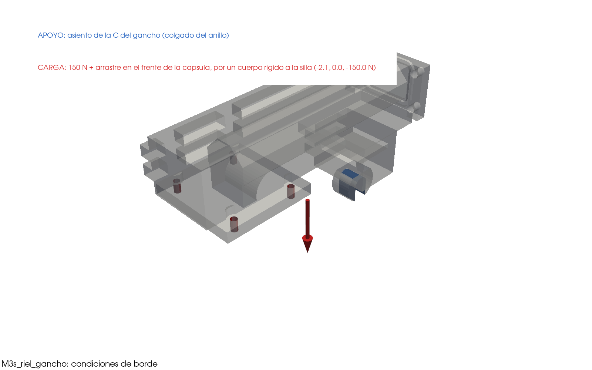

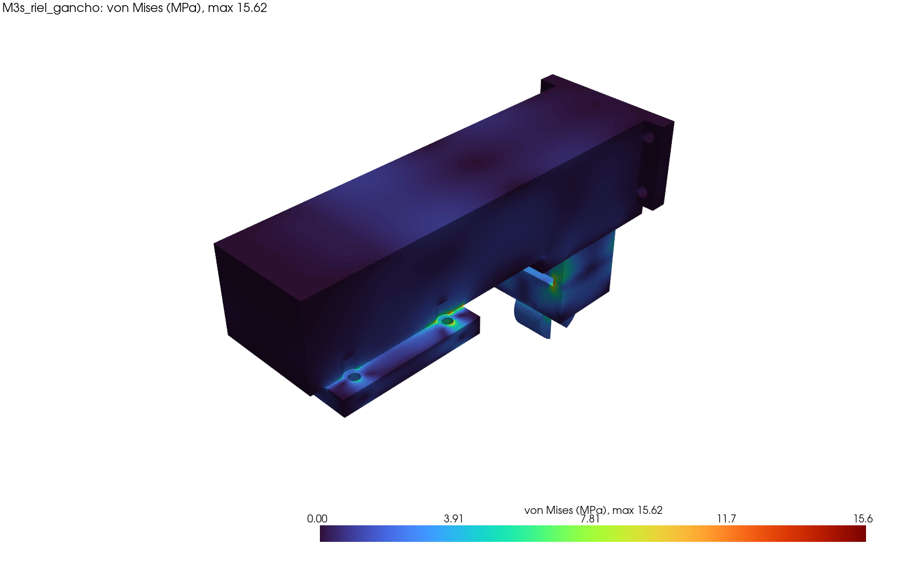

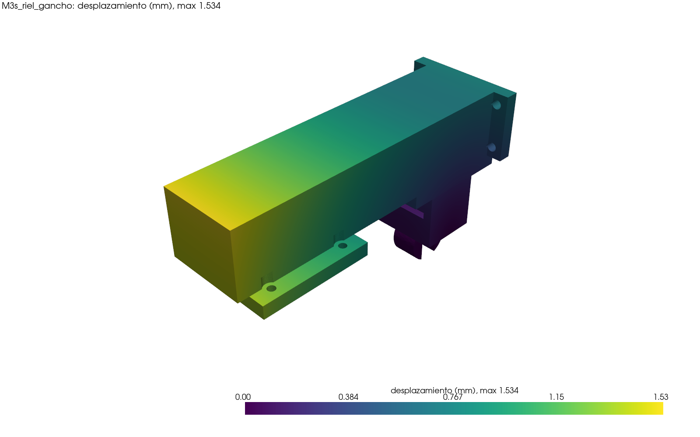

### M5s_capsula_tapa_pie

Tapa de capsula con pie: silla fija, 150 N + corriente en el frente de la capsula.

- Corriente de 1.5 m/s: presion dinamica 0.5*1025*1.5^2 = 1153 Pa sobre el frente de la capsula (area 16.6 cm2, Cd = 1) = 1.92 N, en -X (la corriente empuja la capsula hacia atras), aplicada en el frente.

**Caras elegidas (verificadas por conteo y área):**

- Apoyo fijo: agujeros de la silla (insertos M3 de la tapa del pie) → 4 caras, 301.6 mm²
- Carga: 150 N + arrastre en el frente, por un cuerpo rigido a los 4 M3 de la tapa → 8 caras, 407.2 mm², fuerza [-1.916, 0, -150.0] N

**Resultado:** σ máxima 20.14 MPa (se ubica en x, y, z = [164, -16, -19] mm), FS = 2.48; σ sin el 0.5 % de picos 7.28 MPa (FS 6.9); desplazamiento máximo 0.29 mm; malla de 40394 celdas de segundo orden, tiempo de cálculo PT48.115852S, 0.02666666666666667 horas-núcleo.

[Proyecto en SimScale](https://www.simscale.com/workbench/?pid=770997415227428031) · [Simulación](https://www.simscale.com/workbench/?pid=770997415227428031&mi=spec:df8a7fb4-3edb-447e-85ff-1d450ae2590f%2Cservice:SIMULATION%2Cstrategy:1) · [Resultado](https://www.simscale.com/workbench/?pid=770997415227428031&rru=a4db17dd-ab0e-41c7-8789-b46fe337f847&ci=69c84c14-9979-468c-9470-72fca2815f8f&ct=SOLUTION_FIELD&mt=SIMULATION_RESULT)

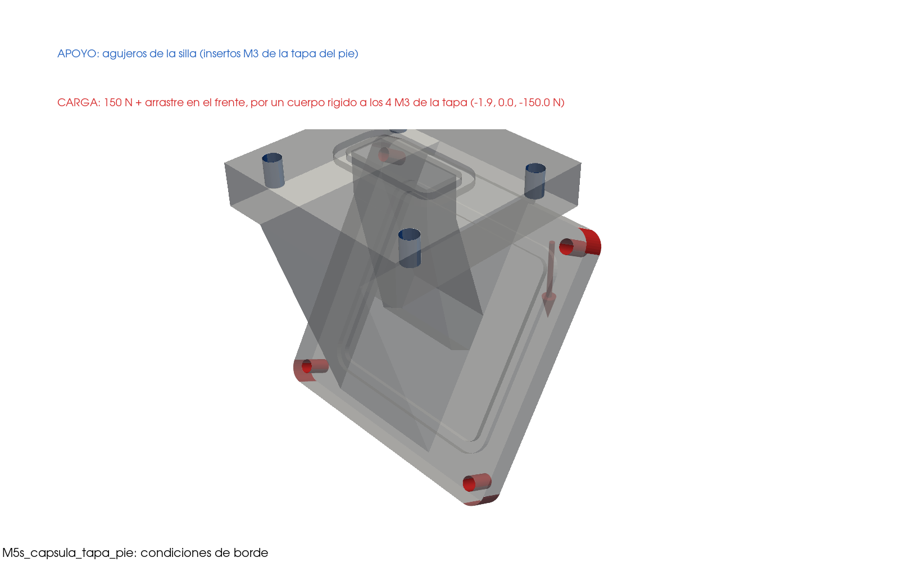

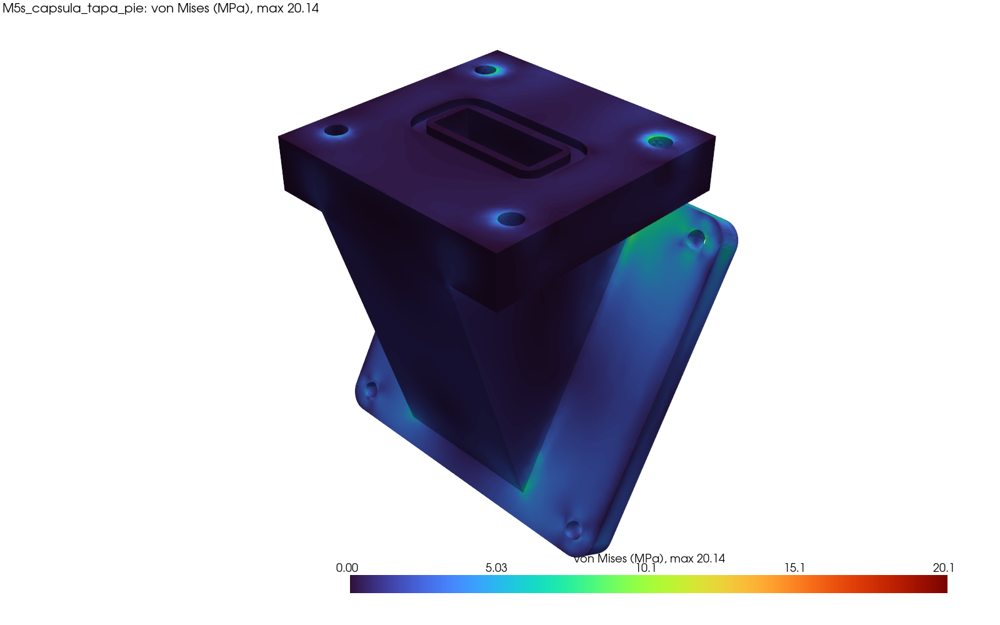

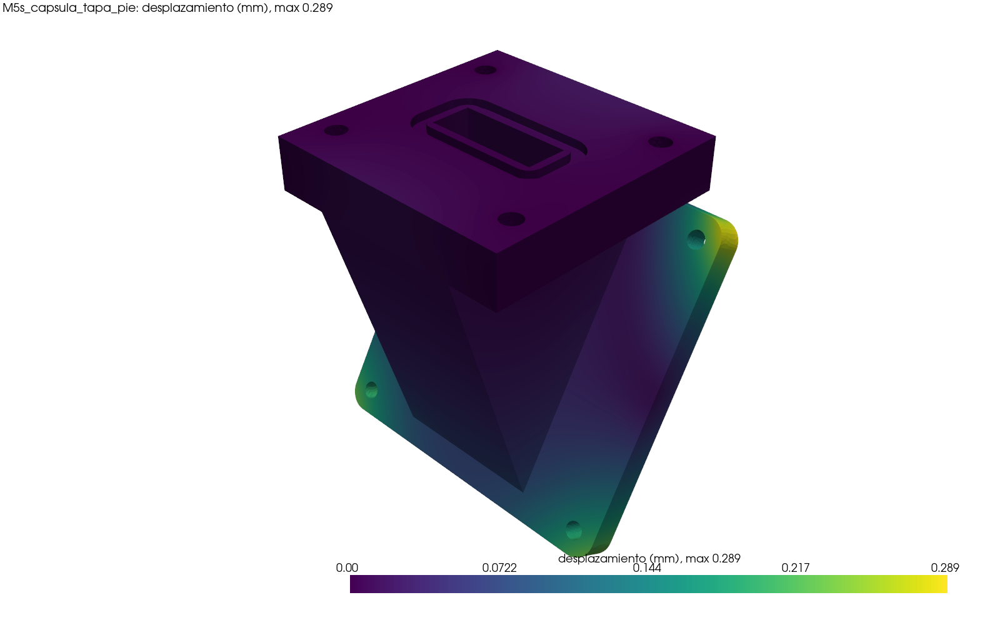

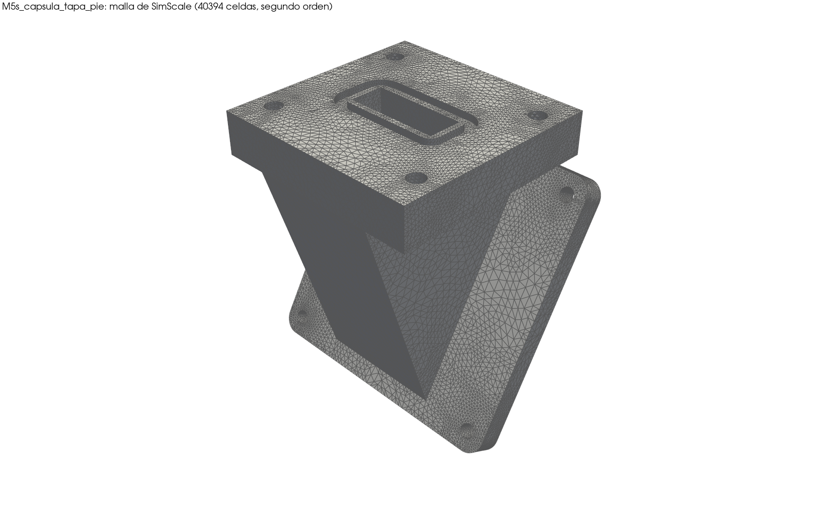

### M1s_caja_cuerpo

Caja: colgada de los insertos M3 de la tapa, el riel con la capsula tira del cojin +X (150 N + corriente).

- Corriente de 1.5 m/s: presion dinamica 0.5*1025*1.5^2 = 1153 Pa sobre el frente de la capsula (area 16.6 cm2, Cd = 1) = 1.92 N, en -X (la corriente empuja la capsula hacia atras), aplicada en el frente.
- Caso propio (el FEM local no tiene la caja): la caja cuelga de la tapa como al izar por el asa; los insertos M3 de la tapa se toman como apoyos fijos y el riel con la capsula tira de los 4 M4 del cojin.

**Caras elegidas (verificadas por conteo y área):**

- Apoyo fijo: agujeros M3 de la brida de la tapa (16) → 16 caras, 1206.4 mm²
- Carga: 150 N + arrastre en el frente de la capsula, por un cuerpo rigido a los 4 M4 del cojin +X → 4 caras, 597.5 mm², fuerza [-1.916, 0, -150.0] N

**Resultado:** σ máxima 25.36 MPa (se ubica en x, y, z = [64, 25, 33] mm), FS = 1.97; σ sin el 0.5 % de picos 7.74 MPa (FS 6.5); desplazamiento máximo 0.45 mm; malla de 176103 celdas de segundo orden, tiempo de cálculo PT2M31.099055S, 0.08388888888888889 horas-núcleo.

[Proyecto en SimScale](https://www.simscale.com/workbench/?pid=770997415227428031) · [Simulación](https://www.simscale.com/workbench/?pid=770997415227428031&mi=spec:471ef147-0491-4e3b-8bf0-17f58b0833a6%2Cservice:SIMULATION%2Cstrategy:1) · [Resultado](https://www.simscale.com/workbench/?pid=770997415227428031&rru=327c9ab5-fd76-4ffc-9e8c-c2cd587eb1dc&ci=0a90a786-26b6-42c4-98ff-84672028d3a8&ct=SOLUTION_FIELD&mt=SIMULATION_RESULT)

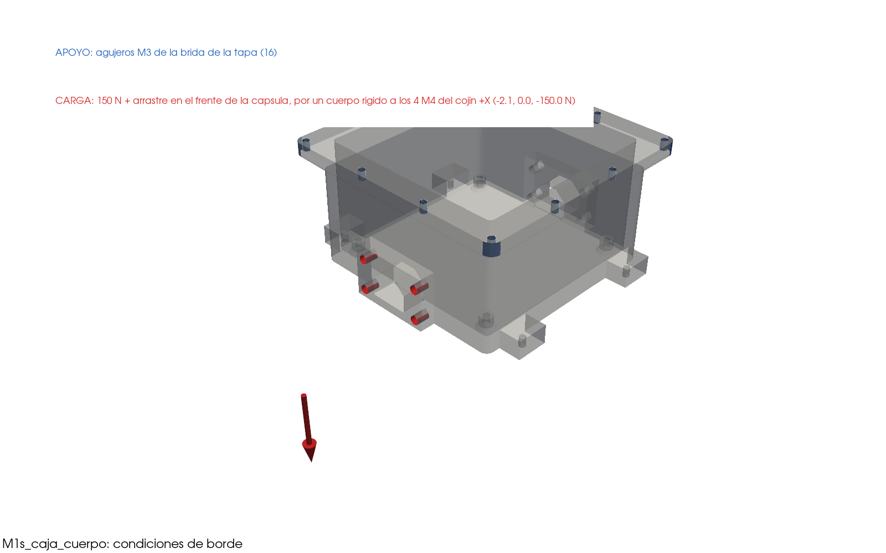

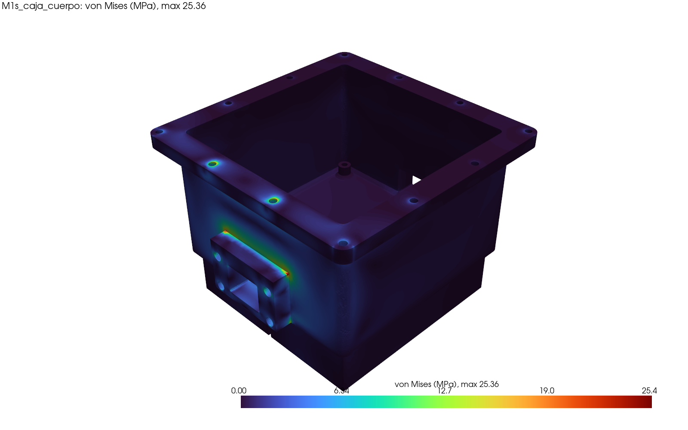

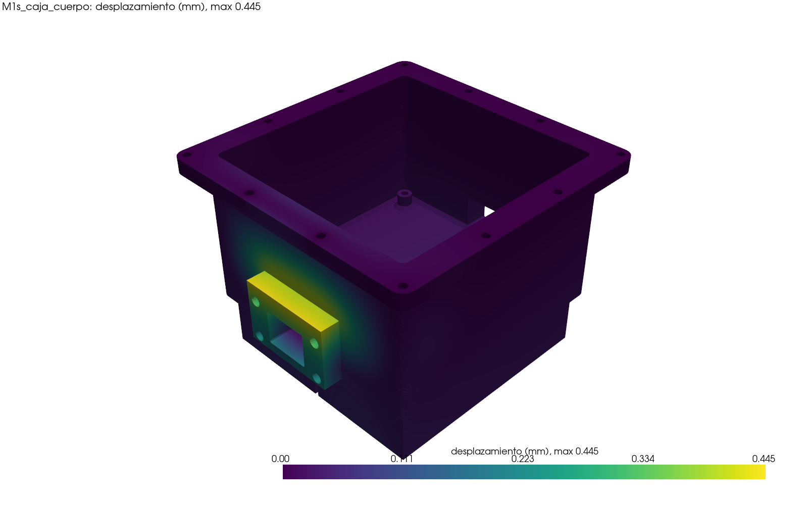

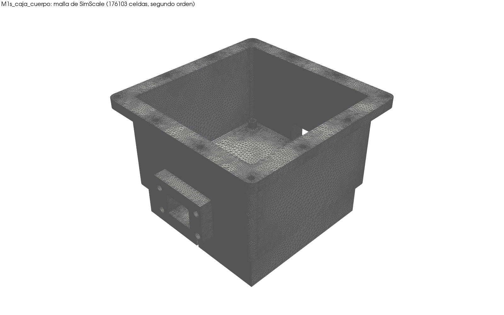

### B3_caja

Caja seca: peso de la electronica y de la tapa + golpe de ola de 200 N de costado.

- Electronica 354 g (parametros del modelo, sin panel ni antena) y tapa 57.2 g, 1 g de gravedad.
- La ola de 200 N se aplica entera contra una pared larga: caso exagerado (la caja va bajo el panel).

**Caras elegidas (verificadas por conteo y área):**

- Apoyo fijo: 4 orejas: huella de los pilares D10 bajo la oreja (atornilladas) → 4 caras, 277.8 mm²
- Carga: peso de la electronica sobre el piso → 1 caras, 10019.8 mm², fuerza [0, 0, -3.473] N
- Carga: peso de la tapa B4 sobre el borde → 1 caras, 6101.9 mm², fuerza [0, 0, -0.561] N
- Carga: golpe de ola 200 N contra la pared +Y → 1 caras, 1167.6 mm², fuerza [0, 200.0, 0] N

**Resultado:** σ máxima 16.18 MPa (se ubica en x, y, z = [-27, 54, 169] mm), FS = 3.09; σ sin el 0.5 % de picos 6.29 MPa (FS 7.9); desplazamiento máximo 1.02 mm; malla de 98078 celdas de segundo orden, tiempo de cálculo PT1M34.855092S, 0.0525 horas-núcleo.

[Proyecto en SimScale](https://www.simscale.com/workbench/?pid=5890288887472164333) · [Simulación](https://www.simscale.com/workbench/?pid=5890288887472164333&mi=spec:16c2f2fb-c0f8-4049-9322-e0175699ffb8%2Cservice:SIMULATION%2Cstrategy:1) · [Resultado](https://www.simscale.com/workbench/?pid=5890288887472164333&rru=683da982-b91d-410a-acdb-a3a4a78bdc26&ci=4062f2d9-9bf0-4f5d-aa56-bb3acb7bea23&ct=SOLUTION_FIELD&mt=SIMULATION_RESULT)

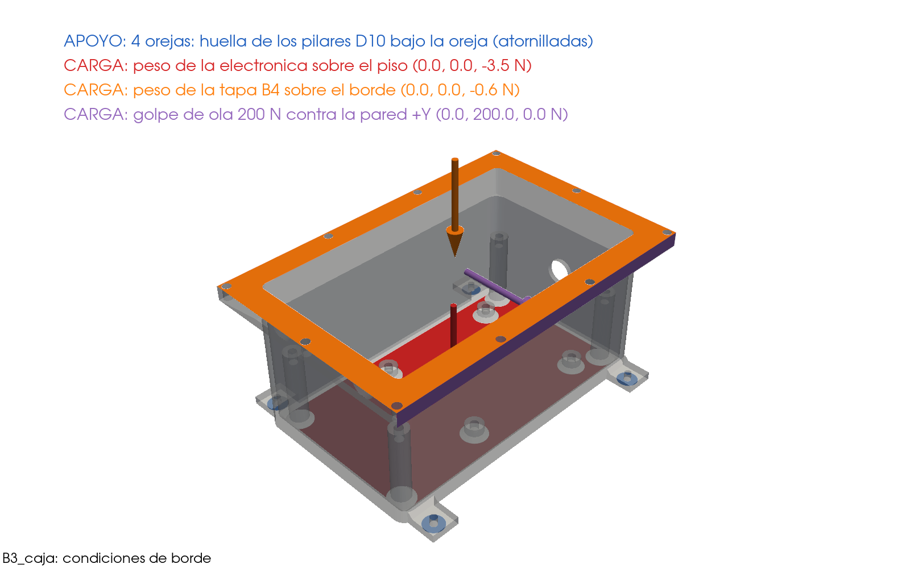

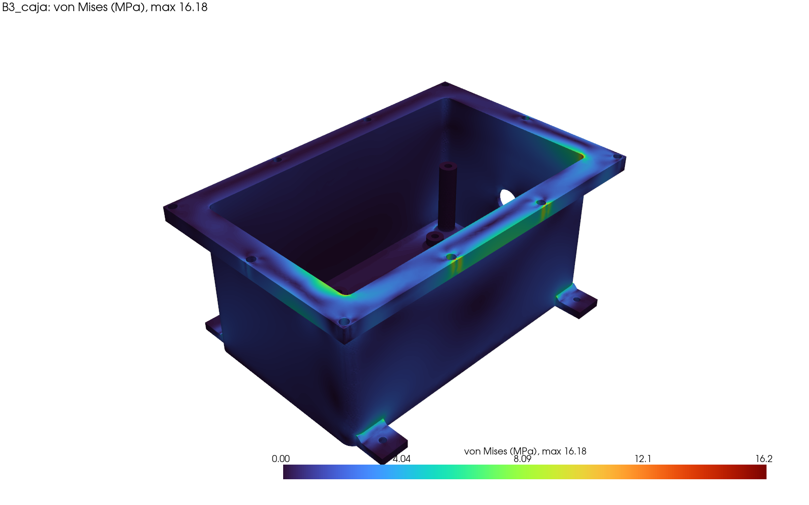

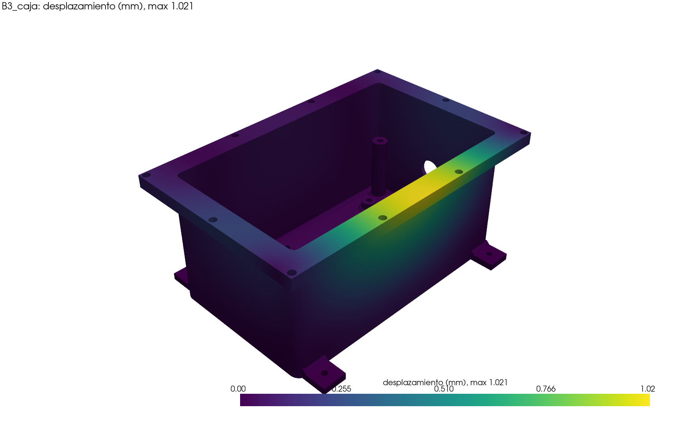

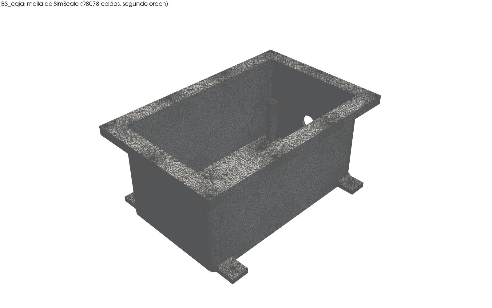

### B2_cubierta_lisa

Media cubierta: peso de la caja y del panel + golpe de ola de 200 N vertical sobre las barras.

- Caja completa 582 g repartida en 4 pilares (cada mitad carga 2); panel 350.0 g en 4 columnas (cada mitad carga 2).
- Golpe de ola vertical: 200 N hacia abajo sobre la cara de arriba de las barras de esa mitad (cada mitad recibe los 200 N enteros: exagerado, en la boya completa se reparten).

**Caras elegidas (verificadas por conteo y área):**

- Apoyo fijo: huella de los 4 bosses D10 del casco bajo los agujeros M3 → 4 caras, 269.7 mm²
- Carga: peso de la caja (1/4 por pilar) → 2 caras, 131.9 mm², fuerza [0, 0, -2.856] N
- Carga: peso del panel (1/4 por columna) → 2 caras, 201.1 mm², fuerza [0, 0, -1.717] N
- Carga: golpe de ola vertical de 200 N sobre las barras → 2 caras, 11108.9 mm², fuerza [0, 0, -200.0] N

**Resultado:** σ máxima 123.23 MPa (se ubica en x, y, z = [-63, -29, 85] mm), FS = 0.41; σ sin el 0.5 % de picos 58.60 MPa (FS 0.9); desplazamiento máximo 34.48 mm; malla de 20858 celdas de segundo orden, tiempo de cálculo PT38.835864S, 0.021388888888888888 horas-núcleo.

[Proyecto en SimScale](https://www.simscale.com/workbench/?pid=5890288887472164333) · [Simulación](https://www.simscale.com/workbench/?pid=5890288887472164333&mi=spec:3b7d9e83-8dea-4a33-a87b-013b19a45c64%2Cservice:SIMULATION%2Cstrategy:1) · [Resultado](https://www.simscale.com/workbench/?pid=5890288887472164333&rru=b56c2df0-44e6-44ca-b5d5-336ee1cf8efa&ci=6a606a5f-216e-4317-8852-e3efdc008c8e&ct=SOLUTION_FIELD&mt=SIMULATION_RESULT)

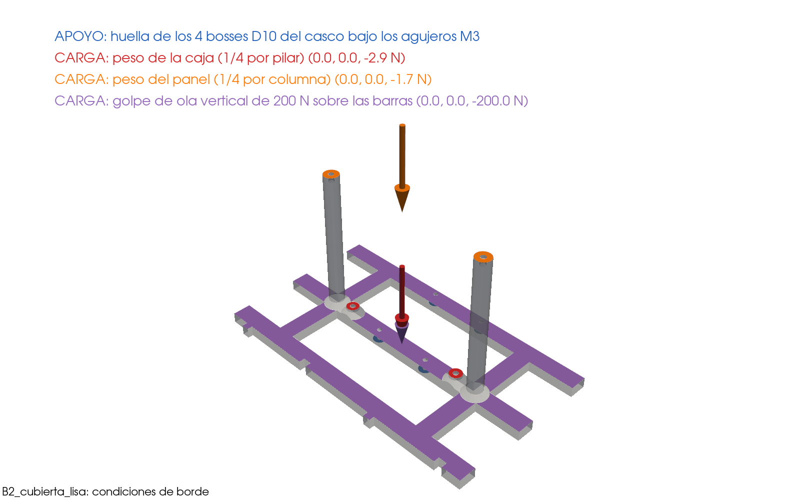

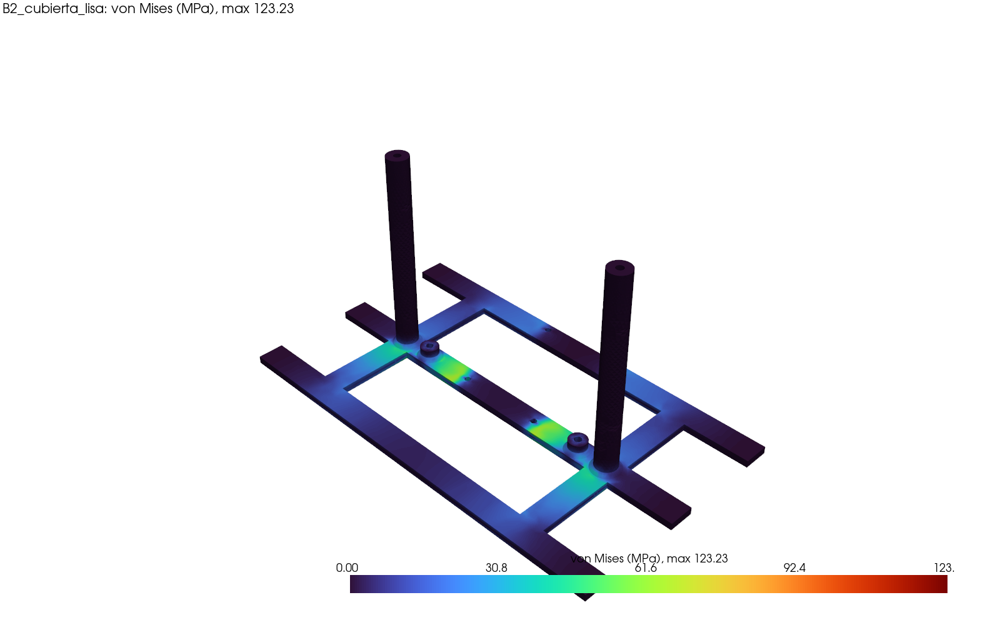

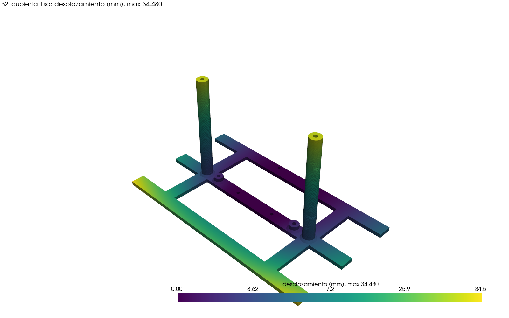

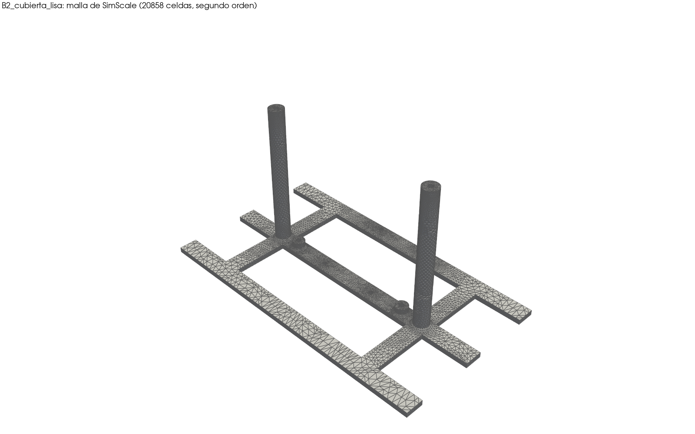

### B2_cubierta_mastil

Media cubierta: peso de la caja y del panel + golpe de ola de 200 N vertical sobre las barras.

- Caja completa 582 g repartida en 4 pilares (cada mitad carga 2); panel 350.0 g en 4 columnas (cada mitad carga 2).
- Golpe de ola vertical: 200 N hacia abajo sobre la cara de arriba de las barras de esa mitad (cada mitad recibe los 200 N enteros: exagerado, en la boya completa se reparten).

**Caras elegidas (verificadas por conteo y área):**

- Apoyo fijo: huella de los 4 bosses D10 del casco bajo los agujeros M3 → 4 caras, 269.7 mm²
- Carga: peso de la caja (1/4 por pilar) → 2 caras, 131.9 mm², fuerza [0, 0, -2.856] N
- Carga: peso del panel (1/4 por columna) → 2 caras, 201.1 mm², fuerza [0, 0, -1.717] N
- Carga: antena → 1 caras, 103.7 mm², fuerza [0, 0, -0.196] N
- Carga: golpe de ola vertical de 200 N sobre las barras → 2 caras, 10885.3 mm², fuerza [0, 0, -200.0] N

**Resultado:** σ máxima 127.71 MPa (se ubica en x, y, z = [62, 28, 85] mm), FS = 0.39; σ sin el 0.5 % de picos 58.34 MPa (FS 0.9); desplazamiento máximo 34.97 mm; malla de 23916 celdas de segundo orden, tiempo de cálculo PT41.859647S, 0.023055555555555555 horas-núcleo.

[Proyecto en SimScale](https://www.simscale.com/workbench/?pid=5890288887472164333) · [Simulación](https://www.simscale.com/workbench/?pid=5890288887472164333&mi=spec:dd51eac0-1dfa-4fe8-b1f9-b9dcccb3c46b%2Cservice:SIMULATION%2Cstrategy:1) · [Resultado](https://www.simscale.com/workbench/?pid=5890288887472164333&rru=86f208f4-dda5-4ad4-a871-f73567420635&ci=8dc3f9aa-f4f9-4af5-8805-1ffd1bc2f19d&ct=SOLUTION_FIELD&mt=SIMULATION_RESULT)

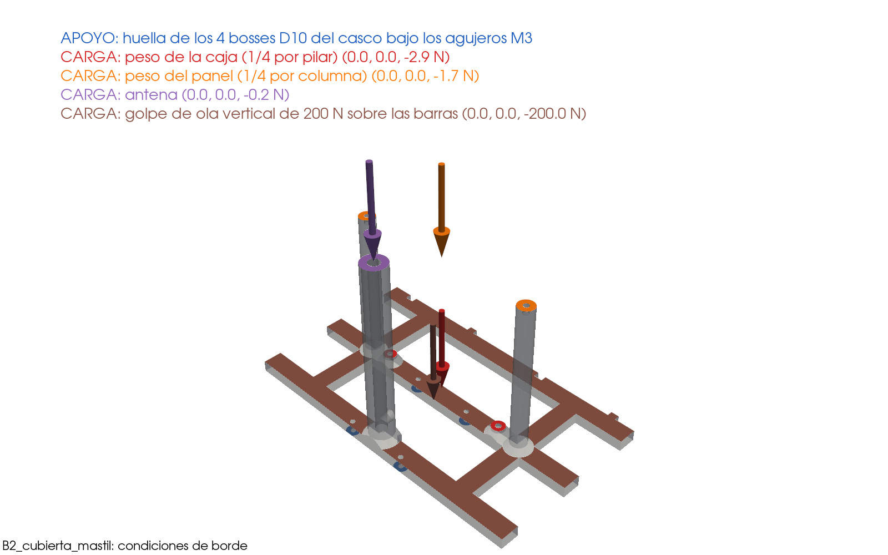

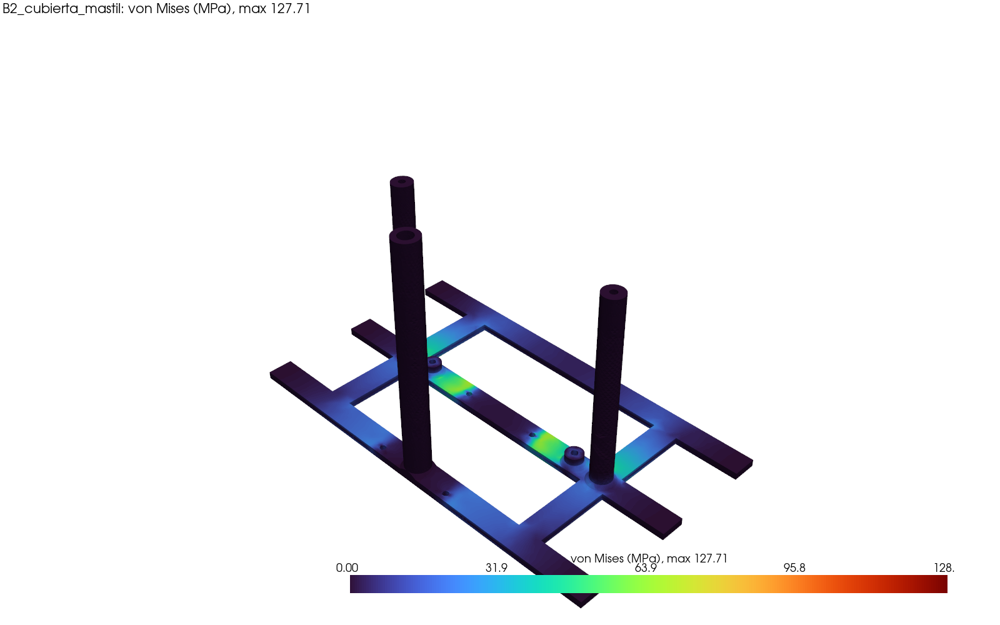

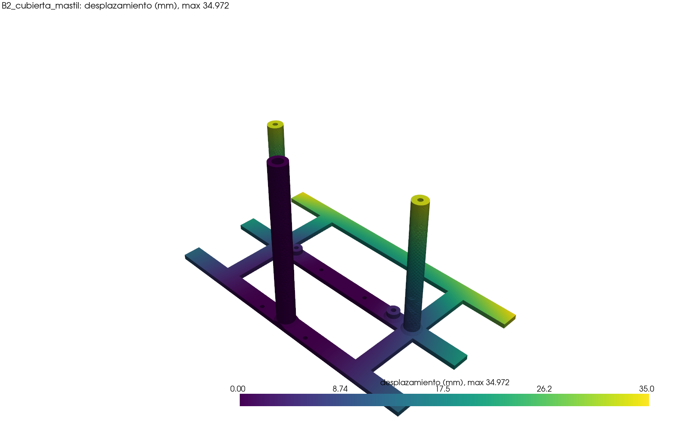

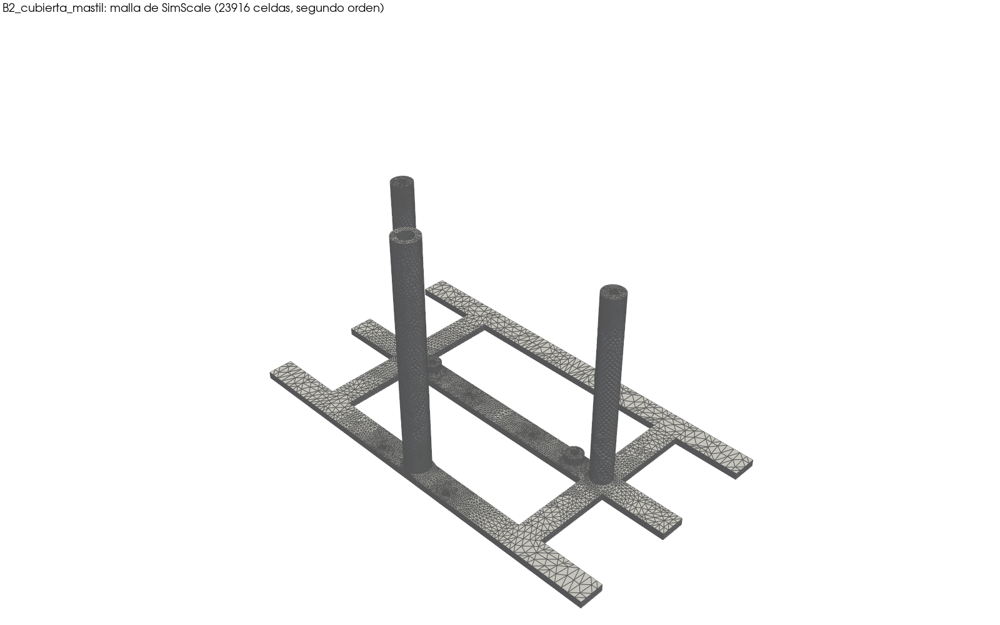

### B2_cubierta_lisa_lateral

Media cubierta: peso de la caja y del panel + golpe de ola de 200 N lateral sobre el panel.

- Caja completa 582 g repartida en 4 pilares (cada mitad carga 2); panel 350.0 g en 4 columnas (cada mitad carga 2).
- Variante lateral: la ola de 200 N golpea el panel (hace de vela) y baja por sus columnas; cada media cubierta recibe los 200 N enteros en sus 2 columnas (exagerado: en la boya completa se reparten entre las dos mitades).

**Caras elegidas (verificadas por conteo y área):**

- Apoyo fijo: huella de los 4 bosses D10 del casco bajo los agujeros M3 → 4 caras, 269.7 mm²
- Carga: peso de la caja (1/4 por pilar) → 2 caras, 131.9 mm², fuerza [0, 0, -2.856] N
- Carga: peso del panel + golpe de ola 200 N (en +Y) sobre las columnas → 2 caras, 201.1 mm², fuerza [0, 200.0, -1.717] N

**Resultado:** σ máxima 333.00 MPa (se ubica en x, y, z = [-63, -29, 85] mm), FS = 0.15; σ sin el 0.5 % de picos 190.79 MPa (FS 0.3); desplazamiento máximo 173.66 mm; malla de 20858 celdas de segundo orden, tiempo de cálculo PT47.127541S, 0.026111111111111113 horas-núcleo.

[Proyecto en SimScale](https://www.simscale.com/workbench/?pid=5890288887472164333) · [Simulación](https://www.simscale.com/workbench/?pid=5890288887472164333&mi=spec:712626db-921c-439f-b37e-0b4b5b5e903b%2Cservice:SIMULATION%2Cstrategy:1) · [Resultado](https://www.simscale.com/workbench/?pid=5890288887472164333&rru=62868e1f-ad1c-4b00-b03c-517a9634fac4&ci=f1805b6e-bfb6-4645-99c7-fff6f5c7bd6b&ct=SOLUTION_FIELD&mt=SIMULATION_RESULT)

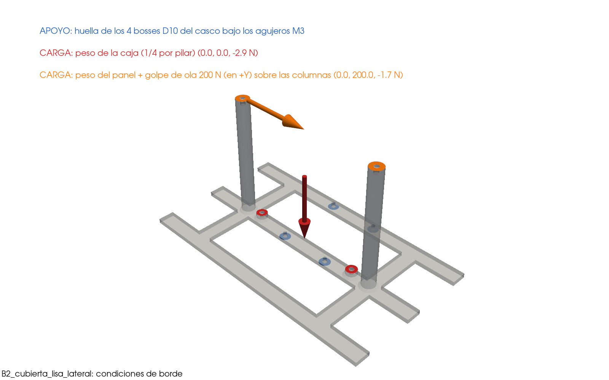

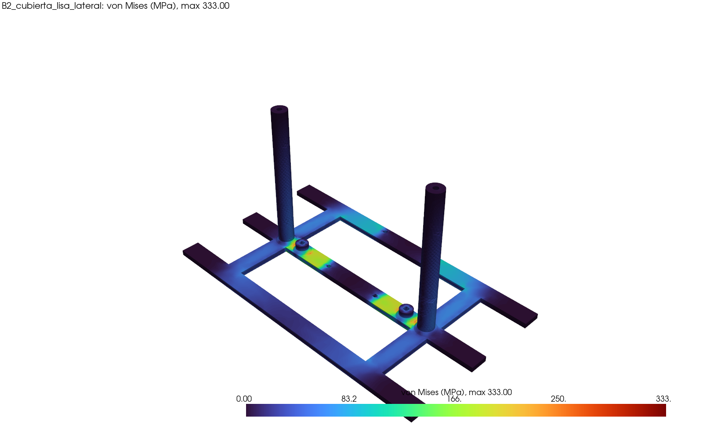

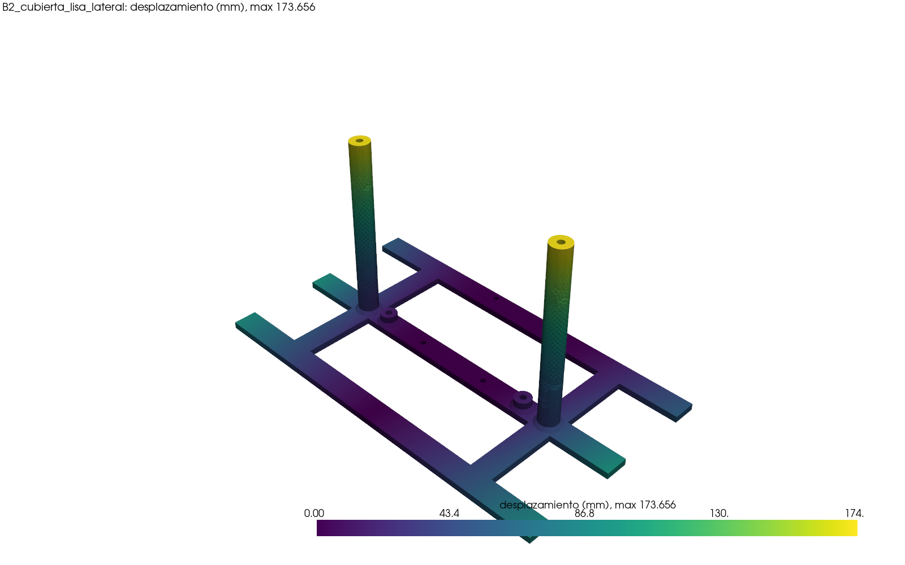

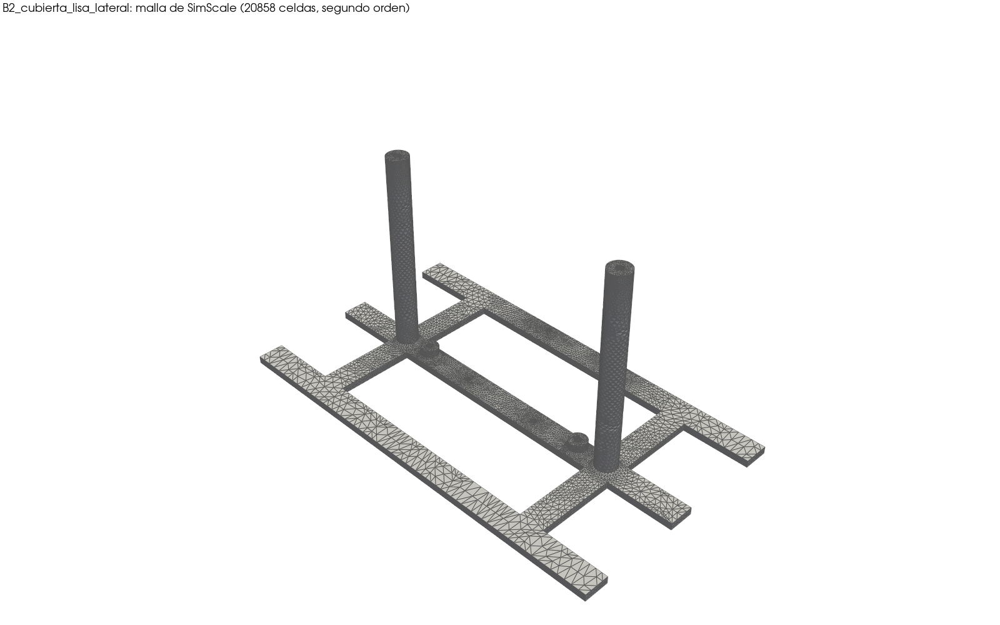

## Qué dicen los resultados

- **Nodo sumergido (riel con gancho, pie de la cápsula, caja):** con 150 N en la cápsula más la corriente, las tres piezas quedan con FS cerca de 2 o mayor sobre el pico máximo, y con FS
  de 6 a 11 si se descarta el 0.5 % de picos. La caja (M1s) es la más justa: el pico cae en el borde del cojín donde se atornilla el riel, que es donde el riel la tira.
  Los desplazamientos son de 0.3 a 1.5 mm. Contra el cálculo local, el desplazamiento del riel coincide (1.53 mm contra 1.91 mm × 0.81 = 1.55 mm por el cambio de E); los esfuerzos
  de SimScale en los agujeros salen distintos porque el reparto de la carga no es el del cuerpo rígido (ver «Ajuste obligado»).
- **Caja seca de la boya (B3):** soporta su peso y un golpe lateral de 200 N con FS 3.1 sobre el pico (8 sin picos). No hay problema.
- **Cubierta de la boya (B2):** **no soporta** un golpe de ola de 200 N sobre ella: las barras son de 14 × 4 mm y salen en voladizo desde los 4 postes (FS 0.4 y unos 35 mm de flecha
  con la carga vertical; peor con la lateral sobre el panel). Solo con los pesos (unos 10 N en total) el esfuerzo sería unas 20 veces menor (la relación carga-esfuerzo es lineal), es decir, sin problema.
  **Corregido el mismo día:** las barras pasaron a 8 mm y la cubierta cumple con FS 3 frente a la ola vertical (ver la sección «Corrección del mismo día»).

## Límites y avisos

- La variante lateral de la media cubierta del mástil terminó en SimScale sin devolver solución (la API contesta 403 «export-source-locked» y el resultado no tiene descarga, aun repitiendo
  la corrida); la de la media cubierta lisa, que es igual salvo por el mástil, sí salió y se da arriba.
- El enlace de cada proyecto es el que usa el sitio para proyectos compartidos (`workbench/?pid=...`). El plan gratuito deja los proyectos públicos, pero desde el script no se
  puede comprobar el acceso sin iniciar sesión (SimScale responde 426 a una consulta sin navegador); conviene abrirlo una vez en una ventana privada.

- Los proyectos del plan gratuito de SimScale son **públicos**: cualquiera con el enlace puede verlos. Contienen solo la geometría y los resultados de estas piezas.
- No se simuló estanqueidad, fatiga ni el efecto de las capas de impresión (material isótropo). Los STEP son los de `salida/prototipos/P2_robusto/step` y `salida/boya_pet/step`.
- Los resultados dependen de las cargas supuestas arriba: si el equipo fija otras (por ejemplo la ola real), se corre de nuevo con el script.
