# LanternGuard: simulación con SimScale (cálculo por API)

Fecha: 04/11/2026. Este documento se explica solo: no hace falta abrir el repositorio.

## Qué se hizo

Se calculó cuánto se deforma y cuánto esfuerzo soporta cada pieza impresa del nodo sumergido (grupo A) y de la boya (grupo B) bajo las cargas de uso, con el programa
SimScale (plan gratuito, por su API) y, cuando SimScale no entrega el resultado o todavía no corrió la geometría actual, con CalculiX en la computadora **con el mismo caso**
(mismas caras, mismas fuerzas, mismo material). Son dos proyectos separados: **«LanternGuard nodo sumergido»** y **«LanternGuard boya»**. Todo lo hace `cad_final/simscale_run.py`
(`python simscale_run.py --pieza NOMBRE`; el informe con `--informe`) y `cad_final/resultados_bloque3.py` (imágenes y `docs/resultados/resultados.json`).

- **Material (PETG):** E = 2.1 GPa, ν = 0.38, densidad 1270 kg/m³. Esfuerzo admisible 50 MPa en el plano de las capas (el cálculo local de la versión simple usaba 45) y 22 MPa **entre capas**.
- **FS = 50 / σ máxima** (cuántas veces cabe la carga hasta el límite). **FS entre capas = 22 / σ p99.5.** σ p99.5 es el esfuerzo sin el 0.5 % de puntos más altos: los picos
  en el borde de un apoyo o de un agujero cargado son un efecto del modelo («pellizca» la pieza), por eso la regla del proyecto juzga con el p99.5. «Cumple» = FS ≥ 1 con p99.5 en ambos sentidos.
- **Fuente de cada resultado:** «SimScale» solo si la corrida existe, se pudo descargar y corrió **la geometría actual**; si no, «FEM local». Local y SimScale coinciden en las piezas
  que tienen los dos (desplazamientos en torno al 3 %).
- **Escalas de color fijas** en todas las imágenes (esfuerzo 0 a 50 MPa; desplazamiento 0 a 6 mm), para poder comparar piezas a simple vista.
- **La flotación y la estabilidad de la boya NO son de este cálculo:** son analíticas y están en `docs/BOYA.md`. El diagrama de cargas del conjunto está en `docs/CARGAS_CONJUNTO.pdf`.

## Resultados

| Pieza | Caso | Fuente | σ máx. (MPa) | FS = 50/σ máx. | σ p99.5 (MPa) | FS entre capas (22/σ p99.5) | Desplaz. (mm) | Local: σ máx. / desplaz. | SimScale: σ máx. / desplaz. | Veredicto | Enlace |
|---|---|---|---|---|---|---|---|---|---|---|---|
| M3s_riel_gancho | Riel con gancho colgado del anillo: capsula con 150 N hacia abajo + corriente de 1.5 m/s | **SimScale** | 15.6 | 3.20 | 4.4 | 4.98 | 1.53 | 16.4 / 1.54 | 15.6 / 1.53 | **cumple** | [abrir](https://www.simscale.com/workbench/?pid=770997415227428031&rru=40540ee4-cc22-408f-85b0-624c8b916226&ci=eb506738-a210-4cff-89a3-5b1f52367445&ct=SOLUTION_FIELD&mt=SIMULATION_RESULT) |
| M5s_capsula_tapa_pie | Tapa de capsula con pie: silla fija, 150 N + corriente en el frente de la capsula | **SimScale** | 20.1 | 2.48 | 7.3 | 3.02 | 0.29 | 15.5 / 0.28 | 20.1 / 0.29 | **cumple** | [abrir](https://www.simscale.com/workbench/?pid=770997415227428031&rru=a4db17dd-ab0e-41c7-8789-b46fe337f847&ci=69c84c14-9979-468c-9470-72fca2815f8f&ct=SOLUTION_FIELD&mt=SIMULATION_RESULT) |
| M1s_caja_cuerpo | Caja: colgada de los insertos M3 de la tapa, el riel con la capsula tira del cojin +X (150 N + corriente) | **SimScale** | 25.4 | 1.97 | 7.7 | 2.84 | 0.45 | 21.6 / 0.44 | 25.4 / 0.45 | **cumple** | [abrir](https://www.simscale.com/workbench/?pid=770997415227428031&rru=327c9ab5-fd76-4ffc-9e8c-c2cd587eb1dc&ci=0a90a786-26b6-42c4-98ff-84672028d3a8&ct=SOLUTION_FIELD&mt=SIMULATION_RESULT) |
| B3_caja | Caja seca: peso de la electronica y de la tapa + golpe de ola de 200 N de costado | **FEM local** | 12.3 | 4.05 | 5.6 | 3.91 | 1.01 | 12.3 / 1.01 | no hay | **cumple** | [abrir](https://www.simscale.com/workbench/?pid=5890288887472164333&mi=spec:16c2f2fb-c0f8-4049-9322-e0175699ffb8%2Cservice:SIMULATION%2Cstrategy:1) |
| B2_cubierta_lisa | Media cubierta: peso de la caja y del panel + golpe de ola de 200 N vertical sobre las barras | **FEM local** | 32.0 | 1.56 | 13.3 | 1.65 | 5.33 | 32.0 / 5.33 | no hay | **cumple** | [abrir](https://www.simscale.com/workbench/?pid=5890288887472164333&mi=spec:fe4b2446-655f-4c26-998b-3856ce11b757%2Cservice:SIMULATION%2Cstrategy:1) |
| B2_cubierta_mastil | Media cubierta: peso de la caja y del panel + golpe de ola de 200 N vertical sobre las barras | **FEM local** | 32.6 | 1.53 | 13.4 | 1.65 | 5.43 | 32.6 / 5.43 | no hay | **cumple** | [abrir](https://www.simscale.com/workbench/?pid=5890288887472164333&mi=spec:195640ad-e0a3-4fc3-9b87-2effc03666d9%2Cservice:SIMULATION%2Cstrategy:1) |
| B2_cubierta_lisa_lateral | Media cubierta: peso de la caja y del panel + golpe de ola de 200 N lateral sobre el panel | **FEM local** | 82.5 | 0.61 | 52.7 | 0.42 | 47.02 | 82.5 / 47.02 | no hay | **NO cumple** | [abrir](https://www.simscale.com/workbench/?pid=5890288887472164333&mi=spec:712626db-921c-439f-b37e-0b4b5b5e903b%2Cservice:SIMULATION%2Cstrategy:1) |
| B2_cubierta_mastil_lateral | Media cubierta: peso de la caja y del panel + golpe de ola de 200 N lateral sobre el panel | **FEM local** | 85.0 | 0.59 | 51.9 | 0.42 | 47.06 | 85.0 / 47.06 | no hay | **NO cumple** | [abrir](https://www.simscale.com/workbench/?pid=5890288887472164333&mi=spec:a946fdb1-a09a-4773-a67e-707fa50b3504%2Cservice:SIMULATION%2Cstrategy:1) |

Lectura: «cumple» = FS ≥ 1 con σ máx. y con σ p99.5 en los dos sentidos; «cumple sin picos» = pasa con p99.5 pero el pico puntual supera 50 MPa (criterio propio, no normativo).
Los enlaces abren la simulación en SimScale (proyecto público del plan gratuito).

## Cargas y apoyos (supuestos, en lenguaje simple)

- **Nodo sumergido (A):** 150 N hacia abajo en el frente de la cápsula (manipulación), más la corriente de 1.5 m/s: presión 0.5 · 1025 · 1.5² = 1153 Pa sobre el frente
  de la cápsula (área de su sección, Cd = 1), convertida en una fuerza en −X en el mismo punto, porque estas piezas no incluyen el cuerpo de la cápsula.
- **Ajuste obligado:** la API de SimScale no deja asignar el punto de una «fuerza remota» («There is no Point assigned»). En su lugar, los 150 N se reparten en una fuerza
  por cada agujero de unión con la misma fuerza total y el mismo momento que daría el cuerpo rígido (reparto de mínima norma). El cálculo local usa **ese mismo reparto**.
- **Caja del nodo (M1s):** caso propio: la caja cuelga de los agujeros M3 de la brida de la tapa (como al izar por el asa) y el riel con la cápsula tira de los 4 M4 del cojín +X.
- **Boya (B):** peso de la electrónica y del panel solar (350 g), de la tapa y de la antena, más un golpe de ola de 200 N. En la caja, los 200 N empujan de lado una pared larga.
  En cada media cubierta hay dos casos: golpe vertical de 200 N sobre las barras, y golpe lateral de 200 N sobre el panel (que baja por sus columnas). Cada mitad recibe los 200 N enteros (exagerado a propósito).
- **Apoyos de la boya:** la caja va atornillada por sus 4 orejas a los pilares de la cubierta (se fija la huella de Ø10 de cada pilar); cada media cubierta, a los 4 postes del casco (huella de Ø10 de cada poste).
- **Cómo se eligieron las caras:** cada cara del STEP se «bautiza» (LGF0000, LGF0001…) y SimScale conserva ese nombre; los apoyos y cargas se escogen por posición y orientación y se comprueba conteo y área.
  Las cargas del cálculo local se reparten de forma consistente sobre los triángulos de esas mismas caras.

### Corrección del mismo día: cubierta de la boya con barras de 8 mm

Con barras de 4 mm la cubierta no aguantaba la ola (tabla de arriba). Por eso **las barras de B2 pasaron de 4 a 8 mm** (`boya_pet.cubierta_espesor`). La boya sigue estable: calado 41,6 mm, francobordo 83,9 mm, GM 101/710 mm, 1014 g impresos.

La simulación con la cubierta nueva **corrió en SimScale** (proyecto B), pero el plan gratuito no dejó descargar el resultado: devolvió el error 403 «export-source-locked». Por eso se verificó en la computadora con CalculiX, usando el mismo golpe de 200 N sobre las barras y la cubierta sujeta en sus agujeros M3. Antes se comprobó que el cálculo local da lo mismo que SimScale con la cubierta vieja:

| Media cubierta | Barras | σ p99.5 (MPa) | FS = 50/σ p99.5 | σ pico (MPa) | Flecha (mm) | Fuente |
|---|---|---|---|---|---|---|
| B2 lisa | 4 mm | 58,6 | 0,85 | 120 | 35,5 | local (SimScale: 58,6 y 34,5: coincide) |
| B2 lisa | **8 mm** | **16,4** | **3,0** | 38,7 | **5,2** | local |
| B2 mástil | **8 mm** | **16,3** | **3,1** | 34,1 | **5,3** | local |

La cubierta de 8 mm **cumple** el golpe vertical de 200 N con FS 3 (sin contar los picos de los bordes de los agujeros), aunque cada mitad recibe los 200 N enteros, lo que es exagerado. Queda pendiente el golpe **lateral** sobre el panel solar, que hace de vela: lo resisten las 4 columnas Ø12 del panel, no las barras. Ver `docs/PENDIENTES.md`.

**Cómo leer «σ máx.» y «σ p99.5».** «σ máx.» es el valor de un solo punto de la malla, en el borde de un agujero o en el lugar donde se aplica la carga. Ese pico sale de cómo se modela, no de la pieza. Por eso el cálculo local usa el percentil 99,5, que ignora el 0,5 % de puntos más altos. Con ese criterio, el riel da FS 11, el pie de la cápsula FS 6,8 y la caja M1s FS 6,5 frente a 50 MPa. Además, el cálculo local verifica la resistencia **entre capas**, que es la mitad: 22 MPa. Ahí el riel da FS 3,2 y el pie FS 3,8.

## Piezas

### M3s_riel_gancho

Riel con gancho colgado del anillo: capsula con 150 N hacia abajo + corriente de 1.5 m/s.

- Corriente de 1.5 m/s: presion dinamica 0.5*1025*1.5^2 = 1153 Pa sobre el frente de la capsula (area 16.6 cm2, Cd = 1) = 1.92 N, en -X (la corriente empuja la capsula hacia atras), aplicada en el frente.

**Caras elegidas (verificadas por conteo y área):**

- Apoyo fijo: asiento de la C del gancho (colgado del anillo) → 3 caras, 392.0 mm²
- Carga: 150 N + arrastre en el frente de la capsula, por un cuerpo rigido a la silla → 4 caras, 256.4 mm², fuerza [-1.916, 0, -150.0] N

**Resultado (SimScale):** σ máxima 15.62 MPa (FS 3.20); σ sin el 0.5 % de picos 4.42 MPa (FS 11.32 en el plano de las capas con 50 MPa; FS **entre capas** 4.98 con 22 MPa); desplazamiento máximo 1.53 mm; malla de 259277 elementos.

[Proyecto en SimScale](https://www.simscale.com/workbench/?pid=770997415227428031) · [Simulación](https://www.simscale.com/workbench/?pid=770997415227428031&mi=spec:633b313d-9ace-4eaf-ba44-8f94def22dc5%2Cservice:SIMULATION%2Cstrategy:1) · [Resultado](https://www.simscale.com/workbench/?pid=770997415227428031&rru=40540ee4-cc22-408f-85b0-624c8b916226&ci=eb506738-a210-4cff-89a3-5b1f52367445&ct=SOLUTION_FIELD&mt=SIMULATION_RESULT)

Escalas fijas en todas las imágenes: esfuerzo 0 a 50 MPa y desplazamiento 0 a 6 mm (magenta = pasa del tope).

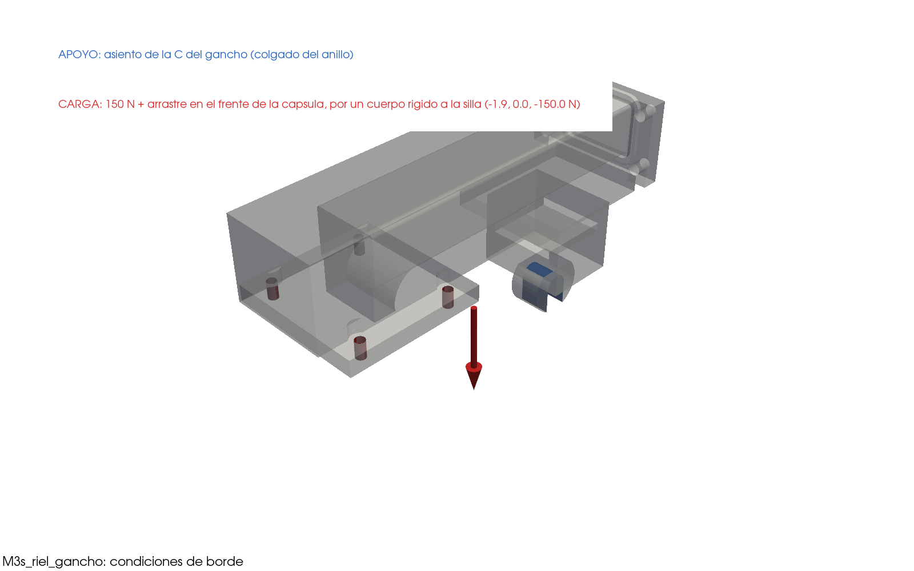

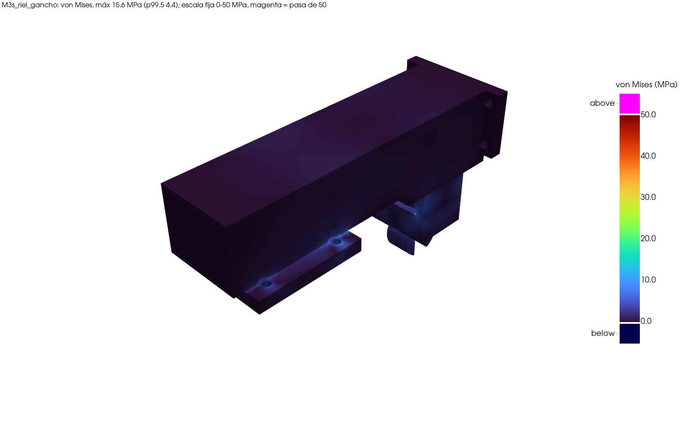

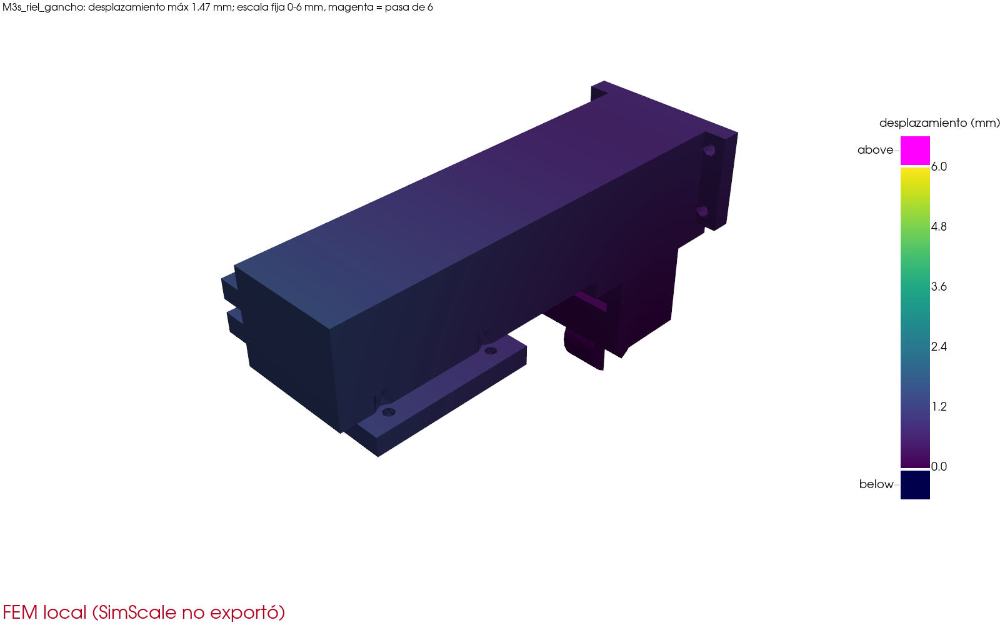

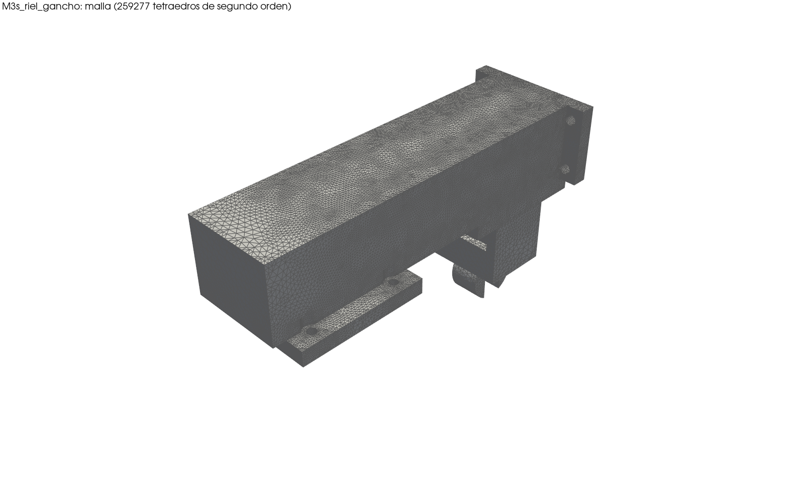

### M5s_capsula_tapa_pie

Tapa de capsula con pie: silla fija, 150 N + corriente en el frente de la capsula.

- Corriente de 1.5 m/s: presion dinamica 0.5*1025*1.5^2 = 1153 Pa sobre el frente de la capsula (area 18.1 cm2, Cd = 1) = 2.09 N, en -X (la corriente empuja la capsula hacia atras), aplicada en el frente.

**Caras elegidas (verificadas por conteo y área):**

- Apoyo fijo: agujeros de la silla (insertos M3 de la tapa del pie) → 4 caras, 301.6 mm²
- Carga: 150 N + arrastre en el frente, por un cuerpo rigido a los 4 M3 de la tapa → 8 caras, 407.2 mm², fuerza [-1.916, 0, -150.0] N

**Resultado (SimScale):** σ máxima 20.14 MPa (FS 2.48); σ sin el 0.5 % de picos 7.28 MPa (FS 6.87 en el plano de las capas con 50 MPa; FS **entre capas** 3.02 con 22 MPa); desplazamiento máximo 0.29 mm; malla de 40394 elementos.

[Proyecto en SimScale](https://www.simscale.com/workbench/?pid=770997415227428031) · [Simulación](https://www.simscale.com/workbench/?pid=770997415227428031&mi=spec:df8a7fb4-3edb-447e-85ff-1d450ae2590f%2Cservice:SIMULATION%2Cstrategy:1) · [Resultado](https://www.simscale.com/workbench/?pid=770997415227428031&rru=a4db17dd-ab0e-41c7-8789-b46fe337f847&ci=69c84c14-9979-468c-9470-72fca2815f8f&ct=SOLUTION_FIELD&mt=SIMULATION_RESULT)

Escalas fijas en todas las imágenes: esfuerzo 0 a 50 MPa y desplazamiento 0 a 6 mm (magenta = pasa del tope).

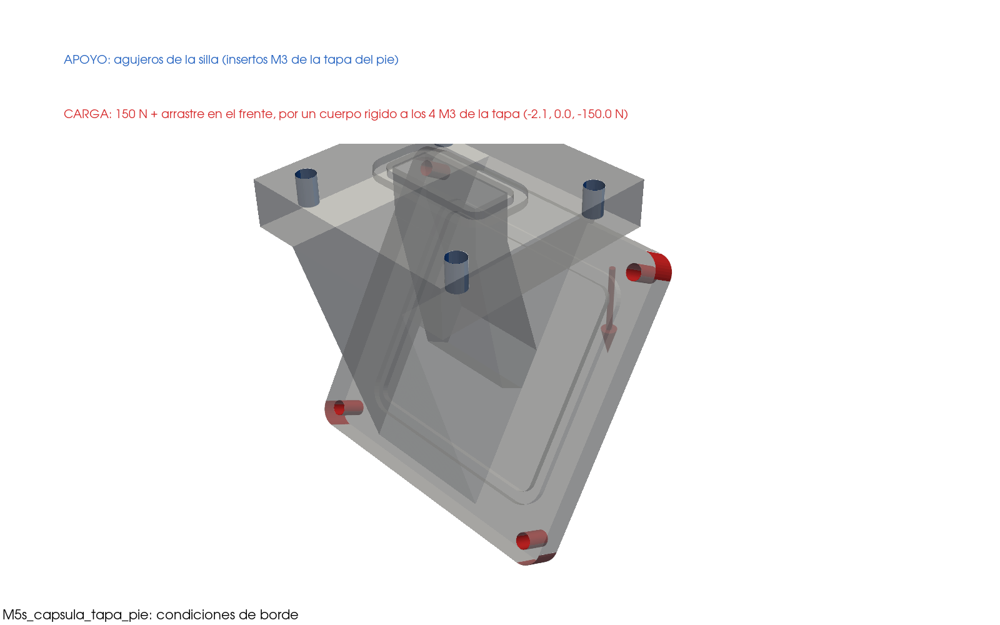

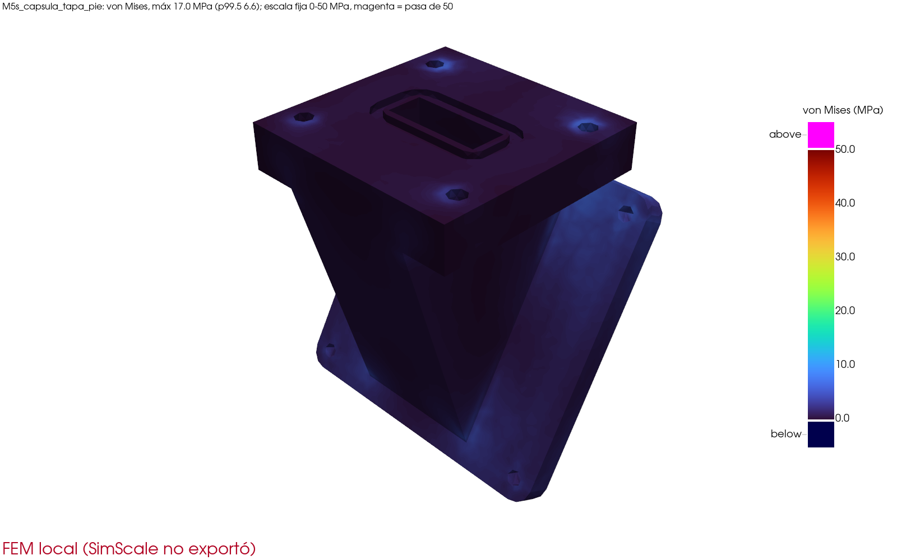

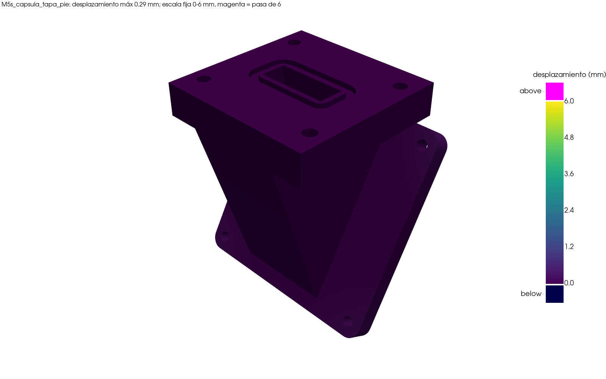

### M1s_caja_cuerpo

Caja: colgada de los insertos M3 de la tapa, el riel con la capsula tira del cojin +X (150 N + corriente).

- Corriente de 1.5 m/s: presion dinamica 0.5*1025*1.5^2 = 1153 Pa sobre el frente de la capsula (area 16.6 cm2, Cd = 1) = 1.92 N, en -X (la corriente empuja la capsula hacia atras), aplicada en el frente.
- Caso propio (el FEM local no tiene la caja): la caja cuelga de la tapa como al izar por el asa; los insertos M3 de la tapa se toman como apoyos fijos y el riel con la capsula tira de los 4 M4 del cojin.

**Caras elegidas (verificadas por conteo y área):**

- Apoyo fijo: agujeros M3 de la brida de la tapa (16) → 16 caras, 1206.4 mm²
- Carga: 150 N + arrastre en el frente de la capsula, por un cuerpo rigido a los 4 M4 del cojin +X → 4 caras, 597.5 mm², fuerza [-1.916, 0, -150.0] N

**Resultado (SimScale):** σ máxima 25.36 MPa (FS 1.97); σ sin el 0.5 % de picos 7.74 MPa (FS 6.46 en el plano de las capas con 50 MPa; FS **entre capas** 2.84 con 22 MPa); desplazamiento máximo 0.45 mm; malla de 176103 elementos.

[Proyecto en SimScale](https://www.simscale.com/workbench/?pid=770997415227428031) · [Simulación](https://www.simscale.com/workbench/?pid=770997415227428031&mi=spec:471ef147-0491-4e3b-8bf0-17f58b0833a6%2Cservice:SIMULATION%2Cstrategy:1) · [Resultado](https://www.simscale.com/workbench/?pid=770997415227428031&rru=327c9ab5-fd76-4ffc-9e8c-c2cd587eb1dc&ci=0a90a786-26b6-42c4-98ff-84672028d3a8&ct=SOLUTION_FIELD&mt=SIMULATION_RESULT)

Escalas fijas en todas las imágenes: esfuerzo 0 a 50 MPa y desplazamiento 0 a 6 mm (magenta = pasa del tope).

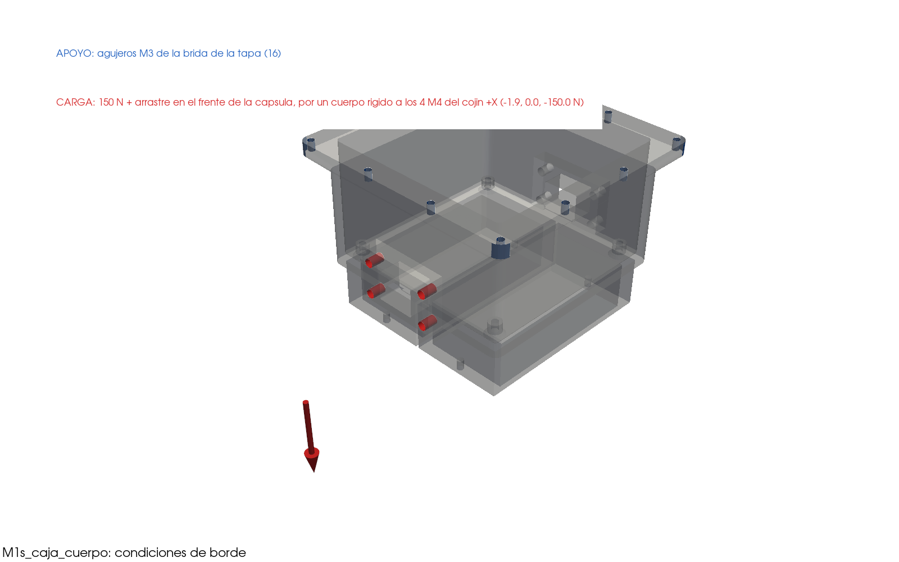

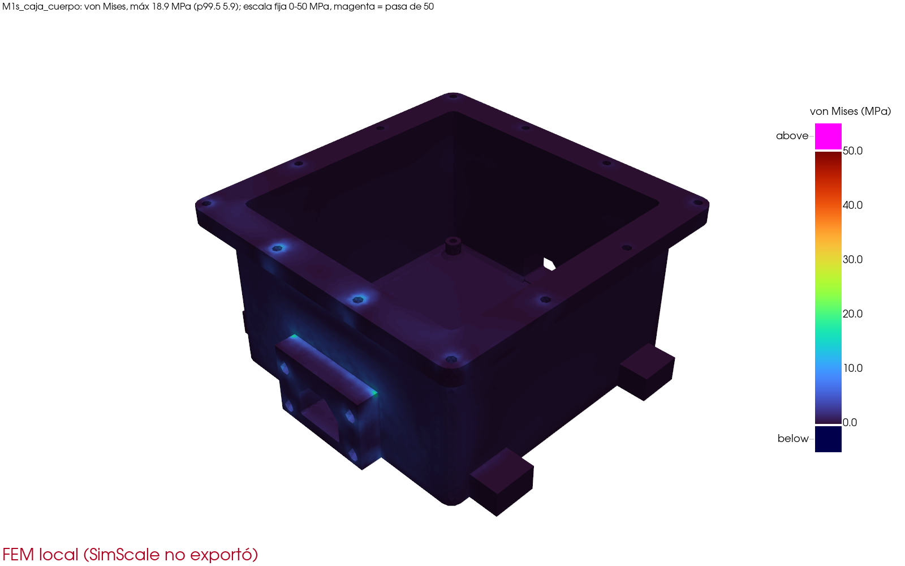

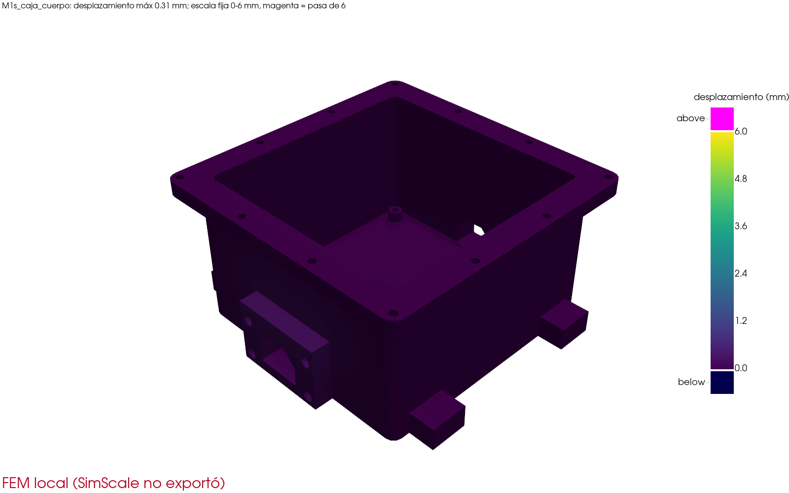

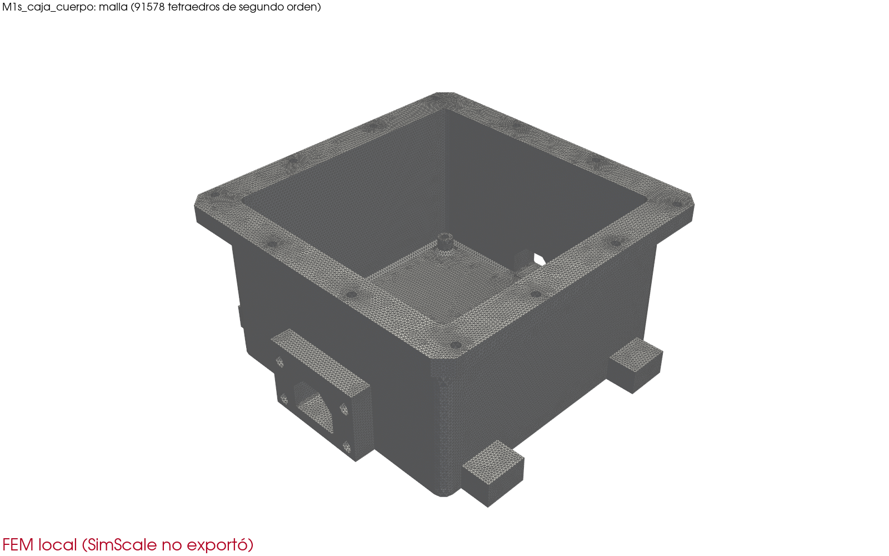

### B3_caja

Caja seca: peso de la electronica y de la tapa + golpe de ola de 200 N de costado.

- Electronica 354 g (parametros del modelo, sin panel ni antena) y tapa 57.2 g, 1 g de gravedad.
- La ola de 200 N se aplica entera contra una pared larga: caso exagerado (la caja va bajo el panel).

**Caras elegidas (verificadas por conteo y área):**

- Apoyo fijo: 4 orejas: huella de los pilares D10 bajo la oreja (atornilladas) → 4 caras, 277.8 mm²
- Carga: peso de la electronica sobre el piso → 1 caras, 10019.8 mm², fuerza [0, 0, -3.473] N
- Carga: peso de la tapa B4 sobre el borde → 1 caras, 6101.9 mm², fuerza [0, 0, -0.561] N
- Carga: golpe de ola 200 N contra la pared +Y → 1 caras, 1167.6 mm², fuerza [0, 200.0, 0] N

**Resultado (FEM local):** σ máxima 12.34 MPa (FS 4.05); σ sin el 0.5 % de picos 5.63 MPa (FS 8.88 en el plano de las capas con 50 MPa; FS **entre capas** 3.91 con 22 MPa); desplazamiento máximo 1.01 mm; malla de 56643 elementos. Motivo: SimScale corrió otra geometría (B3_caja_50dfd164); la actual es B3_caja_311c2c56.

[Proyecto en SimScale](https://www.simscale.com/workbench/?pid=5890288887472164333) · [Simulación](https://www.simscale.com/workbench/?pid=5890288887472164333&mi=spec:16c2f2fb-c0f8-4049-9322-e0175699ffb8%2Cservice:SIMULATION%2Cstrategy:1) · [Resultado](https://www.simscale.com/workbench/?pid=5890288887472164333&mi=spec:16c2f2fb-c0f8-4049-9322-e0175699ffb8%2Cservice:SIMULATION%2Cstrategy:1)

Escalas fijas en todas las imágenes: esfuerzo 0 a 50 MPa y desplazamiento 0 a 6 mm (magenta = pasa del tope).

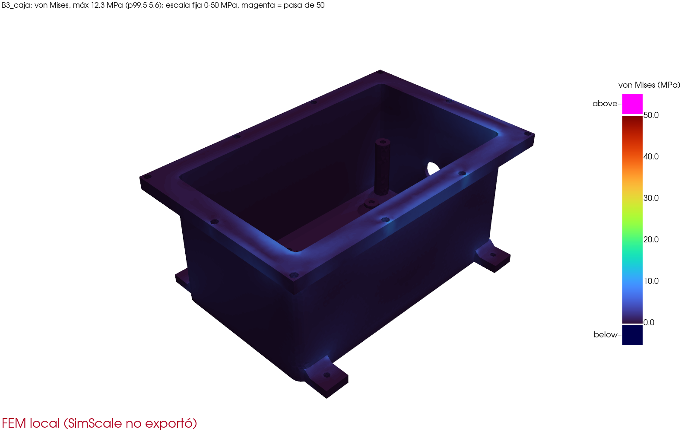

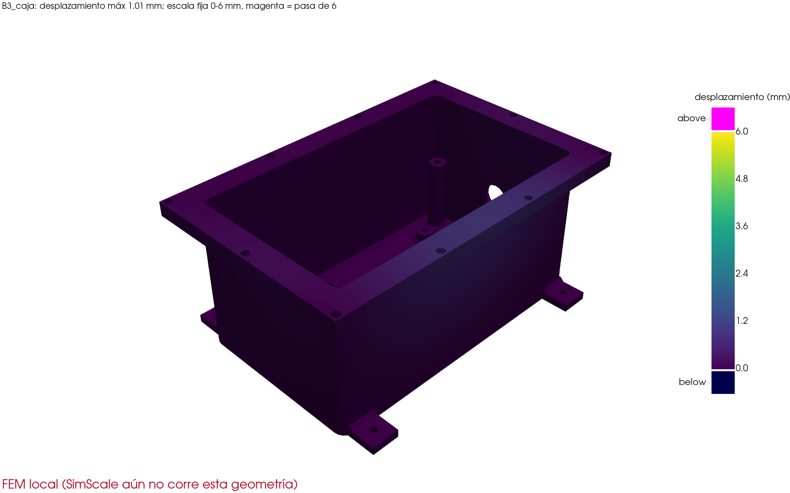

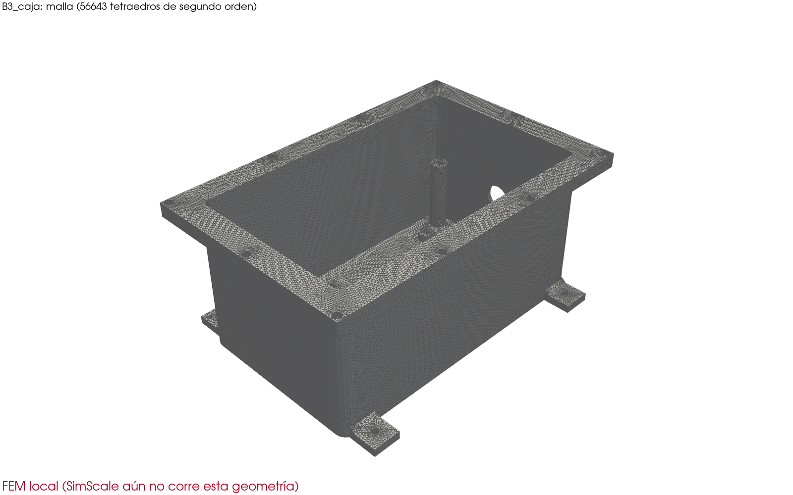

### B2_cubierta_lisa

Media cubierta: peso de la caja y del panel + golpe de ola de 200 N vertical sobre las barras.

- Caja completa 582 g repartida en 4 pilares (cada mitad carga 2); panel 350.0 g en 4 columnas (cada mitad carga 2).
- Golpe de ola vertical: 200 N hacia abajo sobre la cara de arriba de las barras de esa mitad (cada mitad recibe los 200 N enteros: exagerado, en la boya completa se reparten).

**Caras elegidas (verificadas por conteo y área):**

- Apoyo fijo: huella de los 4 bosses D10 del casco bajo los agujeros M3 → 4 caras, 269.7 mm²
- Carga: peso de la caja (1/4 por pilar) → 2 caras, 131.9 mm², fuerza [0, 0, -2.856] N
- Carga: peso del panel (1/4 por columna) → 2 caras, 201.1 mm², fuerza [0, 0, -1.717] N
- Carga: golpe de ola vertical de 200 N sobre las barras → 2 caras, 11108.9 mm², fuerza [0, 0, -200.0] N

**Resultado (FEM local):** σ máxima 31.97 MPa (FS 1.56); σ sin el 0.5 % de picos 13.30 MPa (FS 3.76 en el plano de las capas con 50 MPa; FS **entre capas** 1.65 con 22 MPa); desplazamiento máximo 5.33 mm; malla de 28134 elementos. Motivo: la corrida existe pero SimScale no devolvió el resultado (403 export-source-locked).

[Proyecto en SimScale](https://www.simscale.com/workbench/?pid=5890288887472164333) · [Simulación](https://www.simscale.com/workbench/?pid=5890288887472164333&mi=spec:fe4b2446-655f-4c26-998b-3856ce11b757%2Cservice:SIMULATION%2Cstrategy:1) · [Resultado](https://www.simscale.com/workbench/?pid=5890288887472164333&mi=spec:fe4b2446-655f-4c26-998b-3856ce11b757%2Cservice:SIMULATION%2Cstrategy:1)

Escalas fijas en todas las imágenes: esfuerzo 0 a 50 MPa y desplazamiento 0 a 6 mm (magenta = pasa del tope).

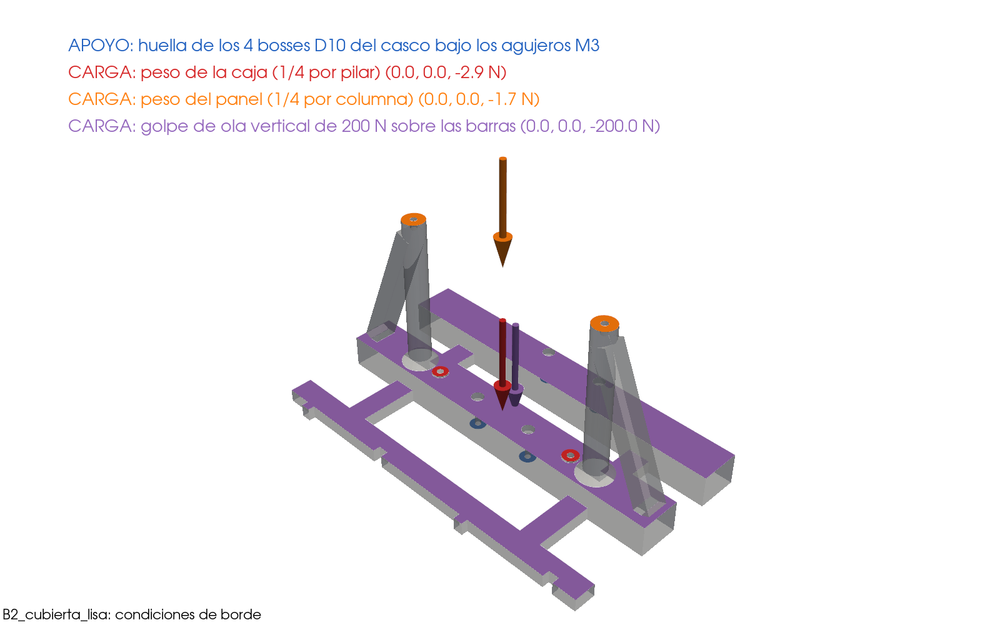

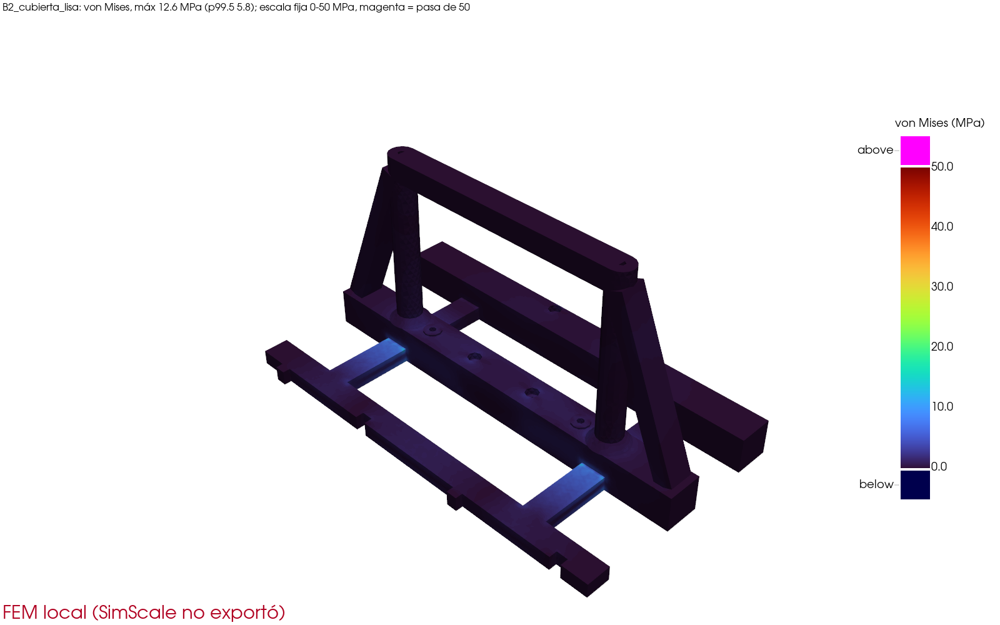

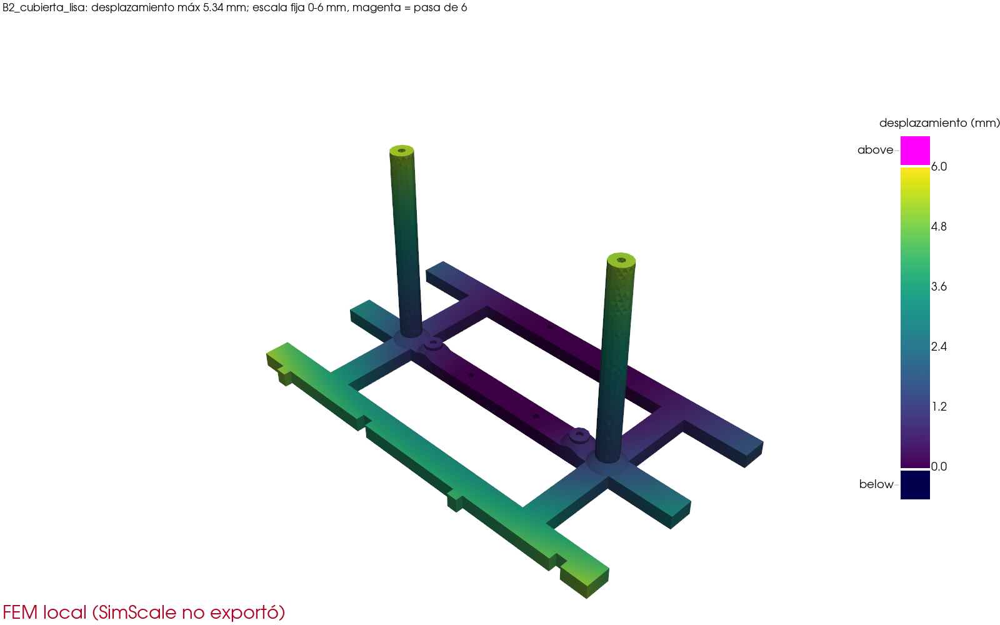

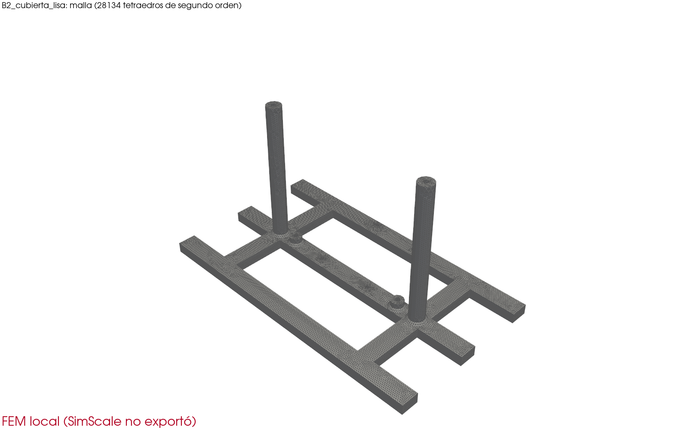

### B2_cubierta_mastil

Media cubierta: peso de la caja y del panel + golpe de ola de 200 N vertical sobre las barras.

- Caja completa 582 g repartida en 4 pilares (cada mitad carga 2); panel 350.0 g en 4 columnas (cada mitad carga 2).
- Golpe de ola vertical: 200 N hacia abajo sobre la cara de arriba de las barras de esa mitad (cada mitad recibe los 200 N enteros: exagerado, en la boya completa se reparten).

**Caras elegidas (verificadas por conteo y área):**

- Apoyo fijo: huella de los 4 bosses D10 del casco bajo los agujeros M3 → 4 caras, 269.7 mm²
- Carga: peso de la caja (1/4 por pilar) → 2 caras, 131.9 mm², fuerza [0, 0, -2.856] N
- Carga: peso del panel (1/4 por columna) → 2 caras, 201.1 mm², fuerza [0, 0, -1.717] N
- Carga: antena → 1 caras, 103.7 mm², fuerza [0, 0, -0.196] N
- Carga: golpe de ola vertical de 200 N sobre las barras → 2 caras, 10885.3 mm², fuerza [0, 0, -200.0] N

**Resultado (FEM local):** σ máxima 32.58 MPa (FS 1.53); σ sin el 0.5 % de picos 13.36 MPa (FS 3.74 en el plano de las capas con 50 MPa; FS **entre capas** 1.65 con 22 MPa); desplazamiento máximo 5.43 mm; malla de 32122 elementos. Motivo: la corrida existe pero SimScale no devolvió el resultado (403 export-source-locked).

[Proyecto en SimScale](https://www.simscale.com/workbench/?pid=5890288887472164333) · [Simulación](https://www.simscale.com/workbench/?pid=5890288887472164333&mi=spec:195640ad-e0a3-4fc3-9b87-2effc03666d9%2Cservice:SIMULATION%2Cstrategy:1) · [Resultado](https://www.simscale.com/workbench/?pid=5890288887472164333&mi=spec:195640ad-e0a3-4fc3-9b87-2effc03666d9%2Cservice:SIMULATION%2Cstrategy:1)

Escalas fijas en todas las imágenes: esfuerzo 0 a 50 MPa y desplazamiento 0 a 6 mm (magenta = pasa del tope).

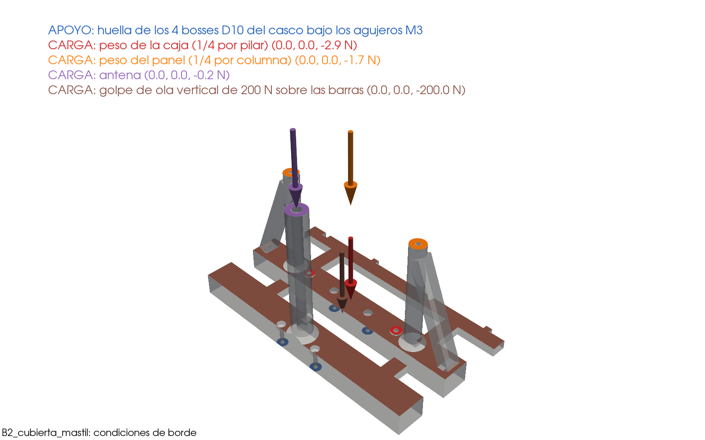

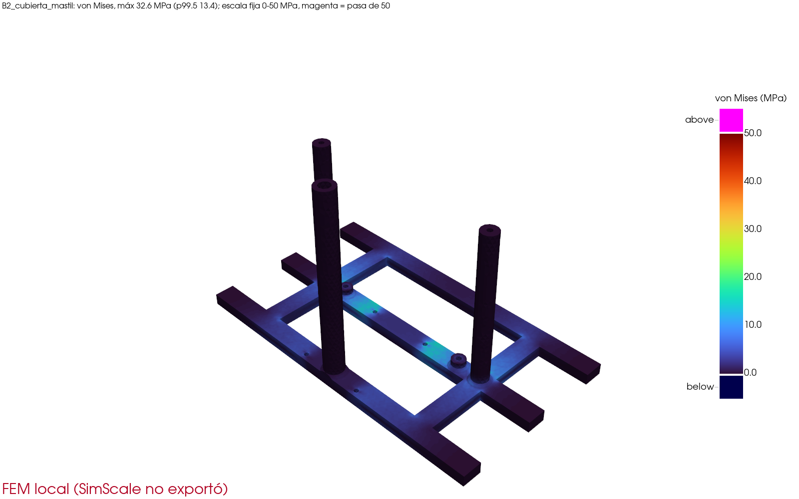

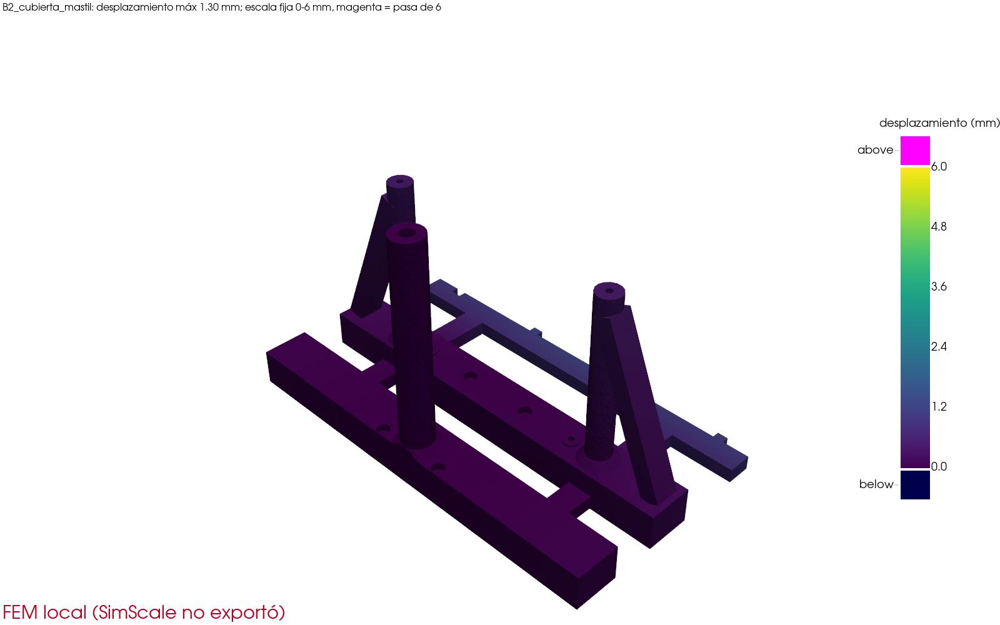

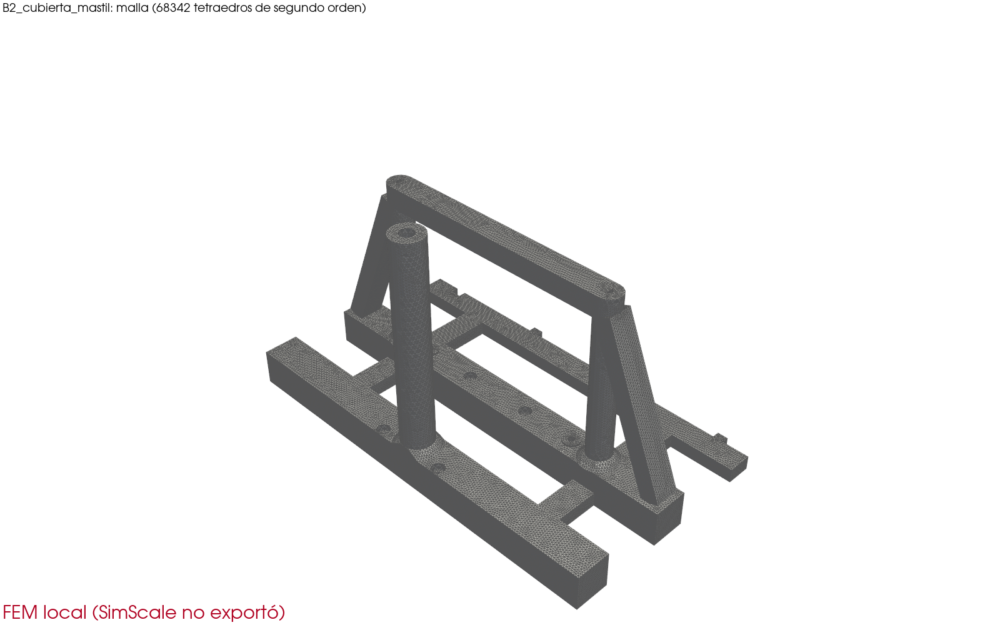

### B2_cubierta_lisa_lateral

Media cubierta: peso de la caja y del panel + golpe de ola de 200 N lateral sobre el panel.

- Caja completa 582 g repartida en 4 pilares (cada mitad carga 2); panel 350.0 g en 4 columnas (cada mitad carga 2).
- Variante lateral: la ola de 200 N golpea el panel (hace de vela) y baja por sus columnas; cada media cubierta recibe los 200 N enteros en sus 2 columnas (exagerado: en la boya completa se reparten entre las dos mitades).

**Caras elegidas (verificadas por conteo y área):**

- Apoyo fijo: huella de los 4 bosses D10 del casco bajo los agujeros M3 → 4 caras, 269.7 mm²
- Carga: peso de la caja (1/4 por pilar) → 2 caras, 131.9 mm², fuerza [0, 0, -2.856] N
- Carga: peso del panel + golpe de ola 200 N (en +Y) sobre las columnas → 2 caras, 201.1 mm², fuerza [0, 200.0, -1.717] N

**Resultado (FEM local):** σ máxima 82.48 MPa (FS 0.61); σ sin el 0.5 % de picos 52.66 MPa (FS 0.95 en el plano de las capas con 50 MPa; FS **entre capas** 0.42 con 22 MPa); desplazamiento máximo 47.02 mm; malla de 28134 elementos. Motivo: SimScale corrió otra geometría (B2_cubierta_lisa_lateral_d0c015b8); la actual es B2_cubierta_lisa_lateral_6d5b6744.

[Proyecto en SimScale](https://www.simscale.com/workbench/?pid=5890288887472164333) · [Simulación](https://www.simscale.com/workbench/?pid=5890288887472164333&mi=spec:712626db-921c-439f-b37e-0b4b5b5e903b%2Cservice:SIMULATION%2Cstrategy:1) · [Resultado](https://www.simscale.com/workbench/?pid=5890288887472164333&mi=spec:712626db-921c-439f-b37e-0b4b5b5e903b%2Cservice:SIMULATION%2Cstrategy:1)

Escalas fijas en todas las imágenes: esfuerzo 0 a 50 MPa y desplazamiento 0 a 6 mm (magenta = pasa del tope).

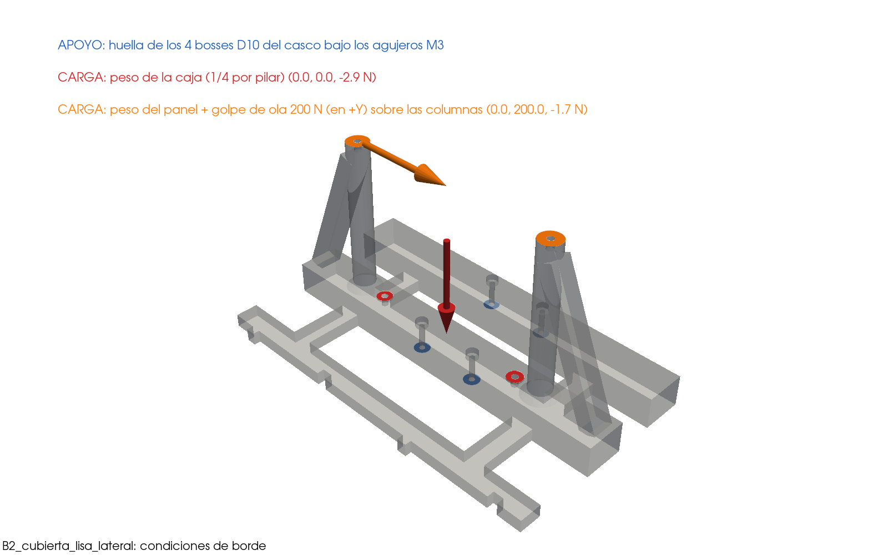

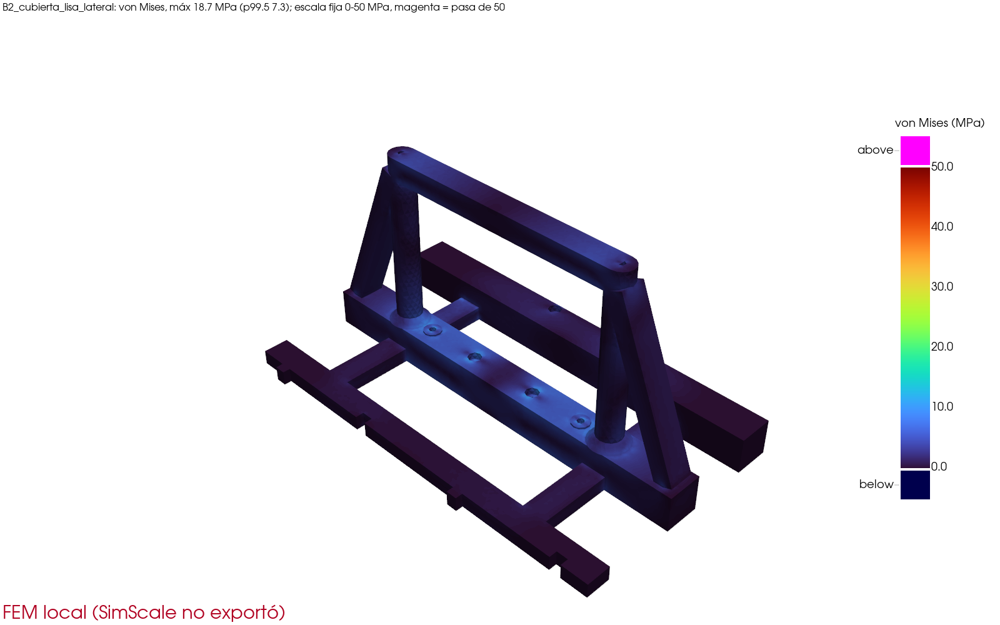

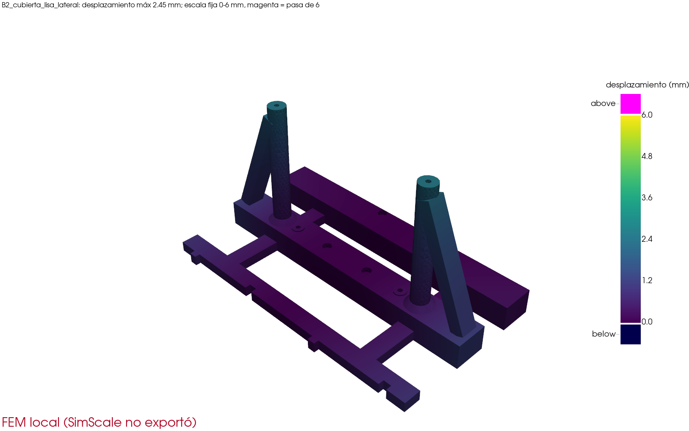

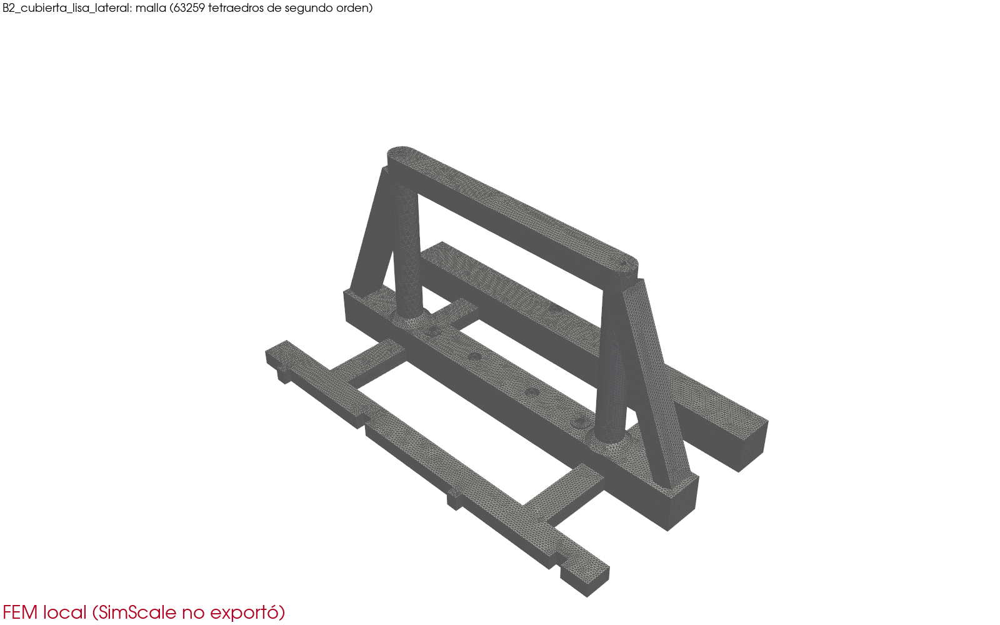

### B2_cubierta_mastil_lateral

Media cubierta: peso de la caja y del panel + golpe de ola de 200 N lateral sobre el panel.

- Caja completa 582 g repartida en 4 pilares (cada mitad carga 2); panel 350.0 g en 4 columnas (cada mitad carga 2).
- Variante lateral: la ola de 200 N golpea el panel (hace de vela) y baja por sus columnas; cada media cubierta recibe los 200 N enteros en sus 2 columnas (exagerado: en la boya completa se reparten entre las dos mitades).

**Caras elegidas (verificadas por conteo y área):**

- Apoyo fijo: huella de los 4 bosses D10 del casco bajo los agujeros M3 → 4 caras, 269.7 mm²
- Carga: peso de la caja (1/4 por pilar) → 2 caras, 131.9 mm², fuerza [0, 0, -2.856] N
- Carga: peso del panel + golpe de ola 200 N (en +Y) sobre las columnas → 2 caras, 201.1 mm², fuerza [0, 200.0, -1.717] N
- Carga: antena → 1 caras, 103.7 mm², fuerza [0, 0, -0.196] N

**Resultado (FEM local):** σ máxima 85.01 MPa (FS 0.59); σ sin el 0.5 % de picos 51.93 MPa (FS 0.96 en el plano de las capas con 50 MPa; FS **entre capas** 0.42 con 22 MPa); desplazamiento máximo 47.06 mm; malla de 32122 elementos. Motivo: la corrida existe pero SimScale no devolvió el resultado (403 export-source-locked).

[Proyecto en SimScale](https://www.simscale.com/workbench/?pid=5890288887472164333) · [Simulación](https://www.simscale.com/workbench/?pid=5890288887472164333&mi=spec:a946fdb1-a09a-4773-a67e-707fa50b3504%2Cservice:SIMULATION%2Cstrategy:1) · [Resultado](https://www.simscale.com/workbench/?pid=5890288887472164333&mi=spec:a946fdb1-a09a-4773-a67e-707fa50b3504%2Cservice:SIMULATION%2Cstrategy:1)

Escalas fijas en todas las imágenes: esfuerzo 0 a 50 MPa y desplazamiento 0 a 6 mm (magenta = pasa del tope).

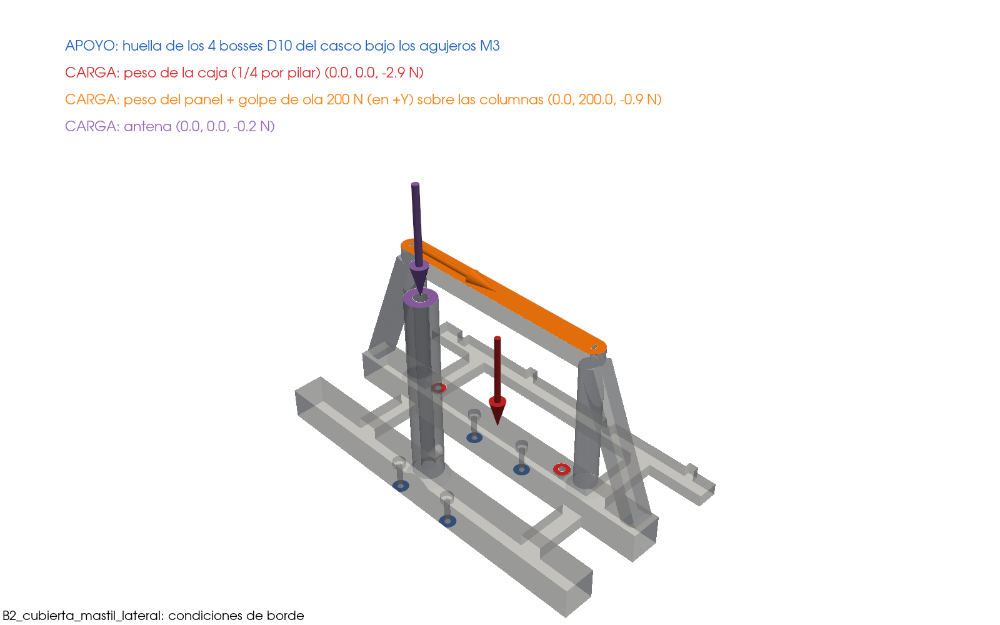

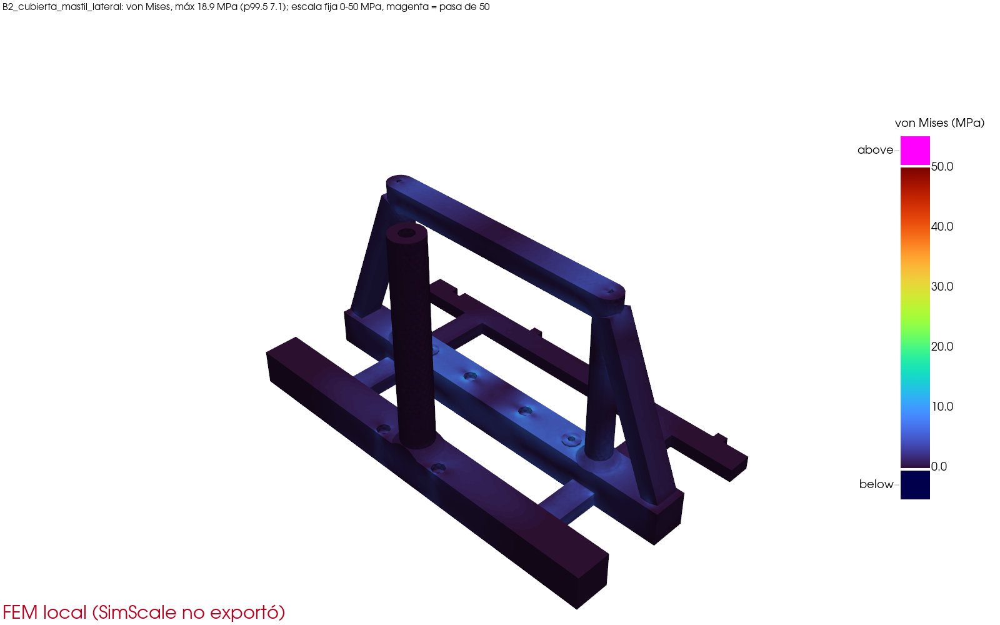

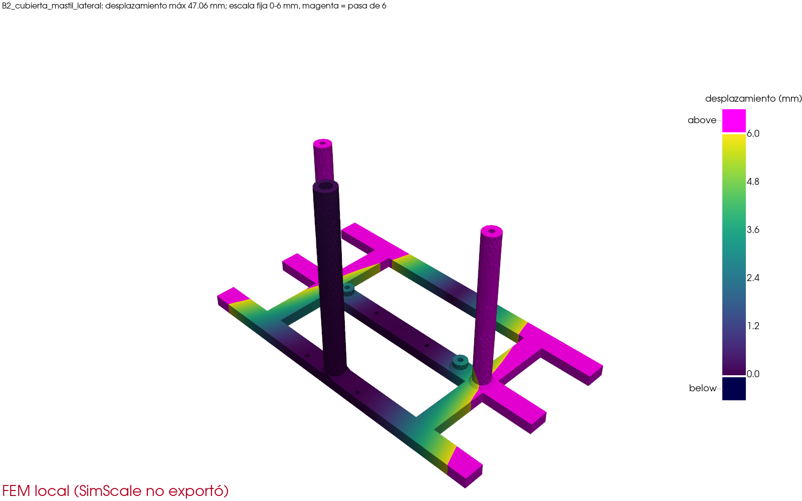

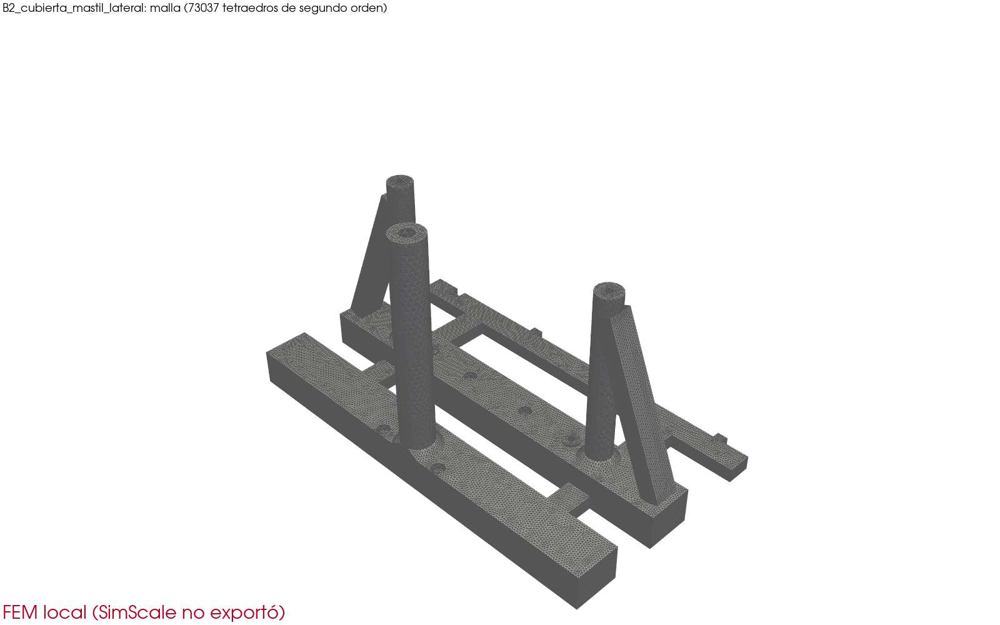

## Qué dicen los resultados

- **M3s_riel_gancho** (SimScale): FS 3.20 (pico), 11.3 sin picos, 4.98 entre capas, 1.53 mm.
- **M5s_capsula_tapa_pie** (SimScale): FS 2.48 (pico), 6.9 sin picos, 3.02 entre capas, 0.29 mm.
- **M1s_caja_cuerpo** (SimScale): FS 1.97 (pico), 6.5 sin picos, 2.84 entre capas, 0.45 mm.
- **B3_caja** (FEM local): FS 4.05 (pico), 8.9 sin picos, 3.91 entre capas, 1.01 mm.
- **B2_cubierta_lisa** (FEM local): FS 1.56 (pico), 3.8 sin picos, 1.65 entre capas, 5.33 mm.
- **B2_cubierta_mastil** (FEM local): FS 1.53 (pico), 3.7 sin picos, 1.65 entre capas, 5.43 mm.
- **B2_cubierta_lisa_lateral** (FEM local): FS 0.61 (pico), 0.9 sin picos, 0.42 entre capas, 47.02 mm.
- **B2_cubierta_mastil_lateral** (FEM local): FS 0.59 (pico), 1.0 sin picos, 0.42 entre capas, 47.06 mm.
- **Golpe lateral de 200 N sobre el panel (cubierta de 8 mm): NO cumple.** σ sin picos 51.9 MPa (FS 0.96 en el plano, 0.42 entre capas), desplazamiento 47 mm. Los 200 N entran enteros por las 2 columnas de una sola mitad (exagerado). Si se reparten entre las dos mitades (100 N cada una; el esfuerzo es proporcional a la carga) queda σ ≈ 26 MPa: FS 1.9 en el plano pero 0.85 entre capas, es decir, **las columnas Ø12 no cumplirían entre capas** aun con el reparto. La flecha de decenas de mm también muestra que la cubierta se dobla mucho.

## Límites y avisos

- Las corridas de SimScale de la cubierta con barras de 8 mm terminaron bien pero el plan gratuito devolvió 403 «export-source-locked» al descargar el resultado; por eso esas piezas salen con FEM local.
  No se usaron capturas del visor web de SimScale: la clave de la API no inicia sesión en la página y no hay una sesión abierta.
- El enlace de cada proyecto es el que usa el sitio para proyectos compartidos (`workbench/?pid=...`). El plan gratuito deja los proyectos públicos (contienen solo geometría y resultados de estas piezas);
  desde el script no se puede comprobar el acceso sin iniciar sesión, conviene abrirlo una vez en una ventana privada.
- No se simuló estanqueidad, fatiga ni el efecto de las capas de impresión (material isótropo; las capas solo entran en el FS entre capas). Los STEP son los de `salida/prototipos/P2_robusto/step` y `salida/boya_pet/step` del momento de la corrida.
- El FEM local usa el máximo por elemento (puntos de integración) y no el valor nodal de SimScale; el p99.5 de los dos es comparable, el máximo puntual puede diferir.
- Los resultados dependen de las cargas supuestas arriba: si el equipo fija otras (por ejemplo la ola real), se corre de nuevo con el script.
