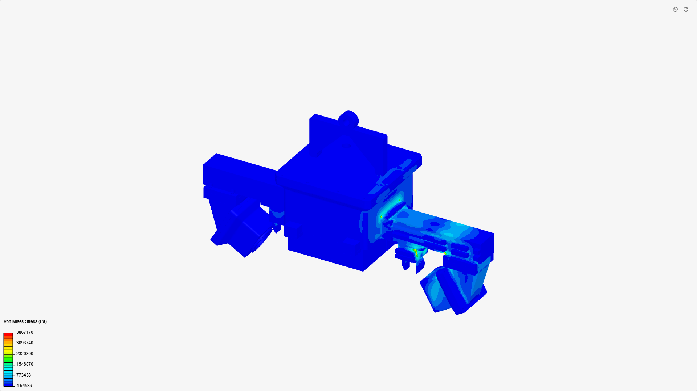
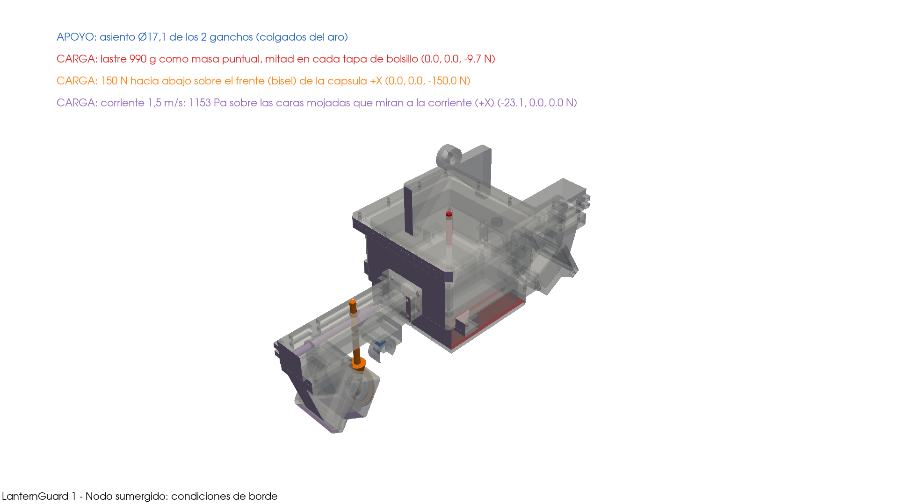
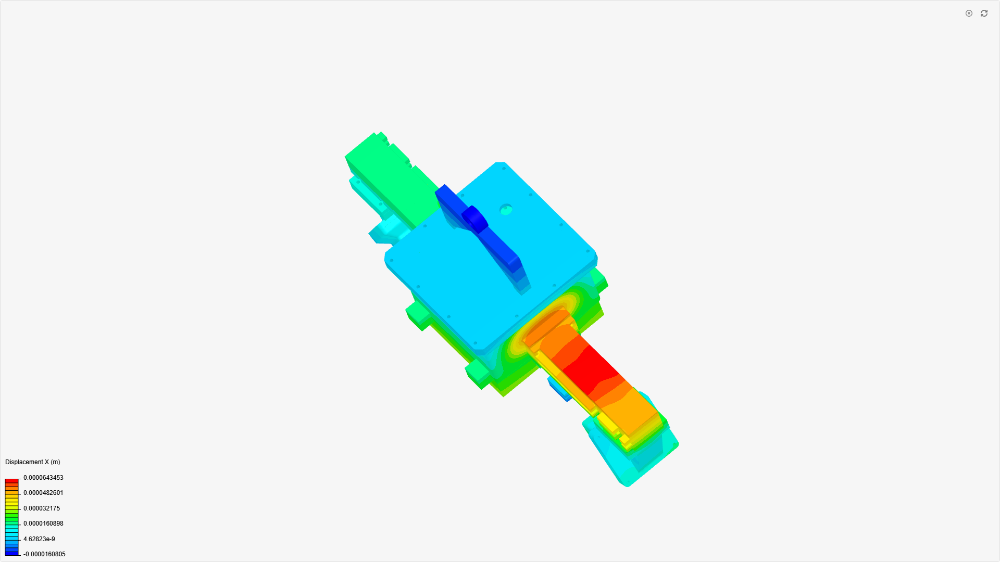
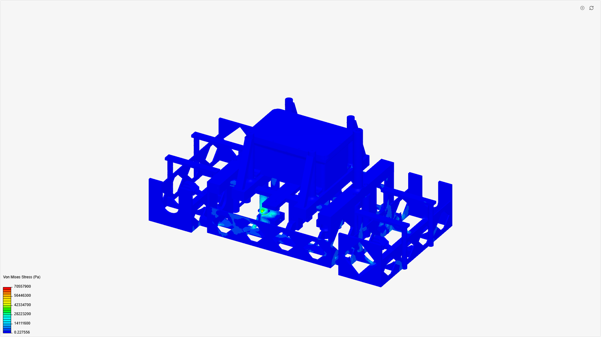
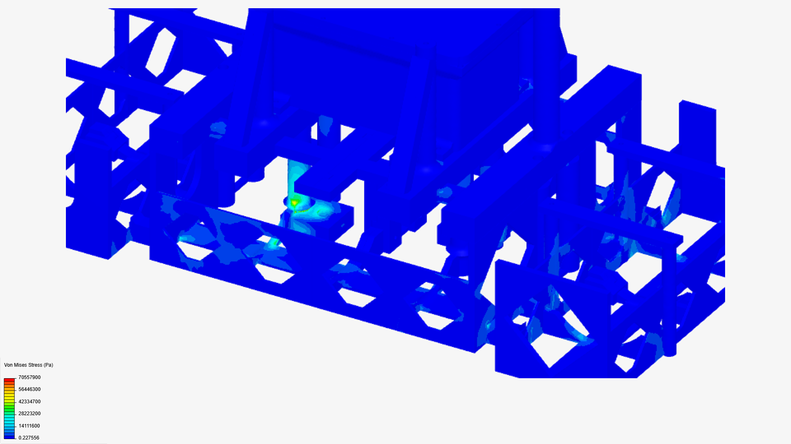
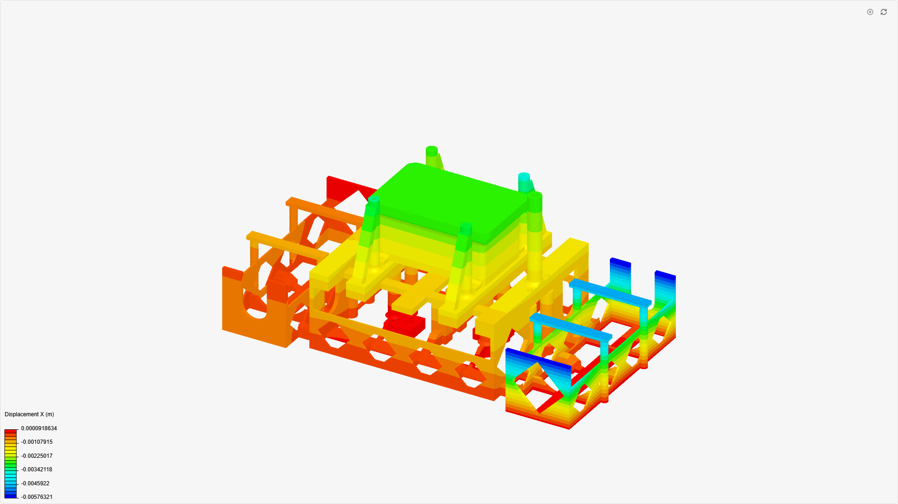
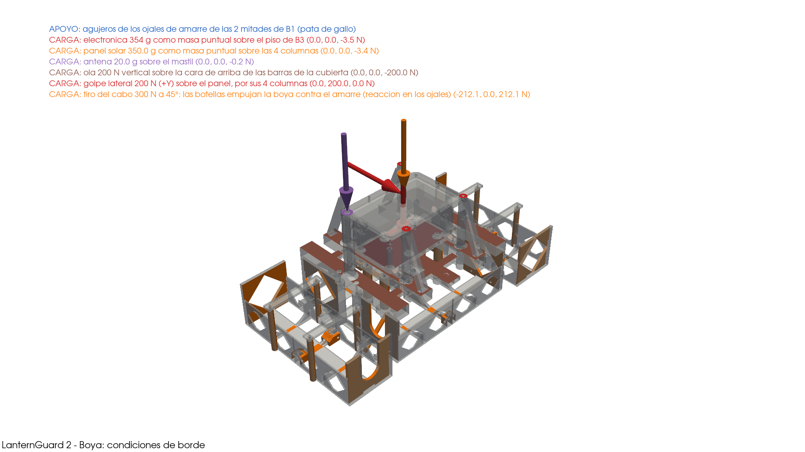
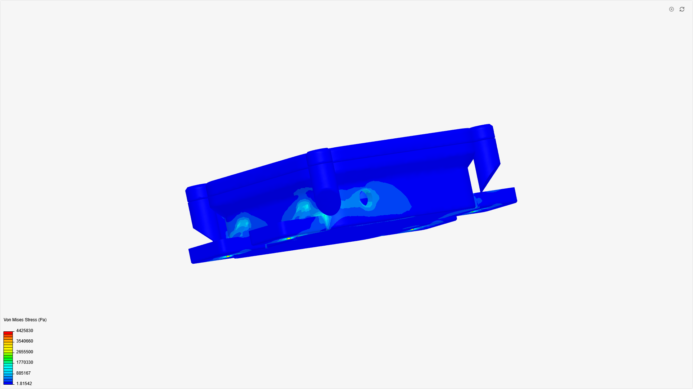
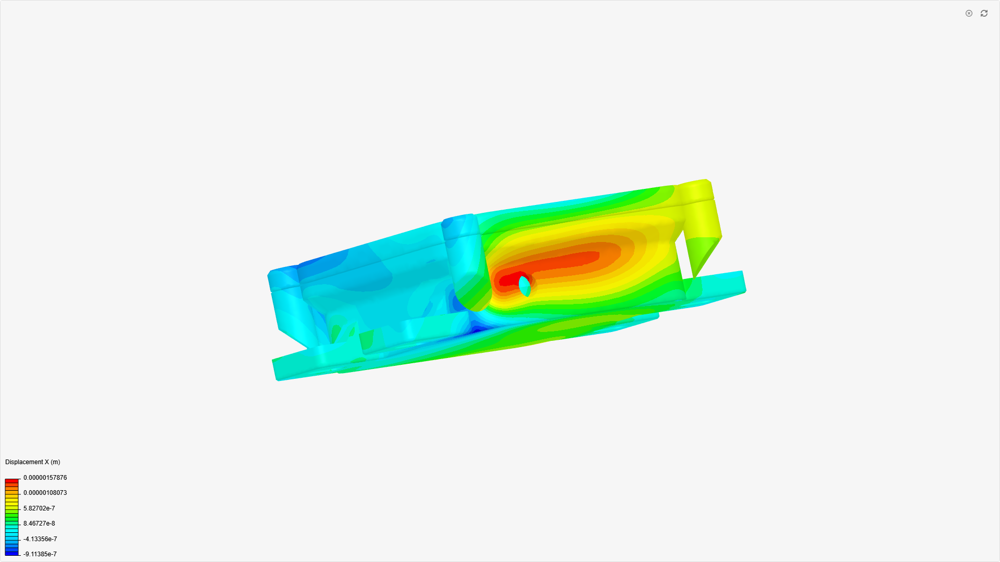
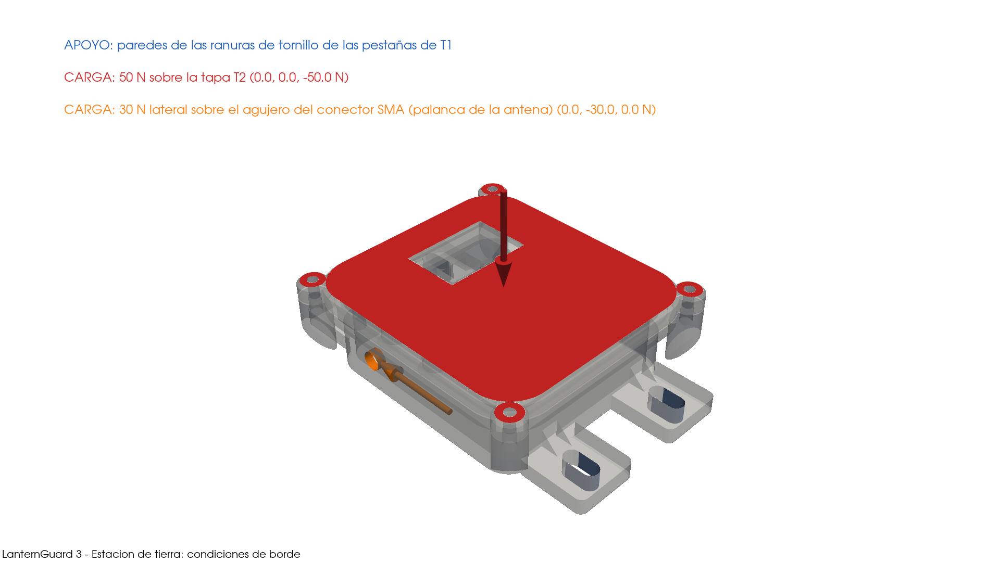

# LanternGuard: SimScale por módulo ensamblado (07/11/2026)

Cada módulo se simuló **ensamblado completo**, como el proyecto de María (*prueba - módulo sumergido PI*), y no pieza por pieza. Análisis estático lineal con contactos pegados (*bonded*) entre todas las piezas que se tocan.

| Módulo | Material | σ máx. | σ adm. | **FS** | Dónde | Página pública |
|---|---|---|---|---|---|---|
| 1 · Nodo sumergido | PETG | **3,87 MPa** | 50 MPa | **12,9** | asiento Ø17,1 del gancho de M3s y riel entre la caja y la cápsula | [lanternguard_1_-_nodo_sumergido](https://www.simscale.com/projects/yoichi_palacio/lanternguard_1_-_nodo_sumergido_1336844629/) |
| 2 · Boya | PETG | **70,6 MPa** bruto (pico singular) | 50 MPa | **0,71 bruto**; ≥ 1,8 fuera del pico | ojal de amarre de B1, en el borde del empotramiento | [lanternguard_2_-_boya](https://www.simscale.com/projects/yoichi_palacio/lanternguard_2_-_boya_661668473/) |
| 3 · Estación de tierra | PLA | **4,43 MPa** | 40 MPa | **9,0** | ranuras de las pestañas de montaje de T1 (borde del apoyo) y zona del agujero SMA | [lanternguard_3_-_estacion_de_tierra](https://www.simscale.com/projects/yoichi_palacio/lanternguard_3_-_estacion_de_tierra_418577745/) |

El σ máx. sale del `modelInfo` del visor público de SimScale (`resultInfoArr[0].maximumValue`), no de leer la leyenda. FS = σ adm. / σ máx.

**Los FS de este informe no reemplazan a los del FEM local.** Son del conjunto en PETG o PLA macizo e isótropo. El FEM local (`fem_tet10`) usa la resistencia entre capas y por eso da FS más bajos. El ensamble sirve para ver cómo se reparte la carga entre las piezas. En el nodo y en tierra, ninguna unión concentra más esfuerzo que las piezas solas. En la boya, el único valor por encima del admisible es un pico singular en el apoyo (ver §2).

## Comparación

| Módulo | Este informe | María (ensamble viejo) | FEM local por pieza |
|---|---|---|---|
| Nodo | 3,87 MPa · FS 12,9 | 19,5 MPa · FS ≈ 2,6 | M3s 16,9 MPa (FS 2,96); M5s 17,0; M1s 18,9 |
| Boya | 70,6 MPa bruto, en el apoyo (FS 0,71); ≤ 28 MPa fuera de él (FS ≥ 1,8) | (ensamble sin resultado publicado) | B3 12,3 MPa; B2 vertical 10,2/10,8; B2 lateral 15,4/15,8; B1 tiro del cabo 20,6 |
| Tierra | 4,43 MPa · FS 9,0 | (no existía) | (no se había calculado) |

**Por qué el nodo da 5 veces menos que María.** Son tres diferencias:
1. **Carga.** María puso presión hidrostática en toda la superficie. Aquí van las cargas del encargo: peso propio, lastre de 990 g, 150 N en una cápsula y la corriente de 1,5 m/s (1153 Pa en las caras que miran aguas arriba).
2. **Apoyo.** Aquí el nodo cuelga del asiento Ø17,1 del gancho, como en el agua. No se usó una base empotrada.
3. **Geometría.** Es la versión del 05/11: aro Ø16,5 y M3s con asiento Ø17,1, la misma que está en Onshape (`VERIFICACION_2026-11-07.md`).

**Por qué el FEM local da más.** El FEM por pieza empotra cada pieza en su unión y le pone la carga entera. En el ensamble, la carga se reparte entre las piezas pegadas y los apoyos son más blandos.

## 1 · Nodo sumergido

- **Geometría:** `00_ENSAMBLE_nodo.step`, 20 piezas. Las 4 REF (electrónica de referencia) y el aro LR2 quedan fuera: el aro es el apoyo.
- **Contactos:** pegados entre caras a ≤ 0,35 mm. El script verificó que todas las piezas forman un solo grupo conectado: ninguna queda suelta.
- **Apoyo:** empotramiento en los 2 asientos Ø17,1 de los ganchos de M3s, donde se apoyan en el aro.
- **Cargas:**
  - peso propio, con g = 9,81 m/s²;
  - lastre: masa puntual de 0,990 kg sobre las 2 tapas M3t;
  - 150 N hacia abajo en la cápsula derecha M6 (sus 7 caras);
  - corriente de 1,5 m/s: 0,5·ρ·Cd·v² con ρ 1025 y Cd 1,0, que da 1153 Pa en las 32 caras que miran aguas arriba (+X, halladas por trazado de rayos).
- **Malla:** finura 4, unos 5,5 millones de celdas según la estimación de la API. El cálculo tardó 18 min 53 s y gastó 1,26 h de CPU.
- **Resultado:** σ máx. 3,87 MPa, con FS 12,9. El pico está en el asiento del gancho de M3s, que es el borde del apoyo. Fuera del apoyo, la zona más cargada es el riel entre la caja y la cápsula.
- **Desplazamiento:** el visor público solo publica la componente X, que va de −16 µm a 64 µm. La magnitud pide sesión.

## 2 · Boya

- **Geometría:** el ensamble de la boya, 14 piezas, sin las 4 REF.
- **Contactos:** con la detección amplia del nodo, SimScale rechazó dos veces la proyección del par B2–B3 («empty contact node list»). En la corrida 2, ese par es estricto (solo planos enfrentados o cilindros del mismo radio, con la cara mayor como maestra) y el resto es amplio, a 0,35 mm. La tolerancia de proyección es 1,0 mm.
- **Apoyo:** empotramiento en los ojos de amarre de B1, donde se ata el cabo.
- **Cargas:**
  - peso propio;
  - masas: electrónica de 354 g en el piso de B3, panel solar de 350 g en las columnas y antena de 20 g en el mástil;
  - ola de 200 N hacia abajo en la cubierta;
  - golpe lateral de 200 N en el panel;
  - tiro del cabo de 300 N, a 45° y repartido en los asientos de las botellas: (−212, 0, +212) N.
- **Malla:** finura 4, unos 9,2 millones de celdas según la estimación de la API. Corrida 2: 14 min 22 s y 0,96 h de CPU.
- **Resultado:** se hicieron **dos corridas**, y las dos quedan en el proyecto público.
  - **Corrida 1, todos los contactos estrictos:** σ máx. 146,8 MPa. **Es un artefacto.** El modo estricto dejó cada cuna B5 pegada al casco por 311 mm², cuando el contacto real mide unos 7 650 mm². En el desplazamiento X, una cuna gira 5,8 mm alrededor de ese parche (captura abajo). No sirve como veredicto.
  - **Corrida 2, contactos completos a 0,35 mm y estrictos solo entre B2 y B3:** σ máx. **70,6 MPa**. El pico es un solo punto, en el ojal de amarre de B1, justo en el borde de la cara empotrada. Es una singularidad del apoyo: el empotramiento rígido de un agujero da tensión infinita en su borde cuando la malla se afina. A mano, el ojal trabaja a 1–2 MPa: la reacción es de unos 290 N, repartida en 2 ojales con agujero Ø10,5 y unos 10 mm de espesor.
  - **Fuera del pico:** casi todo el modelo queda por debajo de 14 MPa. Las zonas más cargadas, en las cunas y la cubierta, están en la banda de 14 a 28 MPa, así que el **FS es ≥ 1,8** (50/28) con la leyenda como cota. El FEM local por pieza da FS 2,4 en B1 con el tiro del cabo (20,6 MPa) y 3,2 en B2 con el golpe lateral (15,8 MPa). Las 4 cargas actúan juntas, como caso envolvente.
  - **Pendiente:** con sesión, sondear el valor a 2–3 mm del ojal en el post-procesador. La corrida de desplazamiento es de la corrida 1; la 2 no tiene la suya publicada.
- **Flujo incompresible (opción b):** **no se hizo.** Se usaron las horas en la segunda corrida estática, y la prioridad era un resultado estático confiable. El arrastre sigue estimado con Cd 1,0.

## 3 · Estación de tierra

- **Geometría:** T1 (caja) y T2 (tapa), en PLA.
- **Contactos:** 1 par pegado, en el asiento de la tapa.
- **Apoyo:** las paredes de las 4 ranuras en U de las pestañas de T1, que son 12 caras. Es donde entran los tornillos de montaje. La primera corrida empotraba todo el fondo de T1: la cara inferior es una sola y abarca las pestañas, así que esa corrida (0,92 MPa) se descartó y se rehízo.
- **Cargas:**
  - 50 N hacia abajo en la tapa T2;
  - 30 N horizontales, perpendiculares al eje, en el agujero del conector SMA. Es la palanca de la antena.
- **Malla:** unos 2,5 millones de celdas, con 0,08 h de CPU.
- **Resultado:** σ máx. 4,43 MPa, con FS 9,0. Los picos están en los bordes de las ranuras de apoyo, que son concentraciones del empotramiento, y alrededor del agujero SMA. La tapa queda casi descargada.
- **Desplazamiento:** el visor público solo publica la componente X, que va de −0,91 µm a 1,58 µm. La magnitud pide sesión (ver `GUIA_CAPTURAS_SIMSCALE.md`).

## Lo que no se pudo hacer sin iniciar sesión

En el plan gratuito, la API no entrega resultados. Al exportar responde 403 «export-source-locked» y al pedir un informe responde «result is locked». Todo lo de arriba sale de la página pública de cada proyecto. **No se pudieron leer sin sesión** cuatro cosas:
- la magnitud del desplazamiento;
- la vista de la malla;
- las condiciones de borde dentro del workbench;
- **la configuración del proyecto de María.** La configuración de este informe sigue el encargo, no la de ella.

En su lugar van el render local de las condiciones de borde y el número de celdas estimado. Los pasos para sacar esas capturas con sesión están en `docs/GUIA_CAPTURAS_SIMSCALE.md`.

## Supuestos y simplificaciones

- Material macizo, isótropo y lineal. No se modelan el relleno ni la anisotropía de la impresión.
- Todos los contactos son pegados. No hay fricción ni separación, así que los tornillos y las juntas no se modelan.
- Las piezas REF (electrónica) entran solo como masas puntuales, no como sólidos.
- El arrastre de la corriente usa Cd 1,0, sin CFD.
- Los picos que están sobre una cara empotrada son singularidades del apoyo. El valor real ahí depende de cómo se reparta la carga del tornillo o del aro.

Scripts: `cad_final/simscale_modulos.py`, también como `simscale_run.py --modulo <nodo|boya|tierra>`, y `cad_final/capturas_simscale.py`. Estado y pids en `salida/simscale_modulos/state.json`.
