# LanternGuard: SimScale por módulo ensamblado (v2, 07/11/2026)

Cada módulo se simuló **ensamblado completo**: análisis estático lineal, malla de 2.º orden y contactos pegados (*bonded*) entre las piezas que se tocan. Esta versión agrega tres cosas: la lectura crítica del proyecto de María, un caso hidrostático del nodo a 1 m y la boya rehecha por casos de una sola carga, con apoyo realista en el ojal y convergencia en 2 mallas. Las capturas son del workbench con sesión iniciada.

## Resumen

| Módulo · caso | Material | σ máx. | FS macizo (σ adm.) | FS entre capas | ¿Pasa? |
|---|---|---|---|---|---|
| 1 · Nodo, combinado (peso + lastre + 150 N + corriente) | PETG | 3,87 MPa | **12,9** (50) | **5,7** (22) | Sí |
| 1 · Nodo, hidrostático a 1 m | PETG | 0,84 MPa | **59** (50) | **26** (22) | Sí |
| 2 · Boya, tiro del cabo 300 N colineal (reacción en los ojales), malla B | PETG | 23,1 MPa | **2,2** (50) | **0,95** (22) | Macizo sí; entre capas, justo |
| 2 · Boya, ola 200 N (asientos de las botellas) | PETG | 2,31 MPa | **22** (50) | **9,5** (22) | Sí |
| 2 · Boya, golpe lateral 200 N (asientos de las botellas) | PETG | 6,45 MPa | **7,8** (50) | **3,4** (22) | Sí |
| 3 · Estación de tierra (50 N tapa + 30 N SMA) | PLA | 4,43 MPa | **9,0** (40) | **4,5** (20, supuesto) | Sí |

- **σ máx.** sale del `modelInfo` del visor público de SimScale (`resultInfoArr[0].maximumValue`), con FS = σ adm. / σ máx.
- **FS entre capas** usa la resistencia de la unión entre capas impresas. Para PETG es 22 MPa (`params.py`, `petg.sigma_capas`). Para PLA es 20 MPa, un **supuesto** con la misma proporción, porque el repo no tiene ese parámetro.
- **Los picos sobre una cara de apoyo son singularidades:** crecen sin límite al afinar la malla. Por eso cada caso dice dónde está el máximo y si queda lejos del apoyo.

**Proyectos públicos:**
- [1 · Nodo sumergido](https://www.simscale.com/projects/yoichi_palacio/lanternguard_1_-_nodo_sumergido_1336844629/)
- [2 · Boya](https://www.simscale.com/projects/yoichi_palacio/lanternguard_2_-_boya_661668473/)
- [3 · Estación de tierra](https://www.simscale.com/projects/yoichi_palacio/lanternguard_3_-_estacion_de_tierra_418577745/)

Las corridas anteriores siguen en cada proyecto; no se borró ninguna.

## Límite del plan: sin valores ni sondas en el workbench

La cuenta tiene el plan Community excedido. Con sesión iniciada, el post-procesador muestra los contornos, pero desactiva los números de la leyenda y las estadísticas: «*Legend bar values are disabled for this result because it was generated from an exceeded Community plan*». Eso trae tres consecuencias:

- **No se pudieron poner sondas** a 2 y 3 mm del borde del ojal de B1.
- **El desplazamiento** sale solo como contorno, sin cifra.
- **Los promedios por zona** se pidieron en el control de resultados, pero tampoco se pueden leer.

Los máximos de von Mises salen del visor público. En lugar de las sondas, la boya se lee por **convergencia del pico entre 2 mallas**: un pico que cambia poco entre la malla A y la B es real, y uno que crece es singular. Además, se compara con cálculos a mano.

## Configuración y justificación

| Tema | Decisión | Por qué |
|---|---|---|
| Análisis | Estático lineal, 2.º orden (`mesh_order SECOND`) | Las deformaciones son de µm a décimas de mm; los tetraedros de 2.º orden no se rigidizan en flexión. |
| Material | PETG: E 2,1 GPa, ν 0,38, ρ 1270 kg/m³, σ adm. 50 MPa. PLA (tierra): E 3,5 GPa, ν 0,36, ρ 1240, σ adm. 40 MPa | Lo que pide el encargo. |
| Contactos | Pegados solo donde se tocan las caras: ≤ 0,35 mm y proyección a 1,0 mm. Se verifica que todo forme un solo grupo conectado | En el ensamble real, las piezas van atornilladas o pegadas en esas caras. Si se pegan caras que no se tocan, el conjunto queda falsamente rígido. |
| Apoyos | Nodo: asientos Ø17,1 de los ganchos en el aro. Tierra: ranuras de los tornillos. Boya: según el caso (§2) | Es donde la pieza se apoya de verdad, no una base empotrada inventada. |
| Malla | Simmetrix, finura 4. Boya: refinamiento local de 1,5 mm (A) y 0,75 mm (B) en el agujero y el saliente del ojal | Convergencia en la zona que decide el FS de la boya. |
| Lectura | Máximo del visor; se ubica en la captura; si está sobre el apoyo, se marca como singular | No se pueden tomar sondas (ver arriba). |
| *Inertia relief* | No está disponible en la API ni en el plan | Por eso la boya se separa en casos que se equilibran con su propio apoyo. |

### Mallas reales

Son el número de celdas que entrega `MeshesApi`. La versión 1 de este informe usaba la estimación previa de la API, que se pasaba de 20 a 60 veces.

| Malla | Celdas |
|---|---|
| Tierra | 78 344 |
| Nodo, combinado | 218 458 |
| Nodo, hidrostático | 216 960 |
| Boya, corrida 1 | 143 676 |
| Boya, corrida 2 | 147 817 |
| Boya, malla A (1,5 mm en el ojal) | 193 610 |
| Boya, malla B (0,75 mm en el ojal) | 360 127 |

Los casos de la boya de una sola carga reutilizan las mallas A y B.

## Proyecto de María: lectura crítica

Con nuestra clave de API se leyó la configuración completa de los dos proyectos públicos de María: la simulación, la malla y las corridas. Los archivos están en `salida/simscale_modulos/maria_nodo_spec.json` y `maria_boya_spec.json`.

| Tema | María (nodo) | Juicio | Nuestra configuración |
|---|---|---|---|
| Tipo de análisis | Estático lineal | ✔ Correcto | Igual |
| Material | PETG, E 2,1 GPa, ν 0,38, ρ 1250 | ✔ Correcto (ρ 1250 frente a 1270, sin efecto) | PETG con ρ 1270 |
| Gravedad | Activa | ✔ | Activa |
| Contactos | 13 pares pegados, tolerancia 1 mm | ✔ Adecuado. Una tolerancia de 1 mm puede pegar caras que no se tocan | Pegado a ≤ 0,35 mm, proyección a 1 mm, un solo grupo verificado |
| Apoyo | 1 cara empotrada: el ojal de izaje de la tapa (B5) | ✘ En el agua, el nodo cuelga de los ganchos del aro, no del ojal de la tapa. Una sola cara empotrada concentra todo el esfuerzo en esa cara | Los 2 asientos Ø17,1 de los ganchos de M3s |
| Presión | 30 kPa constantes en 294 caras de 12 cuerpos | ✘ 30 kPa equivale a 3 m de profundidad, pero el diseño es de 1 m. Además no tiene gradiente y carga también las partes inundadas, que tienen agua por los dos lados | **Adoptado y corregido:** p(Z) = ρ·g·(1 m − (Z − Z_c)) solo en las 213 caras exteriores del volumen seco |
| Otras cargas | Ninguna: ni lastre, ni corriente, ni los 150 N | ✘ Faltan las cargas del encargo | Caso combinado: peso + lastre de 990 g + 150 N + corriente de 1,5 m/s |
| Malla | Automática, finura 5, 222 033 celdas, `mesh_order` sin definir | ~ Densidad parecida, sin refinamiento ni convergencia | Finura 4, 2.º orden, refinamiento local donde decide el FS |
| Resultado | 19,5 MPa (corrida de 5 min, 0,17 h CPU) | Pico en la cara empotrada del ojal: singularidad del apoyo | 3,87 MPa (combinado) y 0,84 MPa (hidrostático) |
| **Boya** | **CFD incompresible**, no estructural: agua de mar, entrada a 0,3 m/s, 8,85 M celdas, 2 h 16 min | ~ Útil para el arrastre, pero 0,3 m/s es la quinta parte de la corriente de diseño (1,5 m/s) y no da esfuerzos | Estructural. Arrastre con Cd 1,0 a 1,5 m/s; CFD no repetido |

**Qué se adoptó de María:** el análisis estático lineal, el PETG, la gravedad, los contactos pegados y la idea de cargar el nodo con presión hidrostática, corregida a 1 m, con gradiente y solo sobre el volumen seco. **Qué se corrigió:** el apoyo, la profundidad, las caras cargadas y las cargas que faltaban.

## 1 · Nodo sumergido

- **Geometría:** `00_ENSAMBLE_nodo.step`, 20 piezas. Las 4 REF (electrónica de referencia) entran solo como masas. El aro LR2 queda fuera porque es el apoyo.
- **Apoyo:** los 2 asientos Ø17,1 de los ganchos de M3s, que cuelgan del aro.

### Caso A · Combinado

- **Cargas:** peso propio, lastre de 0,990 kg como masa en las tapas M3t, 150 N hacia abajo en la cápsula M6 y la corriente de 1,5 m/s (1153 Pa en las 32 caras que miran aguas arriba).
- **Resultado:** σ máx. **3,87 MPa**, con FS 12,9 en macizo y **5,7 entre capas**. El pico está en el asiento del gancho de M3s, en el borde del apoyo. Fuera del apoyo, la zona más cargada es el riel entre la caja y la cápsula.

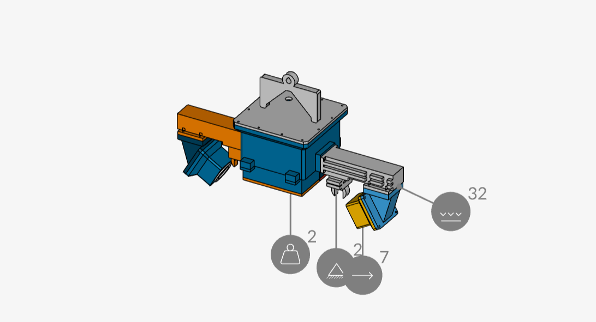

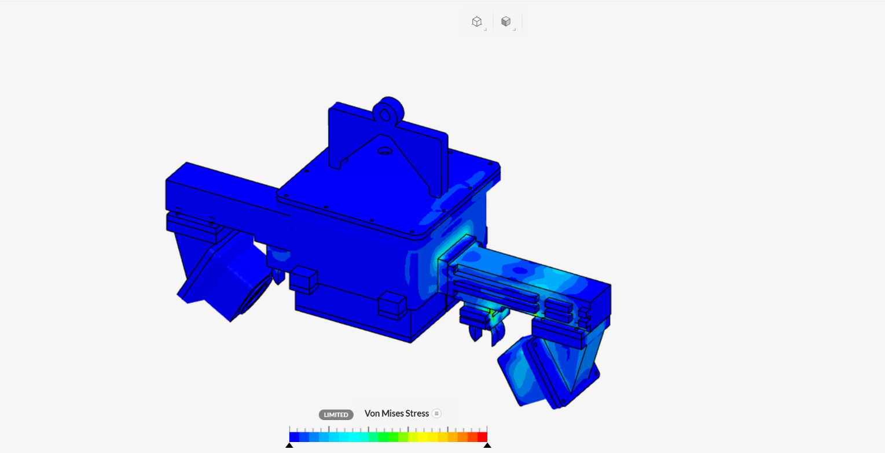

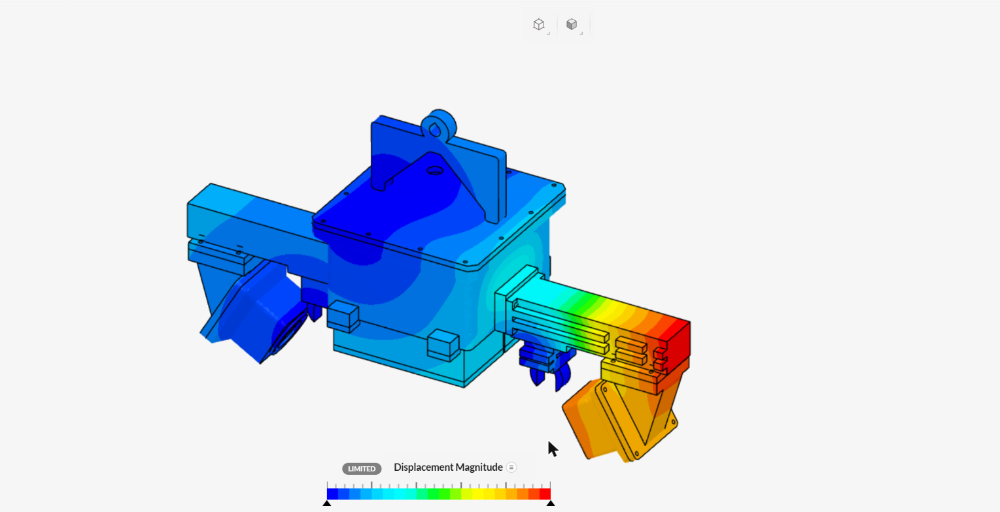

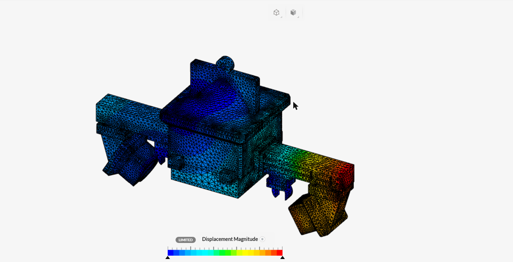

### Caso B · Hidrostático a 1 m

- **Cargas:** p = 10055,2·(1,0351 − Z) Pa, con Z en m, sobre las 213 caras exteriores mojadas de M1s, M2, M3s, M4 y M5s (1493 cm²). Se suman el peso y el lastre.
- **Resultado:** σ máx. **0,84 MPa**, con FS 59 en macizo y **26 entre capas**. El contorno muestra las paredes de la caja M1s abombándose hacia adentro. A 1 m (≈ 10 kPa), la presión no gobierna el diseño.
- **Corrida:** 11 min 30 s y 0,38 h de CPU.

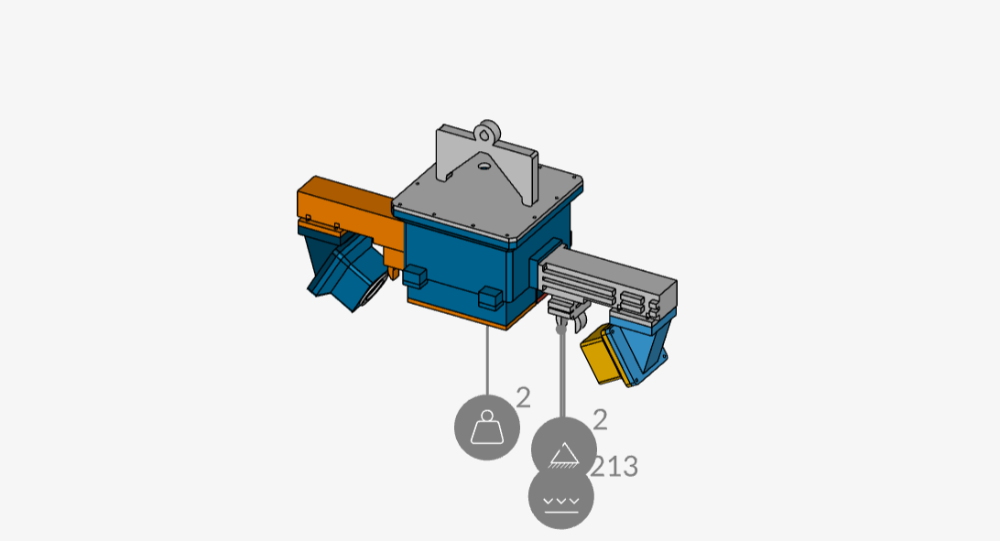

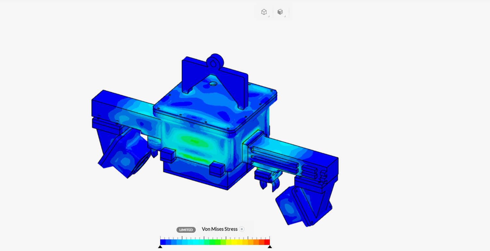

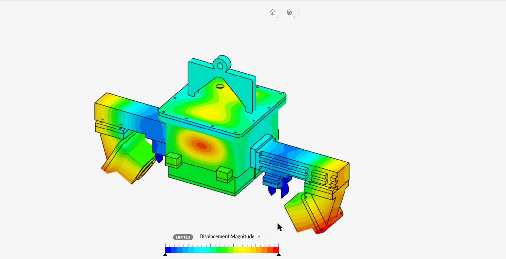

**Conclusión del nodo: pasa.** El FS más bajo es 5,7 entre capas. No hace falta reforzar. El FEM local por pieza sigue siendo el que gobierna (M3s 16,9 MPa, FS 2,96), porque empotra cada pieza y le pone la carga entera.

## 2 · Boya

- **Geometría:** 14 piezas, sin las 4 REF.
- **Contactos:** completos, pegados a ≤ 0,35 mm. Solo el par B2–B3 es estricto, porque SimScale no logra proyectarlo en modo amplio. Todo forma un solo grupo conectado.
- **Malla:** de 2.º orden, finura 4 y refinamiento local en el agujero y el saliente de cada ojal (8 caras, 3727 mm²): **A = 1,5 mm** (193 610 celdas) y **B = 0,75 mm** (360 127 celdas).

### Por qué la boya ya no se calcula con todas las cargas juntas

El caso combinado (peso + ola + golpe lateral + cabo) se corrió con tres apoyos distintos:

| Apoyo | σ máx. |
|---|---|
| Ojales empotrados, contactos estrictos (corrida 1) | 146,8 MPa |
| Ojales empotrados, contactos completos (corrida 2) | 70,6 MPa |
| Ojales con resorte 2e5 N/m + agua como resorte en los asientos, malla A / malla B | 539 / 440 MPa |

El resto de la boya no pasó de unos 28 MPa en ninguno de los tres. **Un pico que cambia siete veces según el apoyo es una singularidad, no un esfuerzo.** La ola y el golpe lateral generan un momento que, en el agua, se reparte entre el empuje de las botellas, la escora y la inercia. La rigidez de giro del agua es apenas ρ·g·I ≈ 6,5 N·m/rad. Un modelo estático sin *inertia relief* no tiene por dónde sacar ese momento, salvo por el agujero del ojal, y SimScale no ofrece *inertia relief* en este plan. Las corridas quedan en el proyecto como evidencia. **La boya se separa en casos de una sola carga, cada uno con su apoyo físico.**

### Caso A · Tiro del cabo de 300 N (convergencia)

- **Apoyo:** cada ojal lleva un resorte de 2e5 N/m en el agujero Ø10,5, que representa el grillete y la pata de gallo. No es una cara rígida.
- **Carga:** 300 N sobre los 154 asientos de las botellas (90 814 mm²), que es el empuje del agua que la boya opone al amarre.
- **Primer intento, a 45°:** la carga va a (−212, 0, +212) N, como en el encargo. σ máx. 64,8 MPa con la malla A y 51,8 con la B: no converge.
  - La recta de la carga no pasa por los ojales, así que el tiro deja un momento que solo puede tomar el agujero.
  - En el agua eso no ocurre. La boya es un cuerpo sometido a dos fuerzas (el tiro del cabo y el empuje del agua), así que gira hasta que las dos quedan colineales.
- **Caso válido, colineal:** la fuerza va desde el centroide de los asientos (z = 38,8 mm) hacia el de los ojales (z = 7,0 mm), es decir (0, 0, 300) N en ejes de la boya.

| Malla | σ máx. | Variación |
|---|---|---|
| A (1,5 mm en el ojal) | 23,08 MPa | — |
| B (0,75 mm en el ojal) | 23,09 MPa | **+0,02 %** (< 5 %) |

- **Lectura:**
  - **El pico no está en el ojal.** Ahí la malla se refinó a la mitad y el máximo no se movió, así que el ojal queda por debajo de 23 MPa en las dos mallas. A mano, el aplastamiento en cada ojal es de unos 150 N / (10,5 × 10 mm²) ≈ 1,4 MPa.
  - **El pico está en el reticulado del casco B1 y las cunas B5,** en las esquinas interiores de los nudos, donde llega la carga de las botellas. El contorno muestra puntos amarillos y verdes (≈ 10–17 MPa) en esos nudos, y el resto queda por debajo de 7 MPa.
  - El FEM local de B1 con el tiro del cabo dio 20,6 MPa, coherente con este resultado.
- **FS:** 50 / 23,1 = **2,2 en macizo** y 22 / 23,1 = **0,95 entre capas** en el pico. En la banda de los nudos (≤ 17 MPa) queda en ≈ 1,3 entre capas.

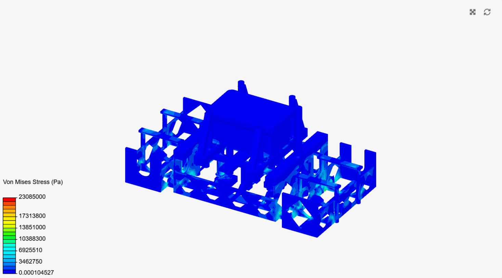

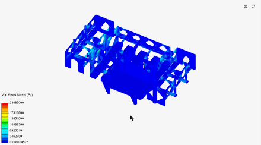

### Caso B · Ola de 200 N

- **Carga:** 200 N verticales sobre la cara de arriba de las barras de la cubierta B2 (10 caras).
- **Apoyo:** los asientos de las botellas fijos, porque las botellas y el agua toman la carga. El apoyo queda lejos de la zona que se lee.
- **Resultado:** σ máx. **2,31 MPa**, en las barras de la cubierta, en su unión con la caja B3. FS **22 en macizo y 9,5 entre capas**.

### Caso C · Golpe lateral de 200 N

- **Carga:** 200 N en +Y sobre el panel, que entra por la punta de sus 4 columnas.
- **Apoyo:** los asientos de las botellas fijos.
- **Resultado:** σ máx. **6,45 MPa**, en la base de las columnas, donde se unen a la cubierta. FS **7,8 en macizo y 3,4 entre capas**. El FEM local de B2 con el golpe lateral dio 15,4–15,8 MPa, porque empotra la pieza sola.

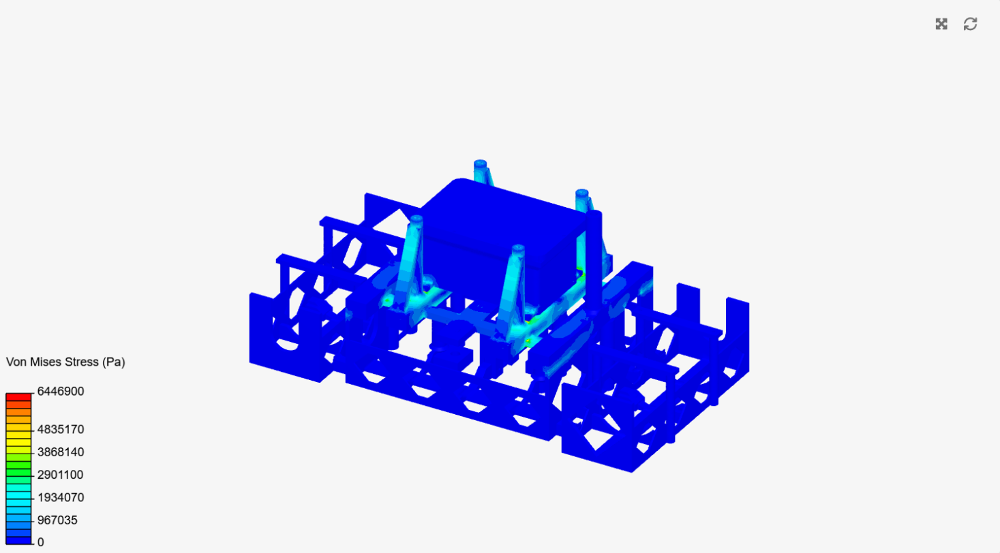

**Los casos no se superponen,** porque cada uno tiene su propio apoyo. La envolvente es el peor caso por pieza: B1 y B5 con el cabo (23,1 MPa) y B2 con el golpe lateral (6,45 MPa).

**Sondas en el ojal:** no se pudieron tomar, porque el plan bloquea los valores (ver arriba). Las reemplazan la convergencia A/B en el ojal y el cálculo a mano.

**Conclusión de la boya:**
- **Pasa contra material macizo:** el FS mínimo es 2,2.
- **Entre capas queda justo (FS 0,95 en el pico)** con el tiro del cabo.
- **Qué reforzar, en los nudos del reticulado de B1 y B5 que reciben las botellas:**
  - un filete de r ≥ 2 mm en las esquinas interiores;
  - más perímetros (≥ 4) o 100 % de relleno en esa zona;
  - imprimir las barras con las capas a lo largo de ellas, no a través.
- **El ojal no hace falta reforzarlo.**

## 3 · Estación de tierra

- **Geometría y contactos:** T1 (caja) y T2 (tapa) en PLA, con 1 par pegado en el asiento de la tapa.
- **Apoyo:** las paredes de las 4 ranuras en U de las pestañas (12 caras), donde van los tornillos.
- **Cargas:** 50 N hacia abajo en la tapa y 30 N horizontales en el agujero SMA (la palanca de la antena).
- **Resultado:** σ máx. **4,43 MPa**, con FS 9,0 en macizo y **4,5 entre capas** (supuesto de 20 MPa). Los picos están en los bordes de las ranuras de apoyo y alrededor del agujero SMA. La tapa queda casi descargada.

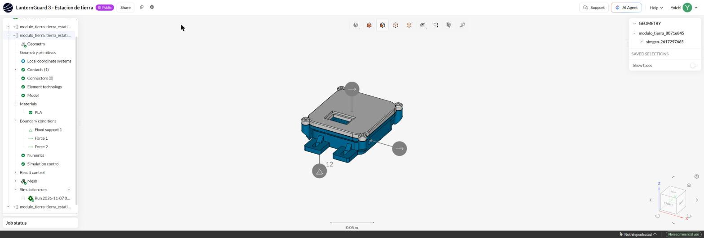

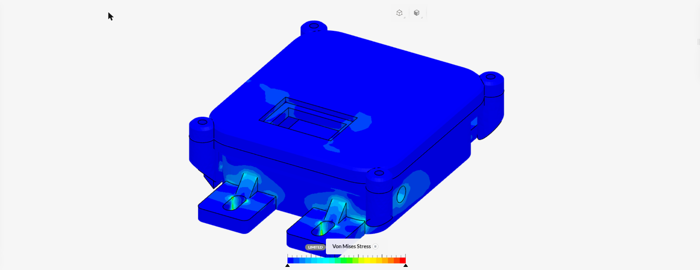

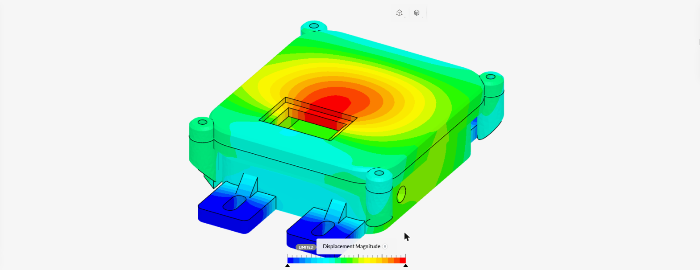

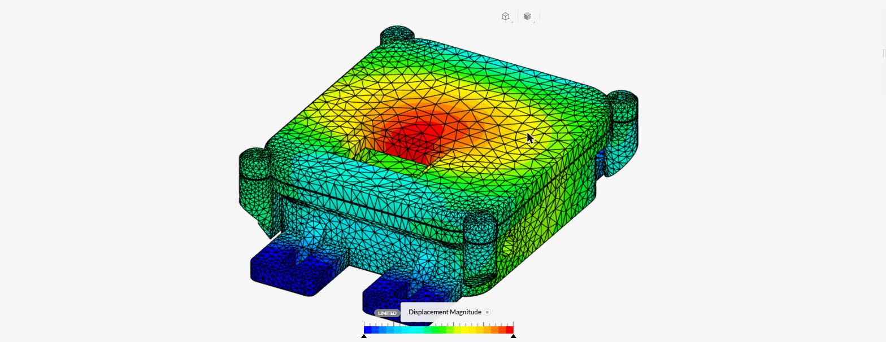

**Conclusión de tierra: pasa.** No hace falta reforzar.

## Supuestos y simplificaciones

- El material es macizo, isótropo y lineal. El efecto de las capas entra solo por el FS entre capas.
- Los contactos son pegados, sin fricción ni separación. Los tornillos no se modelan uno por uno.
- Las piezas REF (electrónica) entran como masas puntuales.
- El arrastre usa Cd 1,0, sin CFD.
- Las capturas salen de la pestaña del navegador (Claude in Chrome), con una ventana de 2284 × 777 px. No se pudo fijar 1920 × 1080. La vista es isométrica o la más cercana que deja ver la zona.
- La malla se muestra en el post-procesador, como superficies con aristas, porque la vista de malla del workbench se quedaba en «downloading».

Scripts: `cad_final/simscale_modulos.py` (casos: `--caso nodo_hidro`, `boya_v3A/B`, `boya_caboA/B`, `boya_olaA`, `boya_lateralA`) y `cad_final/simscale_run.py`. Estado e ids en `salida/simscale_modulos/state.json`. Las decisiones están en `docs/DECISIONES.md` (07/11).
