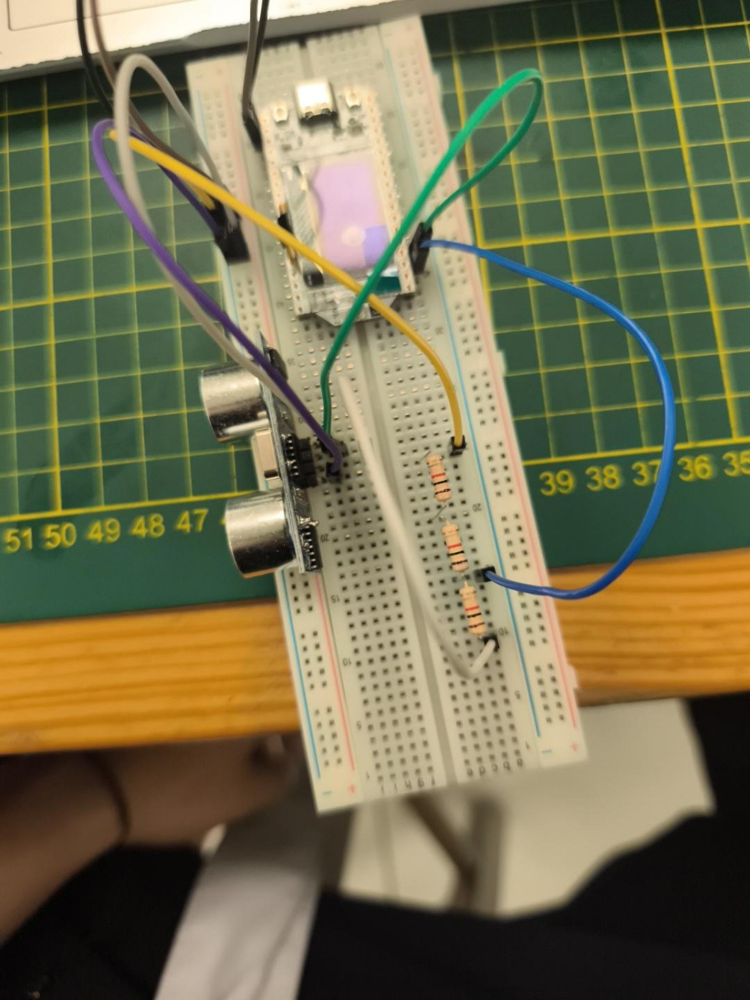
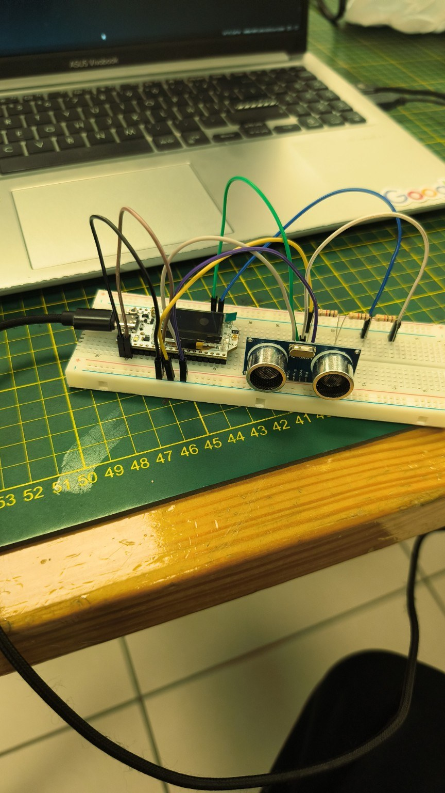
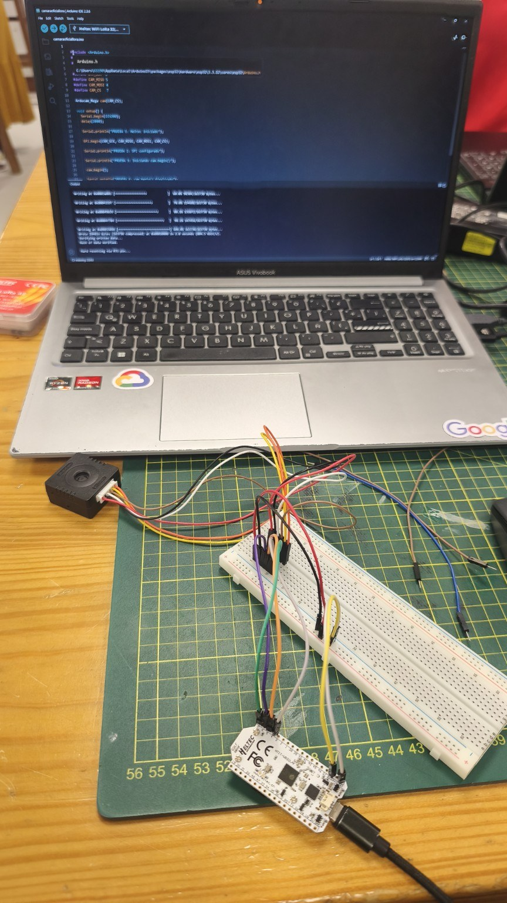
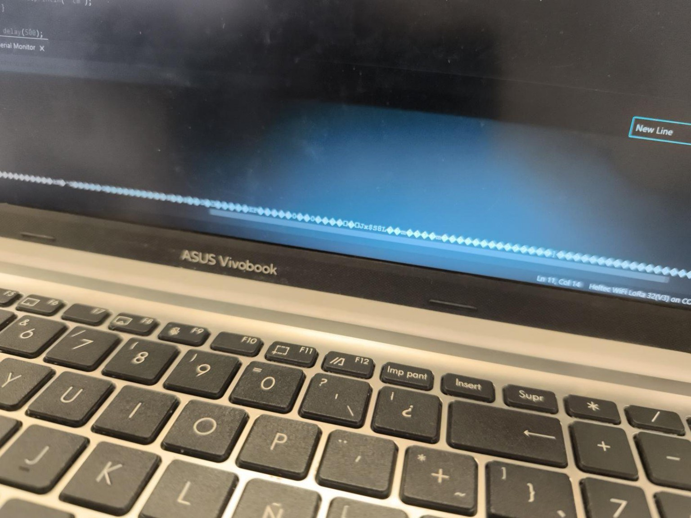
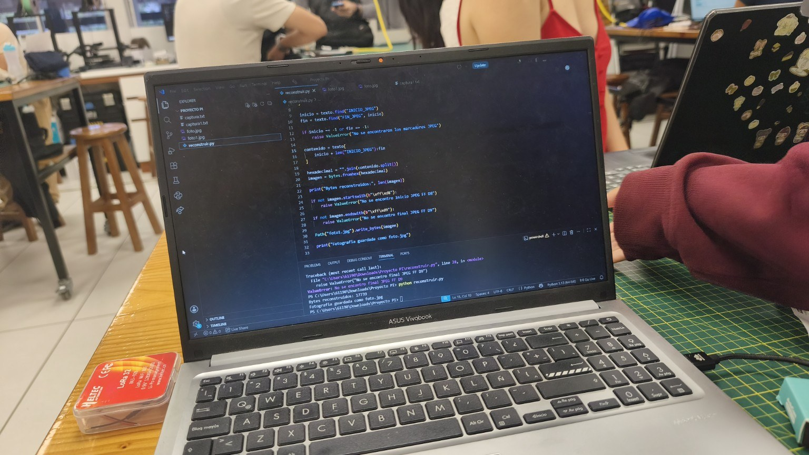
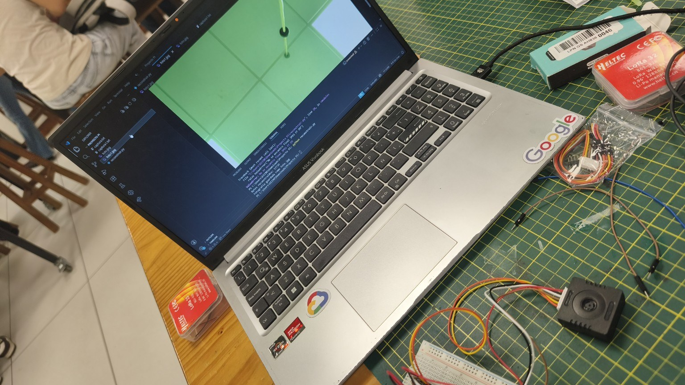

<h1 align="center">LanternGuard</h1>

<h2 align="center">TRL 3 — Validación mediante simulación en SimScale</h2>

<strong>Sección de simulaciones CFD y estructurales (FEA) de la boya, el módulo sumergido y el módulo en tierra</strong>

<h2 align="center">Información académica</h2>

  <table>
    <thead>
      <tr>
        <th align="center">Campo</th>
        <th align="center">Información</th>
      </tr>
    </thead>
    <tbody>
      <tr>
        <td><strong>Proyecto</strong></td>
        <td align="center">LanternGuard</td>
      </tr>
      <tr>
        <td><strong>Curso</strong></td>
        <td align="center">Proyecto Integrador</td>
      </tr>
      <tr>
        <td><strong>Docentes</strong></td>
        <td>
          <ul>
            <li>Umbert Lewis de la Cruz Rodriguez</li>
            <li>Renzo Jose Chan Rios</li>
            <li>Maria Angelica Rejas Nuñez</li>
            <li>Harry Anderson Rivera Tito</li>
          </ul>
        </td>
      </tr>
      <tr>
        <td><strong>Integrantes</strong></td>
        <td>
          <ul>
            <li>Antezana De la Cruz, María</li>
            <li>Santamaria Huaytan, Gabriela</li>
            <li>Bustos Montañez, Melissa</li>
            <li>Lombardi Quispe, Joseph</li>
            <li>Palacios Tanaka, Yoichi</li>
          </ul>
        </td>
      </tr>
      <tr>
        <td><strong>Periodo académico</strong></td>
        <td align="center">2026-2</td>
      </tr>
    </tbody>
  </table>

---

## 1. Introducción

LanternGuard es una propuesta tecnológica para el monitoreo periódico de la bioincrustación en las linternas de cultivo de concha de abanico (*Argopecten purpuratus*) en la Bahía de Samanco. El sistema está formado por tres módulos: una **boya marina**, un **módulo sumergido**, instalado en una linterna de 20 cm de diámetro, y un **módulo en tierra**, que aloja la estación LoRa receptora.

Esta sección del TRL 3 [[1]](#ref-1) presenta la validación de la geometría de los tres módulos mediante simulaciones en SimScale, antes de su impresión 3D. Se simuló el flujo de agua alrededor de la boya (CFD) y se evaluó el esfuerzo y el desplazamiento del módulo sumergido y del módulo en tierra (análisis estático). La boya y el módulo sumergido se fabricarán en PETG [[2]](#ref-2), y el módulo en tierra en PLA.

Las pruebas de banco de electrónica y software se documentan en la sección 5.

---

## 2. Módulo de boya: dinámica de fluidos

### 2.1. Configuración de la simulación

Se simuló el paso de la corriente marina alrededor de la boya mediante un análisis de fluido incompresible. Para ello se creó un bloque de agua (*Flow region*) alrededor del modelo, ya que SimScale solo calcula el flujo dentro de un volumen al que se le asignan las propiedades del fluido. La Tabla 1 resume los valores ingresados.

<strong>Tabla 1. Parámetros de la simulación CFD de la boya</strong>

| Parámetro | Valor |
|---|---|
| Fluido | Agua de mar, 3,5 % de salinidad |
| Densidad | 1024 kg/m³ |
| Viscosidad cinemática | 9,88 × 10⁻⁷ m²/s |
| Entrada (*Velocity inlet*) | Ux = 0, Uy = 0,3 m/s, Uz = 0 (cara Min Y) |
| Salida (*Pressure outlet*) | Presión manométrica de 0 Pa (cara Max Y) |
| Paredes (*Wall*) | Condición *Slip* en 4 caras (Min/Max X y Min/Max Z) |
| Turbulencia | Automática |

<em><strong>Nota.</strong> Elaboración propia a partir de la configuración de SimScale.</em>

<strong><em>Figura 1. Material y volumen de fluido (agua de mar) de la simulación de la boya.</em></strong>

  

<em><strong>Nota.</strong> Elaboración propia en SimScale. Se asignó el agua de mar al volumen Flow region.</em>

<strong><em>Figura 2. Condición de entrada de velocidad (Velocity inlet).</em></strong>

  

<em><strong>Nota.</strong> Elaboración propia en SimScale. La corriente entra por la cara Min Y con Uy = 0,3 m/s.</em>

<strong><em>Figura 3. Condición de salida de presión (Pressure outlet).</em></strong>

  

<em><strong>Nota.</strong> Elaboración propia en SimScale. La salida se ubica en la cara Max Y con presión manométrica de 0 Pa.</em>

<strong><em>Figura 4. Condición de pared con deslizamiento (Wall – Slip).</em></strong>

  

<em><strong>Nota.</strong> Elaboración propia en SimScale. Se asignó a las cuatro caras laterales del volumen de agua.</em>

### 2.2. Justificación de los valores

La Tabla 2 explica por qué se eligió cada valor numérico.

<strong>Tabla 2. Justificación técnica de los valores de la simulación de la boya</strong>

| Parámetro | Justificación |
|---|---|
| Salinidad de 3,5 % | Es la salinidad media del agua de mar oceánica (unos 35 g de sal por kg de agua), usada como referencia en las correlaciones de propiedades del agua de mar [[3]](#ref-3). |
| Densidad de 1024 kg/m³ | A esa salinidad y a temperaturas templadas, el agua de mar tiene una densidad cercana a 1024 kg/m³ [[3]](#ref-3), unos 2,4 % mayor que la del agua dulce. |
| Viscosidad cinemática de 9,88 × 10⁻⁷ m²/s | Resulta de dividir la viscosidad dinámica del agua de mar entre su densidad. Es del orden de 10⁻⁶ m²/s para agua de mar templada [[3]](#ref-3). |
| Velocidad de 0,3 m/s (Uy); Ux y Uz = 0 | La corriente en Samanco avanza de forma horizontal. Para la bahía se reportan velocidades de 1,2 a 14,2 cm/s, y para la Corriente Costera Peruana, de 5 a 15 cm/s [[4]](#ref-4). Se eligió 0,3 m/s (30 cm/s), casi el doble del máximo reportado, para simular un caso exigente. Ux = 0 y Uz = 0 indican que el flujo no tiene componente lateral ni vertical. |
| Turbulencia automática | Con 0,3 m/s y una longitud característica de 0,254 m (largo de la pieza B1_casco), el número de Reynolds es Re = U·L/ν ≈ 7,7 × 10⁴. Para ese valor, el flujo alrededor de un cuerpo es turbulento [[5]](#ref-5). |
| Presión de salida de 0 Pa | En flujos incompresibles se trabaja con presión manométrica. El valor de 0 Pa es la referencia, y las demás presiones se calculan respecto a ella [[6]](#ref-6). |
| Paredes con *Slip* | Las caras laterales del bloque de agua no son paredes reales, sino el límite del dominio. La condición *Slip* evita que se formen capas límite artificiales en esos bordes [[6]](#ref-6). |

<em><strong>Nota.</strong> Elaboración propia a partir de las fuentes citadas.</em>

### 2.3. Resultados e interpretación

**Velocidad del flujo.** La velocidad máxima registrada fue de 1,858 km/h (0,516 m/s), unas 1,7 veces la velocidad de entrada (0,3 m/s, equivalente a 1,08 km/h). El agua se acelera de forma moderada al rodear los flotadores y el casco, y detrás de la estructura se forma una zona de baja velocidad (azul y celeste) que corresponde a la estela. Esta estela es corta y no se extiende de forma significativa aguas abajo.

<strong><em>Figura 5. Mapa de magnitud de velocidad en un plano de corte de la boya.</em></strong>

  

<em><strong>Nota.</strong> Elaboración propia en SimScale. Escala de 0 a 1,858 km/h.</em>

<strong><em>Figura 6. Vectores de velocidad alrededor de la boya.</em></strong>

  

<em><strong>Nota.</strong> Elaboración propia en SimScale. Los vectores muestran la dirección de la corriente a lo largo del eje Y.</em>

**Presión.** La presión varió entre −289,7 Pa y 53,79 Pa. Las zonas de presión positiva se ubican en los bordes de la estructura que reciben el flujo de frente. Los valores negativos, que indican succión, aparecen solo en puntos localizados. En el resto del dominio la presión se mantiene cerca de cero (por ejemplo, −14,4 Pa en el punto marcado en la Figura 8).

<strong><em>Figura 7. Mapa de presión en un plano de corte de la boya.</em></strong>

  

<em><strong>Nota.</strong> Elaboración propia en SimScale. Escala de −289,7 Pa a 53,79 Pa.</em>

<strong><em>Figura 8. Valor de presión en un punto específico.</em></strong>

  

<em><strong>Nota.</strong> Elaboración propia en SimScale. El punto marcado registra −14,41 Pa.</em>

**Convergencia.** La simulación se ejecutó durante 1000 iteraciones. Los residuos bajaron y luego se mantuvieron estables, sin divergir: la presión (p) se estabilizó cerca de 10⁻³, Ux y Uz entre 10⁻⁴ y 10⁻³, y Uy, k y ω quedaron por debajo de 10⁻⁴. Esto indica que el cálculo es estable y que los resultados son confiables para un análisis preliminar.

<strong><em>Figura 9. Residuos de la simulación de la boya.</em></strong>

  

<em><strong>Nota.</strong> Elaboración propia en SimScale. Se muestran los residuos de Ux, Uy, Uz, p, k y ω.</em>

**Interpretación.** El diseño es favorable desde el punto de vista hidrodinámico. La corriente se acelera poco, la estela es corta y las diferencias de presión son de solo unos cientos de pascales. Con un valor máximo de 289,7 Pa (0,00029 MPa), las cargas del agua son unas cien mil veces menores que la resistencia de referencia del PETG, cercana a 50 MPa [[2]](#ref-2). Por ello, no se espera deformación plástica de la boya por la acción de la corriente. Esta comparación es una referencia de orden de magnitud: en esta sección la boya se evaluó solo con CFD y no se realizó un análisis estructural de la boya.

---

## 3. Módulo sumergido: análisis estático

### 3.1. Configuración de la simulación

Se realizó un análisis estático del conjunto del módulo sumergido (*Rnamble-Nodo*), con material PETG y cuatro condiciones: gravedad, soporte fijo, fuerza de las pinzas y presión hidrostática. La Tabla 3 resume los valores.

<strong>Tabla 3. Parámetros de la simulación estática del módulo sumergido</strong>

  
| Parámetro | Valor |
|---|---|
| Material | PETG (elástico lineal e isótropo): E = 2,1 GPa, ν = 0,38, ρ = 1250 kg/m³ |
| Gravedad | 9,81 m/s², dirección (0, 0, −1) |
| Soporte fijo | 3 caras de la argolla de la pieza M2_caja_tapa |
| Fuerza en los ganchos | −30 N en Z sobre 3 caras de cada gancho de las piezas M3s_riel_gancho |
| Presión hidrostática | 30 kPa sobre 353 caras exteriores |

<em><strong>Nota.</strong> Elaboración propia a partir de la configuración de SimScale.</em>

<strong><em>Figura 10. Gravedad del modelo del módulo sumergido.</em></strong>

  

<em><strong>Nota.</strong> Elaboración propia en SimScale. Gravedad de 9,81 m/s² hacia −Z.</em>

<strong><em>Figura 11. Material PETG asignado al módulo sumergido.</em></strong>

  

<em><strong>Nota.</strong> Elaboración propia en SimScale. Se asignó a 16 volúmenes del ensamble.</em>

<strong><em>Figura 12. Soporte fijo en el agujero tipo argolla del módulo.</em></strong>

  

<em><strong>Nota.</strong> Elaboración propia en SimScale. Se fijaron 3 caras de la pieza M2_caja_tapa, toda la parte interna.</em>

<strong><em>Figura 13. Fuerza aplicada en los ganchos que sujetan la linterna (Force 2 y 4).</em></strong>

  

<em><strong>Nota.</strong> Elaboración propia en SimScale. Fuerza de −30 N en Z sobre las caras del gancho que tienen contacto con la linterna.</em>

<strong><em>Figura 14. Presión hidrostática de 30 kPa.</em></strong>

  

<em><strong>Nota.</strong> Elaboración propia en SimScale. La presión se aplicó sobre 353 caras en contacto con el agua.</em>

### 3.2. Justificación de los valores

<strong>Tabla 4. Justificación técnica de los valores de la simulación del módulo sumergido</strong>

| Parámetro | Justificación |
|---|---|
| Presión de 30 kPa | Es la presión hidrostática a unos **3 m de profundidad** en agua de mar, que es donde se ubicará la linterna de 20 cm. Se calcula con P = ρ·g·h = 1024 × 9,81 × 3 ≈ 30,1 kPa [[5]](#ref-5). Coincide con la regla de que la presión aumenta aproximadamente 1 atm por cada 10 m de profundidad [[7]](#ref-7) (unos 30,4 kPa a 3 m) y con el valor de 0,445 psi por pie de agua de mar [[8]](#ref-8) (unos 30,2 kPa a 3 m). Es presión manométrica, porque dentro del módulo hay aire a presión atmosférica. |
| 353 caras | Son todas las caras exteriores del módulo que están en contacto con el agua. |
| Fuerza de −30 N | Se estimó un peso de unos 3 kg para la linterna de 20 cm armada, mojada y con carga de prueba (F = m·g = 3 × 9,81 ≈ 30 N). El signo negativo indica que la fuerza actúa hacia abajo (−Z). |
| Gravedad de 9,81 m/s² en −Z | Es la aceleración de la gravedad en la superficie terrestre, dirigida hacia abajo [[5]](#ref-5). Así se incluye el peso propio de las piezas. |
| Soporte fijo en la argolla | El módulo se sostiene por la argolla de la tapa. Fijar esas 3 caras reproduce el punto desde el cual cuelga el conjunto. |
| PETG: E = 2,1 GPa, ν = 0,38, ρ = 1250 kg/m³ | Son los valores de la biblioteca de materiales de SimScale para PETG, que no se modificaron. El módulo de 2,1 GPa corresponde a PETG macizo; en piezas impresas se reportan valores menores (934 MPa con 20 % de relleno) [[2]](#ref-2). |
| Resistencia de referencia de ~50 MPa | En ensayos de tracción de PETG impreso con 100 % de relleno se obtuvo 50,09 MPa [[2]](#ref-2). Se usa como límite de referencia, y se aclara que disminuye con menor relleno. En el mismo estudio, el ASA obtuvo el menor valor de resistencia (23,43 MPa con 20 % de relleno) [[2]](#ref-2), y el PETG sigue siendo la opción elegida por el equipo. |

<em><strong>Nota.</strong> Elaboración propia a partir de las fuentes citadas.</em>

**Prototipo frente a implementación a gran escala.** La simulación valida un prototipo a escala, diseñado para una linterna de 20 cm y para pruebas iniciales, por lo que se usó una carga de ~3 kg y no la de una linterna real. Para una linterna de tamaño real (unos 40 kg, es decir, ~400 N) y con mayor bioincrustación, el diseño de los brazos deberá escalarse con mayor sección transversal, nervaduras de refuerzo o refuerzos metálicos. Esta proyección es teórica y no forma parte de la simulación.

### 3.3. Resultados e interpretación

**Esfuerzo de von Mises.** El esfuerzo máximo fue de **16,37 MPa**. En la vista superior predominan valores bajos (azul, menores de ~3 MPa) y los esfuerzos más altos se concentran en zonas puntuales. El criterio de von Mises permite comparar este valor con el límite elástico de materiales dúctiles como el PETG [[9]](#ref-9).

<strong><em>Figura 15a. Esfuerzo de von Mises del módulo sumergido (vista superior).</em></strong>

  

<strong><em>Figura 15b. Esfuerzo de von Mises del módulo sumergido (vista inferior).</em></strong>

  

<em><strong>Nota.</strong> Elaboración propia en SimScale. Escala de 7,28 × 10⁻⁶ a 16,37 MPa.</em>

**Desplazamiento.** El desplazamiento máximo fue de **0,2859 mm**, y se presenta en la base inferior de la caja, que es la zona plana más grande expuesta a la presión del agua. La tapa se desplaza unos 0,2 mm en sus bordes y casi nada alrededor de la argolla, que es el apoyo fijo.

<strong><em>Figura 16. Desplazamiento del módulo sumergido (vista superior).</em></strong>

  

<em><strong>Nota.</strong> Elaboración propia en SimScale. Escala de 0 a 0,2859 mm.</em>

<strong><em>Figura 17. Desplazamiento del módulo sumergido (vista frontal).</em></strong>

  

<em><strong>Nota.</strong> Elaboración propia en SimScale. La zona roja de la base de la caja corresponde al máximo desplazamiento.</em>

<strong><em>Figura 18. Desplazamiento del módulo sumergido (análisis de un punto específico).</em></strong>

  

<em><strong>Nota.</strong> Elaboración propia en SimScale. El punto marcado en el brazo derecho registra 0,180 mm.</em>

**Asimetría entre los brazos.** El desplazamiento de los dos brazos no es igual. En el diseño actual, las rendijas triangulares de las piezas M3s_riel_gancho están invertidas: en el brazo derecho quedan hacia el frente y en el izquierdo hacia atrás. Como las rendijas reducen la rigidez de cada lado de forma distinta, los brazos se deforman de manera diferente aunque la carga sea la misma. En el diseño anterior, con brazos simétricos, el desplazamiento era igual en ambos.

**Interpretación.** El esfuerzo máximo (16,37 MPa) equivale a un 33 % del límite de referencia del PETG (~50 MPa) [[2]](#ref-2), es decir, un factor de seguridad de aproximadamente 3,1. Por tanto, no se espera deformación plástica y el diseño es seguro para la carga simulada. Los picos locales pueden estar algo sobrestimados por las aristas y los puntos de contacto del modelo. El desplazamiento de 0,29 mm es pequeño frente a las dimensiones del módulo (147 × 146 mm de planta). Como la tapa y el cuerpo se desplazan de forma parecida (~0,2 mm), el movimiento relativo en la unión es menor, y la presión externa presiona la tapa contra su junta, lo que favorece el sellado de los O-ring. Por ello, el riesgo de filtración por deformación es bajo. Se recomienda imprimir las piezas con relleno alto, para mantener la resistencia cercana al valor de referencia, y verificar la compresión de los O-ring en la prueba física.

---

## 4. Módulo en tierra: carcasa de la estación LoRa

### 4.1. Configuración de la simulación

El módulo en tierra recibe por radio los datos de la boya y los envía a internet por WiFi. Se instalará en el muelle o en la caseta del cultivo, apoyado en posición horizontal sobre un estante y atornillado por sus pestañas. Se simuló la caja (T1_caja) y la tapa (T2_tapa) en PLA con un análisis estático.

<strong>Tabla 5. Parámetros de la simulación estática del módulo en tierra</strong>

| Parámetro | Valor |
|---|---|
| Material | PLA (elástico lineal e isótropo): E = 3,5 GPa, ν = 0,36, ρ = 1250 kg/m³ |
| Soporte fijo | 12 caras de las ranuras de las pestañas de T1_caja |
| Fuerza 2 (componentes) | −1 N en Z sobre la base interior de la caja (cara 1092) |
| Fuerza 3 (manipulación) | −50 N en Z sobre la tapa (cara 63 de T2_tapa) |
| Gravedad | 9,81 m/s², dirección (0, 0, −1) |

<em><strong>Nota.</strong> Elaboración propia a partir de la configuración de SimScale.</em>

<strong><em>Figura 19. Material PLA asignado al módulo en tierra.</em></strong>

  

<em><strong>Nota.</strong> Elaboración propia en SimScale. Se asignó a T1_caja y T2_tapa.</em>

<strong><em>Figura 20. Soporte fijo del módulo.</em></strong>

  

<em><strong>Nota.</strong> Elaboración propia en SimScale. Se fijaron 12 caras de las ranuras de las orificios laterales.</em>

<strong><em>Figura 21. Fuerza del peso de los componentes (Force 2).</em></strong>

  

<em><strong>Nota.</strong> Elaboración propia en SimScale. Fuerza de −1 N sobre la base interior de la caja.</em>

<strong><em>Figura 22. Fuerza de manipulación sobre la tapa (Force 3).</em></strong>

  

<em><strong>Nota.</strong> Elaboración propia en SimScale. Fuerza de −50 N sobre la tapa.</em>

<strong><em>Figura 23. Gravedad del modelo del módulo en tierra.</em></strong>

  

<em><strong>Nota.</strong> Elaboración propia en SimScale. Gravedad de 9,81 m/s² hacia −Z.</em>

### 4.2. Justificación de los valores

<strong>Tabla 6. Justificación técnica de los valores de la simulación del módulo en tierra</strong>

| Parámetro | Justificación |
|---|---|
| PLA: E = 3,5 GPa, ν = 0,36, ρ = 1250 kg/m³ | Valores usuales del PLA: módulo de 3,5 GPa y resistencia a la tracción de ~50 MPa [[10]](#ref-10). Se eligió PLA porque el equipo dispone del material. El PLA se ablanda cerca de 55–60 °C (temperatura de deflexión de 65 °C a baja carga [[10]](#ref-10)), por lo que la instalación debe ser a la sombra o bajo techo, no al sol directo. |
| Soporte fijo en 12 caras | Representa el atornillado de las pestañas al estante, que es la única sujeción de la caja. |
| −1 N (componentes) | La placa Heltec y la batería pesan unos 100 g, es decir, 0,1 kg × 9,81 ≈ 1 N. |
| −50 N (manipulación) | Caso de uso: una persona se apoya o presiona la tapa con la mano al abrirla o cerrarla (~5 kg × 9,81 ≈ 50 N). Verifica que la tapa no se rompa con el uso. |
| Gravedad de 9,81 m/s² en −Z | Aceleración de la gravedad terrestre [[5]](#ref-5). Incluye el peso propio de las piezas. |
| Sin carga de viento | La caja es pequeña y la fuerza del viento sobre ella es de pocos newtons, por lo que se consideró despreciable. |

<em><strong>Nota.</strong> Elaboración propia a partir de las fuentes citadas.</em>

### 4.3. Resultados e interpretación

**Esfuerzo de von Mises.** El esfuerzo máximo fue de **2,938 MPa**. Casi toda la caja se mantiene por debajo de ~1,2 MPa, y los valores más altos aparecen en el borde de las ranuras de las pestañas, que son los puntos donde se aplicó el soporte fijo.

<strong><em>Figura 24. Esfuerzo de von Mises de la caja del módulo en tierra.</em></strong>

  

<em><strong>Nota.</strong> Elaboración propia en SimScale. Escala de 1,604 × 10⁻⁶ a 2,938 MPa.</em>

**Desplazamiento.** El desplazamiento máximo fue de **0,0131 mm** (13 µm) y se presenta en el centro de la tapa, cerca de la ventana, que es la zona más alejada de los apoyos.

<strong><em>Figura 25a. Desplazamiento del módulo en tierra (vista posterior).</em></strong>

  

<strong><em>Figura 25b. Desplazamiento del módulo en tierra (vista inferior).</em></strong>

  

<em><strong>Nota.</strong> Elaboración propia en SimScale. Escala de 0 a 0,0131 mm.</em>

**Interpretación.** El esfuerzo máximo (2,938 MPa) es unas 17 veces menor que la resistencia de referencia del PLA (~50 MPa) [[10]](#ref-10), y el desplazamiento de la tapa es de solo 13 µm bajo una presión de mano de 50 N. Por ello, la carcasa es mecánicamente viable: soporta el peso de los componentes y el uso normal de apertura y cierre, sin riesgo de rotura ni de deformaciones que afecten el cierre de la tapa. La principal limitación del PLA es térmica, y se resuelve con instalación a la sombra.

---

## 5. Pruebas de banco de electrónica y software

### 5.1. Acelerómetro — prueba preliminar de la ruta de telemetría

El objetivo de esta prueba fue ensayar la ruta prevista para transmitir las lecturas del acelerómetro. En el banco se conectó un **sensor ultrasónico de proximidad** al ESP32 integrado en la placa Heltec para usar lecturas de distancia como datos de prueba.

En una prueba separada del enlace, un segundo Heltec recibió a 915 MHz el mensaje de 20 bytes `PRUEBA HELTEC EMISOR`, con un RSSI de −14 dBm y un SNR de 12 dB. Este resultado confirma la recepción del paquete de prueba. Queda pendiente verificar la recepción de lecturas de aceleración con el sensor previsto.

  
   <em>Figura 26. Montaje en protoboard del sensor ultrasónico y la placa Heltec.</em>

  
   <em>Figura 27. Vista frontal del sensor ultrasónico y del cableado hacia el Heltec.</em>

### 5.2. Cámara — captura y reconstrucción JPEG en Python

Se montó una cámara con una placa Heltec y se inspeccionó la salida en el monitor serie durante las pruebas. Para reconstruir la imagen en la computadora, el script de Python extrajo los datos hexadecimales de la captura, los convirtió a bytes y comprobó los marcadores de inicio (`FF D8`) y fin (`FF D9`) del JPEG antes de guardar el archivo. Una ejecución detectó que faltaba el marcador final. En una ejecución posterior se guardó el JPEG y se abrió la imagen en la computadora.

La evidencia corresponde a la **reconstrucción local de la fotografía en el lado emisor**. Para cerrar la prueba de extremo a extremo queda por documentar la recepción de los fragmentos en el segundo Heltec y la reconstrucción automática del JPEG a partir de esos datos.

  
   <em>Figura 28. Montaje de banco con la cámara, la placa Heltec y el Arduino IDE.</em>

  
   <em>Figura 29. Salida del monitor serie observada durante las pruebas de banco.</em>

  
   <em>Figura 30. Script de reconstrucción en Python y confirmación de guardado en la terminal.</em>

  
   <em>Figura 31. Imagen JPEG reconstruida y abierta en la computadora.</em>

---

## Referencias bibliográficas

**[1]** Consejo Nacional de Ciencia, Tecnología e Innovación Tecnológica (CONCYTEC), *Directiva N.º 001-2022-CONCYTEC-P: Uso de la metodología Nivel de Madurez Tecnológica (TRL)*, Resolución de Presidencia N.º 020-2022-CONCYTEC-P, Perú, 2022. [En línea]. Disponible en: <https://vinculate.concytec.gob.pe/wp-content/files/RP-020-2022-CONCYTEC-P.pdf>

**[2]** P. Krawulski, W. Kończewicz, S. Bazychowska y B. Adamkiewicz, "Analysis of strength properties of selected materials for 3D printing," *Scientific Journal of Gdynia Maritime University*, n.º 136, pp. 7–19, 2025. doi: <https://doi.org/10.26408/136.01>

**[3]** M. H. Sharqawy, J. H. Lienhard V y S. M. Zubair, "Thermophysical properties of seawater: A review of existing correlations and data," *Desalination and Water Treatment*, vol. 16, n.º 1–3, pp. 354–380, 2010. doi: <https://doi.org/10.5004/dwt.2010.1079>

**[4]** M. B. Luján Monja, "Estrategia para la gestión y el desarrollo sustentable de la bahía de Samanco – Región Áncash, Perú," Asociación Aquacultura y Desarrollo (AQUADES), s. f. [En línea]. Disponible en: <https://www.oannes.org.pe/upload/201609221345112007741859.pdf>

**[5]** Y. A. Çengel y J. M. Cimbala, *Fluid Mechanics: Fundamentals and Applications*, 4.ª ed., McGraw-Hill Education, 2018.

**[6]** SimScale GmbH, "SimScale Documentation," documentación técnica, s. f. [En línea]. Disponible en: <https://www.simscale.com/docs/>

**[7]** NOAA Pacific Marine Environmental Laboratory (PMEL), "Water pressures at ocean depths," material educativo, s. f. [En línea]. Disponible en: <https://pmel.noaa.gov/eoi/nemo1998/education/pressure.html>

**[8]** National Oceanic and Atmospheric Administration (NOAA), "Physics of diving," en *NOAA Diving Manual*, cap. 2, s. f. [En línea]. Disponible en: <https://www.ehs.ucsb.edu/files/docs/ds/physics.pdf>

**[9]** R. G. Budynas y J. K. Nisbett, *Shigley's Mechanical Engineering Design*, 11.ª ed., McGraw-Hill Education, 2020.

**[10]** M. Waseem, B. Salah, T. Habib, W. Saleem, M. Abas, R. Khan, U. Ghani y M. U. R. Siddiqi, "Multi-response optimization of tensile creep behavior of PLA 3D printed parts using categorical response surface methodology," *Polymers*, vol. 12, n.º 12, art. 2962, 2020. doi: <https://doi.org/10.3390/polym12122962>

