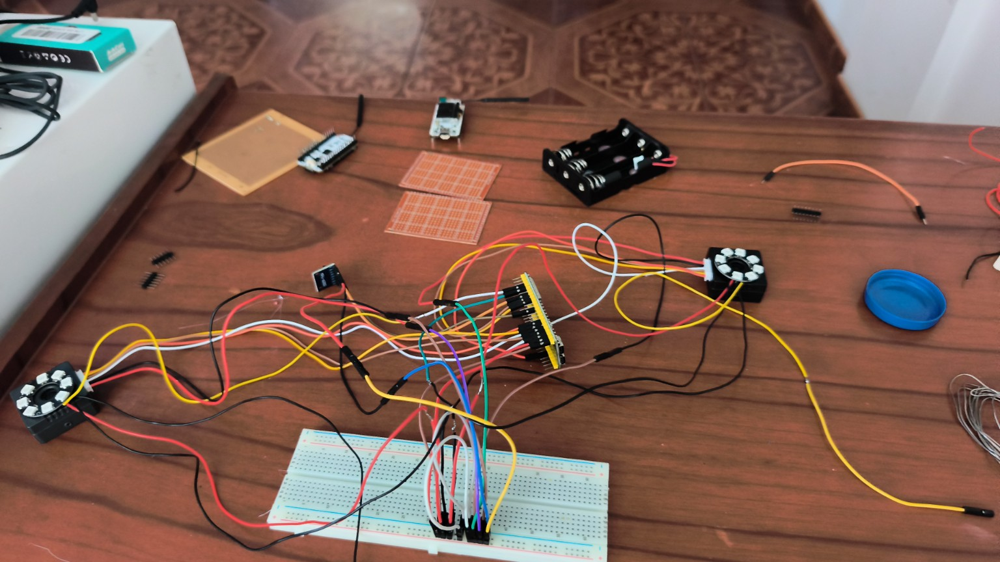
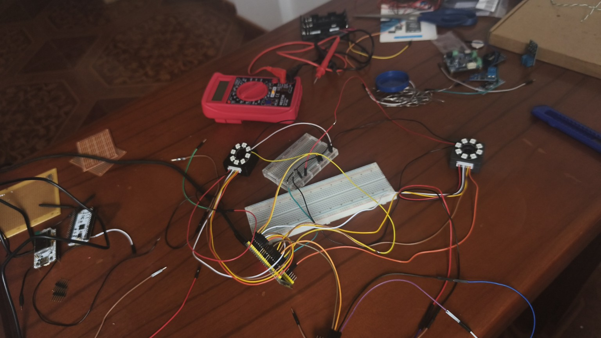
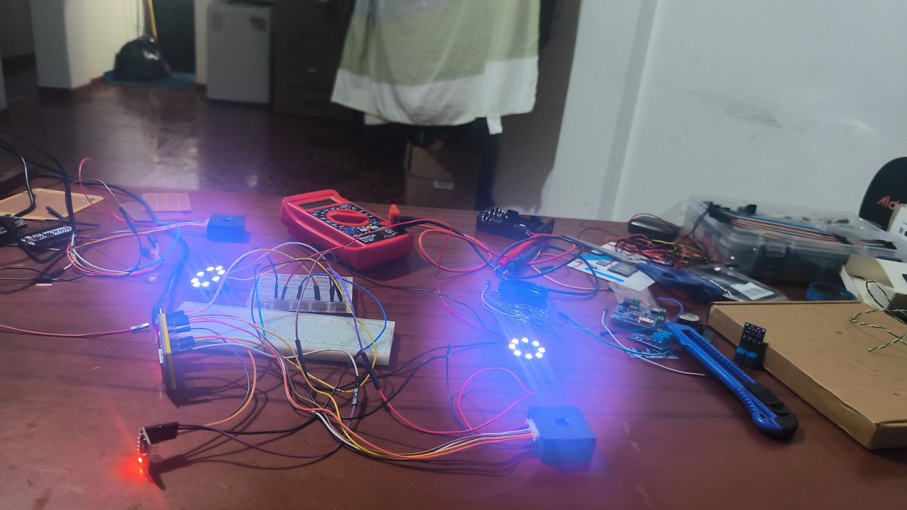
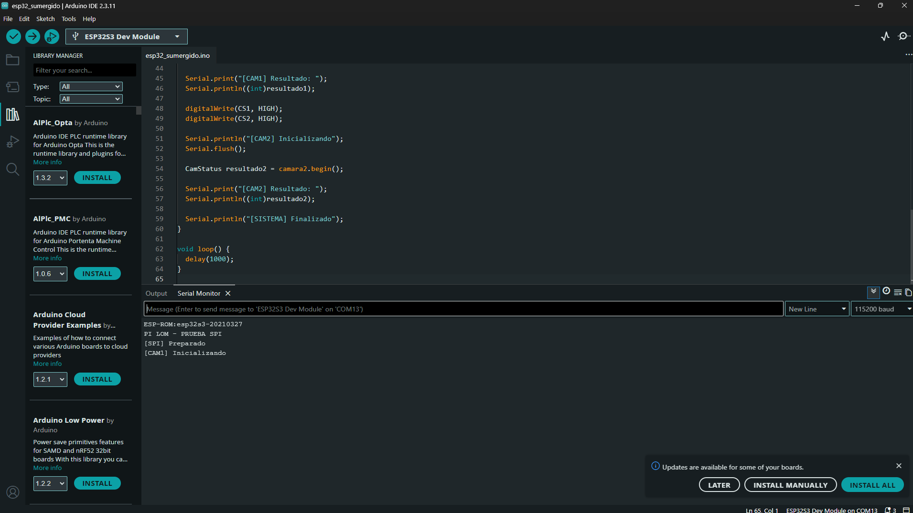
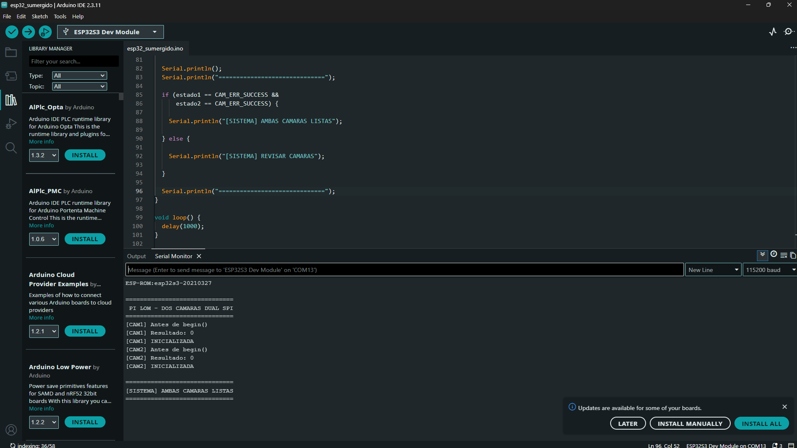
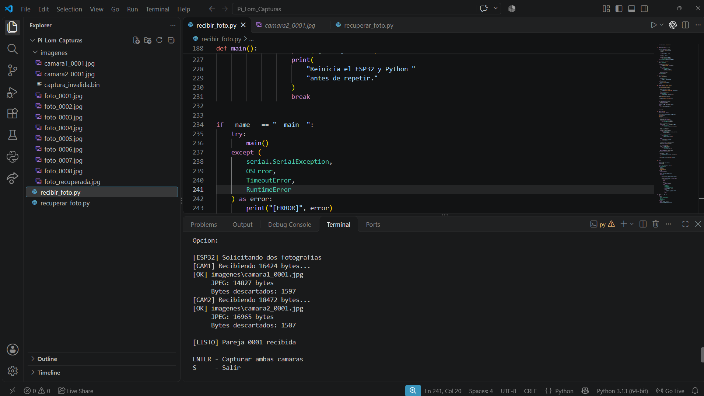
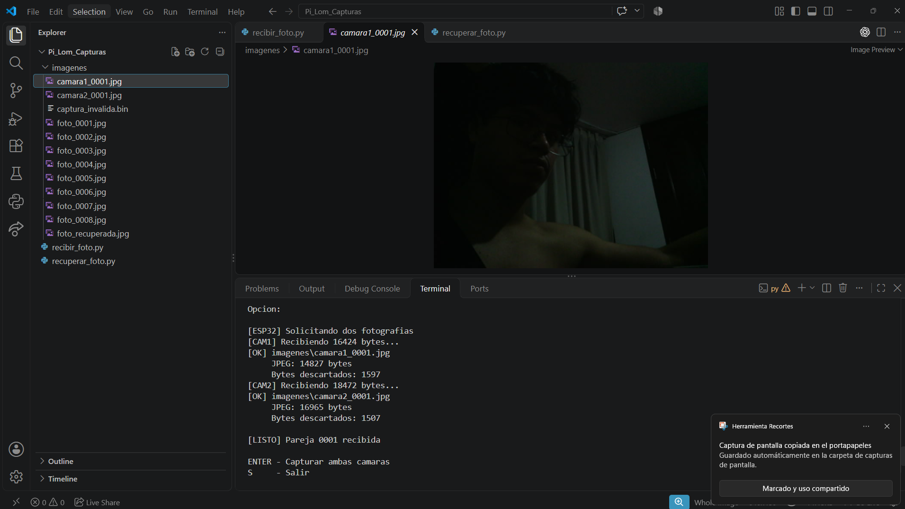
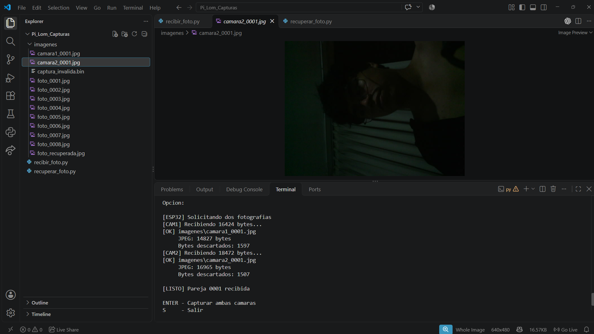

<h1 align="center">LanternGuard</h1>

<h2 align="center">TRL 4 — Integración y validación preliminar en laboratorio</h2>

<strong>Adquisición de imágenes con dos cámaras Arducam Mega, iluminación LED y recepción local en Python. </strong>

<h2 align="center">Información académica</h2>

  <table>
    <thead>
      <tr>
        <th align="center">Campo</th>
        <th align="center">Información</th>
      </tr>
    </thead>
    <tbody>
      <tr>
        <td><strong>Proyecto</strong></td>
        <td align="center">LanternGuard</td>
      </tr>
      <tr>
        <td><strong>Curso</strong></td>
        <td align="center">Proyecto Integrador</td>
      </tr>
      <tr>
        <td><strong>Docentes</strong></td>
        <td>
          <ul>
            <li>Umbert Lewis de la Cruz Rodriguez</li>
            <li>Renzo Jose Chan Rios</li>
            <li>Maria Angelica Rejas Nuñez</li>
            <li>Harry Anderson Rivera Tito</li>
          </ul>
        </td>
      </tr>
      <tr>
        <td><strong>Integrantes</strong></td>
        <td>
          <ul>
            <li>Antezana De la Cruz, María</li>
            <li>Santamaria Huaytan, Gabriela</li>
            <li>Bustos Montañez, Melissa</li>
            <li>Lombardi Quispe, Joseph</li>
            <li>Palacios Tanaka, Yoichi</li>
          </ul>
        </td>
      </tr>
      <tr>
        <td><strong>Periodo académico</strong></td>
        <td align="center">2026-2</td>
      </tr>
    </tbody>
  </table>

---

**Fecha de consolidación documental:** 19 de noviembre de 2026. Las evidencias corresponden a pruebas recientes del equipo; no se dispone de una bitácora con fecha y hora individual para cada ensayo.

> **Estado de madurez.** Esta sección documenta el trabajo orientado a TRL 4: integración y validación preliminar de subsistemas en laboratorio. No certifica formalmente el nivel TRL 4 ni acredita un prototipo marino completo. Se verificó una pareja de fotografías transferida por **USB serial**, además de la inicialización de ambas cámaras y el encendido de dos anillos LED en pruebas de banco. No existe una corrida documentada que reúna cámaras, iluminación sincronizada, acelerómetro y LoRa.

## 1. Introducción y objetivo

LanternGuard busca monitorear linternas de cultivo de concha de abanico mediante imágenes desde dos ángulos y medición de inclinación. El objetivo de esta etapa fue avanzar de las pruebas de concepto del [TRL3](../TRL3%20-%20LanternGuard/Readme.md) hacia un montaje de adquisición dual en laboratorio: inicializar dos cámaras, solicitar sus fotografías, transferirlas a una computadora y comprobar su visualización.

Se conserva el formato académico del TRL3: información del equipo, secciones numeradas, tablas de configuración y resultados, figuras con descripciones y conclusiones acotadas a la evidencia. La numeración de tablas y figuras comienza nuevamente en este documento. Los archivos históricos del TRL3 permanecen intactos.

### 1.1. Alcance y procedencia de la evidencia

Se utilizan ocho archivos proporcionados por el equipo: tres fotografías del montaje y cinco capturas de pantalla. Las fotografías muestran un banco de trabajo en seco; las capturas registran Arduino IDE y VS Code. El archivo de contexto visual del TRL3 no se incorpora como evidencia experimental y no se duplican bibliotecas de terceros.

La fuente de los parámetros de montaje es `INSTRUCCIONES_PARA_WORK.txt` del paquete entregado por el equipo. Los valores de recepción y los mensajes de inicialización se contrastaron visualmente con las capturas. Las conexiones no se pueden certificar únicamente a partir de fotografías del cableado. Los resultados de MPU6050 son antecedentes reportados, sin un registro específico de lectura incluido en este paquete.

## 2. Arquitectura prevista y arquitectura ensayada

**Arquitectura de campo prevista.** Dos cámaras con anillos de iluminación se ubicarán en extremos opuestos de una estructura sumergible. Un controlador recibirá las imágenes y las lecturas del acelerómetro. La conexión por cable llevará los datos a una boya con controlador, LoRa a 915 MHz y alimentación solar/batería. La estación en tierra recibirá los datos; un aplicativo almacenará las imágenes y, en una fase posterior, un modelo estimará biofouling y detectará roturas. La captura periódica cada 15 días es un objetivo operativo, sin autonomía demostrada en estas pruebas.

**Arquitectura demostrada en esta entrega.** Dos Arducam Mega → ESP32-S3 → USB serial → programa Python en PC → archivos JPEG → previsualización en VS Code. El registro muestra recepción de CAM1 seguida de CAM2. Una pareja de capturas no demuestra exposición simultánea ni sincronización temporal entre cámaras. La iluminación se verifica mediante fotografías de encendido en un ensayo de banco; no se acredita que estuviera sincronizada con las dos imágenes guardadas.

<strong>Tabla 1. Alcance de la validación por subsistema</strong>

| Subsistema o enlace | Evidencia disponible | Conclusión permitida | Pendiente |
|---|---|---|---|
| Dos cámaras y ESP32-S3 | Figuras 4–8 | Inicialización dual y una pareja de JPEG recibida localmente | Repetibilidad, estabilidad y firmware final versionado |
| Dos anillos LED | Figura 3 | Ambos anillos encendidos en banco | Sincronización, consumo, temperatura y calidad óptica |
| MPU6050 | Pruebas I²C previas reportadas por el equipo | Antecedente de detección y lecturas | Registro crudo, calibración y captura condicionada a inclinación |
| Enlace USB serial al PC | Figura 6 | Recepción y guardado de CAM1 y CAM2 | Protocolo completo y recuperación ante fallos |
| LoRa 915 MHz | Antecedentes de TRL3 | Ensayos separados de comunicación | Transmisión de la pareja desde este montaje hasta tierra |
| Boya, panel y batería | Arquitectura objetivo | Diseño previsto | Autonomía y balance energético medidos |
| Aplicativo e IA | Objetivo de desarrollo | Sin validación final aportada para esta integración | Almacenamiento integrado y evaluación con datos reales |
| Carcasa y operación marina | Sin prueba física incluida | No hay validación submarina | Sellado, presión, corrosión e inmersión |

## 3. Materiales, entorno y montaje

<strong>Tabla 2. Componentes y herramientas de las pruebas</strong>

| Elemento | Cantidad / configuración reportada | Función y observación |
|---|---|---|
| ESP32-S3 Dev Module | 1 controlador de banco | Adquisición; no confundir con una placa Heltec de los ensayos LoRa |
| Arducam Mega | 2 módulos de 5 MP | CAM1 y CAM2; 5 MP es la identificación de los módulos, no la resolución demostrada |
| Anillos WS2812B | 2 anillos de 8 LED | Iluminación auxiliar; datos GPIO4 y GPIO5 según el equipo |
| MPU6050 | Sensor usado en pruebas previas | Aceleración/inclinación; sin lecturas nuevas adjuntas |
| Protoboard y cables | Montaje provisional | Distribución de señales y alimentación |
| PC, USB y Arduino IDE | Arduino IDE 2.3.11 | Programación; selección ESP32S3 Dev Module, COM13 y 115200 baud visibles |
| Python y VS Code | Script identificado como `recibir_foto.py` | Solicitud, recepción y guardado; versión de Python y dependencias no registradas |

No se registraron tensión bajo carga, corriente, temperatura ambiente, nivel de iluminación, distancia al objeto ni duración completa del ensayo. La presencia de instrumentos en la mesa no constituye una medición documentada.

<strong><em>Figura 1. Vista general del montaje electrónico en banco.</em></strong>

*Nota. Fotografía proporcionada por el equipo. Se observa la distribución provisional de componentes; no es un montaje encapsulado ni sumergido.*

<strong><em>Figura 2. Detalle del controlador y las conexiones en protoboard.</em></strong>

*Nota. Fotografía complementaria del montaje. Permite examinar la disposición física; la asignación exacta de cada cable debe contrastarse con el firmware y el esquema definitivo.*

### 3.1. Conexiones de referencia y ambigüedad pendiente

<strong>Tabla 3. Asignación reportada para el montaje de referencia</strong>

| Dispositivo | Señal | GPIO / conexión reportada |
|---|---|---|
| Ambas cámaras, bus compartido | SCK | GPIO12 |
| Ambas cámaras, bus compartido | MISO | GPIO13 |
| Ambas cámaras, bus compartido | MOSI | GPIO11 |
| CAM1 | CS independiente | GPIO10 |
| CAM2 | CS independiente | GPIO21 |
| Cámaras | Alimentación y referencia | 5 V y GND común, según descripción del equipo |
| Anillo 1 | Datos | GPIO4 |
| Anillo 2 | Datos | GPIO5 |
| MPU6050, pruebas previas | SDA / SCL | GPIO8 / GPIO7 |
| MPU6050, pruebas previas | Dirección I²C | 0x68 reportada |

*Nota. Es una tabla de referencia del ensayo, no un esquemático final. No se especifica una alimentación del MPU6050 ni de los anillos que no esté registrada. La alimentación de 5 V descrita para las cámaras no establece el nivel eléctrico de sus señales.*

El ZIP técnico `PI_Lom_Arducam_DualSPI.zip` contiene una **variante anterior de diagnóstico con buses independientes**: CAM1 SCK12/MISO13/MOSI11/CS10 y CAM2 SCK16/MISO17/MOSI18/CS21. Su archivo `LEEME_PI_LOM.txt` indica que esa variante no se había validado físicamente ni compilado en Arduino IDE. Por tanto, no se puede usar ese código para certificar la topología o la biblioteca de la corrida exitosa. La tabla anterior conserva la configuración de bus compartido reportada en las instrucciones, sujeta a conciliación con el sketch definitivo. El material de diagnóstico se consultó, pero no se publica como firmware operativo ni se replica la biblioteca.

## 4. Metodología y secuencia experimental

La siguiente secuencia reconstruye lo observado y lo reportado, sin atribuir horas ni número de intentos no registrados. No equivale a un procedimiento de reproducción exacta porque faltan el sketch final, la biblioteca efectivamente utilizada y el receptor Python completo.

1. **Montaje físico.** Se conectaron el controlador y los periféricos en banco con protoboard y cables. Las Figuras 1 y 2 registran esta disposición.
2. **Prueba de iluminación.** Se encendieron los dos anillos; la Figura 3 permite verificar visualmente su funcionamiento. No se realizó una comparación controlada de imágenes con y sin luz.
3. **Diagnóstico de inicialización.** Se instrumentó el arranque con mensajes de SPI y de inicio de cada cámara. La Figura 4 termina en `[CAM1] Inicializando`, sin resultado final visible.
4. **Revisión SPI y CS.** El equipo reportó revisar selección SPI/CS y conexiones después de bloqueos o reinicios. El material de referencia incluye una alternativa con dos buses; no hay un registro de cambios que permita aislar qué modificación produjo el resultado final.
5. **Verificación de inicialización dual.** En otra captura, CAM1 y CAM2 retornan `0` y el programa imprime `[SISTEMA] AMBAS CAMARAS LISTAS` (Figura 5).
6. **Recepción local.** El programa Python solicita dos fotografías, recibe sus bloques por USB serial, identifica los datos JPEG que guarda y reporta los bytes descartados. La terminal confirma `[LISTO] Pareja 0001 recibida` (Figura 6).
7. **Inspección visual.** Se abren `camara1_0001.jpg` y `camara2_0001.jpg` en VS Code (Figuras 7 y 8). La interfaz indica 640 × 480 en las previsualizaciones. Estos JPEG originales no están incluidos como archivos independientes en la entrega.
8. **Interfaz de repetición.** La terminal ofrece `ENTER - Capturar ambas camaras` y `S - Salir`. Esto acredita la opción disponible, sin demostrar una serie de repeticiones completada.

### 4.1. Validación visual de iluminación

<strong><em>Figura 3. Dos anillos LED encendidos en el banco.</em></strong>

*Nota. Se observa emisión de luz de ambos anillos. La fotografía no determina iluminancia, uniformidad sobre una malla, corriente ni temperatura. No demuestra por sí sola exposición adecuada ni sincronización con las cámaras.*

### 4.2. Fallo observado y avance de la inicialización

<strong><em>Figura 4. Diagnóstico inicial sin confirmación de arranque de CAM1.</em></strong>

*Nota. Aunque el archivo recibido se llama `07_inicializacion_doble.png`, su contenido solo muestra `PI LOM - PRUEBA SPI`, `[SPI] Preparado` y `[CAM1] Inicializando`. No prueba la inicialización de las dos cámaras ni permite determinar cuánto tiempo transcurrió o la causa de la detención.*

<strong><em>Figura 5. Inicialización exitosa de las dos cámaras en un ensayo posterior.</em></strong>

*Nota. La consola muestra `[CAM1] Resultado: 0`, `[CAM2] Resultado: 0`, las confirmaciones de inicialización y `[SISTEMA] AMBAS CAMARAS LISTAS`. El código visible compara los estados con `CAM_ERR_SUCCESS`. Este resultado verifica el arranque en esa ejecución; no caracteriza estabilidad prolongada.*

<strong>Tabla 4. Bitácora de problemas y resolución observada</strong>

| Situación | Evidencia / procedencia | Intervención reportada | Resultado y límite |
|---|---|---|---|
| Reinicios o bloqueo durante `begin()` | Relato del equipo y bitácora previa de TRL3 | Revisión de cableado, selección SPI/CS e instrumentación de mensajes | Sin registro causal que permita atribuir una causa única |
| Último mensaje visible en CAM1 | Figura 4 | Diagnósticos de inicialización sucesivos | La captura no muestra un resultado de CAM1 ni CAM2 |
| Inicialización de ambas cámaras | Figura 5 | Versión posterior del ensayo | Dos resultados `0`; firmware exacto sin adjuntar |
| Datos recibidos que no integran el JPEG guardado | Figura 6 | Identificación del JPEG y descarte en Python, según salida del programa | Se guardan archivos visualizables; origen de bytes excedentes sin resolver |
| Imágenes oscuras y orientaciones distintas | Figuras 7 y 8 | Sin corrección controlada documentada | Ajuste de iluminación, exposición y orientación pendiente |

## 5. Resultados experimentales de captura dual

<strong><em>Figura 6. Recepción y guardado local de la pareja 0001 en Python.</em></strong>

*Nota. La salida muestra solicitud de dos fotografías, cantidades recibidas, tamaños JPEG, descartes y rutas de guardado. La interfaz de repetición queda visible. La comunicación de este ensayo es USB serial; no se observan métricas o paquetes LoRa.*

<strong>Tabla 5. Datos transcritos de la recepción documentada</strong>

| Magnitud | CAM1 | CAM2 |
|---|---:|---:|
| Bytes recibidos reportados | 16424 | 18472 |
| Bytes del JPEG guardado reportados | 14827 | 16965 |
| Bytes descartados reportados | 1597 | 1507 |
| Comprobación aritmética | 16424 = 14827 + 1597 | 18472 = 16965 + 1507 |
| Archivo reportado en PC | `imagenes/camara1_0001.jpg` | `imagenes/camara2_0001.jpg` |
| Resolución mostrada en previsualización | 640 × 480 | 640 × 480 |
| Imagen abierta visualmente | Figura 7 | Figura 8 |

*Nota. Los tamaños son valores de la terminal, no una medición independiente de los JPEG originales, ausentes en el paquete. La comprobación aritmética es un cálculo documental. No se interpreta el descarte como tasa de pérdida de paquetes ni de corrupción del enlace.*

En la pareja registrada se reportan **34896 bytes recibidos**, **31792 bytes JPEG guardados** y **3104 bytes descartados**, sumando las dos cámaras. Se confirma la coherencia de las sumas, pero no se dispone del flujo binario para examinar el contenido descartado. No se puede determinar si corresponde a encabezados, mensajes de depuración, relleno u otra condición. Un archivo abierto no basta para demostrar integridad byte a byte de la transferencia.

La evidencia acredita **una pareja completada**. Los otros nombres de archivo visibles en el explorador no son una bitácora de ensayos ni justifican un total de repeticiones exitosas. No se dispone de denominador de intentos, marcas temporales, consumo o distancia; no se calculan tasa de éxito, latencia ni rendimiento sostenido.

### 5.1. Fotografías guardadas y calidad observada

<strong><em>Figura 7. Previsualización del JPEG de CAM1 en VS Code.</em></strong>

*Nota. Es una captura de pantalla PNG proporcionada por el equipo, no el JPEG original de la cámara. La imagen permite reconocer una escena de interior, pero presenta baja iluminación. No contiene una malla de cultivo evaluada ni constituye una prueba de detección de biofouling.*

<strong><em>Figura 8. Previsualización del JPEG de CAM2 en VS Code.</em></strong>

*Nota. Es una captura de pantalla PNG, no el JPEG original. Se observa una orientación diferente y poca iluminación. La pareja demuestra dos archivos visualizables; no acredita calibración geométrica, exposición óptima ni sincronización.*

### 5.2. Integración del MPU6050

El equipo reporta detección I²C en `0x68` y lecturas previas con SDA GPIO8 y SCL GPIO7. La función prevista es estimar inclinación y estabilidad del módulo. No se adjuntan registros de aceleración, unidades, calibración, ángulos de referencia o marcas de tiempo que permitan evaluar precisión o decidir cuándo capturar.

El MPU6050 no debe confundirse con el sensor ultrasónico utilizado como fuente de datos de prueba en la sección 5.1 del TRL3. Aquella telemetría no mide aceleración. La integración del acelerómetro con la pareja de fotografías queda pendiente de una corrida conjunta con datos sincronizados.

## 6. Limitaciones reales y reproducibilidad

- **Firmware incompleto para reproducir el ensayo.** No se entregaron el sketch definitivo ni `recibir_foto.py` completo; las capturas solo muestran fragmentos. Faltan versión efectiva de biblioteca, dependencias y definición íntegra del protocolo. La variante de dos buses no sustituye estos archivos.
- **Topología por confirmar.** Hay discrepancia entre el bus compartido descrito y los dos buses del material de diagnóstico. No se publica un esquema final hasta contrastar cableado y firmware de la ejecución exitosa.
- **Una pareja documentada.** No hay campaña repetida con registro de fallos, reinicios y tiempos. La estabilidad del conjunto permanece abierta.
- **Integridad de datos limitada.** Solo se tienen previsualizaciones y el reporte de bytes. Faltan JPEG originales, flujo serial crudo y comprobaciones de integridad para caracterizar los descartes.
- **Calidad óptica preliminar.** Se observan imágenes oscuras y orientación desigual. No hay ensayo con malla, biofouling de referencia, agua turbia ni medición del efecto de los LED.
- **Integración parcial.** No se demuestra cámaras + luz sincronizada + acelerómetro + LoRa en una misma corrida. No se ha validado la transmisión de estas dos cámaras a través de la boya.
- **Energía sin caracterizar.** No hay mediciones de corriente, tensión bajo carga, consumo por pareja ni prueba autónoma con panel/batería.
- **Ambiente marino sin validar.** No se aportan pruebas de estanqueidad, presión, inmersión o funcionamiento prolongado en el mar. Las simulaciones del TRL3 no sustituyen estos ensayos físicos.
- **Aplicativo y análisis pendientes.** No se ha validado aquí un aplicativo final ni un modelo para estimar porcentaje de biofouling o detectar roturas. No existen resultados de exactitud aplicables a estas imágenes.

## 7. Plan de siguientes pruebas y criterios de cierre propuestos

Los criterios de esta tabla son propuestas para una campaña futura, no resultados obtenidos ni requisitos institucionales ya aprobados. Los umbrales numéricos deben definirse con el equipo y los docentes antes del ensayo.

<strong>Tabla 6. Campaña necesaria para ampliar la validación</strong>

| Prioridad | Prueba propuesta | Registro requerido | Criterio de cierre propuesto |
|---|---|---|---|
| 1 | Conciliar montaje, firmware y biblioteca | Esquema por señal, fotos identificadas, versiones y código completo | Una única configuración reproducible, sin discrepancia de buses |
| 2 | Repetir inicialización y captura dual | Número de intentos definido previamente, log completo, reinicios y JPEG originales con hash | Reportar éxitos e intentos; verificar dos JPEG decodificables por pareja |
| 3 | Analizar protocolo y descartes | Flujo serial crudo, longitudes, identificador de cámara/pareja y delimitación de trama | Explicar los bytes externos al JPEG y detectar transferencias incompletas |
| 4 | Comparar luz encendida/apagada | Misma escena, distancia y exposición registradas; imágenes originales y consumo | Cuantificar mejora visual, saturación y uniformidad según criterio acordado |
| 5 | Calibrar e integrar MPU6050 | Lecturas con unidades, posiciones de referencia y tiempos de cada captura | Asociar una lectura válida a cada pareja y evaluar error de inclinación |
| 6 | Transmitir pareja por LoRa 915 MHz | Logs emisor/receptor, fragmentos, tamaño, tiempo, pérdidas e integridad | Reconstruir dos JPEG de la pareja correcta en el receptor y compararlos con origen |
| 7 | Medir energía del conjunto | Corriente y tensión en reposo, luz, captura y transmisión; duración | Estimar energía por ciclo y contrastar autonomía objetivo con mediciones |
| 8 | Validar carcasa y operación acuática | Protocolo acordado de sellado/presión, duración y revisión posterior | Documentar ausencia o presencia de filtraciones antes de ensayar electrónica sumergida |
| 9 | Aplicativo y modelo | Almacenamiento por dispositivo/fecha, datos etiquetados y conjunto de evaluación | Recuperar imágenes y evaluar el modelo frente a referencias reales |

Para cada corrida se recomienda registrar fecha, responsable, identificador de montaje, versiones de firmware/receptor, alimentación, condiciones de escena, hora de solicitud, tamaños por cámara, resultado y causa de fallo cuando pueda verificarse. Así se podrá distinguir una demostración puntual de una operación repetible.

## 8. Conclusiones

1. Se avanzó desde el diagnóstico de inicialización hasta observar las dos cámaras listas y recibir una pareja de archivos JPEG en una computadora mediante USB serial.
2. Los dos anillos LED se observaron encendidos en banco. Esto valida el encendido, con evaluación óptica y eléctrica todavía pendiente.
3. La terminal reportó 14827 bytes JPEG para CAM1 y 16965 para CAM2; ambas imágenes se abrieron en VS Code. La oscuridad y la orientación diferente limitan su uso como demostración de calidad de inspección.
4. Los antecedentes del acelerómetro y de LoRa son ensayos separados. No se atribuye a la pareja recibida una transmisión inalámbrica o integración completa que no está demostrada.
5. Esta entrega respalda integración preliminar en laboratorio orientada a TRL 4. La repetibilidad, la reproducción exacta, la integración extremo a extremo y la validación marina necesitan nuevos registros antes de afirmar la madurez del sistema completo.

## 9. Trazabilidad y fuentes del proyecto

<strong>Tabla 7. Relación entre antecedentes y resultados de esta entrega</strong>

| Fuente | Aporte | Relación con TRL4 |
|---|---|---|
| [TRL3 — documento principal](../TRL3%20-%20LanternGuard/Readme.md) | Simulaciones y pruebas de banco; sección 5 distingue sensor ultrasónico y reconstrucción local | Antecedente mecánico/electrónico conservado sin modificaciones |
| [TRL3 — integración electrónica y software](../TRL3%20-%20LanternGuard/Integracion_electronica_y_software.md) | Bitácora previa con captura dual pendiente y ensayos LoRa separados reportados | La recepción local de una pareja actualiza el estado en esta nueva sección; no demuestra el enlace dual por radio |
| Instrucciones del equipo en el ZIP de entrega | Materiales, conexiones reportadas, pruebas previas y límites | Fuente de parámetros que las fotografías no permiten verificar por sí solas |
| Figuras 1–3 | Fotografías del montaje y encendido | Evidencia física de banco |
| Figuras 4–5 | Capturas Arduino | Diagnóstico sin confirmación y posterior inicialización dual |
| Figuras 6–8 | Terminal y previsualizaciones VS Code | Recepción de una pareja y calidad visual preliminar |
| ZIP técnico de referencia | Variante experimental de dos buses SPI | Referencia de diagnóstico; no prueba de firmware desplegado |

La sección principal de TRL3 solo documenta reconstrucción local del JPEG; su bitácora complementaria reporta otros ensayos LoRa. Se preserva esa diferencia de alcance sin convertirla en validación del montaje dual actual. Esta sección se basa en los registros aportados y no agrega mediciones externas ni extrapola las simulaciones anteriores a estanqueidad o funcionamiento marino.

### 9.1. Inventario de evidencias versionadas

| Figura | Archivo original recibido | Tipo y alcance |
|---|---|---|
| 1 | [01_montaje_general.jpg](evidencias/fotos/01_montaje_general.jpg) | Fotografía del banco |
| 2 | [02_montaje_protoboard.jpg](evidencias/fotos/02_montaje_protoboard.jpg) | Fotografía complementaria |
| 3 | [03_anillos_led_funcionando.jpg](evidencias/fotos/03_anillos_led_funcionando.jpg) | Fotografía de encendido |
| 4 | [07_inicializacion_doble.png](evidencias/capturas/07_inicializacion_doble.png) | Captura con último mensaje de CAM1 |
| 5 | [08_pruebas_arduino.png](evidencias/capturas/08_pruebas_arduino.png) | Captura de ambas cámaras listas |
| 6 | [04_recepcion_dual_python.png](evidencias/capturas/04_recepcion_dual_python.png) | Captura de recepción serial |
| 7 | [05_fotografia_camara_1.png](evidencias/capturas/05_fotografia_camara_1.png) | Previsualización; no JPEG original |
| 8 | [06_fotografia_camara_2.png](evidencias/capturas/06_fotografia_camara_2.png) | Previsualización; no JPEG original |

Los ocho binarios se conservan sin recortes ni alteraciones respecto al ZIP recibido. El archivo `09_contexto_estructura_trl3.png` se usó exclusivamente como referencia editorial y se excluye de esta carpeta de evidencias.
