# Clasificación de cable, esponja y Sigma Face mediante Edge Impulse y la XIAO ESP32S3 Sense

## 1. Introducción

Tiny Machine Learning (TinyML) es una tecnología que permite ejecutar modelos de aprendizaje automático en dispositivos pequeños, como los microcontroladores. Gracias a esto, la placa puede hacer la predicción por sí misma, sin necesidad de enviar cada imagen a una computadora.

En este taller se volvió a trabajar con la placa **XIAO ESP32S3 Sense** de Seeed Studio, que trae un procesador ESP32-S3 y una cámara [1]. En el taller anterior se entrenó el modelo dentro de SenseCraft AI [2]. Esta vez fue entrenado en **Edge Impulse**, una plataforma en línea donde se cargan los datos, se entrena la red neuronal y se exporta el modelo para distintas placas [3], [4]. Seeed Studio documenta este mismo flujo para la XIAO ESP32S3 Sense [5].

Se configuró Arduino IDE (Integrated Development Environment, entorno de desarrollo integrado), tomando fotos propias con la cámara de la placa, se entrenó el modelo en Edge Impulse y posteriormente se evaluó con dos pruebas estadísticas. Después fue ejecutado en la placa desde Arduino IDE y, al final, en SenseCraft AI.

Se eligieron tres clases: **Cable**, **Esponja** y **Sigma Face**. Las dos primeras son objetos del laboratorio. La tercera es el rostro de Joseph haciendo el gesto "Sigma Face". Capturando **50 imágenes por clase**, **150 en total**.

Con este taller se vio el recorrido completo de un modelo TinyML: desde tomar las fotos hasta ejecutarlo en la placa. Además, esta vez se pudo medir qué tan bien funcionaba el modelo con un conjunto de imágenes de prueba, algo que en el taller anterior no fue registrado.

## 2. Objetivos

### 2.1. Objetivo general

Entrenar en Edge Impulse un clasificador de imágenes de tres clases (Cable, Esponja y Sigma Face) con fotos tomadas por la propia XIAO ESP32S3 Sense, evaluarlo y ejecutarlo en la placa.

### 2.2. Objetivos específicos

- Configurar Arduino IDE y la cámara de la placa mediante el ejemplo CameraWebServer.
- Capturar 50 imágenes por clase y realizar su etiquetado en Edge Impulse.
- Entrenar un modelo de 96x96 píxeles mediante transferencia de aprendizaje.
- Evaluar el modelo con dos pruebas estadísticas: *Live classification* y *Model testing*.
- Exportar el modelo como librería de Arduino, adaptar los pines de la cámara y leer sus predicciones en el monitor serie.
- Probar el modelo en SenseCraft AI y comparar los resultados obtenidos con los del taller anterior.

## 3. Materiales y herramientas

### 3.1. Materiales utilizados

<p align="center">
  <strong>Tabla 1.</strong> <em>Materiales y herramientas utilizados durante el laboratorio.</em>
</p>

<div align="center">
<table>
  <thead>
    <tr>
      <th>N.º</th>
      <th>Material o herramienta</th>
      <th>Función</th>
    </tr>
  </thead>
  <tbody>
    <tr>
      <td align="center">1</td>
      <td>XIAO ESP32S3 Sense</td>
      <td>Placa con la que capturamos las imágenes y ejecutamos el modelo.</td>
    </tr>
    <tr>
      <td align="center">2</td>
      <td>Cámara de la XIAO ESP32S3 Sense</td>
      <td>Tomó las fotos del conjunto de datos y las imágenes de prueba.</td>
    </tr>
    <tr>
      <td align="center">3</td>
      <td>Cable USB (Universal Serial Bus) tipo C a USB tipo A</td>
      <td>El cable que pidió el profesor: punta tipo C para la placa y USB para la laptop. Alimenta y programa la placa.</td>
    </tr>
    <tr>
      <td align="center">4</td>
      <td>Laptop</td>
      <td>Para programar la placa y entrar a Edge Impulse y SenseCraft AI.</td>
    </tr>
    <tr>
      <td align="center">5</td>
      <td>Arduino IDE 2.3.10</td>
      <td>Para cargar CameraWebServer y el ejemplo de inferencia, y para leer el monitor serie.</td>
    </tr>
    <tr>
      <td align="center">6</td>
      <td>Paquete de placas ESP32 de Espressif Systems</td>
      <td>Permite programar la XIAO ESP32S3 desde Arduino IDE. Usamos la versión estable recomendada por la guía.</td>
    </tr>
    <tr>
      <td align="center">7</td>
      <td>Ejemplo CameraWebServer y página <code>captura_xiao_etiqueta_personalizada.html</code></td>
      <td>Transmiten la imagen de la cámara por la red y descargan lotes de fotos etiquetadas en un archivo ZIP.</td>
    </tr>
    <tr>
      <td align="center">8</td>
      <td>Edge Impulse</td>
      <td>Para cargar los datos, diseñar el impulse, entrenar, probar y exportar el modelo.</td>
    </tr>
    <tr>
      <td align="center">9</td>
      <td>SenseCraft AI</td>
      <td>Para ejecutar el modelo en la placa y ver sus predicciones.</td>
    </tr>
    <tr>
      <td align="center">10</td>
      <td>Cable delgado, esponja y rostro con el gesto Sigma Face</td>
      <td>Lo que reconoce el modelo: una clase cada uno.</td>
    </tr>
    <tr>
      <td align="center">11</td>
      <td>GitHub</td>
      <td>Repositorio donde guardamos los archivos y esta documentación.</td>
    </tr>
  </tbody>
</table>
</div>

<p align="center">
  <em>Fuente: Elaboración propia.</em>
</p>

### 3.2. Características de la placa XIAO ESP32S3 Sense

La placa XIAO ESP32S3 Sense integra un procesador ESP32-S3 de doble núcleo con una frecuencia de hasta 240 MHz, 8 MB de PSRAM (*Pseudo Static Random Access Memory*, memoria de acceso aleatorio pseudoestática), 8 MB de memoria Flash, conectividad Wi-Fi, Bluetooth LE (*Low Energy*, de bajo consumo) y un módulo de cámara [1].

Entre sus componentes, el módulo de cámara resulta fundamental para la captura del conjunto de datos y la posterior ejecución de las pruebas del modelo. Asimismo, la activación de la PSRAM es un requisito establecido en la guía de laboratorio, debido a que el modelo de aprendizaje automático requiere memoria adicional para el procesamiento de imágenes; su omisión genera errores por insuficiencia de memoria durante la inferencia [5].

## 4. Desarrollo del taller

### 4.1. Configuración de Arduino IDE

En primer lugar, se procedió a configurar el entorno de desarrollo Arduino IDE para programar la placa XIAO ESP32S3 [5]:

1. En **Archivo >> Preferencias**, se agregó la siguiente dirección URL (*Uniform Resource Locator*, dirección web) en el campo de gestor de URLs adicionales de tarjetas:
   `https://raw.githubusercontent.com/espressif/arduino-esp32/gh-pages/package_esp32_dev_index.json`
2. En **Herramientas >> Placa >> Administrador de placas**, se instaló el paquete **esp32 de Espressif Systems**, seleccionando la versión estable recomendada en la guía. Se evitó el uso de versiones etiquetadas como *alpha*, debido a problemas de compatibilidad observados con la placa XIAO y la plataforma Edge Impulse.
3. En **Herramientas >> Placa**, se seleccionó el modelo **XIAO_ESP32S3** y, en **Herramientas >> Puerto**, se asignó el puerto COM correspondiente a la placa conectada.
4. En **Herramientas >> PSRAM**, se configuró la opción **OPI PSRAM** (*Octal Peripheral Interface*, interfaz periférica octal) para habilitar la memoria adicional requerida por el módulo de cámara y el modelo de inferencia.

### 4.2. Cámara con CameraWebServer

Para tomar nuestras fotos usamos el ejemplo **Archivo >> Ejemplos >> ESP32 >> Camera >> CameraWebServer** que se encuentra en las indicaciones. En `board_config.h` activamos el modelo de cámara de nuestra placa:

```cpp
#define CAMERA_MODEL_XIAO_ESP32S3 // Has PSRAM
```

En el programa principal se ingresaron las credenciales de la red Wi-Fi del laboratorio, manteniendo los demás parámetros con sus valores por defecto. Cabe precisar que dichas credenciales se omiten en el presente documento por motivos de seguridad.

Tras cargar el programa, el monitor serie desplegó la dirección IP (*Internet Protocol*) asignada a la cámara. Al acceder a dicha dirección desde un navegador web, se inició la transmisión en vivo mediante la opción **Start Stream**. Adicionalmente, al añadir la extensión `/capture` a la dirección IP, se obtiene una fotografía fija.

De acuerdo con lo indicado en la guía de la práctica, se contemplaron dos posibles inconvenientes durante este procedimiento: si el entorno Arduino IDE no reconoce el puerto COM, se debe desconectar la placa, verificar su correcto ensamblado y volver a conectarla; por otra parte, si el dispositivo no logra conectarse a la red Wi-Fi, se deben verificar el nombre de la red y la contraseña ingresados en el código.

### 4.3. Captura del conjunto de datos (dataset: imágenes y etiqueta)

Con la cámara transmitiendo abrimos la página **captura_xiao_etiqueta_personalizada.html** que nos dieron en clase. En ella se escribe la IP de la cámara, la etiqueta, cuántas fotos tomar y cada cuánto tiempo. Dejamos el intervalo por defecto de la página de captura. Al terminar, la página descarga un ZIP con una carpeta que lleva el nombre de la etiqueta [6].

Melissa y María participaron en la captura junto con el resto del equipo. Hicimos una ronda por clase y salieron tres archivos: `Cable_images_50.zip`, `Esponja_images_50.zip` y `Sigma face_images_50.zip`.

- **Cable:** un cable negro delgado sobre la base de corte verde del laboratorio.
- **Esponja:** una esponja gris oscura sobre la misma base de corte.
- **Sigma Face:** el rostro de Joseph haciendo siempre el mismo gesto, con el laboratorio de fondo.

Revisamos los archivos: cada clase tiene **50 imágenes** y todas miden **320x240 píxeles**, en formato JPEG (Joint Photographic Experts Group).

<p align="center">
  <strong>Tabla 2.</strong> <em>Distribución de las imágenes capturadas.</em>
</p>

<div align="center">
<table>
  <thead>
    <tr>
      <th>Clase</th>
      <th>Cantidad de imágenes</th>
      <th>Resolución</th>
      <th>Distribución porcentual</th>
    </tr>
  </thead>
  <tbody>
    <tr>
      <td>Cable</td>
      <td align="center">50</td>
      <td align="center">320x240</td>
      <td align="center">33,3 %</td>
    </tr>
    <tr>
      <td>Esponja</td>
      <td align="center">50</td>
      <td align="center">320x240</td>
      <td align="center">33,3 %</td>
    </tr>
    <tr>
      <td>Sigma Face</td>
      <td align="center">50</td>
      <td align="center">320x240</td>
      <td align="center">33,3 %</td>
    </tr>
    <tr>
      <td><strong>Total</strong></td>
      <td align="center"><strong>150</strong></td>
      <td align="center">-</td>
      <td align="center"><strong>100 %</strong></td>
    </tr>
  </tbody>
</table>
</div>

<p align="center">
  <em>Fuente: Elaboración propia a partir de los archivos capturados con la XIAO ESP32S3 Sense.</em>
</p>

Antes de pasar a Edge Impulse descomprimimos los tres archivos, cerramos el monitor serie y detuvimos la transmisión, como pide la guía. Las 150 imágenes están en [Data.zip](Data.zip), en las carpetas `Cable/`, `Esponja/` y `Sigma Face/`.

### 4.4. Proyecto en Edge Impulse

En la plataforma Edge Impulse se creó una cuenta de usuario y se registró un nuevo proyecto denominado **Joseph_Lombardi-project-1**, asignándole la etiqueta de identificación correspondiente al Grupo 2 del curso Proyecto Integrador (Figura 1). En este entorno de trabajo se centralizaron las etapas de adquisición de datos, diseño del *impulse*, entrenamiento, evaluación estadística y exportación del modelo.

<p align="center">
  
  <br />
  <strong>Figura 1.</strong> <em>Panel principal del proyecto Joseph_Lombardi-project-1 en Edge Impulse.</em>
</p>

Como se observa en la Figura 1, la interfaz del proyecto muestra los siguientes aspectos clave de la configuración inicial:

- **Estructura del proyecto:** En el panel superior se confirma el nombre del proyecto (`Joseph_Lombardi-project-1`) bajo la cuenta del usuario, junto con la etiqueta personalizada de identificación (`TINYML - EDGE IMPULSE (S9 PI - GRUPO 2)`).
- **Dispositivo de referencia (*Target*):** En la esquina superior derecha se muestra la arquitectura por defecto seleccionada por la plataforma, correspondiente a un microcontrolador **Cortex-M4F a 80 MHz**. Cabe precisar que este valor sirve únicamente como referencia base para la estimación inicial del rendimiento.
- **Modo de privacidad:** En la sección *Sharing*, el proyecto se mantuvo configurado en modo privado (*Private*), restringiendo el acceso únicamente a los integrantes del equipo autorizados.

### 4.5. Carga y etiquetado de las imágenes

Para la importación del conjunto de datos a Edge Impulse, se utilizó la opción de adición de datos existentes (*Add existing data*) [3]. Para cada una de las tres clases, se seleccionaron sus 50 imágenes correspondientes, se configuró la división automática de muestras (**Automatically split between training and test**) y se ingresó manualmente la etiqueta de identificación en el campo **Enter label** [3].

<p align="center">
  
  <br />
  <strong>Figura 2.</strong> <em>Selección de los archivos descomprimidos de las tres clases.</em>
</p>

En la Figura 2 se observa la estructura de los archivos locales previamente descompresionados, organizados en las carpetas `Cable_images_50`, `Esponja_images_50` y `Sigma face_images_50`, cada una conteniendo los lotes de 50 imágenes capturadas.

<p align="center">
  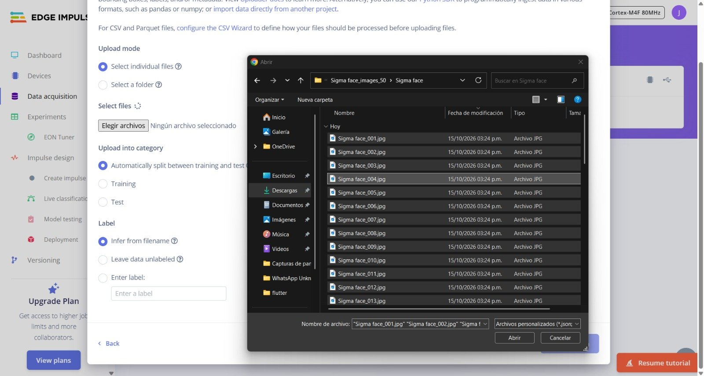
  <br />
  <strong>Figura 3.</strong> <em>Selección masiva de imágenes de la clase Sigma Face en el explorador de archivos.</em>
</p>

Como se aprecia en la Figura 3, se procedió con la selección masiva de las 50 fotografías correspondientes a cada clase (ejemplificado con la clase *Sigma Face*) desde el explorador de archivos del sistema operativo para su carga directa en la plataforma.

<p align="center">
  
  <br />
  <strong>Figura 4.</strong> <em>Parámetros de carga y asignación manual de etiqueta en Edge Impulse.</em>
</p>

En la Figura 4 se detallan los ajustes aplicados durante el proceso de importación: la confirmación de los 50 archivos cargados, la activación de la partición automática para la separación entre entrenamiento y prueba, y la asignación explícita del nombre de la clase en el campo *Enter label*.

<p align="center">
  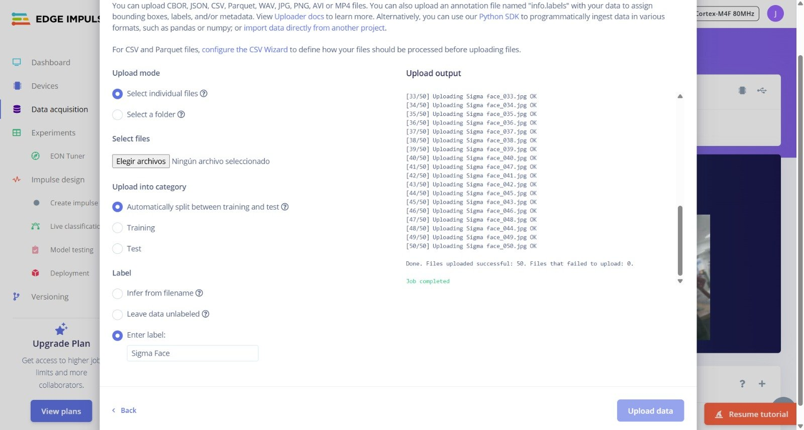
  <br />
  <strong>Figura 5.</strong> <em>Confirmación y registro de importación en Edge Impulse.</em>
</p>

La Figura 5 muestra la consola de registro (*log*) generada por la plataforma al finalizar la transferencia, confirmando el procesamiento exitoso de los 50 archivos de la clase sin registrar errores de subida. Este procedimiento se replicó bajo la misma metodología para las clases *Cable* y *Esponja*.

<p align="center">
  
  <br />
  <strong>Figura 6.</strong> <em>Resumen del conjunto de datos en la sección Data acquisition.</em>
</p>

Como resultado global, la sección **Data acquisition** (Figura 6) consolidó un total de **150 muestras**. La división automática de la plataforma distribuyó los datos en una proporción aproximada de **79 % para entrenamiento** (119 imágenes) y **21 % para prueba** (31 imágenes), garantizando un balance equitativo entre las tres clases.

<p align="center">
  <strong>Tabla 4.</strong> <em>Partición del conjunto de datos en Edge Impulse.</em>
</p>

<div align="center">
<table>
  <thead>
    <tr>
      <th>Conjunto</th>
      <th>Cantidad de imágenes</th>
      <th>Porcentaje</th>
    </tr>
  </thead>
  <tbody>
    <tr>
      <td>Entrenamiento (*Training*)</td>
      <td align="center">119</td>
      <td align="center">79 %</td>
    </tr>
    <tr>
      <td>Prueba (*Test*)</td>
      <td align="center">31</td>
      <td align="center">21 %</td>
    </tr>
    <tr>
      <td><strong>Total</strong></td>
      <td align="center"><strong>150</strong></td>
      <td align="center"><strong>100 %</strong></td>
    </tr>
  </tbody>
</table>
</div>

<p align="center">
  <em>Fuente: Elaboración propia a partir de la sección Data acquisition de Edge Impulse.</em>
</p>

Cabe señalar que las 31 imágenes asignadas al conjunto de prueba provienen de las mismas sesiones de adquisición que los datos de entrenamiento. Aunque no participan en la optimización de los pesos del modelo, comparten condiciones homogéneas de iluminación, fondo y perspectiva respecto al conjunto de entrenamiento.

### 4.6. Diseño del impulse

En Edge Impulse, un *impulse* es la cadena que recibe los datos, los procesa y se los pasa a un bloque de aprendizaje. Lo armamos en **Impulse design >> Create impulse** con tres partes:

- **Image data:** valores por defecto. Las imágenes se reducen a **96x96 píxeles** antes de entrar al modelo.
- **Processing block: Image.** Normaliza las imágenes. Ahí se elige RGB (rojo, verde y azul) o escala de grises y se pulsa **Generate features**.
- **Learning block: Transfer Learning (Images).** El bloque *Classification* aprende patrones a partir de las características de los datos de entrada. Transfer learning, en cambio, parte de una red ya entrenada y la ajusta a nuestras imágenes. Por eso funciona con pocas fotos, como las nuestras [7].

La capa de entrada recibe **27 648 características** (Figura 7). Eso es 96 x 96 x 3: trabajamos en RGB.

### 4.7. Entrenamiento por transferencia de aprendizaje

En **Impulse design >> Transfer learning** revisamos los parámetros y pulsamos **Save & train**. El número de ciclos de entrenamiento se mantuvo en el valor por defecto. La Tabla 5 resume lo que se ve en la captura.

<p align="center">
  <strong>Tabla 5.</strong> <em>Parámetros de entrenamiento utilizados en Edge Impulse.</em>
</p>

<div align="center">
<table>
  <thead>
    <tr>
      <th>Parámetro</th>
      <th>Valor</th>
    </tr>
  </thead>
  <tbody>
    <tr>
      <td>Número de ciclos de entrenamiento</td>
      <td align="center">Valor por defecto (no lo modificamos)</td>
    </tr>
    <tr>
      <td>Tasa de aprendizaje (learning rate)</td>
      <td align="center">0,0005</td>
    </tr>
    <tr>
      <td>Procesador de entrenamiento</td>
      <td align="center">GPU (Graphics Processing Unit, unidad de procesamiento gráfico)</td>
    </tr>
    <tr>
      <td>Aumento de datos (data augmentation)</td>
      <td align="center">Desactivado</td>
    </tr>
    <tr>
      <td>Arquitectura</td>
      <td align="center">MobileNetV2 96x96 0.35 (capa final de 16 neuronas, dropout 0,1)</td>
    </tr>
    <tr>
      <td>Capa de entrada</td>
      <td align="center">27 648 características</td>
    </tr>
    <tr>
      <td>Capa de salida</td>
      <td align="center">3 clases</td>
    </tr>
  </tbody>
</table>
</div>

<p align="center">
  <em>Fuente: Elaboración propia a partir de la sección Transfer learning de Edge Impulse.</em>
</p>

El *dropout* apaga al azar una parte de las neuronas durante el entrenamiento. Sirve para que el modelo no memorice las imágenes.

Al terminar, Edge Impulse mostró el desempeño sobre el **conjunto de validación**, una parte de las imágenes de entrenamiento que la plataforma aparta para evaluar el modelo mientras aprende. Con la versión **Quantized (int8)**, cuyos pesos se guardan como enteros de 8 bits, obtuvimos una exactitud (*accuracy*) de **91,7 %** y una pérdida (*loss*) de **0,16** (Figura 7).

<p align="center">
  
  <br />
  <strong>Figura 7.</strong> <em>Parámetros de entrenamiento, arquitectura MobileNetV2 y desempeño sobre el conjunto de validación (Quantized int8).</em>
</p>

La Tabla 6 tiene la matriz de confusión. La puntuación F1 junta dos cosas: la precisión (de las imágenes que el modelo puso en una clase, cuántas eran de esa clase) y la exhaustividad o *recall* (de las imágenes de una clase, cuántas reconoció). La curva ROC (*Receiver Operating Characteristic*, característica operativa del receptor) mide qué tan bien separa el modelo las clases. Un área de 1,00 es una separación completa en las imágenes evaluadas.

<p align="center">
  <strong>Tabla 6.</strong> <em>Matriz de confusión y métricas sobre el conjunto de validación (Quantized int8).</em>
</p>

<div align="center">
<table>
  <thead>
    <tr>
      <th>Clase real \ Clase predicha</th>
      <th>Cable</th>
      <th>Esponja</th>
      <th>Sigma Face</th>
      <th>F1</th>
    </tr>
  </thead>
  <tbody>
    <tr>
      <td>Cable</td>
      <td align="center"><strong>100 %</strong></td>
      <td align="center">0 %</td>
      <td align="center">0 %</td>
      <td align="center">0,94</td>
    </tr>
    <tr>
      <td>Esponja</td>
      <td align="center">12,5 %</td>
      <td align="center"><strong>87,5 %</strong></td>
      <td align="center">0 %</td>
      <td align="center">0,88</td>
    </tr>
    <tr>
      <td>Sigma Face</td>
      <td align="center">0 %</td>
      <td align="center">12,5 %</td>
      <td align="center"><strong>87,5 %</strong></td>
      <td align="center">0,93</td>
    </tr>
  </tbody>
</table>
</div>

<p align="center">
  <em>Fuente: Elaboración propia a partir de la sección Transfer learning de Edge Impulse. Exactitud: 91,7 %; pérdida: 0,16; área bajo la curva ROC: 1,00; precisión, exhaustividad y F1 ponderados: 0,92.</em>
</p>

En el **Data explorer** (Figura 10) cada punto es una imagen. Las tres clases forman grupos separados y solo unos pocos puntos salen marcados como incorrectos.

En la misma pantalla, Edge Impulse estima el rendimiento en el dispositivo con su compilador EON Compiler (modo *RAM optimized*): **754 ms** de inferencia, **228,0 K** de RAM (Random Access Memory, memoria de acceso aleatorio) y **546,0 K** de Flash. Ojo: esa estimación es para el dispositivo objetivo del proyecto, un **Cortex-M4F a 80 MHz** (Figura 3), no para la XIAO. Además, nuestra librería no usa el compilador EON (`EI_CLASSIFIER_COMPILED 0` en `model_metadata.h` de [Modelo.zip](Modelo.zip)). La tomamos solo como referencia.

<p align="center">
  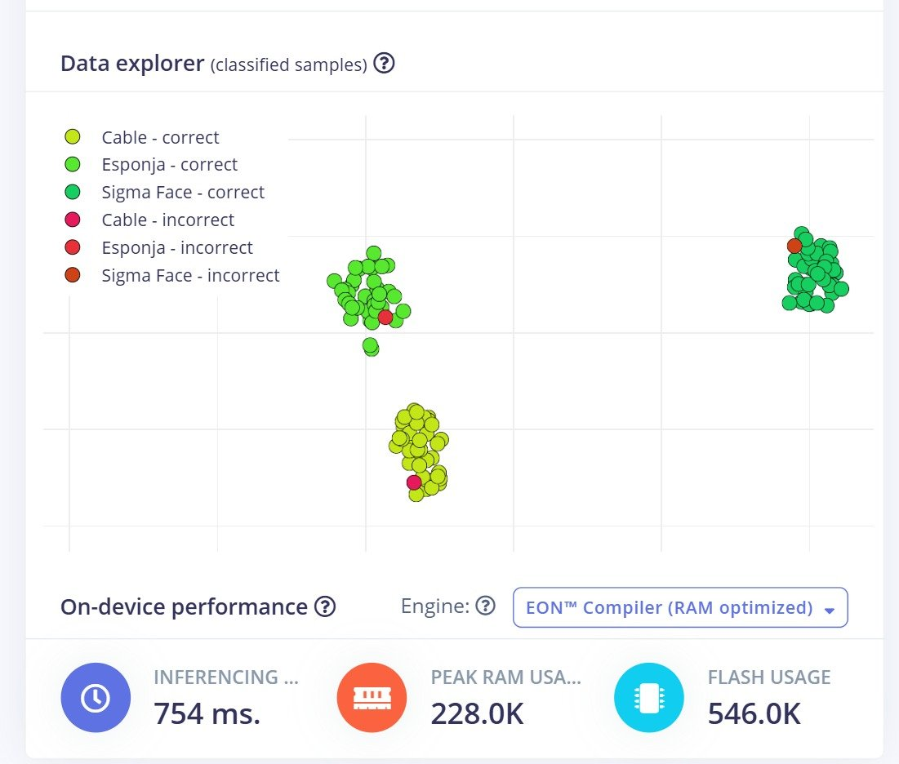
  <br />
  <strong>Figura 10.</strong> <em>Data explorer de las muestras clasificadas y estimación de rendimiento para el objetivo Cortex-M4F a 80 MHz.</em>
</p>

### 4.8. Pruebas estadísticas (2)

La pizarra pedía dos pruebas estadísticas. En Edge Impulse las hicimos con **Live classification** y **Model testing**.

#### 4.8.1. Prueba estadística 1: Live classification

En **Live classification** se elige una muestra del conjunto de prueba y se pulsa **Load sample** para clasificarla sola [6], [8]. Probamos una imagen por clase con la versión **Unoptimized (float32)**, la versión sin cuantizar, con pesos en números decimales de 32 bits.

<p align="center">
  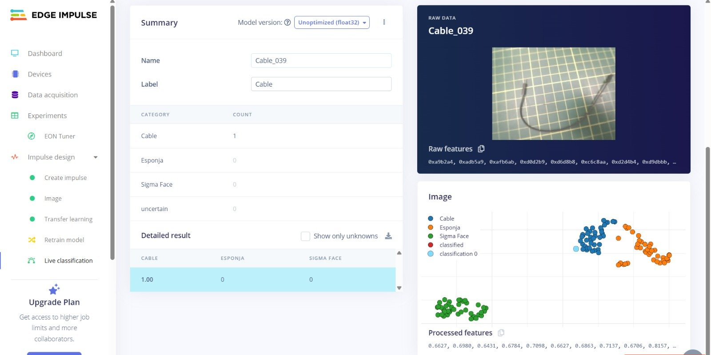
  <br />
  <strong>Figura 11.</strong> <em>Live classification de la muestra Cable_039: Cable 1,00.</em>
</p>

<p align="center">
  
  <br />
  <strong>Figura 12.</strong> <em>Live classification de la muestra Esponja_048: Esponja 1,00.</em>
</p>

<p align="center">
  <strong>Tabla 7.</strong> <em>Resultados de Live classification (Unoptimized float32).</em>
</p>

<div align="center">
<table>
  <thead>
    <tr>
      <th>Muestra</th>
      <th>Etiqueta real</th>
      <th>Cable</th>
      <th>Esponja</th>
      <th>Sigma Face</th>
      <th>Resultado</th>
    </tr>
  </thead>
  <tbody>
    <tr>
      <td>Cable_039</td>
      <td align="center">Cable</td>
      <td align="center">1,00</td>
      <td align="center">0</td>
      <td align="center">0</td>
      <td align="center">Correcto</td>
    </tr>
    <tr>
      <td>Esponja_048</td>
      <td align="center">Esponja</td>
      <td align="center">0</td>
      <td align="center">1,00</td>
      <td align="center">0</td>
      <td align="center">Correcto</td>
    </tr>
    <tr>
      <td>Sigma face_040</td>
      <td align="center">Sigma Face</td>
      <td align="center">0</td>
      <td align="center">0</td>
      <td align="center">1,00</td>
      <td align="center">Correcto</td>
    </tr>
  </tbody>
</table>
</div>

<p align="center">
  <em>Fuente: Elaboración propia a partir de la sección Live classification de Edge Impulse. La captura de Sigma face_040 no la incluimos como figura.</em>
</p>

Las tres muestras salieron correctas, con 1,00. Pero es una imagen por clase: sirve para ver que el modelo funciona, no para medir qué tan bien funciona.

#### 4.8.2. Prueba estadística 2: Model testing

**Model testing** clasifica de una vez todo el conjunto de prueba con el botón **Classify all** [6], [9]. Con la versión **Unoptimized (float32)** obtuvimos **96,77 %** de exactitud sobre las 31 imágenes de prueba: 30 correctas.

<p align="center">
  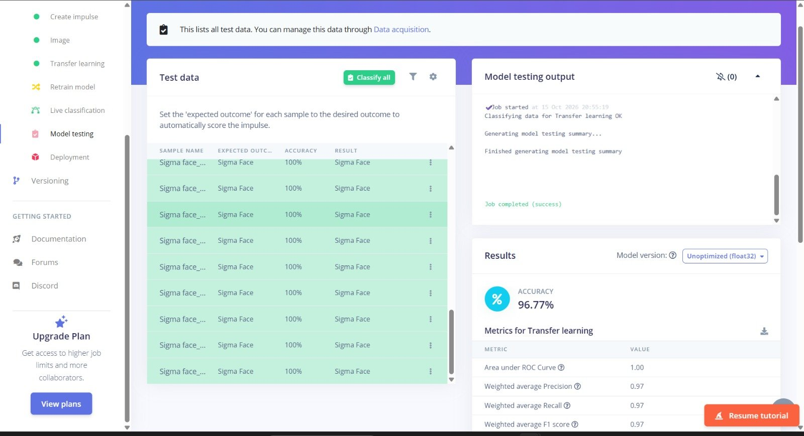
  <br />
  <strong>Figura 13.</strong> <em>Resultado de Model testing sobre el conjunto de prueba: exactitud de 96,77 %.</em>
</p>

<p align="center">
  
  <br />
  <strong>Figura 14.</strong> <em>Matriz de confusión de Model testing y Feature explorer, donde se marca una muestra de Esponja clasificada incorrectamente.</em>
</p>

<p align="center">
  <strong>Tabla 8.</strong> <em>Matriz de confusión y métricas de Model testing (Unoptimized float32).</em>
</p>

<div align="center">
<table>
  <thead>
    <tr>
      <th>Clase real \ Clase predicha</th>
      <th>Cable</th>
      <th>Esponja</th>
      <th>Sigma Face</th>
      <th>Incierto</th>
      <th>F1</th>
    </tr>
  </thead>
  <tbody>
    <tr>
      <td>Cable</td>
      <td align="center"><strong>100 %</strong></td>
      <td align="center">0 %</td>
      <td align="center">0 %</td>
      <td align="center">0 %</td>
      <td align="center">0,95</td>
    </tr>
    <tr>
      <td>Esponja</td>
      <td align="center">9,1 %</td>
      <td align="center"><strong>90,9 %</strong></td>
      <td align="center">0 %</td>
      <td align="center">0 %</td>
      <td align="center">0,95</td>
    </tr>
    <tr>
      <td>Sigma Face</td>
      <td align="center">0 %</td>
      <td align="center">0 %</td>
      <td align="center"><strong>100 %</strong></td>
      <td align="center">0 %</td>
      <td align="center">1,00</td>
    </tr>
  </tbody>
</table>
</div>

<p align="center">
  <em>Fuente: Elaboración propia a partir de la sección Model testing de Edge Impulse. Exactitud: 96,77 %; área bajo la curva ROC: 1,00; precisión, exhaustividad y F1 ponderados: 0,97.</em>
</p>

El único error fue una esponja que el modelo tomó por cable. En la validación también hubo una esponja confundida con cable. No lo tomamos como un patrón confirmado, porque las dos evaluaciones usan versiones distintas del modelo e imágenes distintas.

### 4.9. Exportación del modelo (Deployment)

En **Deployment** elegimos **Arduino library**, con TensorFlow Lite como motor de inferencia, y la versión **Quantized (int8)**. Según la guía, la versión int8 es más rápida y ocupa menos RAM y Flash, con la misma precisión reportada [6]. Al pulsar **Build**, Edge Impulse generó la librería.

El archivo descargado, `ei-joseph_lombardi-project-1-arduino-1.0.1-impulse-#1.zip`, está sin cambios en esta carpeta como [Modelo.zip](Modelo.zip). Dentro está la librería `Joseph_Lombardi-project-1_inferencing`, con las etiquetas Cable, Esponja y Sigma Face.

### 4.10. Modelo en Arduino IDE

Con la librería descargada seguimos la guía para ejecutar el modelo en la placa [6], [4]:

1. En **Programa >> Incluir Librería >> Añadir biblioteca .ZIP** elegimos el ZIP del modelo.
2. Abrimos **Archivo >> Ejemplos >> Joseph_Lombardi-project-1_inferencing >> esp32 >> esp32_camera**.
3. Borramos el bloque de pines que va desde `#define CAMERA_MODEL_ESP_EYE // Has PSRAM` hasta el primer `#endif`, porque es de otra cámara. En su lugar pegamos los pines de la XIAO ESP32S3 Sense. GPIO significa *General Purpose Input/Output* (entradas y salidas de propósito general); cada línea dice a qué terminal de la placa va un pin de la cámara [6], [10]:

```cpp
#define PWDN_GPIO_NUM     -1
#define RESET_GPIO_NUM    -1
#define XCLK_GPIO_NUM     10
#define SIOD_GPIO_NUM     40
#define SIOC_GPIO_NUM     39

#define Y9_GPIO_NUM       48
#define Y8_GPIO_NUM       11
#define Y7_GPIO_NUM       12
#define Y6_GPIO_NUM       14
#define Y5_GPIO_NUM       16
#define Y4_GPIO_NUM       18
#define Y3_GPIO_NUM       17
#define Y2_GPIO_NUM       15
#define VSYNC_GPIO_NUM    38
#define HREF_GPIO_NUM     47
#define PCLK_GPIO_NUM     13
```

4. También borramos el bloque `#if defined(CAMERA_MODEL_ESP_EYE)` que pone los pines 13 y 14 como `INPUT_PULLUP`, porque también es de la otra cámara [6].
5. Verificamos, subimos el código y abrimos el monitor serie.

La guía dice que, si sale un error por falta de espacio, hay que aumentar `arena_size` en el archivo de la carpeta `tflite-model` de la librería [6]. En nuestro caso no fue necesario modificar la memoria del modelo.

### 4.11. Edge Impulse: pruebas en el monitor serie

En la pizarra esta parte aparece como "Edge Impulse: Pruebas (paso 6)". Es el paso 6 de la parte "Modelo en Arduino IDE" de la guía [6]. Yoichi cargó el programa y abrió el monitor serie, y fuimos poniendo cada objeto frente a la cámara. Cada bloque del monitor muestra el tiempo de DSP (*Digital Signal Processing*, procesamiento digital de la señal), el tiempo de clasificación y la puntuación de cada clase.

<p align="center">
  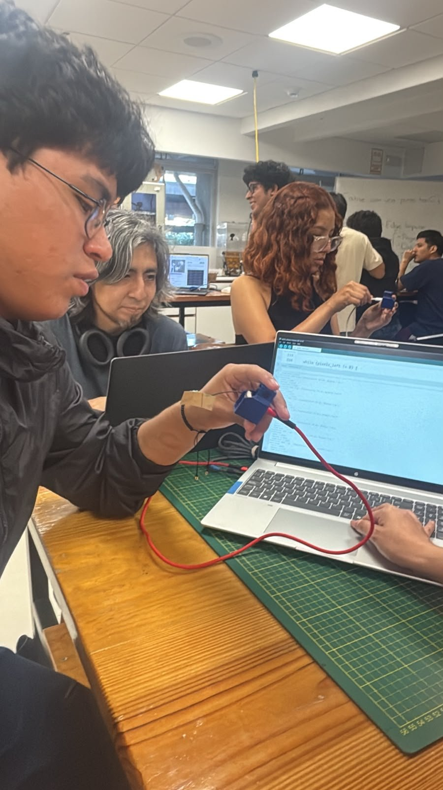
  <br />
  <strong>Figura 15.</strong> <em>Prueba en Arduino IDE: la placa conectada a la laptop, con uno de los objetos del dataset frente a la cámara.</em>
</p>

<p align="center">
  
  <br />
  <strong>Figura 16.</strong> <em>El equipo durante la prueba, con el monitor serie abierto. Sobre el tapete de corte se ve la esponja del dataset.</em>
</p>

<p align="center">
  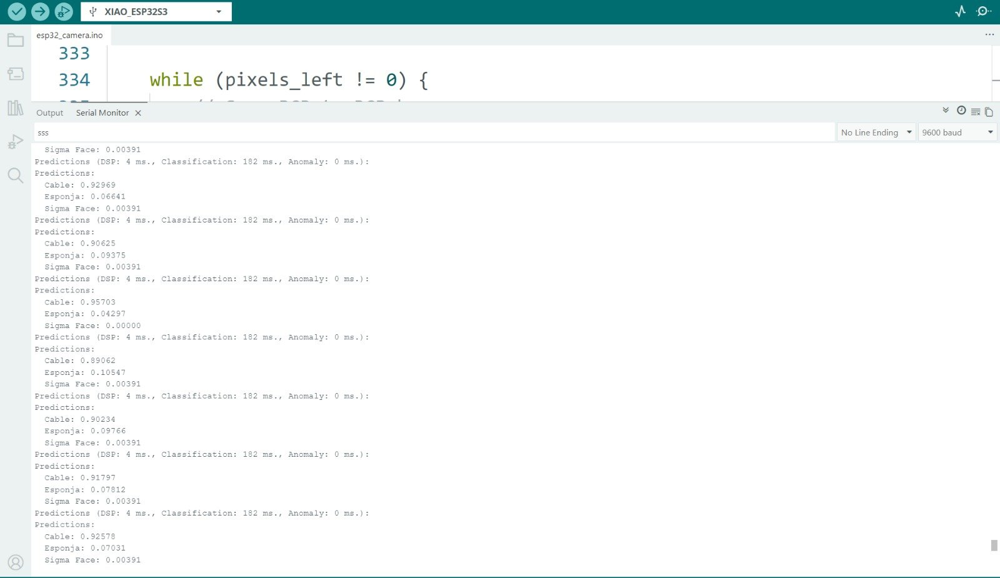
  <br />
  <strong>Figura 17.</strong> <em>Monitor serie con el cable frente a la cámara.</em>
</p>

<p align="center">
  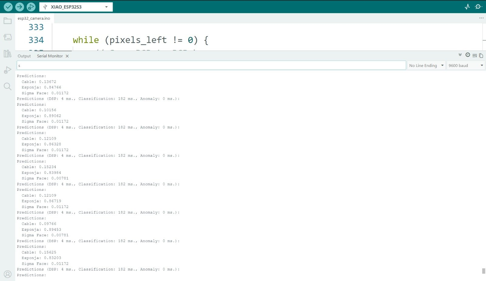
  <br />
  <strong>Figura 18.</strong> <em>Monitor serie con la esponja frente a la cámara.</em>
</p>

<p align="center">
  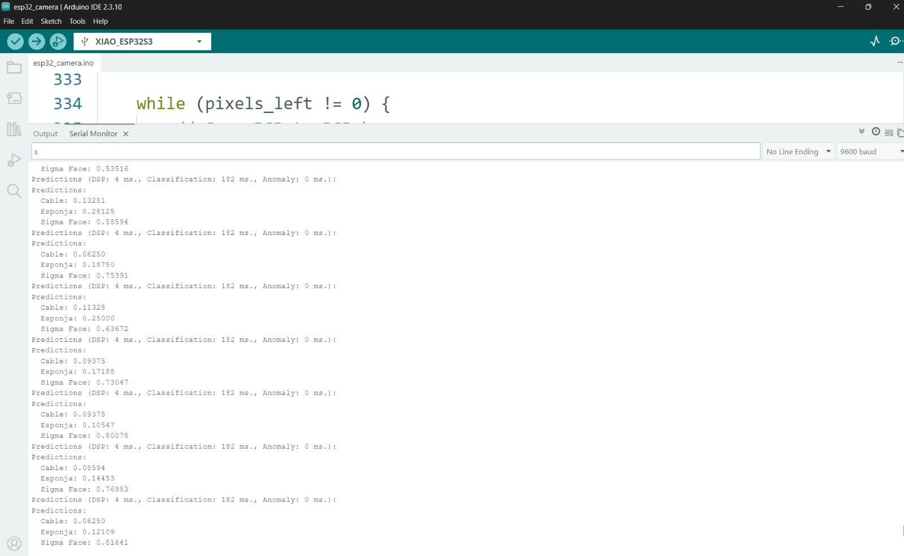
  <br />
  <strong>Figura 19.</strong> <em>Monitor serie con el gesto Sigma Face frente a la cámara.</em>
</p>

<p align="center">
  <strong>Tabla 9.</strong> <em>Puntuación de la clase correcta en el monitor serie.</em>
</p>

<div align="center">
<table>
  <thead>
    <tr>
      <th>Objeto presentado</th>
      <th>Bloques completos</th>
      <th>Puntuación mínima</th>
      <th>Puntuación máxima</th>
      <th>Promedio</th>
    </tr>
  </thead>
  <tbody>
    <tr>
      <td>Cable</td>
      <td align="center">7</td>
      <td align="center">0,89062</td>
      <td align="center">0,95703</td>
      <td align="center">0,9185</td>
    </tr>
    <tr>
      <td>Esponja</td>
      <td align="center">7</td>
      <td align="center">0,83203</td>
      <td align="center">0,89453</td>
      <td align="center">0,8622</td>
    </tr>
    <tr>
      <td>Sigma Face</td>
      <td align="center">7</td>
      <td align="center">0,58594</td>
      <td align="center">0,81641</td>
      <td align="center">0,7277</td>
    </tr>
  </tbody>
</table>
</div>

<p align="center">
  <em>Fuente: Elaboración propia a partir de los bloques completos visibles en las Figuras 17, 18 y 19.</em>
</p>

**Lo que observamos**

En todos los bloques, la clase con mayor puntuación fue la del objeto que teníamos delante. En todas las cabeceras visibles el monitor marcó **4 ms de DSP** y **182 ms de clasificación**.

Sigma Face fue la clase más baja y la que más subía y bajaba. Arriba en la Figura 19 incluso aparece un 0,53516, de un bloque que no se ve completo.

### 4.12. SenseCraft: pruebas

Yoichi se encargó de esta parte. Volvimos al **Dashboard** de Edge Impulse y descargamos el bloque **Transfer learning model** en formato **TensorFlow Lite (int8 quantized)** [6]. En **SenseCraft AI >> Espacio de trabajo >> Subir modelo** le pusimos un nombre, elegimos el archivo y agregamos los objetos en el mismo orden de las etiquetas del modelo: Cable, Esponja y Sigma Face [6], [11].

Con el modelo cargado, la **Vista previa** muestra la imagen de la cámara con una barra de confianza por clase, y el **Registro del dispositivo** muestra los tiempos de cada inferencia.

<p align="center">
  
  <br />
  <strong>Figura 20.</strong> <em>Prueba de la clase Cable en SenseCraft AI.</em>
</p>

<p align="center">
  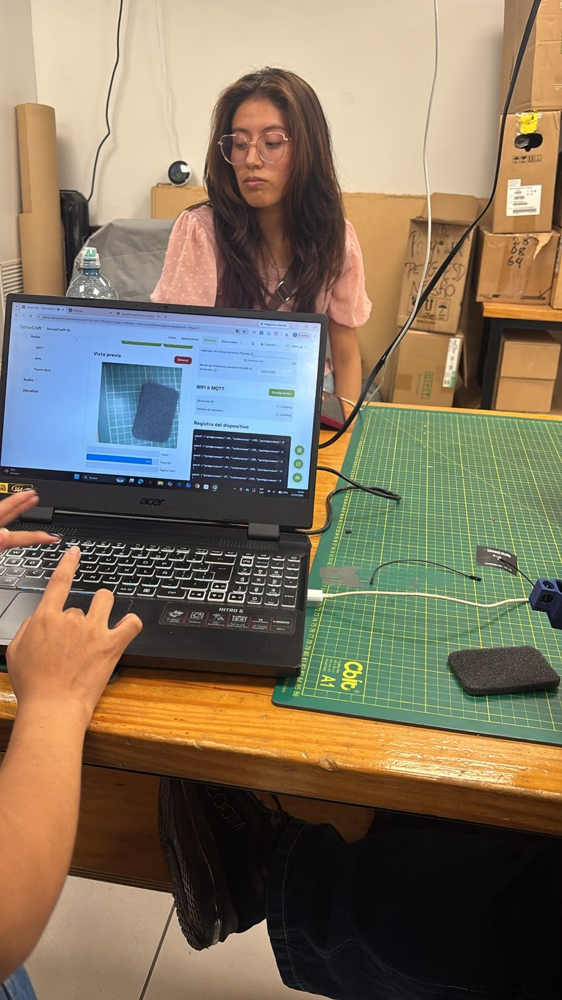
  <br />
  <strong>Figura 21.</strong> <em>Prueba de la clase Esponja en SenseCraft AI.</em>
</p>

<p align="center">
  
  <br />
  <strong>Figura 22.</strong> <em>Prueba de la clase Sigma Face, con la placa orientada hacia el rostro de uno de los integrantes.</em>
</p>

<p align="center">
  
  <br />
  <strong>Figura 23.</strong> <em>Vista previa de SenseCraft AI con el cable: Cable 90 %.</em>
</p>

<p align="center">
  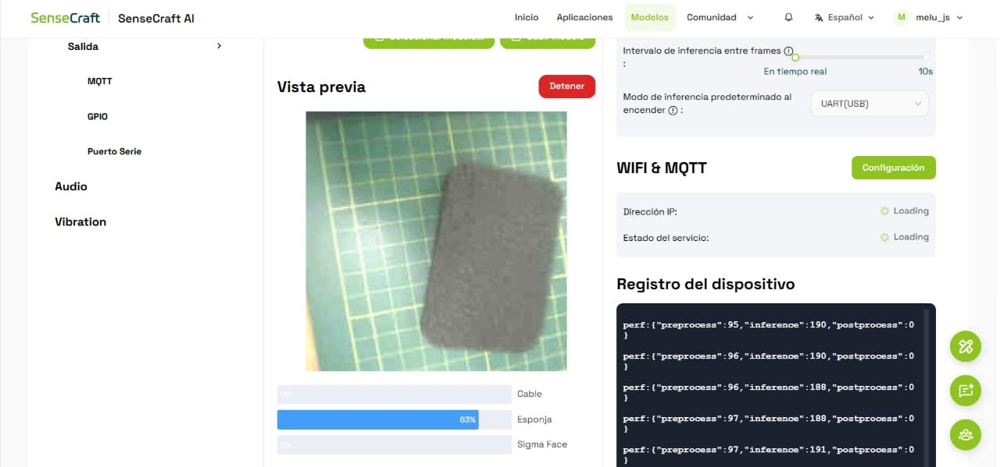
  <br />
  <strong>Figura 24.</strong> <em>Vista previa de SenseCraft AI con la esponja: Esponja 83 %.</em>
</p>

<p align="center">
  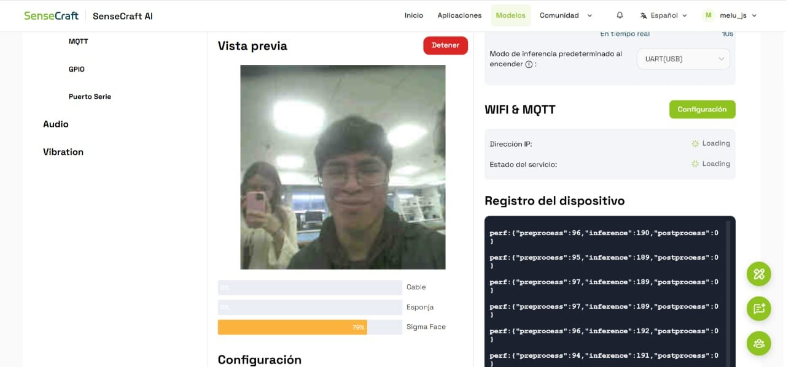
  <br />
  <strong>Figura 25.</strong> <em>Vista previa de SenseCraft AI con el gesto Sigma Face: Sigma Face 79 %.</em>
</p>

**Lo que observamos**

En las tres capturas la clase correcta tuvo la mayor confianza y las otras dos quedaron en 0 %.

## 5. Resultados y análisis

### 5.1. Conjunto de datos

Tuvimos **150 imágenes**, **50 por clase**, de **320x240 píxeles**. Edge Impulse separó **119 para entrenamiento y 31 para prueba** y las redujo a **96x96 píxeles** en RGB.

Las clases están equilibradas en cantidad, pero cada una es un solo objeto (un cable, una esponja y un rostro) fotografiado sobre el mismo fondo y desde pocos ángulos. Eso no garantiza que el modelo reconozca otros cables, otras esponjas u otros rostros.

### 5.2. Pruebas estadísticas en Edge Impulse

<p align="center">
  <strong>Tabla 10.</strong> <em>Resumen de las evaluaciones realizadas en Edge Impulse.</em>
</p>

<div align="center">
<table>
  <thead>
    <tr>
      <th>Evaluación</th>
      <th>Versión del modelo</th>
      <th>Datos evaluados</th>
      <th>Exactitud</th>
      <th>F1 ponderado</th>
    </tr>
  </thead>
  <tbody>
    <tr>
      <td>Entrenamiento (validación)</td>
      <td align="center">Quantized (int8)</td>
      <td align="center">Conjunto de validación</td>
      <td align="center">91,7 %</td>
      <td align="center">0,92</td>
    </tr>
    <tr>
      <td>Live classification</td>
      <td align="center">Unoptimized (float32)</td>
      <td align="center">3 muestras, una por clase</td>
      <td align="center">3 de 3 correctas</td>
      <td align="center">-</td>
    </tr>
    <tr>
      <td>Model testing</td>
      <td align="center">Unoptimized (float32)</td>
      <td align="center">31 imágenes de prueba</td>
      <td align="center">96,77 %</td>
      <td align="center">0,97</td>
    </tr>
  </tbody>
</table>
</div>

<p align="center">
  <em>Fuente: Elaboración propia a partir de las Figuras 9, 11 a 14 y la Tabla 7.</em>
</p>

Hay que leer estas cifras con dos cuidados. La validación usó el modelo int8 y las dos pruebas el float32, así que no comparan exactamente el mismo modelo. Y las imágenes de prueba vienen de las mismas sesiones que las de entrenamiento: el 96,77 % dice que el modelo distingue bien estas tres escenas, no que funcione igual con objetos o fondos nuevos.

### 5.3. Confianza por clase en el dispositivo

<p align="center">
  <strong>Tabla 11.</strong> <em>Confianza de la clase correcta en el dispositivo.</em>
</p>

<div align="center">
<table>
  <thead>
    <tr>
      <th>Clase</th>
      <th>SenseCraft AI</th>
      <th>Monitor serie (mínimo a máximo)</th>
      <th>Monitor serie (promedio)</th>
    </tr>
  </thead>
  <tbody>
    <tr>
      <td>Cable</td>
      <td align="center">90 %</td>
      <td align="center">89,1 % a 95,7 %</td>
      <td align="center">91,9 %</td>
    </tr>
    <tr>
      <td>Esponja</td>
      <td align="center">83 %</td>
      <td align="center">83,2 % a 89,5 %</td>
      <td align="center">86,2 %</td>
    </tr>
    <tr>
      <td>Sigma Face</td>
      <td align="center">79 %</td>
      <td align="center">58,6 % a 81,6 %</td>
      <td align="center">72,8 %</td>
    </tr>
  </tbody>
</table>
</div>

<p align="center">
  <em>Fuente: Elaboración propia a partir de las Figuras 17 a 19 y 23 a 25. Los valores del monitor serie corresponden a los 7 bloques completos de la Tabla 9.</em>
</p>

En las dos herramientas el orden fue el mismo: **Cable** primero, luego **Esponja** y al final **Sigma Face**. En SenseCraft AI cada valor es una sola captura, no un promedio.

En la placa la confianza fue menor que el 1,00 de Live classification. Tiene sentido: en la placa el modelo ve imágenes nuevas tomadas en vivo y corre la versión int8, mientras que Live classification usó imágenes guardadas y la versión float32. No hicimos pruebas para separar cuánto pesa cada cosa.

Sigma Face fue la clase con menos confianza y más variación. Un rostro cambia de posición, distancia y luz mucho más que un objeto quieto sobre la mesa, y su fondo es el laboratorio, mientras que el cable y la esponja comparten la base de corte. Tampoco comprobamos cuál de estos factores influyó más.

### 5.4. Tiempos de preprocesamiento e inferencia

<p align="center">
  <strong>Tabla 12.</strong> <em>Tiempos registrados y estimados.</em>
</p>

<div align="center">
<table>
  <thead>
    <tr>
      <th>Fuente</th>
      <th>Preprocesamiento</th>
      <th>Inferencia</th>
      <th>Postprocesamiento</th>
    </tr>
  </thead>
  <tbody>
    <tr>
      <td>SenseCraft AI, Registro del dispositivo (16 registros)</td>
      <td align="center">87 a 97 ms (promedio 94,9 ms)</td>
      <td align="center">188 a 192 ms (promedio 189,7 ms)</td>
      <td align="center">0 ms</td>
    </tr>
    <tr>
      <td>Arduino IDE, monitor serie</td>
      <td align="center">DSP: 4 ms</td>
      <td align="center">Clasificación: 182 ms</td>
      <td align="center">-</td>
    </tr>
    <tr>
      <td>Edge Impulse, estimación para Cortex-M4F a 80 MHz</td>
      <td align="center">-</td>
      <td align="center">754 ms</td>
      <td align="center">-</td>
    </tr>
  </tbody>
</table>
</div>

<p align="center">
  <em>Fuente: Elaboración propia a partir de las Figuras 10, 17 a 19 y 23 a 25.</em>
</p>

La inferencia tardó cerca de **190 ms** en SenseCraft AI y **182 ms** en el monitor serie: valores parecidos. El preprocesamiento, en cambio, fue muy distinto (4 ms frente a unos 95 ms). Son programas diferentes y seguramente cada uno mide etapas distintas, así que no los comparamos directamente.

Los tiempos reales en la placa fueron mucho menores que los 754 ms que estimó Edge Impulse. Esa estimación es para un Cortex-M4F a 80 MHz con el compilador EON; el ESP32-S3 de la XIAO llega a 240 MHz [1].

### 5.5. Comparación con el taller anterior

En el taller anterior entrenamos en SenseCraft AI un modelo de dos clases, Lentes y Celular [2].

<p align="center">
  <strong>Tabla 13.</strong> <em>Comparación entre el taller de SenseCraft AI y el taller de Edge Impulse.</em>
</p>

<div align="center">
<table>
  <thead>
    <tr>
      <th>Aspecto</th>
      <th>Taller anterior (SenseCraft AI)</th>
      <th>Este taller (Edge Impulse)</th>
    </tr>
  </thead>
  <tbody>
    <tr>
      <td>Clases</td>
      <td align="center">2 (Lentes y Celular)</td>
      <td align="center">3 (Cable, Esponja y Sigma Face)</td>
    </tr>
    <tr>
      <td>Imágenes</td>
      <td align="center">162 (81 por clase)</td>
      <td align="center">150 (50 por clase)</td>
    </tr>
    <tr>
      <td>Plataforma de entrenamiento</td>
      <td align="center">SenseCraft AI</td>
      <td align="center">Edge Impulse, transferencia de aprendizaje con MobileNetV2</td>
    </tr>
    <tr>
      <td>Evaluación en la plataforma</td>
      <td align="center">No registrada</td>
      <td align="center">Validación 91,7 % y Model testing 96,77 %</td>
    </tr>
    <tr>
      <td>Ejecución en la placa</td>
      <td align="center">SenseCraft AI</td>
      <td align="center">Arduino IDE (monitor serie) y SenseCraft AI</td>
    </tr>
    <tr>
      <td>Confianza en SenseCraft AI</td>
      <td align="center">Lentes: 100 % en 3 pruebas. Celular: 88 %, 77 % y 90 %</td>
      <td align="center">Cable: 90 %. Esponja: 83 %. Sigma Face: 79 % (una captura por clase)</td>
    </tr>
  </tbody>
</table>
</div>

<p align="center">
  <em>Fuente: Elaboración propia a partir de la documentación del taller anterior [2] y de los resultados de este taller.</em>
</p>

Con una clase más y menos fotos por clase, el modelo acertó las tres clases en la placa. Sus confianzas en SenseCraft AI (79 % a 90 %) se parecen a las del celular en el taller anterior (77 % a 90 %) y quedan por debajo del 100 % de los lentes. Como esta vez tomamos una sola captura por clase y la vez anterior tres, la comparación es solo orientativa.

Lo que más cambió fue la forma de evaluar. Edge Impulse nos dio un conjunto de prueba y una matriz de confusión, algo que en el taller anterior no registramos. Y pudimos correr el mismo modelo de dos maneras: como librería de Arduino y en SenseCraft AI.

### 5.6. Limitaciones y mejoras

- **Un solo objeto por clase.** Un cable, una esponja y un rostro. El modelo pudo aprender esos objetos en particular, no "cable" o "esponja" en general.
- **Mismo fondo y pocos ángulos.** Un cambio de fondo, distancia o luz podría cambiar la clasificación.
- **Prueba sin imágenes realmente nuevas.** Las 31 imágenes de prueba salieron de las mismas sesiones que las de entrenamiento.
- **Pocas pruebas en la placa.** Una captura por clase en SenseCraft AI y siete bloques por clase en el monitor serie.
- **Sin aumento de datos.** Entrenamos con *data augmentation* desactivado.

Para la próxima: fotografiar varios objetos por clase con fondos y luces distintos, capturar el conjunto de prueba en otra sesión, activar el aumento de datos y repetir las pruebas en la placa para sacar promedios.

## 6. Conclusiones

1. Con 150 fotos propias y transferencia de aprendizaje, el modelo acertó 30 de las 31 imágenes de Model testing (96,77 %). El único error fue una esponja tomada por cable.

2. En la placa el modelo reconoció las tres clases, tanto en el monitor serie como en SenseCraft AI. El orden de confianza se repitió en las dos herramientas: Cable (90 % en SenseCraft AI), Esponja (83 %) y Sigma Face (79 %).

3. Sigma Face fue la clase más difícil. En el monitor serie bajó hasta 0,59 en los bloques completos. Un rostro se mueve y cambia de fondo mucho más que un objeto sobre la mesa.

4. Aprendimos a no mezclar cifras. La validación usó el modelo int8 y las pruebas el float32, y los 754 ms que estimó Edge Impulse eran para otro microcontrolador: en la XIAO medimos unos 190 ms.

5. Un 96,77 % con imágenes de las mismas sesiones no asegura que el modelo funcione con otros cables, esponjas o rostros. Para medir eso necesitamos datos más variados y un conjunto de prueba capturado aparte.

## 7. Archivos del proyecto

- **[Conjunto de datos (Data.zip)](Data.zip):** las 150 imágenes capturadas con la XIAO ESP32S3 Sense, de 320x240 píxeles, en las carpetas `Cable/`, `Esponja/` y `Sigma Face/` (50 por clase).

- **[Modelo (Modelo.zip)](Modelo.zip):** librería de Arduino exportada desde Edge Impulse (`Joseph_Lombardi-project-1_inferencing`, versión 1.0.1, modelo cuantizado int8). Se instala en Arduino IDE con **Programa >> Incluir Librería >> Añadir biblioteca .ZIP**.

- **[Imágenes del taller](imagenes/):** fotos de la pizarra y del laboratorio, y capturas de pantalla usadas como figuras en este documento.

## 8. Referencias bibliográficas

<a id="ref1"></a>

[1] Seeed Studio, "Getting Started with Seeed Studio XIAO ESP32-S3 Series," *Seeed Studio Wiki*. [En línea]. Disponible en: https://wiki.seeedstudio.com/xiao_esp32s3_getting_started/. [Accedido: 16-oct-2026].

<a id="ref2"></a>

[2] Equipo 02, "Clasificación de lentes y celulares mediante SenseCraft AI y activación de LED con GPIO," repositorio PI_Equipo_02, Proyecto Integrador, Universidad Peruana Cayetano Heredia, 2026. Disponible en: [../TinyML-Sensecraft/readme2.md](../TinyML-Sensecraft/readme2.md).

<a id="ref3"></a>

[3] Edge Impulse, "Data acquisition," *Edge Impulse Documentation*. [En línea]. Disponible en: https://docs.edgeimpulse.com/studio/projects/data-acquisition. [Accedido: 16-oct-2026].

<a id="ref4"></a>

[4] Edge Impulse, "Run Arduino library (IDE 2.0)," *Edge Impulse Documentation*. [En línea]. Disponible en: https://docs.edgeimpulse.com/hardware/deployments/run-arduino-2-0. [Accedido: 16-oct-2026].

<a id="ref5"></a>

[5] Seeed Studio, "XIAO ESP32S3-Sense Image Classification," *Seeed Studio Wiki*. [En línea]. Disponible en: https://wiki.seeedstudio.com/tinyml_course_Image_classification_project/. [Accedido: 16-oct-2026].

<a id="ref6"></a>

[6] Edge Impulse, "Transfer learning (images)," *Edge Impulse Documentation*. [En línea]. Disponible en: https://docs.edgeimpulse.com/studio/projects/learning-blocks/blocks/transfer-learning-images. [Accedido: 16-oct-2026].

<a id="ref8"></a>

[7] Edge Impulse, "Live classification," *Edge Impulse Documentation*. [En línea]. Disponible en: https://docs.edgeimpulse.com/studio/projects/live-classification. [Accedido: 16-oct-2026].

<a id="ref9"></a>

[8] Edge Impulse, "Model testing," *Edge Impulse Documentation*. [En línea]. Disponible en: https://docs.edgeimpulse.com/studio/projects/model-testing. [Accedido: 16-oct-2026].

<a id="ref10"></a>

[9] Seeed Studio, "Camera Usage in Seeed Studio XIAO ESP32S3 Sense," *Seeed Studio Wiki*. [En línea]. Disponible en: https://wiki.seeedstudio.com/xiao_esp32s3_camera_usage/. [Accedido: 16-oct-2026].

<a id="ref11"></a>

[10] Seeed Studio, "Using a model for XIAO ESP32S3 Sense," *Seeed Studio Wiki*. [En línea]. Disponible en: https://wiki.seeedstudio.com/sensecraft-ai/tutorials/sensecraft-ai-pretrained-models-for-xiao/. [Accedido: 16-oct-2026].
