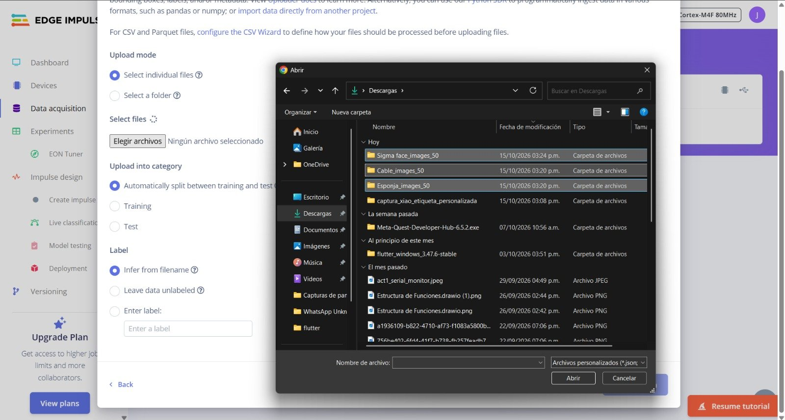
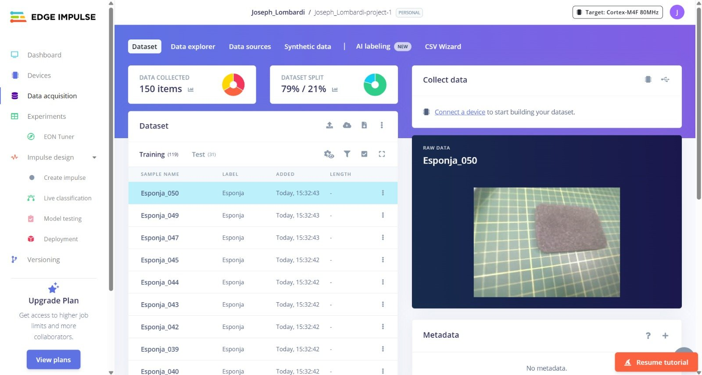
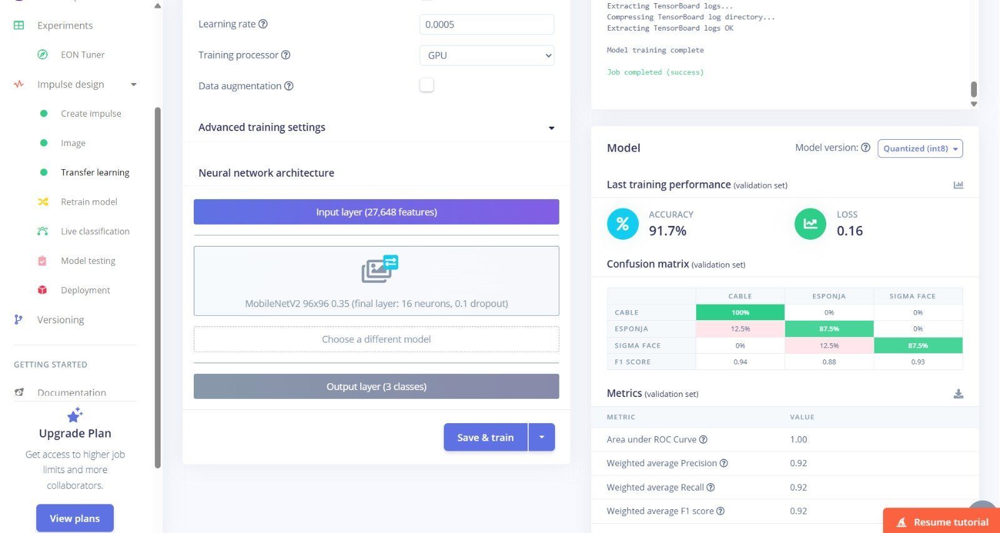
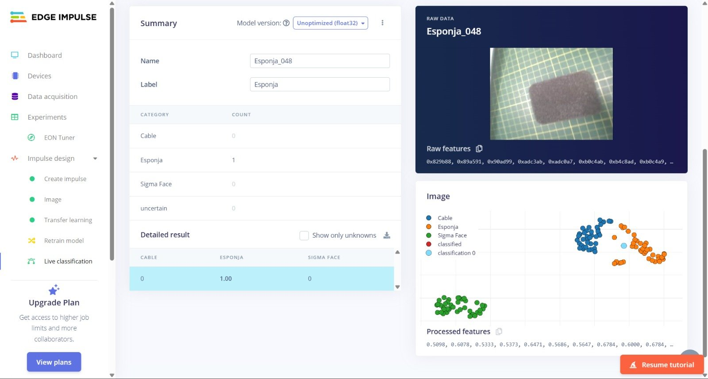
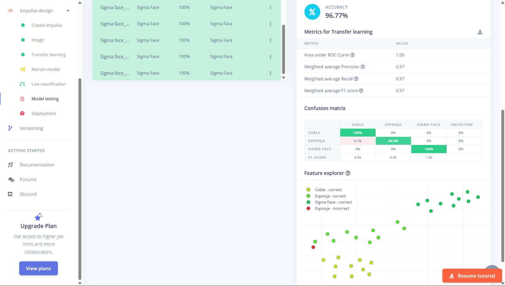
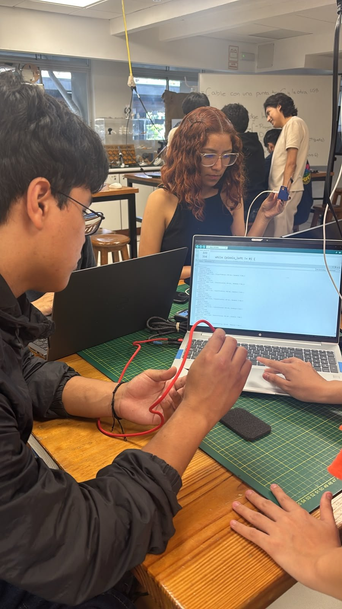
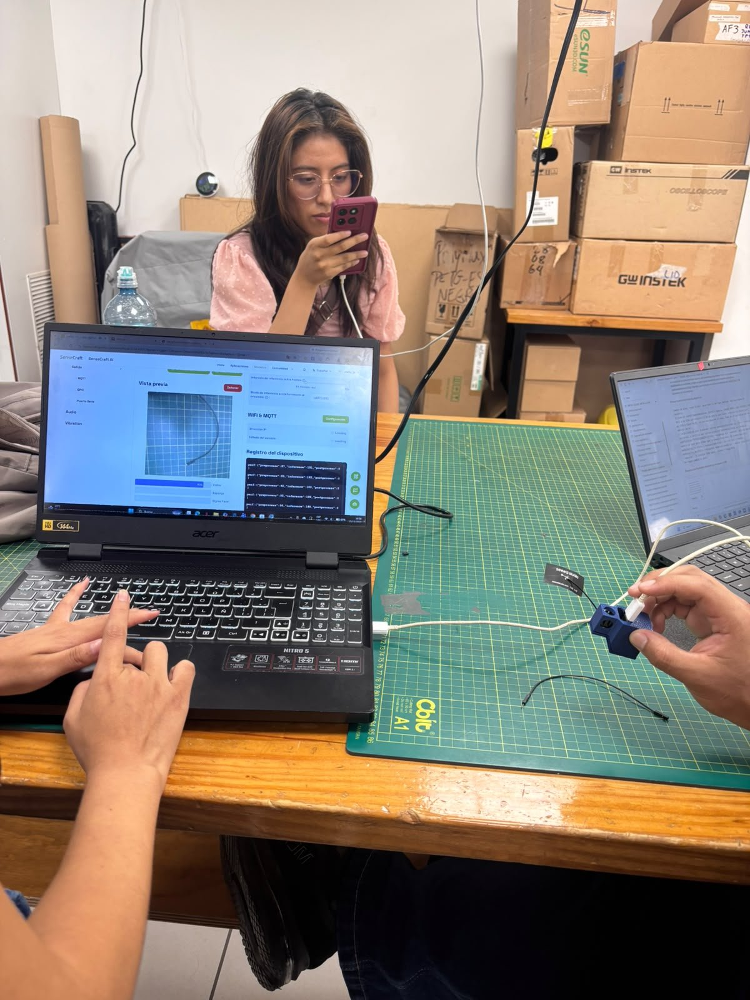
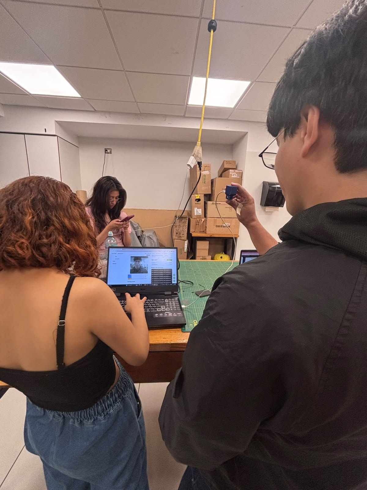
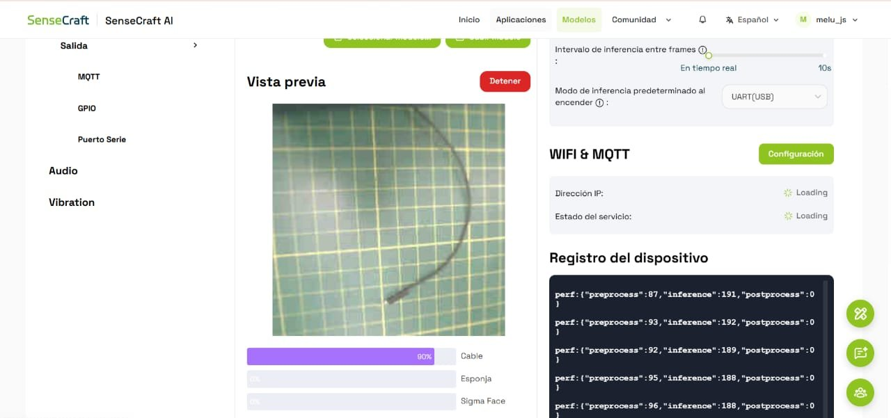

# Clasificación de cable, esponja y Sigma Face mediante Edge Impulse y la XIAO ESP32S3 Sense

## 1. Introducción

Tiny Machine Learning (TinyML) es una tecnología que permite ejecutar modelos de aprendizaje automático en dispositivos pequeños, como los microcontroladores, sin depender de una computadora para realizar cada predicción.

En este taller, realizado el jueves 15 de octubre de 2026, volvimos a trabajar con la placa **XIAO ESP32S3 Sense** de Seeed Studio, que incorpora un procesador ESP32-S3 y un módulo de cámara [1]. A diferencia del taller anterior, en el que entrenamos el modelo directamente en SenseCraft AI [2], esta vez construimos el modelo en **Edge Impulse**, una plataforma en línea que permite cargar datos, diseñar el procesamiento, entrenar redes neuronales y exportar el resultado para distintos dispositivos [3], [4]. Seeed Studio también documenta este flujo de clasificación de imágenes con Edge Impulse para la XIAO ESP32S3 Sense [5].

El flujo completo siguió la guía de clase [6]: configuramos Arduino IDE (Integrated Development Environment, entorno de desarrollo integrado), capturamos nuestras propias fotografías con la cámara de la placa, entrenamos un clasificador de imágenes por transferencia de aprendizaje en Edge Impulse, lo evaluamos con dos pruebas estadísticas, lo ejecutamos en la placa desde Arduino IDE y, finalmente, visualizamos sus predicciones en SenseCraft AI.

Elegimos tres clases: **Cable**, **Esponja** y **Sigma Face**. Las dos primeras corresponden a objetos del laboratorio y la tercera al rostro de una persona realizando un mismo gesto. Para cada clase capturamos **50 imágenes**, con un total de **150 fotografías**.

El proyecto de Edge Impulse fue creado por Joseph Lombardi Quispe, y la parte final del taller, es decir, el reconocimiento en Arduino IDE mediante el monitor serie y la visualización en SenseCraft AI, estuvo a cargo de Yoichi Palacios Tanaka. [COMPLETAR: nombres de los demás integrantes que participaron el jueves y su rol].

## 2. Objetivos

### 2.1. Objetivo general

Desarrollar, evaluar y desplegar en la placa XIAO ESP32S3 Sense un modelo de clasificación de imágenes de tres clases (Cable, Esponja y Sigma Face), entrenado en Edge Impulse a partir de fotografías capturadas por la propia placa.

### 2.2. Objetivos específicos

- Configurar Arduino IDE y la cámara de la XIAO ESP32S3 Sense para capturar imágenes mediante el ejemplo CameraWebServer.
- Construir un conjunto de datos de 150 imágenes, con 50 imágenes por clase, y etiquetarlo en Edge Impulse.
- Diseñar un impulse de clasificación de imágenes de 96x96 píxeles y entrenarlo por transferencia de aprendizaje.
- Evaluar el modelo mediante dos pruebas estadísticas de Edge Impulse: Live classification y Model testing.
- Exportar el modelo como librería de Arduino, adaptarlo a los pines de la cámara de la XIAO y comprobar sus predicciones en el monitor serie.
- Visualizar el modelo en SenseCraft AI y registrar la confianza por clase y los tiempos de preprocesamiento e inferencia.
- Comparar los resultados con el taller anterior de dos clases y documentar el procedimiento en GitHub.

## 3. Materiales y herramientas

### 3.1. Materiales utilizados

Para desarrollar el laboratorio utilizamos la placa XIAO ESP32S3 Sense, una laptop, los objetos seleccionados para el reconocimiento y tres plataformas de software: Arduino IDE, Edge Impulse y SenseCraft AI.

<p align="center">
  <strong>Tabla 1.</strong> <em>Materiales y herramientas utilizados durante el laboratorio.</em>
</p>

<div align="center">
<table>
  <thead>
    <tr>
      <th>N.º</th>
      <th>Material o herramienta</th>
      <th>Función</th>
    </tr>
  </thead>
  <tbody>
    <tr>
      <td align="center">1</td>
      <td>XIAO ESP32S3 Sense</td>
      <td>Placa utilizada para capturar las imágenes y ejecutar el modelo.</td>
    </tr>
    <tr>
      <td align="center">2</td>
      <td>Cámara de la XIAO ESP32S3 Sense</td>
      <td>Permite capturar las imágenes del conjunto de datos y las imágenes de prueba.</td>
    </tr>
    <tr>
      <td align="center">3</td>
      <td>Cable USB (Universal Serial Bus) tipo C a USB tipo A</td>
      <td>Cable solicitado por el profesor, con una punta tipo C para la placa y la otra USB para la laptop. Permite alimentar y programar la placa.</td>
    </tr>
    <tr>
      <td align="center">4</td>
      <td>Laptop</td>
      <td>Se utilizó para programar la placa y acceder a Edge Impulse y SenseCraft AI.</td>
    </tr>
    <tr>
      <td align="center">5</td>
      <td>Arduino IDE 2.3.10</td>
      <td>Entorno utilizado para cargar CameraWebServer y el ejemplo de inferencia, y para leer el monitor serie.</td>
    </tr>
    <tr>
      <td align="center">6</td>
      <td>Paquete de placas ESP32 de Espressif Systems</td>
      <td>Permite programar la XIAO ESP32S3 desde Arduino IDE. Versión instalada: [COMPLETAR: versión del paquete ESP32].</td>
    </tr>
    <tr>
      <td align="center">7</td>
      <td>Ejemplo CameraWebServer y página <code>captura_xiao_etiqueta_personalizada.html</code></td>
      <td>Permiten transmitir la imagen de la cámara por la red y descargar lotes de fotografías etiquetadas en un archivo ZIP.</td>
    </tr>
    <tr>
      <td align="center">8</td>
      <td>Edge Impulse</td>
      <td>Plataforma utilizada para cargar los datos, diseñar el impulse, entrenar, probar y exportar el modelo.</td>
    </tr>
    <tr>
      <td align="center">9</td>
      <td>SenseCraft AI</td>
      <td>Plataforma utilizada para ejecutar el modelo exportado y visualizar sus predicciones.</td>
    </tr>
    <tr>
      <td align="center">10</td>
      <td>Cable delgado, esponja y rostro con el gesto Sigma Face</td>
      <td>Elementos que definen las tres clases del modelo.</td>
    </tr>
    <tr>
      <td align="center">11</td>
      <td>GitHub</td>
      <td>Repositorio utilizado para almacenar los archivos y documentar el taller.</td>
    </tr>
  </tbody>
</table>
</div>

<p align="center">
  <em>Fuente: Elaboración propia.</em>
</p>

### 3.2. Características de la placa XIAO ESP32S3 Sense

La XIAO ESP32S3 Sense cuenta con un procesador ESP32-S3 de doble núcleo que trabaja hasta 240 MHz, 8 MB de memoria PSRAM (Pseudo Static Random Access Memory, memoria de acceso aleatorio pseudoestática), 8 MB de memoria Flash, conectividad Wi-Fi y Bluetooth LE (Low Energy, de bajo consumo), y un módulo de cámara [1].

En este taller, la característica más importante fue la cámara, porque la utilizamos tanto para construir el conjunto de datos como para evaluar el modelo. También fue importante la PSRAM: la guía de clase indica activarla porque el modelo necesita memoria adicional para procesar las imágenes de la cámara y evitar errores por falta de memoria [6].

## 4. Desarrollo del taller

### 4.1. Organización de la práctica indicada en la pizarra

Al inicio de la clase, el profesor escribió en la pizarra el material requerido y las secciones que debía tener la documentación del taller. En las fotografías del laboratorio la pizarra aparece al fondo y solo se leen algunos fragmentos ("Cable con una punta tipo C y la otra USB", "Edge Impulse", "Proyecto", "imágenes y etiqueta", "paso 6"), por lo que la Tabla 2 recoge las secciones tal como las anotamos. [COMPLETAR: foto de la pizarra del profesor].

<p align="center">
  <strong>Tabla 2.</strong> <em>Secciones solicitadas en la pizarra y su ubicación en este documento.</em>
</p>

<div align="center">
<table>
  <thead>
    <tr>
      <th>Sección de la pizarra</th>
      <th>Contenido</th>
      <th>Ubicación</th>
    </tr>
  </thead>
  <tbody>
    <tr>
      <td>Proyecto</td>
      <td>Creación del proyecto en Edge Impulse.</td>
      <td align="center">4.5</td>
    </tr>
    <tr>
      <td>Dataset (imágenes y etiqueta)</td>
      <td>Captura de las imágenes, carga y etiquetado en Edge Impulse.</td>
      <td align="center">4.4 y 4.6</td>
    </tr>
    <tr>
      <td>Pruebas estadísticas (2)</td>
      <td>Live classification y Model testing en Edge Impulse.</td>
      <td align="center">4.9</td>
    </tr>
    <tr>
      <td>Edge Impulse: Pruebas</td>
      <td>Ejecución del modelo en la placa y lectura en el monitor serie (paso 6 de la parte "Modelo en Arduino IDE" de la guía).</td>
      <td align="center">4.12</td>
    </tr>
    <tr>
      <td>SenseCraft: Pruebas</td>
      <td>Visualización del modelo en SenseCraft AI.</td>
      <td align="center">4.13</td>
    </tr>
  </tbody>
</table>
</div>

<p align="center">
  <em>Fuente: Elaboración propia a partir de lo indicado por el profesor en la pizarra.</em>
</p>

### 4.2. Paso 1: Configuración inicial de Arduino IDE

Siguiendo la guía de clase [6], primero preparamos Arduino IDE para programar la XIAO ESP32S3:

1. En **Archivo >> Preferencias** agregamos la siguiente dirección en el campo de URL (Uniform Resource Locator, dirección web) adicionales del administrador de placas:
   `https://raw.githubusercontent.com/espressif/arduino-esp32/gh-pages/package_esp32_dev_index.json`
2. En **Herramientas >> Placa >> Administrador de placas** instalamos el paquete **ESP32 de Espressif Systems**. La guía advierte que las versiones con *alpha* en el nombre no funcionan correctamente con la XIAO y Edge Impulse, por lo que recomienda la última versión estable [6].
3. En **Herramientas >> Placa** seleccionamos **XIAO_ESP32S3** y, en **Herramientas >> Puerto**, el puerto al que estaba conectada la placa.
4. En **Herramientas >> PSRAM** seleccionamos **OPI PSRAM**, es decir, la PSRAM con interfaz octal (OPI, *Octal Peripheral Interface*), para disponer de la memoria adicional que necesitan la cámara y el modelo [6].

### 4.3. Paso 2: Preparación de la cámara con CameraWebServer

Para capturar nuestras propias imágenes utilizamos el ejemplo **Archivo >> Ejemplos >> ESP32 >> Camera >> CameraWebServer** [6].

En el archivo `board_config.h` activamos el modelo de cámara de nuestra placa:

```cpp
#define CAMERA_MODEL_XIAO_ESP32S3 // Has PSRAM
```

En el archivo principal colocamos el nombre y la contraseña de la red Wi-Fi del laboratorio, y dejamos las demás líneas con sus valores por defecto. Por seguridad, no incluimos esas credenciales en este documento.

Después verificamos y subimos el programa a la placa. En el monitor serie apareció la dirección IP (Internet Protocol) asignada a la cámara; al abrirla en el navegador pudimos iniciar la transmisión con **Start Stream**, y al añadir `/capture` a la misma dirección obtuvimos una imagen fija [6].

La guía también señala dos errores frecuentes: si Arduino IDE no reconoce el puerto, basta con desconectar la placa, revisar que sus componentes estén bien ensamblados y volver a conectarla; si la placa no se conecta a la red, hay que revisar el nombre y la contraseña escritos en el código [6].

### 4.4. Paso 3: Captura del conjunto de datos (Dataset: imágenes y etiqueta)

Con la cámara transmitiendo, utilizamos la página web **captura_xiao_etiqueta_personalizada.html**, proporcionada en clase. En ella indicamos la dirección IP de la cámara, el nombre de la etiqueta, el número de imágenes y el intervalo entre capturas; al terminar, la página descarga un archivo ZIP con una carpeta que lleva el nombre de la etiqueta [6].

Repetimos el procedimiento una vez por clase y obtuvimos tres archivos: `Cable_images_50.zip`, `Esponja_images_50.zip` y `Sigma face_images_50.zip`. Intervalo entre capturas utilizado: [COMPLETAR: intervalo en milisegundos].

Las clases quedaron definidas de la siguiente manera:

- **Cable:** un cable negro delgado colocado sobre la base de corte verde del laboratorio.
- **Esponja:** una esponja gris oscura colocada sobre la misma base de corte.
- **Sigma Face:** el rostro de [COMPLETAR: nombre de quien posó para esta clase] realizando un mismo gesto, con el laboratorio de fondo.

Al revisar los archivos comprobamos que cada clase tiene exactamente **50 imágenes** y que todas tienen una resolución de **320x240 píxeles** en formato JPEG (Joint Photographic Experts Group).

<p align="center">
  <strong>Tabla 3.</strong> <em>Distribución de las imágenes capturadas.</em>
</p>

<div align="center">
<table>
  <thead>
    <tr>
      <th>Clase</th>
      <th>Cantidad de imágenes</th>
      <th>Resolución</th>
      <th>Distribución porcentual</th>
    </tr>
  </thead>
  <tbody>
    <tr>
      <td>Cable</td>
      <td align="center">50</td>
      <td align="center">320x240</td>
      <td align="center">33,3 %</td>
    </tr>
    <tr>
      <td>Esponja</td>
      <td align="center">50</td>
      <td align="center">320x240</td>
      <td align="center">33,3 %</td>
    </tr>
    <tr>
      <td>Sigma Face</td>
      <td align="center">50</td>
      <td align="center">320x240</td>
      <td align="center">33,3 %</td>
    </tr>
    <tr>
      <td><strong>Total</strong></td>
      <td align="center"><strong>150</strong></td>
      <td align="center">-</td>
      <td align="center"><strong>100 %</strong></td>
    </tr>
  </tbody>
</table>
</div>

<p align="center">
  <em>Fuente: Elaboración propia a partir de los archivos capturados con la XIAO ESP32S3 Sense.</em>
</p>

Antes de pasar a Edge Impulse descomprimimos los tres archivos, cerramos el monitor serie y detuvimos la transmisión de la cámara, como indica la guía [6]. Las 150 imágenes se encuentran en el archivo [Data.zip](Data.zip), organizadas en las carpetas `Cable/`, `Esponja/` y `Sigma Face/`.

#### 4.4.1. Participación en la captura

[COMPLETAR: nombres de los integrantes que realizaron la captura de cada clase]. No contamos con fotografías de esta etapa.

### 4.5. Paso 4: Creación del proyecto en Edge Impulse (Proyecto)

Creamos una cuenta en Edge Impulse y un proyecto nuevo [6]. El proyecto quedó registrado como **Joseph_Lombardi-project-1**, con una etiqueta que lo identifica como proyecto del Grupo 2 del curso de Proyecto Integrador, como se observa en la Figura 1.

<p align="center">
  
  <br />
  <strong>Figura 1.</strong> <em>Panel principal del proyecto Joseph_Lombardi-project-1 en Edge Impulse.</em>
</p>

#### 4.5.1. Participación de Joseph Lombardi Quispe

Joseph Lombardi Quispe creó el proyecto en su cuenta de Edge Impulse y desde ella se realizaron la carga de datos, el entrenamiento, las pruebas estadísticas y la exportación de la librería de Arduino descritos en los pasos 5 a 9. Las capturas de las Figuras 1 a 12 corresponden a ese proyecto.

### 4.6. Paso 5: Carga y etiquetado de las imágenes

Como ya teníamos nuestros datos, elegimos la opción de añadir datos existentes [6]. Para cada clase seleccionamos sus 50 imágenes, dejamos la partición entre entrenamiento y prueba en su valor por defecto (**Automatically split between training and test**) y escribimos manualmente la etiqueta en **Enter label** [6], [3].

<p align="center">
  
  <br />
  <strong>Figura 2.</strong> <em>Carpetas descomprimidas de las tres clases: Sigma face_images_50, Cable_images_50 y Esponja_images_50.</em>
</p>

<p align="center">
  
  <br />
  <strong>Figura 3.</strong> <em>Selección de las imágenes de la clase Sigma Face en la ventana de carga de Edge Impulse.</em>
</p>

<p align="center">
  
  <br />
  <strong>Figura 4.</strong> <em>Carga de 50 archivos con partición automática y la etiqueta Sigma Face escrita manualmente.</em>
</p>

Al subir cada grupo, Edge Impulse mostró el registro de la carga. En la Figura 5 se observa el final de la carga de la clase Sigma Face, con 50 archivos subidos correctamente y ninguno fallido.

<p align="center">
  
  <br />
  <strong>Figura 5.</strong> <em>Registro de carga de la clase Sigma Face: 50 archivos subidos y 0 fallidos.</em>
</p>

Repetimos el procedimiento para Cable y Esponja. Al finalizar, la sección **Data acquisition** mostró **150 elementos** y una partición de **79 % / 21 %**: **119 imágenes de entrenamiento** y **31 imágenes de prueba** (Figura 6).

<p align="center">
  
  <br />
  <strong>Figura 6.</strong> <em>Conjunto de datos en Edge Impulse: 150 elementos, 119 de entrenamiento y 31 de prueba.</em>
</p>

<p align="center">
  <strong>Tabla 4.</strong> <em>Partición del conjunto de datos en Edge Impulse.</em>
</p>

<div align="center">
<table>
  <thead>
    <tr>
      <th>Conjunto</th>
      <th>Cantidad de imágenes</th>
      <th>Porcentaje</th>
    </tr>
  </thead>
  <tbody>
    <tr>
      <td>Entrenamiento (Training)</td>
      <td align="center">119</td>
      <td align="center">79 %</td>
    </tr>
    <tr>
      <td>Prueba (Test)</td>
      <td align="center">31</td>
      <td align="center">21 %</td>
    </tr>
    <tr>
      <td><strong>Total</strong></td>
      <td align="center"><strong>150</strong></td>
      <td align="center"><strong>100 %</strong></td>
    </tr>
  </tbody>
</table>
</div>

<p align="center">
  <em>Fuente: Elaboración propia a partir de la sección Data acquisition de Edge Impulse.</em>
</p>

Es importante señalar que el conjunto de prueba fue separado automáticamente por Edge Impulse a partir de las mismas sesiones de captura. Por eso, aunque esas 31 imágenes no se usan para entrenar, muestran los mismos objetos, con el mismo fondo y en condiciones parecidas a las del entrenamiento.

### 4.7. Paso 6: Diseño del impulse

En Edge Impulse, un *impulse* es la cadena que recibe los datos, los procesa y los entrega a un bloque de aprendizaje. Lo creamos en **Impulse design >> Create impulse** con tres partes [6]:

- **Image data:** dejamos los valores por defecto, con los que las imágenes se redimensionan a **96x96 píxeles** antes de entrar al modelo.
- **Processing block: Image.** Prepara y normaliza las imágenes. En sus parámetros se elige la profundidad de color, RGB (rojo, verde y azul) o escala de grises, y luego se pulsa **Generate features** para generar las características [6].
- **Learning block: Transfer Learning (Images).** A diferencia del bloque *Classification*, que aprende patrones a partir de las características de los datos de entrada, este bloque usa una red neuronal previamente entrenada y adapta parte de su aprendizaje a nuestras imágenes. Esto permite aprovechar características visuales ya aprendidas y entrenar un clasificador con un conjunto de imágenes relativamente pequeño [6], [7].

En la Figura 7 se observa que la capa de entrada del modelo recibe **27 648 características**, valor que corresponde a una imagen de 96x96 píxeles con tres canales de color (96 x 96 x 3), es decir, trabajamos en RGB.

### 4.8. Paso 7: Entrenamiento por transferencia de aprendizaje

En **Impulse design >> Transfer learning** configuramos el entrenamiento y pulsamos **Save & train** [6]. La Tabla 5 resume los parámetros visibles en la captura.

<p align="center">
  <strong>Tabla 5.</strong> <em>Parámetros de entrenamiento utilizados en Edge Impulse.</em>
</p>

<div align="center">
<table>
  <thead>
    <tr>
      <th>Parámetro</th>
      <th>Valor</th>
    </tr>
  </thead>
  <tbody>
    <tr>
      <td>Número de ciclos de entrenamiento</td>
      <td align="center">[COMPLETAR: número de ciclos]</td>
    </tr>
    <tr>
      <td>Tasa de aprendizaje (learning rate)</td>
      <td align="center">0,0005</td>
    </tr>
    <tr>
      <td>Procesador de entrenamiento</td>
      <td align="center">GPU (Graphics Processing Unit, unidad de procesamiento gráfico)</td>
    </tr>
    <tr>
      <td>Aumento de datos (data augmentation)</td>
      <td align="center">Desactivado</td>
    </tr>
    <tr>
      <td>Arquitectura</td>
      <td align="center">MobileNetV2 96x96 0.35 (capa final de 16 neuronas, dropout 0,1)</td>
    </tr>
    <tr>
      <td>Capa de entrada</td>
      <td align="center">27 648 características</td>
    </tr>
    <tr>
      <td>Capa de salida</td>
      <td align="center">3 clases</td>
    </tr>
  </tbody>
</table>
</div>

<p align="center">
  <em>Fuente: Elaboración propia a partir de la sección Transfer learning de Edge Impulse.</em>
</p>

El *dropout* es una técnica que desactiva al azar una fracción de las neuronas durante el entrenamiento para reducir el sobreajuste.

Al terminar, Edge Impulse mostró el desempeño sobre el **conjunto de validación**, una parte de las imágenes de entrenamiento que la plataforma reserva para evaluar el modelo mientras aprende. Con la versión **Quantized (int8)** del modelo, es decir, la versión cuantizada cuyos pesos se representan con enteros de 8 bits, obtuvimos una exactitud (*accuracy*) de **91,7 %** y una pérdida (*loss*) de **0,16** (Figura 7).

<p align="center">
  
  <br />
  <strong>Figura 7.</strong> <em>Parámetros de entrenamiento, arquitectura MobileNetV2 y desempeño sobre el conjunto de validación (Quantized int8).</em>
</p>

La Tabla 6 presenta la matriz de confusión y las métricas de validación. La puntuación F1 combina la precisión (de las imágenes asignadas a una clase, cuántas eran realmente de esa clase) y la exhaustividad o *recall* (de las imágenes de una clase, cuántas fueron reconocidas). La curva ROC (*Receiver Operating Characteristic*, característica operativa del receptor) mide la capacidad del modelo para separar las clases; un área de 1,00 indica una separación completa en el conjunto evaluado.

<p align="center">
  <strong>Tabla 6.</strong> <em>Matriz de confusión y métricas sobre el conjunto de validación (Quantized int8).</em>
</p>

<div align="center">
<table>
  <thead>
    <tr>
      <th>Clase real \ Clase predicha</th>
      <th>Cable</th>
      <th>Esponja</th>
      <th>Sigma Face</th>
      <th>F1</th>
    </tr>
  </thead>
  <tbody>
    <tr>
      <td>Cable</td>
      <td align="center"><strong>100 %</strong></td>
      <td align="center">0 %</td>
      <td align="center">0 %</td>
      <td align="center">0,94</td>
    </tr>
    <tr>
      <td>Esponja</td>
      <td align="center">12,5 %</td>
      <td align="center"><strong>87,5 %</strong></td>
      <td align="center">0 %</td>
      <td align="center">0,88</td>
    </tr>
    <tr>
      <td>Sigma Face</td>
      <td align="center">0 %</td>
      <td align="center">12,5 %</td>
      <td align="center"><strong>87,5 %</strong></td>
      <td align="center">0,93</td>
    </tr>
  </tbody>
</table>
</div>

<p align="center">
  <em>Fuente: Elaboración propia a partir de la sección Transfer learning de Edge Impulse. Exactitud: 91,7 %; pérdida: 0,16; área bajo la curva ROC: 1,00; precisión, exhaustividad y F1 ponderados: 0,92.</em>
</p>

La Figura 8 muestra el **Data explorer**, donde cada punto es una imagen. Las tres clases forman grupos separados y solo aparecen unos pocos puntos marcados como incorrectos. En la misma figura, Edge Impulse estima el rendimiento en el dispositivo con su compilador EON Compiler en modo *RAM optimized*: **754 ms** de inferencia, **228,0 K** de RAM (Random Access Memory, memoria de acceso aleatorio) como máximo y **546,0 K** de memoria Flash. Esta estimación corresponde al dispositivo objetivo configurado en el proyecto, un microcontrolador con núcleo **Cortex-M4F a 80 MHz** (Figura 1), y no a la XIAO ESP32S3. Además, la librería que exportamos usa TensorFlow Lite sin el compilador EON (en `model_metadata.h` de [Modelo.zip](Modelo.zip) figura `EI_CLASSIFIER_COMPILED 0`), y la captura no indica a qué versión del modelo corresponde la estimación. Por eso la tomamos solo como referencia y no como el tiempo real de nuestra placa.

<p align="center">
  
  <br />
  <strong>Figura 8.</strong> <em>Data explorer de las muestras clasificadas y estimación de rendimiento para el objetivo Cortex-M4F a 80 MHz.</em>
</p>

### 4.9. Paso 8: Pruebas estadísticas (2)

La pizarra pedía dos pruebas estadísticas. En Edge Impulse las realizamos con las secciones **Live classification** y **Model testing**.

#### 4.9.1. Prueba estadística 1: Live classification

En **Live classification** se elige una muestra existente del conjunto de prueba y se pulsa **Load sample** para clasificarla individualmente [6], [8]. Probamos una imagen de cada clase con la versión **Unoptimized (float32)** del modelo, es decir, la versión sin cuantizar, cuyos pesos se representan con números decimales de 32 bits.

<p align="center">
  
  <br />
  <strong>Figura 9.</strong> <em>Live classification de la muestra Cable_039: Cable 1,00.</em>
</p>

<p align="center">
  
  <br />
  <strong>Figura 10.</strong> <em>Live classification de la muestra Esponja_048: Esponja 1,00.</em>
</p>

<p align="center">
  <strong>Tabla 7.</strong> <em>Resultados de Live classification (Unoptimized float32).</em>
</p>

<div align="center">
<table>
  <thead>
    <tr>
      <th>Muestra</th>
      <th>Etiqueta real</th>
      <th>Cable</th>
      <th>Esponja</th>
      <th>Sigma Face</th>
      <th>Resultado</th>
    </tr>
  </thead>
  <tbody>
    <tr>
      <td>Cable_039</td>
      <td align="center">Cable</td>
      <td align="center">1,00</td>
      <td align="center">0</td>
      <td align="center">0</td>
      <td align="center">Correcto</td>
    </tr>
    <tr>
      <td>Esponja_048</td>
      <td align="center">Esponja</td>
      <td align="center">0</td>
      <td align="center">1,00</td>
      <td align="center">0</td>
      <td align="center">Correcto</td>
    </tr>
    <tr>
      <td>Sigma face_040</td>
      <td align="center">Sigma Face</td>
      <td align="center">0</td>
      <td align="center">0</td>
      <td align="center">1,00</td>
      <td align="center">Correcto</td>
    </tr>
  </tbody>
</table>
</div>

<p align="center">
  <em>Fuente: Elaboración propia a partir de la sección Live classification de Edge Impulse. La captura de Sigma face_040 no se incluye como figura porque muestra el rostro en primer plano.</em>
</p>

Las tres muestras fueron clasificadas correctamente con la puntuación máxima. Sin embargo, cada prueba corresponde a una sola imagen, por lo que este resultado comprueba el funcionamiento del modelo, pero no mide su desempeño general.

#### 4.9.2. Prueba estadística 2: Model testing

A diferencia de Live classification, que clasifica una imagen a la vez, en **Model testing** el botón **Classify all** clasifica todas las imágenes del conjunto de prueba [6], [9]. Con la versión **Unoptimized (float32)** obtuvimos una exactitud de **96,77 %** sobre las 31 imágenes de prueba, lo que corresponde a 30 imágenes clasificadas correctamente.

<p align="center">
  
  <br />
  <strong>Figura 11.</strong> <em>Resultado de Model testing sobre el conjunto de prueba: exactitud de 96,77 %.</em>
</p>

<p align="center">
  
  <br />
  <strong>Figura 12.</strong> <em>Matriz de confusión de Model testing y Feature explorer, donde se marca una muestra de Esponja clasificada incorrectamente.</em>
</p>

<p align="center">
  <strong>Tabla 8.</strong> <em>Matriz de confusión y métricas de Model testing (Unoptimized float32).</em>
</p>

<div align="center">
<table>
  <thead>
    <tr>
      <th>Clase real \ Clase predicha</th>
      <th>Cable</th>
      <th>Esponja</th>
      <th>Sigma Face</th>
      <th>Incierto</th>
      <th>F1</th>
    </tr>
  </thead>
  <tbody>
    <tr>
      <td>Cable</td>
      <td align="center"><strong>100 %</strong></td>
      <td align="center">0 %</td>
      <td align="center">0 %</td>
      <td align="center">0 %</td>
      <td align="center">0,95</td>
    </tr>
    <tr>
      <td>Esponja</td>
      <td align="center">9,1 %</td>
      <td align="center"><strong>90,9 %</strong></td>
      <td align="center">0 %</td>
      <td align="center">0 %</td>
      <td align="center">0,95</td>
    </tr>
    <tr>
      <td>Sigma Face</td>
      <td align="center">0 %</td>
      <td align="center">0 %</td>
      <td align="center"><strong>100 %</strong></td>
      <td align="center">0 %</td>
      <td align="center">1,00</td>
    </tr>
  </tbody>
</table>
</div>

<p align="center">
  <em>Fuente: Elaboración propia a partir de la sección Model testing de Edge Impulse. Exactitud: 96,77 %; área bajo la curva ROC: 1,00; precisión, exhaustividad y F1 ponderados: 0,97.</em>
</p>

El único error fue una imagen de Esponja clasificada como Cable. En la validación (int8) también hubo una confusión de Esponja con Cable, además de una de Sigma Face con Esponja; como ambas evaluaciones usan versiones distintas del modelo y conjuntos de imágenes distintos, no las tomamos como una confirmación una de la otra.

### 4.10. Paso 9: Exportación del modelo (Deployment)

En **Deployment** elegimos como destino **Arduino library**, con el motor de inferencia TensorFlow Lite, y seleccionamos la versión **Quantized (int8)**. Según la guía, la versión cuantizada int8 ofrece menor latencia, menor uso de RAM y menor tamaño en Flash, manteniendo la precisión reportada [6]. Al pulsar **Build**, Edge Impulse generó la librería.

El archivo descargado, `ei-joseph_lombardi-project-1-arduino-1.0.1-impulse-#1.zip`, se conserva sin cambios en este repositorio como [Modelo.zip](Modelo.zip). En su interior se encuentra la librería `Joseph_Lombardi-project-1_inferencing`, con las etiquetas Cable, Esponja y Sigma Face. [COMPLETAR: captura de la sección Deployment del proyecto].

### 4.11. Paso 10: Modelo en Arduino IDE

Con la librería descargada seguimos los pasos de la guía para ejecutar el modelo en la placa [6], [4]:

1. En **Programa >> Incluir Librería >> Añadir biblioteca .ZIP** seleccionamos el ZIP del modelo.
2. Abrimos el ejemplo **Archivo >> Ejemplos >> Joseph_Lombardi-project-1_inferencing >> esp32 >> esp32_camera**.
3. Eliminamos el bloque de pines que comienza en `#define CAMERA_MODEL_ESP_EYE // Has PSRAM` hasta el primer `#endif`, porque corresponde a otro modelo de cámara, y en su lugar colocamos los pines de la XIAO ESP32S3 Sense. GPIO significa *General Purpose Input/Output* (entradas y salidas de propósito general); estas definiciones indican a qué terminal de la placa está conectado cada pin de la cámara [6], [10]:

```cpp
#define PWDN_GPIO_NUM     -1
#define RESET_GPIO_NUM    -1
#define XCLK_GPIO_NUM     10
#define SIOD_GPIO_NUM     40
#define SIOC_GPIO_NUM     39

#define Y9_GPIO_NUM       48
#define Y8_GPIO_NUM       11
#define Y7_GPIO_NUM       12
#define Y6_GPIO_NUM       14
#define Y5_GPIO_NUM       16
#define Y4_GPIO_NUM       18
#define Y3_GPIO_NUM       17
#define Y2_GPIO_NUM       15
#define VSYNC_GPIO_NUM    38
#define HREF_GPIO_NUM     47
#define PCLK_GPIO_NUM     13
```

4. También eliminamos el bloque `#if defined(CAMERA_MODEL_ESP_EYE)` que configura los pines 13 y 14 como `INPUT_PULLUP`, por pertenecer a la otra cámara [6].
5. Verificamos el código, lo subimos a la placa y abrimos el monitor serie.

La guía indica que, si aparece un error por espacio insuficiente, se debe abrir el archivo de la carpeta `tflite-model` de la librería, buscar `arena_size` y aumentar ese valor [6]. En nuestra librería el archivo es `tflite_learn_1141033_4.h`. [COMPLETAR: indicar si fue necesario modificar arena_size y con qué valor].

### 4.12. Paso 11: Edge Impulse: Pruebas en el monitor serie

Esta sección corresponde al "paso 6" anotado en la pizarra, que es el paso 6 de la parte "Modelo en Arduino IDE" de la guía [6], y no al Paso 6 de este documento. Con el programa cargado, abrimos el monitor serie y colocamos los objetos frente a la cámara de la XIAO ESP32S3 Sense [6]. Cada bloque del monitor muestra el tiempo de procesamiento de la señal, DSP (*Digital Signal Processing*), el tiempo de clasificación y la puntuación de cada clase.

<p align="center">
  
  <br />
  <strong>Figura 13.</strong> <em>Prueba en Arduino IDE con la placa conectada a la laptop. [COMPLETAR: confirmar qué objeto se presentó a la cámara y nombres de quienes aparecen en la foto].</em>
</p>

<p align="center">
  
  <br />
  <strong>Figura 14.</strong> <em>Integrantes durante la prueba en Arduino IDE, con el monitor serie abierto en la laptop. [COMPLETAR: nombres de quienes aparecen en la foto].</em>
</p>

<p align="center">
  
  <br />
  <strong>Figura 15.</strong> <em>Monitor serie con el cable frente a la cámara.</em>
</p>

<p align="center">
  
  <br />
  <strong>Figura 16.</strong> <em>Monitor serie con la esponja frente a la cámara.</em>
</p>

<p align="center">
  
  <br />
  <strong>Figura 17.</strong> <em>Monitor serie con el gesto Sigma Face frente a la cámara.</em>
</p>

<p align="center">
  <strong>Tabla 9.</strong> <em>Puntuación de la clase correcta en el monitor serie.</em>
</p>

<div align="center">
<table>
  <thead>
    <tr>
      <th>Objeto presentado</th>
      <th>Bloques completos</th>
      <th>Puntuación mínima</th>
      <th>Puntuación máxima</th>
      <th>Promedio</th>
    </tr>
  </thead>
  <tbody>
    <tr>
      <td>Cable</td>
      <td align="center">7</td>
      <td align="center">0,89062</td>
      <td align="center">0,95703</td>
      <td align="center">0,9185</td>
    </tr>
    <tr>
      <td>Esponja</td>
      <td align="center">7</td>
      <td align="center">0,83203</td>
      <td align="center">0,89453</td>
      <td align="center">0,8622</td>
    </tr>
    <tr>
      <td>Sigma Face</td>
      <td align="center">7</td>
      <td align="center">0,58594</td>
      <td align="center">0,81641</td>
      <td align="center">0,7277</td>
    </tr>
  </tbody>
</table>
</div>

<p align="center">
  <em>Fuente: Elaboración propia a partir de los bloques completos visibles en las Figuras 15, 16 y 17.</em>
</p>

En todos los bloques registrados, la clase con mayor puntuación coincidió con el objeto presentado. Además, en todas las cabeceras visibles el monitor mostró un tiempo de **DSP de 4 ms** y de **clasificación de 182 ms**.

La clase Sigma Face obtuvo las puntuaciones más bajas y variables. En la parte superior de la Figura 17 incluso aparece un valor de 0,53516, de un bloque que no se muestra completo.

#### 4.12.1. Participación de Yoichi Palacios Tanaka

Yoichi Palacios Tanaka estuvo a cargo del reconocimiento con el modelo en Arduino IDE mediante el monitor serie, cuyos resultados se muestran en las Figuras 15 a 17.

#### 4.12.2. Participación de [COMPLETAR: nombre]

[COMPLETAR: nombres de quienes aparecen en las Figuras 13 y 14 y descripción de su participación].

### 4.13. Paso 12: SenseCraft: Pruebas

Para visualizar el modelo de forma gráfica volvimos al **Dashboard** de Edge Impulse y descargamos el bloque **Transfer learning model** en formato **TensorFlow Lite (int8 quantized)** [6]. Luego, en **SenseCraft AI >> Espacio de trabajo >> Subir modelo**, indicamos un nombre para el modelo, seleccionamos el archivo descargado y agregamos los objetos en el mismo orden de las etiquetas del modelo: Cable, Esponja y Sigma Face [6], [11]. [COMPLETAR: captura de la subida del modelo a SenseCraft AI].

Con el modelo cargado, la **Vista previa** de SenseCraft AI mostró la imagen de la cámara y una barra de confianza por clase, mientras que el **Registro del dispositivo** mostró los tiempos de cada inferencia.

<p align="center">
  
  <br />
  <strong>Figura 18.</strong> <em>Prueba de la clase Cable en SenseCraft AI. [COMPLETAR: nombres de quienes aparecen en la foto].</em>
</p>

<p align="center">
  
  <br />
  <strong>Figura 19.</strong> <em>Prueba de la clase Esponja en SenseCraft AI. [COMPLETAR: nombres de quienes aparecen en la foto].</em>
</p>

<p align="center">
  
  <br />
  <strong>Figura 20.</strong> <em>Prueba de la clase Sigma Face en SenseCraft AI, con la placa orientada hacia el rostro. [COMPLETAR: nombres de quienes aparecen en la foto].</em>
</p>

<p align="center">
  
  <br />
  <strong>Figura 21.</strong> <em>Vista previa de SenseCraft AI con el cable: Cable 90 %.</em>
</p>

<p align="center">
  
  <br />
  <strong>Figura 22.</strong> <em>Vista previa de SenseCraft AI con la esponja: Esponja 83 %.</em>
</p>

<p align="center">
  
  <br />
  <strong>Figura 23.</strong> <em>Vista previa de SenseCraft AI con el gesto Sigma Face: Sigma Face 79 %.</em>
</p>

En las tres capturas, las otras dos clases aparecen con 0 % y el modelo asignó la mayor confianza a la clase correcta.

#### 4.13.1. Participación de Yoichi Palacios Tanaka

Yoichi Palacios Tanaka estuvo a cargo de la visualización del modelo en SenseCraft AI, cuyos resultados se muestran en las Figuras 21 a 23.

#### 4.13.2. Participación de [COMPLETAR: nombre]

[COMPLETAR: nombres de quienes operaron la laptop y presentaron los objetos a la cámara en las Figuras 18 a 20, y descripción de su participación].

## 5. Resultados y análisis

### 5.1. Conjunto de datos

Construimos un conjunto de datos equilibrado de **150 imágenes**, con **50 imágenes por clase** y una resolución de **320x240 píxeles**. Edge Impulse separó **119 imágenes para entrenamiento y 31 para prueba**, y redimensionó cada imagen a **96x96 píxeles** en RGB antes de entrar al modelo.

Al igual que en el taller anterior, cada clase corresponde a un solo objeto físico (un cable, una esponja y el rostro de una persona) fotografiado sobre el mismo fondo y desde pocos ángulos. Por ello, el equilibrio en la cantidad de imágenes no garantiza que el modelo reconozca otros cables, otras esponjas u otros rostros.

### 5.2. Pruebas estadísticas en Edge Impulse

<p align="center">
  <strong>Tabla 10.</strong> <em>Resumen de las evaluaciones realizadas en Edge Impulse.</em>
</p>

<div align="center">
<table>
  <thead>
    <tr>
      <th>Evaluación</th>
      <th>Versión del modelo</th>
      <th>Datos evaluados</th>
      <th>Exactitud</th>
      <th>F1 ponderado</th>
    </tr>
  </thead>
  <tbody>
    <tr>
      <td>Entrenamiento (validación)</td>
      <td align="center">Quantized (int8)</td>
      <td align="center">Conjunto de validación</td>
      <td align="center">91,7 %</td>
      <td align="center">0,92</td>
    </tr>
    <tr>
      <td>Live classification</td>
      <td align="center">Unoptimized (float32)</td>
      <td align="center">3 muestras, una por clase</td>
      <td align="center">3 de 3 correctas</td>
      <td align="center">-</td>
    </tr>
    <tr>
      <td>Model testing</td>
      <td align="center">Unoptimized (float32)</td>
      <td align="center">31 imágenes de prueba</td>
      <td align="center">96,77 %</td>
      <td align="center">0,97</td>
    </tr>
  </tbody>
</table>
</div>

<p align="center">
  <em>Fuente: Elaboración propia a partir de las Figuras 7, 9 a 12 y la Tabla 7.</em>
</p>

Las dos pruebas estadísticas muestran un buen desempeño. En Model testing, el modelo clasificó correctamente 30 de las 31 imágenes de prueba, y el único error fue una esponja reconocida como cable.

Debemos considerar dos aspectos al comparar estas cifras. Primero, la validación se calculó con la versión cuantizada int8, mientras que Live classification y Model testing se realizaron con la versión float32, por lo que no comparan exactamente el mismo modelo. Segundo, las imágenes de prueba provienen de las mismas sesiones de captura que las de entrenamiento, por lo que una exactitud alta indica que el modelo aprendió a distinguir estas tres escenas, pero no demuestra que funcione igual con objetos o fondos nuevos.

### 5.3. Confianza por clase en el dispositivo

La Tabla 11 reúne la confianza obtenida por la clase correcta en SenseCraft AI y las puntuaciones registradas en el monitor serie de Arduino IDE.

<p align="center">
  <strong>Tabla 11.</strong> <em>Confianza de la clase correcta en el dispositivo.</em>
</p>

<div align="center">
<table>
  <thead>
    <tr>
      <th>Clase</th>
      <th>SenseCraft AI</th>
      <th>Monitor serie (mínimo a máximo)</th>
      <th>Monitor serie (promedio)</th>
    </tr>
  </thead>
  <tbody>
    <tr>
      <td>Cable</td>
      <td align="center">90 %</td>
      <td align="center">89,1 % a 95,7 %</td>
      <td align="center">91,9 %</td>
    </tr>
    <tr>
      <td>Esponja</td>
      <td align="center">83 %</td>
      <td align="center">83,2 % a 89,5 %</td>
      <td align="center">86,2 %</td>
    </tr>
    <tr>
      <td>Sigma Face</td>
      <td align="center">79 %</td>
      <td align="center">58,6 % a 81,6 %</td>
      <td align="center">72,8 %</td>
    </tr>
  </tbody>
</table>
</div>

<p align="center">
  <em>Fuente: Elaboración propia a partir de las Figuras 15 a 17 y 21 a 23. Los valores del monitor serie corresponden a los 7 bloques completos de la Tabla 9.</em>
</p>

En ambas herramientas el orden fue el mismo: **Cable** obtuvo la mayor confianza, seguido de **Esponja** y, por último, **Sigma Face**. En SenseCraft AI cada valor proviene de una sola captura, por lo que representa un momento de la prueba y no un promedio.

Las confianzas en el dispositivo (entre 79 % y 90 % en SenseCraft AI) son menores que el 1,00 obtenido en Live classification. Una explicación coherente con lo observado es que en la placa las imágenes son capturas nuevas tomadas en vivo y el modelo ejecutado es la versión int8, mientras que Live classification evaluó imágenes ya guardadas con la versión float32. No realizamos pruebas controladas para separar el efecto de cada factor.

Sigma Face fue la clase con menor confianza y mayor variación en el monitor serie. El rostro cambia de posición, distancia e iluminación con más facilidad que un objeto apoyado sobre la mesa, y sus imágenes tienen un fondo variable (el laboratorio), a diferencia de las otras dos clases, que comparten la base de corte. No hicimos pruebas específicas para confirmar cuál de estos factores influyó más.

### 5.4. Tiempos de preprocesamiento e inferencia

<p align="center">
  <strong>Tabla 12.</strong> <em>Tiempos registrados y estimados.</em>
</p>

<div align="center">
<table>
  <thead>
    <tr>
      <th>Fuente</th>
      <th>Preprocesamiento</th>
      <th>Inferencia</th>
      <th>Postprocesamiento</th>
    </tr>
  </thead>
  <tbody>
    <tr>
      <td>SenseCraft AI, Registro del dispositivo (16 registros)</td>
      <td align="center">87 a 97 ms (promedio 94,9 ms)</td>
      <td align="center">188 a 192 ms (promedio 189,7 ms)</td>
      <td align="center">0 ms</td>
    </tr>
    <tr>
      <td>Arduino IDE, monitor serie</td>
      <td align="center">DSP: 4 ms</td>
      <td align="center">Clasificación: 182 ms</td>
      <td align="center">-</td>
    </tr>
    <tr>
      <td>Edge Impulse, estimación para Cortex-M4F a 80 MHz</td>
      <td align="center">-</td>
      <td align="center">754 ms</td>
      <td align="center">-</td>
    </tr>
  </tbody>
</table>
</div>

<p align="center">
  <em>Fuente: Elaboración propia a partir de las Figuras 8, 15 a 17 y 21 a 23.</em>
</p>

En SenseCraft AI, cada inferencia tardó cerca de **190 ms** y el preprocesamiento cerca de **95 ms**. En el monitor serie, la clasificación tardó **182 ms**, un valor cercano al de SenseCraft AI.

El preprocesamiento sí fue muy diferente: 4 ms en el ejemplo de Arduino frente a cerca de 95 ms en SenseCraft AI. Como se trata de programas distintos, es probable que cada uno incluya etapas diferentes en esa medición, por lo que estos valores no deben compararse directamente.

Por último, los tiempos medidos en la placa son bastante menores que los 754 ms estimados por Edge Impulse. Esa estimación corresponde a un microcontrolador Cortex-M4F a 80 MHz con el compilador EON, mientras que el ESP32-S3 de la XIAO trabaja hasta 240 MHz [1]; por eso la tomamos solo como referencia y no como el tiempo de nuestra placa.

### 5.5. Comparación con el taller anterior

En el taller anterior entrenamos en SenseCraft AI un modelo de dos clases, Lentes y Celular [2]. La Tabla 13 compara ambos talleres.

<p align="center">
  <strong>Tabla 13.</strong> <em>Comparación entre el taller de SenseCraft AI y el taller de Edge Impulse.</em>
</p>

<div align="center">
<table>
  <thead>
    <tr>
      <th>Aspecto</th>
      <th>Taller anterior (SenseCraft AI)</th>
      <th>Este taller (Edge Impulse)</th>
    </tr>
  </thead>
  <tbody>
    <tr>
      <td>Clases</td>
      <td align="center">2 (Lentes y Celular)</td>
      <td align="center">3 (Cable, Esponja y Sigma Face)</td>
    </tr>
    <tr>
      <td>Imágenes</td>
      <td align="center">162 (81 por clase)</td>
      <td align="center">150 (50 por clase)</td>
    </tr>
    <tr>
      <td>Plataforma de entrenamiento</td>
      <td align="center">SenseCraft AI</td>
      <td align="center">Edge Impulse, transferencia de aprendizaje con MobileNetV2</td>
    </tr>
    <tr>
      <td>Evaluación en la plataforma</td>
      <td align="center">No registrada</td>
      <td align="center">Validación 91,7 % y Model testing 96,77 %</td>
    </tr>
    <tr>
      <td>Ejecución en la placa</td>
      <td align="center">SenseCraft AI</td>
      <td align="center">Arduino IDE (monitor serie) y SenseCraft AI</td>
    </tr>
    <tr>
      <td>Confianza en SenseCraft AI</td>
      <td align="center">Lentes: 100 % en 3 pruebas. Celular: 88 %, 77 % y 90 %</td>
      <td align="center">Cable: 90 %. Esponja: 83 %. Sigma Face: 79 % (una captura por clase)</td>
    </tr>
  </tbody>
</table>
</div>

<p align="center">
  <em>Fuente: Elaboración propia a partir de la documentación del taller anterior [2] y de los resultados de este taller.</em>
</p>

Con una clase más y menos imágenes por clase, el modelo de este taller clasificó correctamente las tres clases en las pruebas en la placa (monitor serie y SenseCraft AI) y 30 de las 31 imágenes de Model testing. Sus confianzas en SenseCraft AI (79 % a 90 %) son similares a las del celular en el taller anterior (77 % a 90 %) e inferiores al 100 % de los lentes.

La diferencia más importante es metodológica. En este taller Edge Impulse nos permitió medir el desempeño con un conjunto de prueba (Model testing) y observar una matriz de confusión, algo que en el taller anterior no registramos. También pudimos ejecutar el mismo modelo de dos maneras, como librería de Arduino y en SenseCraft AI. Sin embargo, las pruebas en SenseCraft AI de este taller cuentan con una sola captura por clase, mientras que en el anterior realizamos tres pruebas por clase, por lo que la comparación de confianzas es solo orientativa.

### 5.6. Limitaciones de las pruebas y propuestas de mejora

Aunque los resultados fueron favorables, identificamos las siguientes limitaciones:

- **50 fotos por clase de un solo objeto.** Cada clase corresponde a un único cable, una única esponja y el rostro de una sola persona. El modelo pudo aprender las características de esos elementos específicos y no necesariamente las de cualquier cable, esponja o rostro.
- **Pocos ángulos y el mismo fondo.** El cable y la esponja se fotografiaron siempre sobre la misma base de corte y desde posiciones parecidas, y el rostro con el mismo laboratorio de fondo. Un cambio de fondo, distancia o iluminación podría modificar la clasificación.
- **Sin un conjunto de prueba independiente.** Edge Impulse reservó 31 imágenes para prueba, pero estas provienen de las mismas sesiones de captura que las de entrenamiento. Por ello, el 96,77 % de Model testing describe el desempeño en estas condiciones y no ante imágenes realmente nuevas.
- **Pocas pruebas en el dispositivo.** En SenseCraft AI registramos una captura por clase y en el monitor serie siete bloques completos por clase, sin repetir las pruebas con otros objetos.
- **Aumento de datos desactivado.** Entrenamos sin *data augmentation*, que habría generado variaciones artificiales de las imágenes durante el entrenamiento.

Para mejorar el proyecto proponemos capturar cada clase con varios objetos distintos, fondos, distancias e iluminaciones diferentes; reunir un conjunto de prueba en otra sesión y con objetos que no aparezcan en el entrenamiento; activar el aumento de datos; y repetir las pruebas en el dispositivo varias veces por clase para calcular promedios.

## 6. Conclusiones

1. Desarrollamos el flujo completo de TinyML con Edge Impulse: configuramos Arduino IDE, capturamos 150 imágenes propias con la XIAO ESP32S3 Sense (50 por clase, de 320x240 píxeles), entrenamos un modelo por transferencia de aprendizaje con MobileNetV2 y lo ejecutamos en la placa.

2. Las dos pruebas estadísticas de Edge Impulse mostraron un buen desempeño. Live classification clasificó correctamente una muestra de cada clase con puntuación de 1,00, y Model testing alcanzó una exactitud de 96,77 % sobre 31 imágenes de prueba, con un solo error (una esponja clasificada como cable).

3. En la placa, el modelo reconoció correctamente las tres clases tanto en el monitor serie de Arduino IDE como en SenseCraft AI. En SenseCraft AI obtuvimos 90 % para Cable, 83 % para Esponja y 79 % para Sigma Face, con un preprocesamiento cercano a 95 ms y una inferencia cercana a 190 ms; en el monitor serie, la clasificación tardó 182 ms.

4. Comprendimos que las cifras de cada etapa no son equivalentes: la estimación de 754 ms de Edge Impulse corresponde a otro microcontrolador, la validación usó el modelo int8 y las pruebas estadísticas el modelo float32, y una confianza alta en una captura no representa la precisión general del modelo.

5. Frente al taller anterior, Edge Impulse nos permitió medir el desempeño con un conjunto de prueba y una matriz de confusión. Sin embargo, como cada clase corresponde a un solo objeto fotografiado desde pocos ángulos y el conjunto de prueba proviene de las mismas sesiones, necesitamos datos más variados y un conjunto de prueba independiente para evaluar mejor la capacidad del modelo.

## 7. Archivos del proyecto

Como parte de la documentación del laboratorio, esta carpeta contiene los archivos utilizados durante el desarrollo del modelo:

- **[Conjunto de datos (Data.zip)](Data.zip):** contiene las 150 imágenes capturadas con la XIAO ESP32S3 Sense, de 320x240 píxeles, organizadas en las carpetas `Cable/`, `Esponja/` y `Sigma Face/` (50 imágenes por clase).

- **[Modelo (Modelo.zip)](Modelo.zip):** librería de Arduino exportada desde Edge Impulse (`Joseph_Lombardi-project-1_inferencing`, versión 1.0.1, modelo cuantizado int8). Se instala en Arduino IDE mediante **Programa >> Incluir Librería >> Añadir biblioteca .ZIP**.

- **[Imágenes del taller](imagenes/):** capturas de pantalla y fotografías del laboratorio utilizadas como figuras en este documento.

Estos archivos permiten conservar los datos y el modelo del proyecto, así como facilitar su consulta y revisión.

## 8. Referencias bibliográficas

<a id="ref1"></a>

[1] Seeed Studio, "Getting Started with Seeed Studio XIAO ESP32-S3 Series," *Seeed Studio Wiki*. [En línea]. Disponible en: https://wiki.seeedstudio.com/xiao_esp32s3_getting_started/. [Accedido: 16-oct-2026].

<a id="ref2"></a>

[2] Equipo 02, "Clasificación de lentes y celulares mediante SenseCraft AI y activación de LED con GPIO," repositorio PI_Equipo_02, Proyecto Integrador, Universidad Peruana Cayetano Heredia, 2026. Disponible en: [../TinyML-Sensecraft/readme2.md](../TinyML-Sensecraft/readme2.md).

<a id="ref3"></a>

[3] Edge Impulse, "Data acquisition," *Edge Impulse Documentation*. [En línea]. Disponible en: https://docs.edgeimpulse.com/studio/projects/data-acquisition. [Accedido: 16-oct-2026].

<a id="ref4"></a>

[4] Edge Impulse, "Run Arduino library (IDE 2.0)," *Edge Impulse Documentation*. [En línea]. Disponible en: https://docs.edgeimpulse.com/hardware/deployments/run-arduino-2-0. [Accedido: 16-oct-2026].

<a id="ref5"></a>

[5] Seeed Studio, "XIAO ESP32S3-Sense Image Classification," *Seeed Studio Wiki*. [En línea]. Disponible en: https://wiki.seeedstudio.com/tinyml_course_Image_classification_project/. [Accedido: 16-oct-2026].

<a id="ref6"></a>

[6] Universidad Peruana Cayetano Heredia, *TinyML con XIAO ESP32S3 Sense: Laboratorio con Edge Impulse*, material de clase, Lima, Perú, 2026.

<a id="ref7"></a>

[7] Edge Impulse, "Transfer learning (images)," *Edge Impulse Documentation*. [En línea]. Disponible en: https://docs.edgeimpulse.com/studio/projects/learning-blocks/blocks/transfer-learning-images. [Accedido: 16-oct-2026].

<a id="ref8"></a>

[8] Edge Impulse, "Live classification," *Edge Impulse Documentation*. [En línea]. Disponible en: https://docs.edgeimpulse.com/studio/projects/live-classification. [Accedido: 16-oct-2026].

<a id="ref9"></a>

[9] Edge Impulse, "Model testing," *Edge Impulse Documentation*. [En línea]. Disponible en: https://docs.edgeimpulse.com/studio/projects/model-testing. [Accedido: 16-oct-2026].

<a id="ref10"></a>

[10] Seeed Studio, "Camera Usage in Seeed Studio XIAO ESP32S3 Sense," *Seeed Studio Wiki*. [En línea]. Disponible en: https://wiki.seeedstudio.com/xiao_esp32s3_camera_usage/. [Accedido: 16-oct-2026].

<a id="ref11"></a>

[11] Seeed Studio, "Using a model for XIAO ESP32S3 Sense," *Seeed Studio Wiki*. [En línea]. Disponible en: https://wiki.seeedstudio.com/sensecraft-ai/tutorials/sensecraft-ai-pretrained-models-for-xiao/. [Accedido: 16-oct-2026].
